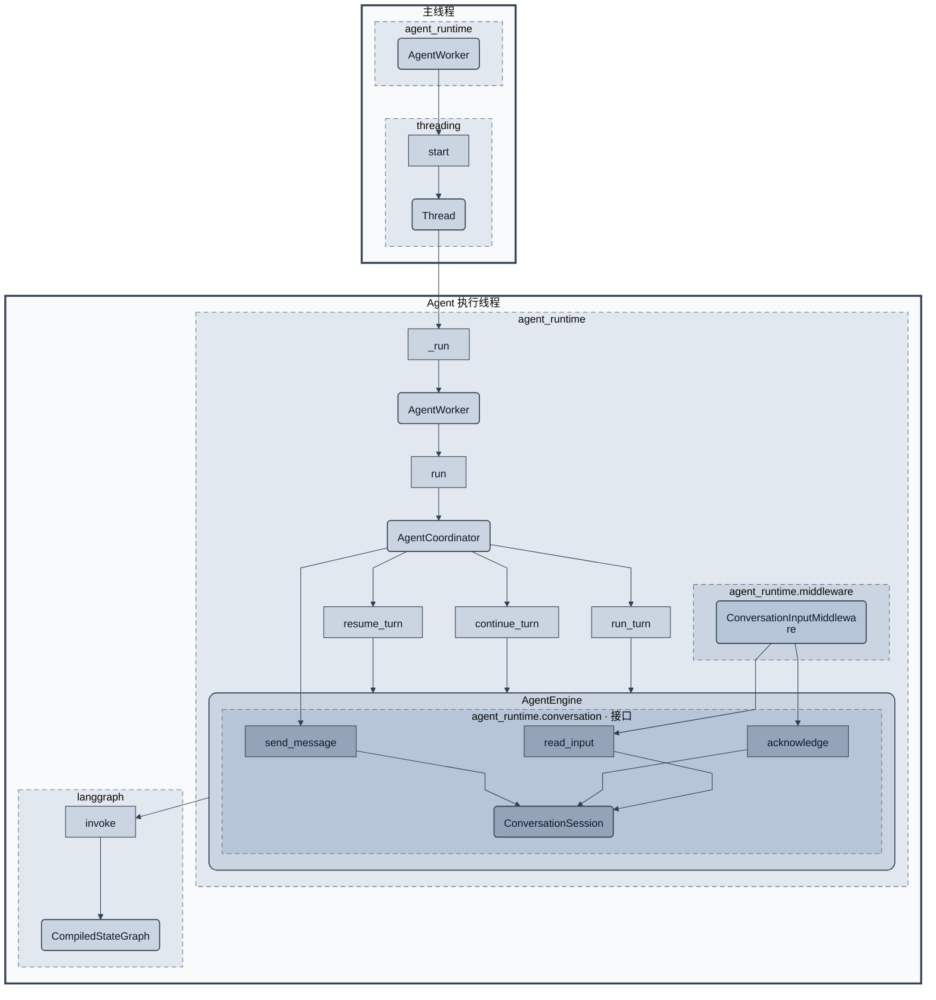

# Agent Runtime 与单会话输入架构

状态：**2026-10-13 已按本设计迁移实现**。Engine 拥有独立会话对象，Manager 管理多个 Gateway。本文同时说明当前不支持的会话交接与历史迁移边界。

## 1. 设计背景与边界

项目重点是执行页面操作与采集任务，不是管理多个聊天会话。当前假设一个 Gateway 的有效通信只来自一个 Channel 的一个 conversation；同一 conversation 可以包含多名发送者。Engine 的工作是执行 Agent，不应同时承担会话路由、消息积压整理和回复地址管理。

较长的模型或工具调用期间，用户可能连续讨论、补充、否定先前请求。把这些消息分别作为独立 user input 提交，会淡化它们属于同一段对话的关系。设计因此将会话能力集中到独立的 conversation 模块：它固定通信对象，并把一次接收边界上的全部积压消息包装成一份保留发言者和顺序的对话输入。

| 模块 | 负责的目的 | 不承担的职责 |
| --- | --- | --- |
| channel / application | 第三方适配、Gateway 实例、可靠的队列接纳与批量读取 | 解释对话、拼接 LLM 输入、决定任务完成 |
| conversation | 固定一个会话，维护未提交消息，生成完整消息块，确定发送位置 | 多会话调度、业务完成判断、模型调用 |
| agent_runtime | 线程生命周期、执行策略、graph 调用及模型安全边界接入 | conversation_id 路由、发送者格式化、消息队列管理 |
| 业务 Engine 子类 | 工具、业务 middleware、提示词、任务验收 | 默认父子通信、共享 Gateway 调度策略 |

每个 Engine 创建并拥有一个 ConversationSession。多个 Engine 可以显式绑定同一个 gateway_id，但会话对象和模型历史各自独立，外部必须保证它们不同时运行。当前暂用同一个 Gateway，不提供自动会话交接、parent/child 继承或广播；互斥运行不等于会话状态能够自动转移。

## 2. Runtime 架构图

图只展开 Runtime，conversation 仅显示公共对象；通信队列、Manager 和 SDK 实现隐藏。线程从上到下排列，使用粗实线边框；模块使用虚线框；对象使用圆角矩形，方法用对象之间连接线上的普通矩形表示。无最外层 src 框。



AgentEngine 的圆角实线框表示对象及其持有范围，ConversationSession 位于框内。输入 middleware 由 Engine 在装配 graph 时创建并注册，graph 保留其回调；Engine 不单独保存 middleware 成员。内部的 conversation 虚线框表示类定义所属模块，不是独立的生命周期所有者。Engine 在构造时创建 ConversationSession，通过 self._conversation 访问它，并负责关闭；内部读取和关闭调用不再用跨模块并列节点表达。对象按执行方法所在线程展示，构造不另设线程。

方法节点放在**定义该方法的模块**内，箭头终点标明所属对象；调用方所在模块不改变方法归属。Engine 持有 Session，Session 的类定义独立位于 agent_runtime.conversation 子包。

| 图中方法 | 代码所属对象 | 定义模块 |
| --- | --- | --- |
| _run | AgentWorker | agent_runtime.worker |
| run | AgentCoordinator | agent_runtime.coordinator |
| run_turn / continue_turn / resume_turn | AgentEngine | agent_runtime.engine |
| read_input / acknowledge / send_message | ConversationSession | agent_runtime.conversation.session |
| invoke | CompiledStateGraph | langgraph |
| start（图中箭头指向 Thread） | Thread | threading |

图中只展示主要调用；Engine 的内部会话读取、恢复确认和关闭仍由代码实现，没有画出的调用不表示不存在。

主线程和 Agent 线程中的 AgentWorker 是同一对象的两个执行位置。Thread 的目标回调为 Worker._run。会话读取和输入确认安排在 Agent 串行执行边界；当前设计不支持 Engine 跨线程调用，也不增加 Engine 锁或线程归属变量。

## 3. 三层执行职责

### AgentWorker：承载执行线程

AgentWorker 提供 start/join，负责线程存在期间持续调用 Coordinator，以及异常传播和本地执行收尾。它不接收消息，不识别会话，也不决定共享 Gateway 的关闭时机。

### AgentCoordinator：选择执行方式

AgentCoordinator 根据 EngineResult 选择继续、恢复、返回等待或结束。它通过 Engine 的只读 conversation 属性取得该 Engine 持有的会话对象，调用 send_message 发送最终结果或中断说明；不另建或替换会话，不读取原始消息、解释发送者或操作消息块缓冲。

| 执行结果 | 调度策略 |
| --- | --- |
| CONTINUE_REQUIRED | 调用 continue_turn；原因可以是新对话输入，也可以是业务未完成 |
| RESUME_READY | 调用 resume_turn；有效确认已由会话模块验证 |
| INTERRUPTED：liveness / model_transport / recursion | 保持既有自动恢复策略 |
| INTERRUPTED：human / execution | 返回等待，分别要求 done / “继续” |
| COMPLETED | 返回完成结果并发送到固定 conversation |
| STOPPED | 结束当前运行 |

EngineResult 不再包含 reply_target、session_id 或完整 graph state。发送位置由会话对象固定，任务状态仍由 Engine 产生。

### AgentEngine：调用模型与工具

AgentEngine 仍公开 run_turn、continue_turn、resume_turn、close 四个无参执行方法，持有一个 LangChain agent。构造时必须显式提供 gateway_id；基类使用该 ID 创建 ConversationSession，保存在 self._conversation 中，不接受外部会话注入。gateway_id 无默认值、不能为 None，不自行查找父 Engine 或创建替代 Gateway。

Engine 对外部输入只认识 MessageBlock：它是一次完整 user input，而不是需要 Engine 再分组的消息列表。会话地址、原始消息、重复事件和发言者标签均封装在 conversation 模块内。

ConductorEngine、CollectorEngine 的工具、提示词、业务 middleware 和结果验收集中在子类。根/子任务称谓不影响通信策略；不同 Engine 的 graph/checkpoint 独立。使用同一 Gateway 不代表共享会话对象或复制 graph 历史。

### Graph 装配与初始输入扩展

AgentEngine._build_graph 统一装配基础能力及子类提供的工具、提示词和 middleware。ConversationInputMiddleware 与重试、工具错误处理和 trace middleware 在同一列表中创建，保持既有顺序；不再使用独立的 _stability 模块或 _input_middleware 成员。Engine 与输入 middleware 共用 middleware.communication.read_pending_input 函数完成消息块确认和 HumanMessage 转换，该函数无独立状态，不反向调用 middleware 实例。

子类通过 _create_initial_messages() -> Sequence[InputMessage] 定义启动任务。接口在首次 run_turn 时求值，构造阶段不调用、不保存 _initial，也不接受通用 initial_messages 构造参数。空序列表示从 ConversationSession 等待输入；非空序列作为首轮任务。执行开始后，后续新轮次、继续和恢复均不重新生成启动任务，仍使用会话输入与 checkpoint。

CollectorEngine 根据 assignment 生成初始用户任务；SubagentEngine 根据其任务消息生成输入；ConductorEngine 沿用默认空序列，从渠道接收任务。业务字段由各子类管理，初始输入格式及生成时机的自定义集中在子类接口中。

## 4. 独立的会话管理模块

详细设计及模块图见 [单会话与对话消息块](conversation-architecture.md)。模块只需要一个有行为的对象 ConversationSession 和一个冻结的数据对象 MessageBlock，不建立多会话管理器、会话调度器或发送者服务。

| 对象 | 设置目的 |
| --- | --- |
| ConversationSession | 每个 Engine 独有的会话对象：固定 channel_id/conversation_id，保留原始输入，准备消息块，确认提交，发送文本 |
| MessageBlock | 一份不可变的完整对话输入：稳定 block_id 和格式化 text；不携带发送回调或 Engine 引用 |

ConversationSession 的创建和生命周期归 Engine，会话管理逻辑仍封装在 conversation 模块。它不放入 GatewayManager 的注册表，也不是全局单例。Engine 为 Coordinator 提供只读 conversation 属性，为输入 middleware 绑定同一对象；两者只有使用权，不负责创建、替换或关闭。业务子类复用基类创建的对象，不另建会话。

## 5. 消息块与模型上下文的关系

一次积压对话对应一条 HumanMessage。其内容例如：

```text
以下是同一会话按接收顺序积攒的消息，请结合整段对话理解当前需求：
A: @robot 检查xx目录
B: 已经找到了
```

A/B 是例子中的发送者标识。真实内容保留发送者身份、原始正文、@提及、发言先后和多行边界，不替用户概括，不把不同人的消息改写成一个人的连续指令。会话模块不凭“已经找到了”自动宣布任务完成；业务 Engine 仍负责理解及验收。

“全部积压”指本次批量读取确定边界时已经进入 Gateway 的所有消息，加上会话模块尚未提交的原始消息；不等待未来消息，不按固定条数把既有积压切成多条 user input。具体批次及幂等约定由 conversation 模块负责，Engine 不直接执行排空循环。

ConversationInputMiddleware 是 graph 与会话模块的薄适配器。它把 MessageBlock 转换为一条带稳定 ID 的 HumanMessage，并根据 graph 中实际存在的 block_id 调用 acknowledge。它不重新格式化对话、不管理路由、不确认单条原始事件。模型已开始的请求不被改写；assistant/tool 配对完整后才接入下一份消息块。

同一块重试使用同一个 ID。checkpoint 已包含该 ID 时不再追加；未确认写入则保留原块，不把新消息混入已提交过的文本。存在待确认块或本地原始积压时不得切换消息消费者；这些消息已离开 Gateway，其他 Engine 无法自动取得。即使积压已处理，固定地址、去重记录和模型历史也不会自动移交。跨 Engine 的会话连续性留给后续调度设计，本阶段不提供透明切换。

最终模型响应期间新增的完整消息块会产生 NEW_INPUT 续跑需求。业务未完成产生的是业务续跑需求，两者仍需区分；前者注入原始对话块，后者使用内部续跑指令。不会因删除多会话队列而删除安全边界接入能力。

## 6. 恢复确认与正常对话

人工/错误恢复不能靠搜索拼接后的文本判断。Engine 根据中断种类调用 ConversationSession.wait_for_confirmation，要求原始单条消息去掉首尾空白后完全匹配 done 或“继续”。引述、较长句子中的同名词、发送者名称或 @提及均不算确认。

Session 保留等待期间的全部补充消息，不逐条提交；确认文本也作为真实发言保留。没有待提交块时，这段积压共同形成一个完整输入块；已有待提交块时，不重写它，新积压属于下一块。一次确认只触发一次恢复，但被用作确认不等于原文已经写入 checkpoint。

Engine 只知道确认条件已满足，不自己扫描正文；恢复载荷仍由业务 Engine 按中断种类生成。恢复动作先于下一个合法模型输入边界时，消息块保持待提交，在允许加入 HumanMessage 的边界提交和确认。自动恢复不要求额外聊天确认，不伪造用户输入。

## 7. Engine 状态精简

| 状态或能力 | 新归属 |
| --- | --- |
| 原始消息缓冲、去重、消息块与提交确认 | ConversationSession |
| 固定 channel_id/conversation_id、发送地址 | ConversationSession；不使用 reply_to |
| _sessions、_ready、_active、按会话保存的中断映射 | 删除；当前只有一个有效 conversation，不需要候选会话队列 |
| _parent、_parent_session、线程归属和 Engine 锁 | 删除；不新增替代通信上下文或执行锁 |
| 模型、工具、middleware、checkpointer、trace | AgentEngine 及业务子类 |
| 当前执行阶段、续跑原因、中断种类、恢复载荷 | ExecutionState；不再与 session_id 配对存储 |
| OPEN / STOPPED / CLOSED | EngineLifecycle；当前没有跨线程停止中的 Engine 状态 |
| 最近的 graph 结果 | Engine 内部，服务于业务验收、输入块确认和训练报告 |

checkpoint 标识只定位这个 Engine 的历史，不用于选择下一会话。与渠道相关的既有历史键如需兼容，可由绑定确定后一次生成，不能重新引入多会话路由表。历史格式迁移需要另行验证，本文不宣称新消息块格式与旧的逐条输入完全相同。

## 8. 模块安排

```text
src/
  agent_runtime/
    worker.py               # AgentWorker
    coordinator.py          # AgentCoordinator
    engine.py               # AgentEngine：统一 graph 装配、执行与状态
    middleware/
      communication.py      # 输入适配、工具调用地址绑定、主动通知与 talk
      model_retry.py        # 模型传输重试
      tool_error.py         # 工具异常转换
    types/
      interrupts.py         # 框架中断载荷解析与分类
      execution.py          # 执行状态、生命周期、结果及让出原因
      framework.py          # LangChain/LangGraph 泛型边界
      response.py           # 结构化完成响应
    messaging/
      messages.py           # 原始收发消息与输入流关闭异常
    conversation/
      session.py            # 固定会话与输入块管理
      message_block.py      # 冻结 MessageBlock
  application/
    gateway_manager.py      # Gateway 生命周期、ID、批量读取保护
    channel_gateway.py      # 消息队列与第三方投递
  channel/
    base.py                 # Channel 抽象
    feishu/channel.py       # 飞书接口适配
```

Runtime 根目录只保留 Worker、Coordinator、Engine 执行核心；middleware 集中框架调用边界上的行为，types 集中数据契约及中断载荷解析。messaging 与 conversation 是 Runtime 内部的通信基础子包；前者为 Channel/Gateway 提供无框架依赖的消息契约，后者保存会话状态及管理行为。根包不再聚合导出执行类，调用方直接导入定义模块，避免读取消息类型时自动装载 Engine 并形成循环依赖。历史内存调查移至 [调查记录](runtime-memory-investigation.md)。

模块之间传递具体数据或调用窄接口。conversation 不导入业务 Engine 或 LangChain；Manager 不导入 conversation；输入 middleware 是框架专属转换位置。

## 9. 线程、所有权与关闭

一个 Gateway 同时只有一个活动 Agent 使用 ConversationSession 接收或确认输入。Manager 的每 Gateway 读取锁只保护批量读取，不调度 Agent，也不使 Engine 并发安全。会话和 Engine 的可变状态不由 SDK/路由线程访问。

会话绑定完成后，工具需要主动通知时只使用本次调用的固定地址值和 gateway_id，通过 Manager.send_message 发送；不把 ConversationSession 或 Engine 引用一路传入工具。尚未绑定地址的通知明确失败，不猜测上次会话或使用别的 Gateway。ConversationInputMiddleware 在 Agent 边界更新不可变的地址快照，工具包装器通过调用级 ContextVar 绑定这些值，并在 finally 恢复；支持初始任务执行中首次绑定会话，避免构造时的旧配置遗漏地址。该上下文不包含服务或 Session 引用，也不向调用链逐层传参。

Engine.close 负责本地执行资源及其 ConversationSession.close；Coordinator.close 将收尾委托给 Engine，不单独管理会话。Session 关闭后禁止继续收发，幂等关闭并保留未确认数据及数量供报告，不伪造“已处理”确认；释放 Engine 前必须明确报告这些未交付输入。Session 关闭不停止 Gateway，也不关闭其出站。Gateway 的外部生命周期所有者负责在停止接纳输入、结束全部生产者后关闭出站、等待排空并释放通信实例。

## 10. 设计验收条件

- Engine 内没有原始消息分组、会话选择、ready 队列、回复地址推断或父子通信。
- 首次有效入站固定 channel_id/conversation_id；不同发送者仍属于同一个 conversation。
- 一个读取边界上的全部积压形成一个有顺序、有发言者标识的 user input，不能逐条提交或静默截断。
- 连续新消息不会使排空无限等待；格式保留否定、补充和多行发言语义。
- 确认词按原始消息匹配；块的确认以 checkpoint 写入为依据，重试不重复注入。
- Engine 自行创建并关闭唯一会话对象；Coordinator 和 middleware 使用该对象，不接受外部会话注入。
- 共用 Gateway 的 Engine 不同时执行，不自动共享或交接会话状态；有本地积压时不得切换消费者，单个 Engine 结束不关闭共享信道。
- 两份通信契约不再包含 reply_to；首次绑定后的消息来源不匹配不会悄悄切换地址。

## 11. 实现验证

`tests` 与 `trainer/tests` 回归结果：484 passed、8 failed，另有 30 个子测试通过。失败项与此前记录的基线一致，未据此宣称全套通过：

| 失败范围 | 数量 | 当前结果 |
| --- | --- | --- |
| Codex prompt_cache_key | 2 | 旧断言与当前模型字段、缓存键来源不一致，未修改 |
| Python 设备动作列表 | 1 | 旧 touch/act 断言与当前动作列表不一致，未修改 |
| middleware 临时手册上下文 | 1 | 组合顺序断言仍失败，未修改 |
| 模型环境配置 | 2 | 旧环境注入及未知 provider 错误断言仍失败，未修改 |
| 页面脚本签名 | 2 个子测试 | 仍要求 run(xml)，现有页面脚本为 run(view)，排除对象未修改 |

Pyright strict 覆盖 120 个文件，0 errors；Ruff、显式类型 AST 检查、类型例外登记及导入环检查均通过。Mermaid 已检查结构，编辑器未连接，未进行实际渲染验证。

仓库根目录无范围 pytest 会收集第三方/示例，出现 16 个收集错误；上述回归明确限定在 tests 与 trainer/tests。未运行 C 编译、回放或真实飞书/模型联网验证。
