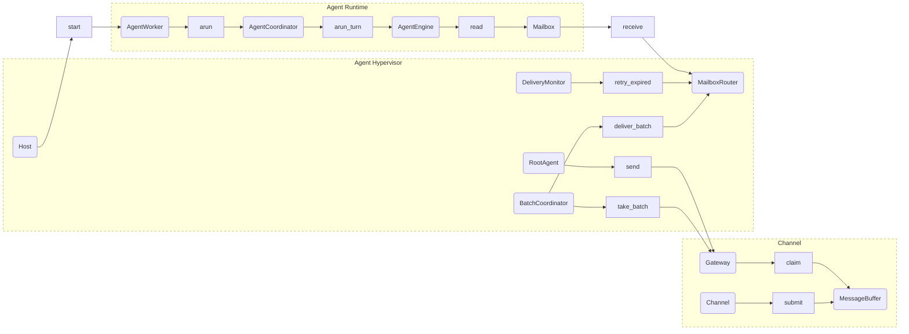
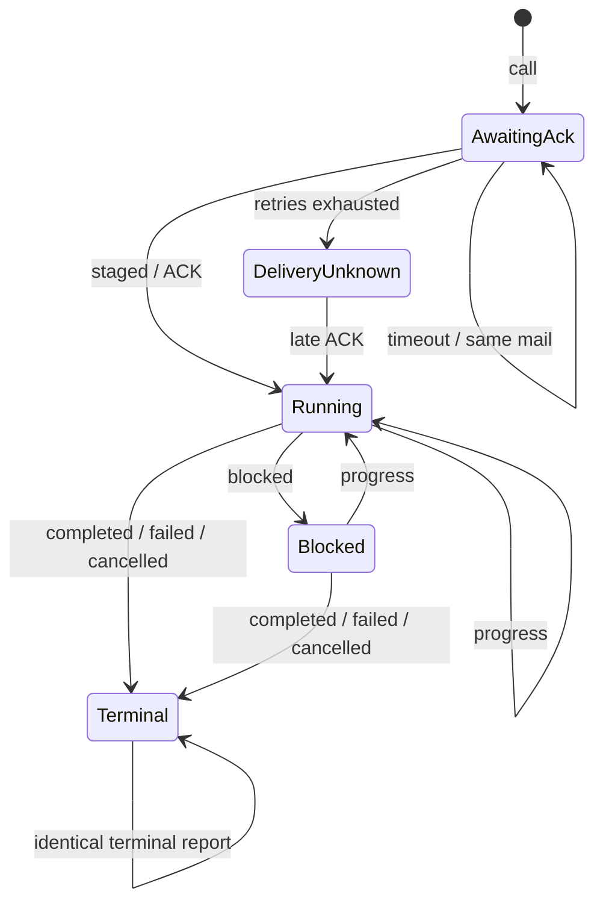
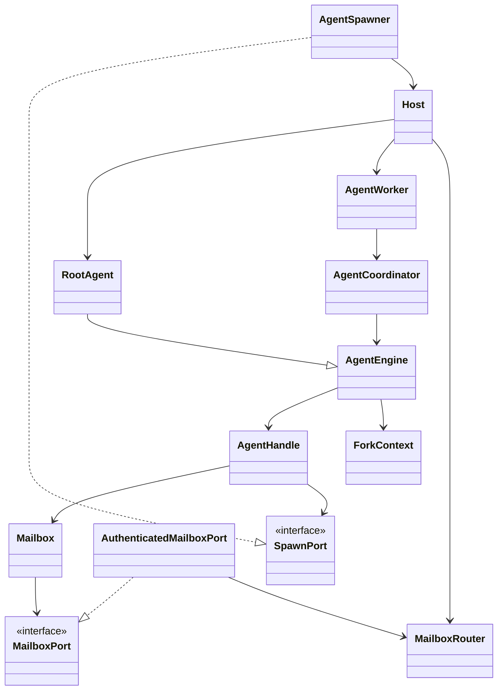

# Channel、Agent Hypervisor 与 Agent Runtime

更新：2026-11-01。本文描述已实现接口；线程边界见 [线程模型](threading-model.md)。
Channel 内部类与通信时序见 [Channel 模块架构](../src/channel/Architecture.md)。
实施前方案保存在 [归档目录](deprecated/runtime-before-hypervisor/three-layer-proposal.md)。
修改通信、运行时或装配职责时，必须同步维护本文和线程模型。

## 分层与目的

| 层 | 目录 | 所有权与职责 |
| --- | --- | --- |
| Channel | `src/channel` | Adapter 规范化外部输入，MessageBuffer 分组，Gateway 提供批次领取和指定地址发送 |
| Hypervisor | `src/agent_hypervisor` | 应用装配、Worker 拓扑、Root、批次交接、带凭据的父子路由及投递超时 |
| Runtime | `src/agent_runtime` | 独立 Engine、续跑、Worker、本地 Mailbox 门面、消息历史和运行稳定性 |
| 业务装配 | `src/application/assistant.py`、conductor、collector | 显式构造专用 Engine，不向通用层注册业务工厂回调 |

Channel 不导入 Runtime 或 Hypervisor。Runtime 只定义 MailboxPort、SpawnPort 等窄接口，
不认识 Channel、Router 或业务 Engine。Hypervisor 实现这些接口并连接两层，不反向导入业务。
RootAgent 是通信 Engine，AssistantEngine 是其业务子类；一个 Root 处理所有已配置 Channel 的批次。
Agent 身份不绑定任何 session，所有外部地址由 `(channel_id, session_id)` 唯一确定。

## 外部输入与批次交接

Adapter 在主事件循环调用 `MessageBuffer.submit(InBoundMessage)`。SDK 外线程的回调先调度回主循环。
Buffer 按地址分组，以第一条消息的入队 sequence 排序；一个组内保留到达顺序。
领取后组被冻结为 ChannelBatch，新到达的同会话消息进入新组，不修改已领取批次。

Gateway 提供 `take_batch()`、`commit_batch(batch_id)`、`release_batch(batch_id)`。
BatchCoordinator 将领取批次交给 Root 邮箱后才 commit；异常时 release，保持原 batch_id 和顺序。
Root 邮箱按 batch_id 去重。邮箱满时协调器等待容量通知，不忙轮询，也不丢弃已领取输入。
批次自身就是一个结构化 mail，入箱会唤醒 Root；不另外发送无内容的提醒。

Root 的 `reply(channel_id, session_id, message)` 只允许发送至 Gateway 已接收过的地址。
Root 派发工具 `call(subagent_id, task, source_batch_ids)` 验证批次来自自身历史，将来源作为不透明
origin 元数据保存于任务；后续报告携带相同 origin。Router 不解释 Channel 地址，Root 不按最近一条消息猜测回信目标。
其他 Agent 仅有父子 call/report，不拥有 Gateway 发送权限。

## 身份、投递与任务

Host 维护 Worker 生命周期，MailboxRouter 维护父子关系、队列和任务账本。
每个 Agent 获得 MailboxToken 和本地 Mailbox；AuthenticatedMailboxPort 校验 token 后推导身份，
模型不能提供 sender_id 或直接访问 Router。Host 的管理接口仍使用 Agent ID，不作为 Agent 工具暴露。

| 操作 | 语义 |
| --- | --- |
| `call(subagent_id, task)` | 仅投递到直接子 Agent，立即返回 task_id，不等待执行结束 |
| `report(task_id, result)` | 仅任务接收者向原调用者报告；可多次 progress/blocked |
| `spawn_subagent(agent_type)` | 创建并启动独立 Worker，不自动发送任务 |
| `kill(subagent_id)` | 只允许直接父销毁子树，在安全边界停止并等待退出 |

接收分两次确认：Router.read 只将 mail 移至 received；ConversationSession 成功暂存消息块后
显式 ACK，停止传输重试；消息写入 checkpoint 后，Session 才移除本地 pending。
因此模型失败不会丢失已经接收但尚未注入的输入。重投保持相同 task_id/mail ID，重复接收不重复加入历史。

30 秒未 ACK 则重投，最多 3 次。耗尽后发送 delivery_unknown notice，不把未知接收状态误判为业务失败；
迟到 ACK 和最终报告仍可接受。ACK 释放重投命令 payload。DeliveryMonitor 按最近 deadline 等待，无固定轮询。

终态冲突被拒绝；传输层相同终态重复报告幂等。任务完成不停止 Worker，Worker 继续等待新任务。
存在未完成子任务不会冻结父 Agent 工具；业务依赖必须显式表达，不从父子关系自动推导。

## 独立执行与派生

AgentWorker 在线程内建立事件循环，空闲时 await Mailbox.receive，运行时通过 ConversationInput
在完整工具调用后的模型边界读取同一邮箱。消息以稳定 ID 写入 graph，保留原有 user block 压缩语义。
每个 Engine 拥有独立 checkpoint、模型历史和执行配置；ainvoke 使用 `durability="exit"`。
异步调用在显式 config context 内创建 Task，避免继承父 graph 的 checkpoint namespace。

通用 Fork 由 ForkContext 记录最近完整模型边界，派生时深复制语义 state，并通过具体 Engine 的
`_create_fork(handle)` 重新装配工具和 graph；不复制锁、邮箱、模型连接或父任务内部执行对象。
子 Engine 使用独立 checkpoint ID。Root、Assistant、Conductor 提供显式重建，未定义安全重建契约的 Engine 拒绝通用 Fork。
Collector 的可变训练资源通过专用构造路径提供，不冒充可安全复制的通用 Agent。

专用 Engine 仍由业务显式构造，通过 `handle.spawner.child()` 申请身份，`start(engine)` 启动。
AgentSpawner 位于 hypervisor/host.py，仅封装父身份作用域和生命周期；不持有业务类型表。

## 生命周期与实现边界

Host 统一负责服务装配和 Agent/Worker 所有权，不再设置独立 AgentApplication。
`open(root, channels)` 启动已注册的唯一 Root、批次和重投协程及 Channel；
`run(root, channels)` 在此基础上监视 Root 和必要服务的退出，最终统一关闭。
`start(engine)` 仍用于启动单个 Worker，供专用子 Agent 装配使用。
`wait_root()` 只等待登记的 Root Worker；未登记或未启动时报错，不扫描父节点列表。
关闭时禁止新派生并通知所有 Agent 停止，停止 Buffer 接收并取消批次/重投协程，异步等待 Worker，最后关闭 Channel。
正在运行的有限工具或模型请求不被强行终止，关闭可能等待它们的超时；共享模型仍由模型所有者关闭。

相对实施前方案，Router 和 Host 使用短互斥区，而不是把全部方法调度到主循环；锁内不执行模型、设备或 join。
Mailbox 的异步等待使用可取消 Future，不占用阻塞等待线程。Channel 缓冲仍严格主循环独占。
这样同步工具可直接执行短路由操作，异步 Worker 不必为队列等待占用线程池。

保障限于进程内：没有持久化消息服务，进程崩溃不保证未注入消息恢复；去重身份及任务账本随 Agent/进程存活，
尚无长期保留策略。多个 Agent 使用同一设备的跨工具业务事务仍需要协调，邮箱锁不承担设备租约。
测试覆盖分组、隔离、ACK/重投、取消、Fork 与嵌套异步配置；真实 Feishu、模型和 Android 联调单独验收。
