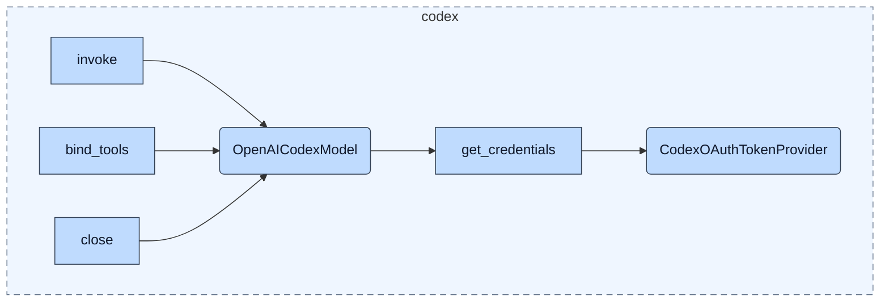
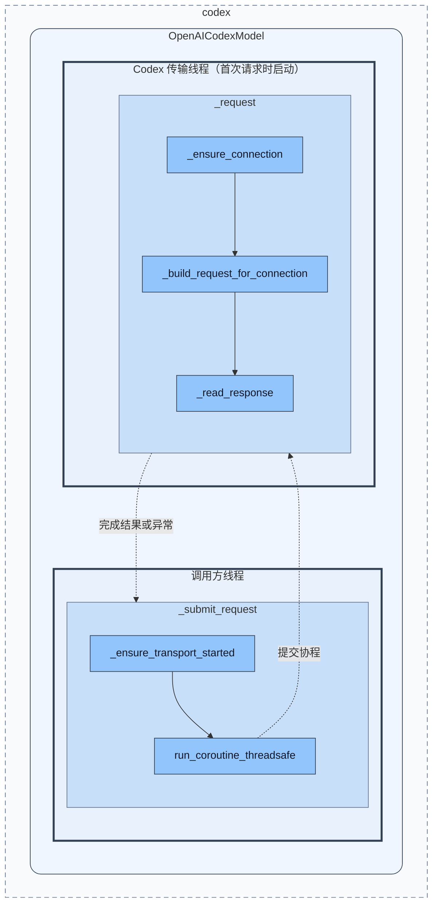

# Codex 模型适配模块架构

状态：**2026-10-14 实现分析快照**。本文依据 `src/codex` 及其直接调用方编写，描述本项目适配器的行为，不代表服务端协议保证。此次只编写文档，不重构代码。配置服务见 [configuration](configuration-architecture.md)，当时 Agent 调度见 [历史 Runtime](deprecated/runtime-before-hypervisor/agent-runtime-architecture.md)，新目标见 [三层设计](agent-system-design.md)。

## 1. 背景与职责

本模块将 LangChain 的聊天模型接口适配到 Codex 的 ChatGPT WebSocket 端点。它接收消息历史和工具声明，生成 Responses 请求，把服务端事件归并为 AIMessage，并维护连接、响应续接信息和用量统计。它不执行工具，不决定 Agent 何时继续或恢复，也不管理 Channel 会话。

当前只有两个行为类：OpenAICodexModel 和 CodexOAuthTokenProvider。前者同时承担框架适配、传输线程、连接生命周期、协议编解码及统计；后者只负责读取本地认证文件。protocol_types 中的类均为 TypedDict 数据契约，不是独立服务或有生命周期的运行对象。

协议覆盖范围见 [Responses 协议支持矩阵](codex-protocol-coverage.md)。当前定位是面向文本、图片输入和本地工具的串行 WebSocket 适配器，不能视为完整 Responses API 客户端；矩阵分别说明本地实现、公开协议差异和未验证的服务端行为。

## 2. 文件与依赖边界

| 文件 | 职责与出口 |
| --- | --- |
| [__init__.py](../src/codex/__init__.py) | 仅导出 OpenAICodexModel、create_chat_model |
| [codex_oauth.py](../src/codex/codex_oauth.py) | 两个行为类、工厂、消息与工具转换、响应汇总和协议日志 |
| [protocol_types.py](../src/codex/protocol_types.py) | 请求/响应 TypedDict、联合类型和 Pydantic TypeAdapter 校验函数 |

`src/application/model.py` 从 ConfigurationManager 选择模型配置，并在 provider 为 codex 时调用工厂。认证路径和 WebSocket 地址通过 `get_other("codex", ...)` 读取。配置初始化必须在构造默认 TokenProvider 前完成。

LangChain 提供 BaseChatModel、消息、工具和 Runnable；websockets 提供连接和连接状态；asyncio 提供独立事件循环及跨线程 Future。protocol_types 只依赖类型校验与基础 JSON 类型，不反向依赖模型类。

## 3. 架构与执行边界

### 3.1 模块接口关系

本图只保留模型调用、工具绑定、资源释放和凭据依赖。异步对应接口及统计接口在第 4 节完整列出，不在图中重复展开。外部线程均通过 OpenAICodexModel 使用模块能力。



构造和 bind_tools 都不启动后台线程。invoke/ainvoke 共享同一条请求路径；close/aclose 由应用所有者调用。TokenProvider 只提供本地凭据，不执行 OAuth 登录或刷新。

### 3.2 请求执行边界

图只回答两件事：**调用方负责准备传输环境并提交任务，传输线程负责连接、请求构造和响应处理。** 外层圆角框始终代表同一个模型对象，两个粗边框表示执行线程；内部矩形只保留承担这些职责的源码方法。



模型容器内的实线表示关键处理阶段的先后关系，不是逐行调用图；虚线表示跨线程任务提交与结果交付。省略的细节归入对应方法的职责，不另设节点：

| 职责边界 | 必须保留的实现语义 |
| --- | --- |
| 准备与提交 | 首次请求在调用方创建循环和线程，等待传输线程就绪后提交协程；后续复用。同步调用等待 Future，异步调用等待其包装结果 |
| 连接与请求构造 | 在传输线程先确定连接，再构造请求体；发送前完成序列化。发送失败重连后重新判断续接条件并重建请求，不能复用旧增量 payload |
| 响应与返回 | 发送后接收、校验并归并事件；请求成功时记录用量和连接锚点，再通过 Future 交付结果。框架的 ChatResult 包装在调用方完成 |

线程创建、就绪事件、Future 包装、序列化、逐事件解析和重试分支均不在图中展开。生命周期约束见第 5 节，协议处理见第 6 节，故障边界见第 7 节。

## 4. 行为类与工厂契约

以下为当前代码的接口摘要，省略实现体。第三方框架的继承接口以其实际定义为准；Any 仅在 bind_tools 的框架覆盖签名中保留，进入内部后转为有限 JSON 类型。

### 4.1 CodexOAuthTokenProvider

```python
class CodexOAuthTokenProvider:
    auth_path: Path

    def __init__(self) -> None: ...
    def get_credentials(self) -> tuple[str, str]: ...
    def get_token(self) -> str: ...
    def get_account_id(self) -> str: ...
```

构造时固定认证文件路径，优先级为 other.codex.auth_json、other.codex.home/auth.json、默认 ~/.codex/auth.json。每次 get_credentials 都重新读文件：支持 tokens.access_token 或顶层 OPENAI_API_KEY，账户 ID 来自 tokens.account_id，缺省为空字符串。两个返回值都必须为字符串。

**名称中的 OAuth 不表示它执行登录或刷新。** 当前没有授权流程、令牌到期判断、刷新请求或文件写回。外部更新认证文件后，下次建立连接时才能读取新凭据；复用现有连接不会重新读取文件。

### 4.2 OpenAICodexModel

```python
class OpenAICodexModel(BaseChatModel):
    model: str = "gpt-5.1"
    ws_url: str = DEFAULT_CODEX_WS_URL
    wait_seconds: float = 600.0
    connect_timeout_seconds: float = 20.0
    max_connection_age_seconds: float = 3300.0
    stream_max_retries: int = Field(default=5, ge=0)
    instructions: str = "You are a helpful assistant."
    reasoning_effort: str | None = "medium"
    store_responses: bool = False
    session_id: str = Field(default_factory=lambda: str(uuid7()))
    token_provider: CodexOAuthTokenProvider = Field(default_factory=CodexOAuthTokenProvider)

    def bind_tools(
        self,
        tools: Sequence[dict[str, Any] | type[BaseModel] | Callable[..., Any] | BaseTool],
        *,
        tool_choice: dict[str, Any] | str | bool | None = None,
        strict: bool | None = None,
        parallel_tool_calls: bool | None = None,
        **kwargs: object,
    ) -> Runnable[LanguageModelInput, AIMessage]: ...

    def close(self) -> None: ...
    async def aclose(self) -> None: ...
    def get_usage_summary(self) -> UsageSummary: ...
    def reset_usage(self) -> None: ...

    # 框架覆盖点，不是额外的业务接口。
    def _generate(
        self, messages: list[BaseMessage], stop: list[str] | None = None,
        run_manager: CallbackManagerForLLMRun | None = None, **kwargs: object,
    ) -> ChatResult: ...

    async def _agenerate(
        self, messages: list[BaseMessage], stop: list[str] | None = None,
        run_manager: AsyncCallbackManagerForLLMRun | None = None, **kwargs: object,
    ) -> ChatResult: ...
```

构造由 Pydantic 字段定义完成，不自定义 __init__。invoke/ainvoke 等由 BaseChatModel 提供，并通过上述覆盖点生成 ChatResult。当前没有自定义 _stream/_astream；虽然服务端返回事件流，对外仍在完成后一次返回 AIMessage，不提供本模块实现的逐 token 流。

bind_tools 返回绑定后的 Runnable，不执行工具，也不新建一个独立传输服务。stop 与 run_manager 参数在覆盖点中未被消费；不能据此声称支持 stop 截断或逐 token 回调。

### 4.3 create_chat_model

```python
def create_chat_model(
    *, model: str, reasoning_effort: str | None = "medium",
    prompt_cache_key: str | None = None, stream_max_retries: int = 5,
) -> OpenAICodexModel: ...
```

工厂创建 TokenProvider，并从配置服务读取 ws_url。prompt_cache_key 当前被显式丢弃，保留参数只是兼容旧调用；模型没有同名字段。stream_max_retries 被保存到模型，但**当前模块没有按该值循环重试**。外层 ModelRetryMiddleware 使用独立的固定配置，见第 7 节。

## 5. 状态、线程与生命周期

| 状态组 | 字段 | 作用与边界 |
| --- | --- | --- |
| 模型身份 | session_id | 实例默认 UUIDv7；用于请求缓存键和连接头，不是 Channel conversation_id 或 Engine checkpoint ID |
| 传输执行环境 | _transport_loop、_transport_thread、_transport_guard、_transport_closing | 懒启动独立事件循环，协调启动/关闭，关闭过程中拒绝新启动 |
| 当前连接 | _ws、_connected_at、_connection_response_id | 连接资源、连接年龄、该连接上最后完成响应的 ID；失效时一起清空 |
| 请求互斥 | _request_lock | 传输循环中的 asyncio.Lock，串行覆盖发送、完整接收和成功记账，防止响应串线 |
| 用量 | _usage_records、_usage_totals | 模型实例累计成功响应的计数，不随断线或 close 自动清空 |

同步和异步调用都通过 run_coroutine_threadsafe 投递到同一个事件循环。同步调用阻塞等待 concurrent Future，异步调用通过 wrap_future 等待；不会为每次请求创建一个事件循环。模型和请求消息在这两个线程间存在共享引用，因此该边界**不是 Channel 与 Agent 的纯消息队列契约**；调用方在请求进行期间不应修改传入历史。

连接复用同时要求状态为 OPEN、创建时间已知且未超过复用窗口。窗口是 max(0, max_connection_age_seconds - wait_seconds)，默认 45 分钟，为最长响应等待保留余量。连接有心跳，连接建立超时与响应完成超时分别管理；响应超时为整次接收的总期限，不会被每个 delta 重置。

close/aclose 先进入 closing 状态，再等待当前请求释放请求锁、关闭连接、停止循环、等待线程结束并清空传输字段。重复关闭可直接返回；关闭结束后 closing 会恢复 False，后续调用可以重新启动传输，**不是永久禁用模型**。从自身传输线程调用关闭入口会被拒绝。同步 close 等待关闭协程有超时，但之后 thread.join 没有显式超时；异步 aclose 的协程等待也没有同样的显式总超时，不承诺严格有界的关闭时长。

## 6. 协议与历史边界

### 请求表示

连续出现在历史开头的 SystemMessage 拼接到 instructions；后续出现的 SystemMessage 保持原有位置，转为 developer 消息。普通用户输入保留文本和图片块的顺序。图片支持 image_url，以及带 image_url 或 file_id 的 input_image；不支持的内容块直接报错，不把图片结构字符串化为普通文本。

AIMessage 转换为助手文本、函数或 custom tool 调用，并回放 additional_kwargs 中保存的 reasoning_items。ToolMessage 转为相应调用输出。工具 schema 从 Chat Completions 函数包装转换为 Responses 形状，custom grammar 保留。工具执行仍由 LangChain/业务层承担。

### 三种身份

| 标识 | 来源 | 用途 |
| --- | --- | --- |
| session_id | 模型字段，默认每实例 UUIDv7 | prompt_cache_key、连接 session_id/x-client-request-id 头 |
| request_id | 每次 _request 新建 UUIDv7 | 传输错误日志关联；不是上述 x-client-request-id 头 |
| response_id | 服务端完成响应，存入 AIMessage.response_metadata | 下次请求的 previous_response_id 锚点 |

自动续接只考虑调用者历史中最后一个带 response_id 的 AIMessage。该响应属于当前连接，或历史明确标记 response_store=True，才允许自动续接。有效锚点之前的历史不再发送，只发送其后的增量。

重连会清空连接锚点：未存储响应必须回到全量历史；已存储响应可按标记继续。显式传入 previous_response_id 会绕过自动资格判断，由调用者承担可用性责任；显式 None 关闭自动续接。请求还会附带 comparison_response_id 和 ttl="30ms"；此值与公开文档针对适用模型列出的 "30m" 不符，不能据此认定缓存期限控制已正确支持。模型适用范围及端点差异见 [协议支持矩阵第 5 节](codex-protocol-coverage.md#5-续接缓存与连接能力)。

### 响应表示

read_response_event 使用 TypeAdapter 严格检查已声明字段的类型。多数响应 TypedDict 为 total=False，type 字段也可缺省，且 type 使用 str 而非 Literal；因此这不是完整的事件判别联合或严格协议状态机，未知事件可以被忽略，直到完成或超时。

文本 delta 按 output/content 索引累计，done 文本覆盖同一位置的累计片段，output_item 事件更新条目。完成事件的 output 优先；缺失时使用累计条目和文本回退，最终生成一个 AIMessage。函数调用转为 tool_calls，reasoning 与 custom call 标识存入 additional_kwargs，response_id、store 和 token usage 放入 response_metadata。

函数 arguments 若不是合法 JSON，当前保留为 __raw_arguments；若解析结果不是对象则使用空参数。这是现有容错行为，不是参数 schema 已通过验证的保证。response.failed、response.incomplete 和 error 事件抛出 RuntimeError，连接由请求层失效处理。

类型校验会过滤未声明字段，包括 error、incomplete_details、refusal、annotations 和消息 phase。因此“识别失败事件”不等于“保留错误原因”，“获取文本”也不等于“无损保留响应”。详见 [协议支持矩阵第 4 节](codex-protocol-coverage.md#4-响应与事件覆盖)。

### 数据契约清单

以下均定义于 [protocol_types.py](../src/codex/protocol_types.py)。TypedDict 只描述字典结构，没有对象方法，不在运行架构图中扩展成服务节点。

| 数据类型 | 作用 |
| --- | --- |
| ResponseText、ResponseItem | 文本、工具调用、reasoning 输出条目 |
| ResponseUsage、ResponsePayload、ResponseEvent | 用量、完整响应和流事件外壳 |
| ResponseMetadata、CodexMessageMetadata | LangChain 消息上的响应/续接与 reasoning/custom tool 元数据 |
| UsageSummary | responses、totals、records 的统计返回值 |
| InputContent、MessageInput | 输入内容块与角色消息 |
| FunctionCallInput、CustomCallInput、FunctionOutput | 工具调用及结果关联 |
| ReasoningInput、ReasoningConfig | 加密 reasoning 回放与请求推理选项 |
| PromptCacheOptions | 续接响应比较选项 |
| CreateResponseRequest、CodexRequestOptions | 最终请求体与单次调用可接受选项 |

ResponseInput 是输入条目的联合别名。read_response_event、read_response_usage、read_codex_message_metadata、read_request_options 是校验函数，不是额外类。请求选项只包括 tools、tool_choice、parallel_tool_calls、previous_response_id 和 store。

## 7. 故障、统计与日志

| 边界 | 当前行为 |
| --- | --- |
| 建连失败 | 记录 connect 错误后向外抛出，不在 _request 内重试建连 |
| send 失败 | 清空连接，重新构建请求并最多重发一次；不是沿用旧增量 payload |
| recv 失败/超时 | 清空连接后向外抛出，不在接收层立即重发 |
| 请求取消 | 发送或接收阶段捕获取消并使连接失效 |
| 外层模型重试 | Runtime 的 ModelRetryMiddleware 对临时网络错误最多重试 5 次；握手仅重试 500/502/503/504，服务端 RuntimeError 不属于此策略 |
| 协议日志写入失败 | OSError 仅记录 warning，不因此重复模型调用 |

重发不能证明服务端未处理原请求，因此这里不提供 exactly-once 或不重复计费保证。外层重试与 send 层的一次重发是不同层级，不应将 stream_max_retries 当作两者的统一预算。

统计只在成功归并 AIMessage 后记录，服务端已消耗但接收失败的调用不会计入。get_usage_summary 复制顶层统计及每条记录，但嵌套 token details 仍是浅拷贝；它和 reset_usage 也没有独立并发保护，不应视为跨线程原子快照接口。

协议日志写到相对当前工作目录的 workspace/logs/codex_responses：包含请求体、完成响应和传输错误。请求/响应可能含用户内容、工具结果与图片数据；传输错误日志主要保留阶段、连接年龄、错误类型和关闭信息，不记录认证头。当前没有日志轮转或统一配置开关。

## 8. 架构评价与后续边界

现有结构的优势是协议类型独立、同步/异步共用持久连接、响应续接在重连时有明确降级，以及工具输出与 reasoning 历史可以回放。

主要集中点是 OpenAICodexModel 的职责过多：模型接口、线程和连接、协议转换、统计都在同一类/文件中。若后续拆分，可沿“LangChain 适配、传输生命周期、协议转换”划分，但本文不新增这些类，也不把建议画成已实现对象。

需要明确保留的现状：TokenProvider 不刷新令牌；stream_max_retries 未控制重试；prompt_cache_key 参数被忽略；公开 stop 参数未被使用；用量查询只是浅拷贝。这些是后续修改需要单独决策的接口行为，不在文档任务中顺手改变。

## 9. 验证与限制

本次实际运行 tests/test_codex_oauth.py：**42 passed、2 failed，另有 13 个子测试通过**。两项失败均与既有 prompt_cache_key 期望不符：一个要求请求使用传入 cache-key，一个读取当前类不存在的同名属性。本文如实记录实际使用 session_id 的实现。

同时尝试运行 tests/test_model_transport_recovery.py，但当前工作区缺少 src/tasks，导入 src.conductor.engine 时收集失败。不能把之前的全套测试结果作为本次验证结果，也没有为完成文档恢复或修改该目录。

未执行真实模型调用、认证登录或 WebSocket 联网验证。Mermalaid 编辑器未配对，架构图保留 Mermaid 源码，未完成渲染器验证。
