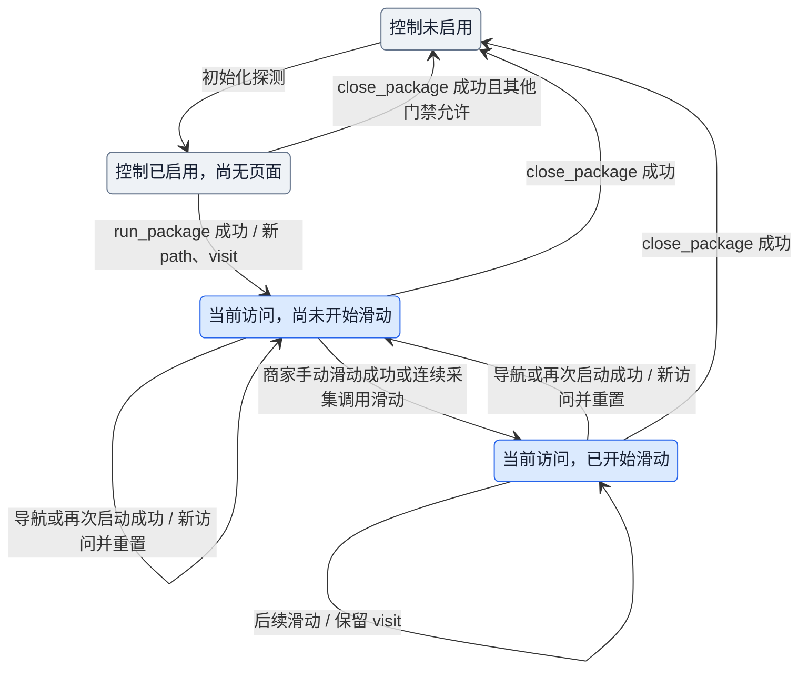
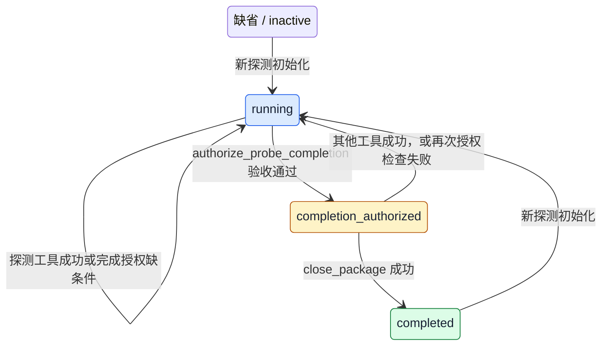
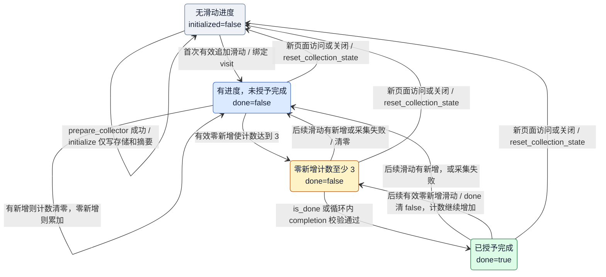
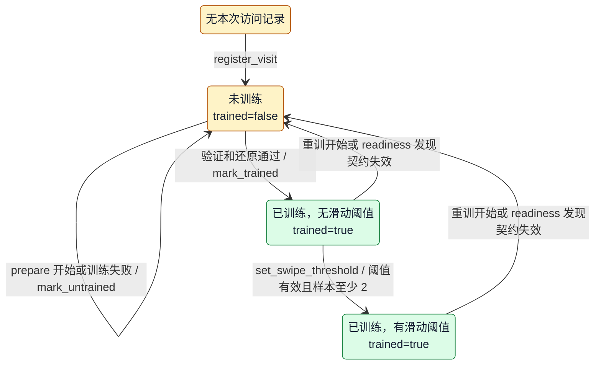
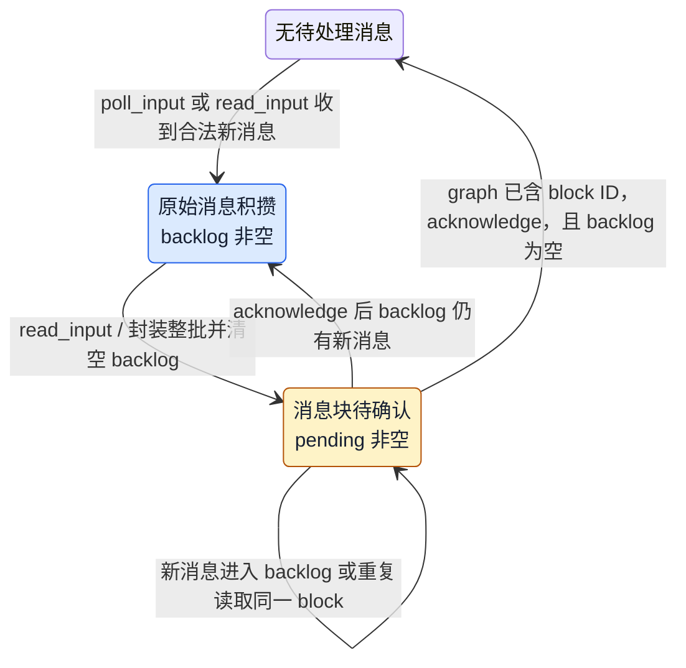
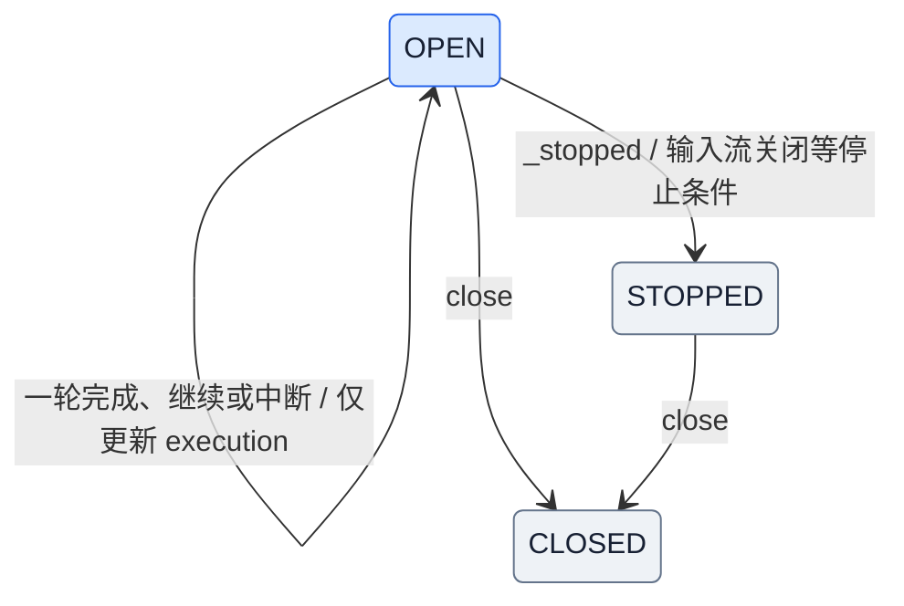

# Conductor 工作流：从页面职责到行动与完成证据

> 状态说明：第 1–6 节保留页面策略迁移前的工作流与审查证据，旧类名、状态图和缺口结论不再代表当前实现。当前实现见第 7 节及 [页面策略架构](page-strategy-design.md)。

本文结合 [middleware 七阶段流程图](middleware-catalog.md#81-七阶段流程图)、Conductor prompt 和实际工具装配，描述正常应用探测路径。重点是每一阶段需要解决的问题、采用的操作，以及形成的下一轮决策依据；不展开 resume / continue 调度或 collector 内部训练流程。

这里有两个时间尺度：**七阶段是每轮模型与工具交互的循环；启动、识别页面、训练、遍历和完成是跨越多轮循环的业务阶段。** 一次模型调用不等于完成一个页面任务，一次工具成功也不等于任务完成。

## 1. Conductor 根据什么决定下一步

Conductor 负责理解任务、选择页面操作和判断何时请求完成验收。它不从页面或截图直接提取商品数据，不自行修改采集脚本。需要采集能力时调用 collector 训练；训练后的采集和写入由服务完成。

| 决策依据 | 作用 | 边界 |
| --- | --- | --- |
| 初始任务配置 | 指定应用、城市、地址、范围和目标页面树 | Engine 将目标叶子路径写入探测状态；配置文字也进入模型输入 |
| Conductor system prompt | 规定导航方式、角色分工、危险操作理由、训练与完成流程 | 是模型行为要求；不能把每条 prompt 要求都当成已实现的硬性校验 |
| 当前 `PAGE.md` | 解释页面结构、功能、所需字段/schema 和可复用操作经验 | 帮助模型理解页面职责；采集字段交给 collector，不由 conductor 提取 |
| 当前 `task.md` | 规定在此页面需要执行的任务和操作目标 | 是页面行动依据；经验备注不能覆盖它 |
| 当前页面证据 | 抽象视图、局部节点、截图、操作后的变化提示 | 用于识别可见目标和判断操作效果，不能据此直接宣称采集完成 |
| 运行时反馈 | 工具结果、结构化拒绝、训练状态、补滑建议、完成验收结果 | 约束下一步操作；工具被拒绝不等于工具不存在 |

**页面职责有模型理解和程序策略两部分。** 模型读 manual 理解“这里要做什么”；代码中的 `PageMechanism.page_policy()` 按 canonical path 提供 merchant、是否要求训练、入口点击额度等策略。当前实现不是由模型读完 manual 后写入一个任意的页面角色，也不是运行时从 manual 自动推导所有门禁。

## 2. 七阶段在业务上分别完成什么

下表与 8.1 的阶段编号一一对应。阶段 1 是已有状态及上一轮决策；不是新发起一次用户输入。初次尚无 tool call 时，先进入阶段 5—7 产生首个行动。

| 阶段 | 目的 | 为实现目的执行的操作 | 形成的结果或状态变化 |
| --- | --- | --- | --- |
| **1. 上一轮输入** | 明确这次行动是在什么页面、任务进度和证据下提出的 | 取已有历史、当前页面访问、训练/采集进度及最新模型 tool calls | 形成待执行请求；模型提出操作本身不改变真实页面或完成状态 |
| **2. tool call 前处理** | 保证动作在当前阶段有意义，并避免不可控的设备操作 | 检查启动/导航前提、目标路径、已完成商家、未完成商家的离开条件、点击额度和同轮设备动作数量；校验危险操作理由；按需保存操作前视图、发送里程碑通知 | 合法请求进入工具；不合法请求返回约束错误。动作认领和审计属于执行记录，不代表页面已切换。未训练状态通常是提醒，不能理解成所有工具都被禁用 |
| **3. tool call** | 获取新证据或推进任务 | 执行页面读取、导航、同页操作、训练委托、连续遍历或完成查询等具体能力 | 产生真实设备/服务副作用和工具返回。`prepare_collector` 可包含多次 collector 模型调用；`collect_continuously` 可包含多步串行滑动，均不是 conductor 每步重新决策 |
| **4. tool call 后处理** | 将执行事实转换成可信的业务进度 | 记录错误与效果提醒；对训练后的指定同页结果进行采集、校验、去重和写入；合并补滑建议；成功导航提交页面访问；提交生命周期变化 | 历史增加工具结果，graph 更新路径、访问、采集或探测状态；训练注册表、工作簿等外部状态也可能更新。导航失败不提交目标路径；效果警告不自动把成功操作变成失败 |
| **5. model 前处理** | 让模型依据当前页面而非过时页面选择行动 | 注入待处理用户 message block；按当前路径、访问 ID、手册摘要补充 `PAGE.md + task.md`；投影压缩旧操作历史；设置页面模式下的串行调用约束 | graph 历史增加用户/手册消息；当前 ModelRequest 获得压缩后的历史、固定工具声明及模型设置。历史投影本身不改写持久化消息 |
| **6. model** | 根据职责、任务和可见证据选择下一步 | 读当前手册与反馈，判断应观察、导航、训练、遍历、修复、请求人工处理还是申请完成；形成参数完整的 tool call 或最终结构化响应 | 产生 AIMessage。此时只产生决策，尚未执行新动作；没有凭模型陈述更新真实页面或采集完成标记 |
| **7. model 后处理** | 判断模型输出是否可以进入执行或结束 | 处理验证码接管；检查探测尚未完成时的提前结束；收取调用期间新到的通信消息供下一轮使用；完成模型追踪 | 正常 tool calls 进入下一轮阶段 1；不合法的提前结束形成纠正反馈。图返回后，Engine 还会校验结构化响应与确定性完成状态，才接受最终完成 |

外部模块在此循环中各自提供一种证据：设备层提供页面事实，页面模块提供手册与策略，collector 提供当前访问的训练证据，采集服务提供写入与完成证据，会话模块提供用户补充要求。Conductor 通过工具结果和模型输入使用这些能力，不需要把它们的内部数据全部呈现给模型。

## 3. 业务阶段：目标、操作、状态变化

### 3.1 启动：把任务范围绑定到一个应用探测过程

**目的。** 确定要探测什么，并建立后续页面行为的上下文。

精确的应用探测触发消息使 Engine 加入环境与配置输入，初始化页面上下文、探测运行标识和目标叶子路径。模型依据配置选择 `run_package`，提供包含 reason、evidence、expected_outcome 和风险确认的理由。

启动成功后，运行时设置应用根路径、当前路径和新的页面访问 ID，重置本次访问的采集字段。下一次模型调用前，根页面 manual 被自动加入输入。启动失败则返回错误，不能继续假定首页已经打开。

**形成的能力：** 从“知道任务目标”变成“有一个明确的当前业务页面”，后续可以按该页规则观察和导航。启动通知只说明开始执行启动动作，不是启动成功的证据。

### 3.2 首次进入页面：先理解职责，再定位行动目标

**目的。** 避免把上一页的操作经验、采集状态或节点位置沿用到新页面。

成功的 `run_package`、`navigate_to` 或 `navigate_back` 先提交 canonical path 和新的 visit ID。阶段 5 按这些值读取当前 `PAGE.md`，随后附加 `task.md`；阶段 6 模型再依据手册区分当前页是入口、列表还是需要训练的商家页，并选择行动。

因此，“首次打开页面先读 manual”是**进入成功后的下一次决策原则**，不是导航前增加一个 manual 查询工具。manual 会自动注入，同一访问且内容未变时不重复添加。新访问或手册内容变化会产生新的手册消息。

模型根据页面职责与可见证据作选择：

| 当前问题 | 合适的行动 | 为什么 |
| --- | --- | --- |
| 需要找到筛选项、地址或列表入口 | 用页面读取工具定位；目标不清晰时使用 screenshot | 手册解释结构，当前视图确认目标确实可见；不要依赖过时坐标 |
| 操作只改变当前页的选项、展开状态或弹窗 | `tap_in_page`；关闭遮挡时声明 `purpose="dismiss_overlay"` | 不改变 canonical path；弹窗由模型依据证据判断，运行时不推断覆盖层 |
| 进入另一业务页面 | `navigate_to`，传从应用根开始的完整 `next_path` | 让导航操作和页面上下文一起变化，不能用普通点击冒充跨页导航 |
| 离开当前业务页面 | `navigate_back`，明确目标路径 | 返回也建立新的访问；列表可能重排，必须重新读取卡片 |
| 进入商家页且需要采集能力 | 根据 PAGE.md 构造 `prepare_collector` 输入 | 训练请求传页面结构与 schema，不把 task.md 的操作流程交给 collector |

**状态变化：** 路径和 visit ID 表示“现在在哪一次访问”；普通同页点击不创建新访问；商家入口点击会消耗额度，开始商品滑动后会限制后续类别点击。一次访问不等于一个永久页面身份：同一 canonical path 的再次进入仍需按新访问检查训练。

### 3.3 训练：让页面遍历具备可验证的采集能力

**目的。** Conductor 只负责操作页面，仍能保证后续采集使用经过验证的规则。

模型调用 `prepare_collector`，传当前页面路径、结构/功能、merchant schema 与 collection schema。Collector 接管页面内训练；conductor 等待工具返回，不能同时操作设备。这里只把训练视为一个完整工具能力，不展开其内部模型工作流。

返回后，模型检查 `trained`、`restoration` 和 `normal_swipe_profile`。运行时训练记录按当前访问登记；满足验证与还原条件后标记 trained，并由采集服务初始化本次访问的存储上下文。安全滑动阈值来自训练结果，模型不自行提高阈值。

**状态变化：** 当前访问从“尚无可信采集能力”变为“已训练并可使用相应采集能力”。这还不是商家采集完成。没有有效滑动 profile 时，不能据此启动自动遍历；仍可观察页面或采取手动恢复操作。未训练警告是提示，自动采集则确实不会在训练前运行。

### 3.4 遍历：按 task.md 操作，以后台采集形成进度证据

**目的。** 完成页面任务，同时积累完整、可写入的采集结果，而不是让 conductor 读取商品值来指挥页面。

训练后，模型按 task.md 判断是否需要打开商品区域，并确定可安全滑动的坐标。商家页首个商品滑动前最多允许一次普通入口点击；滑动开始后以连续遍历为主，不切换类别锚点。

优先使用 `collect_continuously`，传训练得到的原始阈值。服务在一次工具调用内串行长滑、提取、去重、写入；遇到不完整行时补短滑，遇到异常变化或设备错误时返回供模型重新判断。Conductor 不在内部每一步发出采集指令。

手动操作路径中，指定同页工具的成功结果带有快照时，后处理静默运行页面脚本并更新采集进度。导航结果不执行页面脚本；普通页面查询也不应一概视作采集动作。`tap_in_page` / `page_view` 不等同于商品追加滑动；关闭遮挡的点击不触发采集。

**状态变化：** 工作簿保存有效条目，graph 保存采集初始化、最新新增数量、连续零新增滑动次数和访问摘要。出现不完整行时形成补滑建议并打断完成证据；脚本或写入失败不能冒充“零新增”。页面变化提示只提供最多三个优先检查入口，不证明成功或到底。

模型收到 `attention_required` 时先看当前页面再恢复；收到 `yielded` 时结合新用户要求重新判断是否继续。二者都不表示完成。重要问题可用 `talk` 报告，但发送消息不会替代完成验收，也不意味着暂停或已收到用户答复。

### 3.5 单商家完成：用采集证据授权离开

**目的。** 避免把视觉上的列表尾部、没有新数据或一条自然语言结论当成完成。

手动遍历只有在页面证据提示可能到底时才调用 `is_done`。服务要求当前访问已训练、契约有效且采集已初始化，并满足连续三次完整、成功写入且零新增的滑动。`done=false` 则继续合理遍历，等待新的可能结束证据。

`collect_continuously` 的 `completed` 使用同一完成规则，不需要额外调用一次 `is_done`。完成后写入商家完成标记，并根据训练确认的完整商家名登记本次探测已完成商家；清除该商家的未完成恢复义务。模型可以导航返回列表并重新识别下一张卡片。

**状态变化：** “已访问/已训练”升级为“确定完成”。后续再次以同一完整商家身份进入时会被去重拦截，且不会真的点击。未完成商家仍可重试，不能通过改名绕过去重。

因修复需要离开未完成商家时，prompt 要求提供 `recovery_reason`；运行时允许的恢复离开不等于完成，会记录未完成商家义务。后续必须回到该商家完成，才能通过全局完成授权。

### 3.6 全局完成：先验收，再关闭，最后报告

**目的。** 将“模型认为工作结束”与“系统接受探测完成”分开。

模型先根据 task.md 与配置判断各目标页面任务已执行，再调用 `authorize_probe_completion`。当前确定性检查包括目标叶子路径已访问、没有未完成商家义务、应用仍打开且当前不在商家页等。缺少条件时返回 missing 项，模型应据此补做操作。

授权成功使探测状态由 `running` 变为 `completion_authorized`。随后调用带完成理由的 `close_package`；成功后页面上下文关闭、当前访问清空，探测状态成为 `completed`。授权后执行其他非授权/关闭工具会使授权失效，不能长期持有旧授权继续操作再直接关闭。

最后输出 prompt 规定的 JSON：`resolved`、`summary`、`result`、`next_action`。Engine 同时检查结构化响应和探测状态，不接受只写 `resolved=true` 的提前完成。

**验收的实际边界：** “目标叶子已访问”是当前代码可以证明的事实，并不自动证明 task.md 中每条自然语言要求都已完成。模型仍负责遵守页面任务；本文不将 prompt 的业务目标夸大为完整的程序化验收。

## 4. 一次新页面访问如何跨越七阶段

以从列表进入商家为例，以下是正常分支示例，不保证每个页面都只需这些调用：

| 决策轮次 | 行动及处理 | 留给下一轮的依据 |
| --- | --- | --- |
| A：列表页选择目标 | 模型根据列表手册和当前卡片，提出带完整商家名的 `navigate_to`；下一轮阶段 2—4 校验去重、执行导航、提交目标路径和新 visit ID | 工具结果、新商家访问、重置的本次采集进度；此时未运行新页面采集脚本 |
| B：理解商家职责 | 阶段 5 注入商家 PAGE.md + task.md；阶段 6 判断需要训练，构造 `prepare_collector`；后续工具执行完成训练和初始化 | 当前访问的训练状态、还原结果、滑动 profile；不等于商家完成 |
| C：选择遍历方式 | 根据手册和当前视图，必要时先定位/打开商品区域，再选择连续采集或手动操作 | 商品遍历进度、采集证据、补滑/异常提示，或完成结果 |
| D：决定离开 | 连续采集已 completed，或有尾部证据后 `is_done` 返回 true；模型提出 `navigate_back` | 新的列表访问及其 manual；已完成商家身份继续保留用于去重 |

每一轮遵循同一个约束：**操作前依据当前手册和证据，操作后依据实际结果更新状态，再让下一次模型决策使用这些新状态所形成的输入。** 原始 graph 字段并不会全部自动变成给模型看的文字；它们通过手册注入、工具返回、拒绝原因和进度提示影响决策。

## 5. 实现依据与验证边界

- [Conductor prompt](../src/prompts/conductor_prompt.py)：角色边界、页面协议与完成要求。
- [ConductorEngine](../src/conductor/engine.py)、[初始任务配置](../src/prompts/initial_message.py)：任务输入、工具总装配和最终结果验收。
- [页面上下文](../src/middleware/probe/page_context.py)、[页面手册](../src/strategy/context/manual.py)、[页面策略](../src/page/mechanism.py)：路径、访问、手册与门禁。
- [训练协调器](../src/collector/core.py)、[采集服务](../src/tools/collection/service.py)、[连续采集](../src/tools/collection/continuous.py)：训练记录、写入与完成证据。
- [探测生命周期](../src/middleware/probe/lifecycle.py)：恢复义务、关闭授权和完成状态。

本次为源码与 prompt 的静态梳理，仅修改文档；未运行模型、设备或新增业务测试。七阶段 hook 的详细嵌套与先后顺序仍以 middleware 文档 8.1—8.4 为准。

## 6. 工作流审查报告

本节核对文档与当前代码，区分三种结论：**已确认的实现事实**、**有明确触发条件的控制缺口**、**需要业务决策的取舍**。只提出调整建议，不代表已修改实现。审查覆盖七阶段、页面/探测 graph 字段、训练记录和直接参与决策的执行状态；不扩展到 collector 内部全部训练用例结构。

### 6.1 总体判断

主流程方向合理：AI 解释页面和选择行动，代码校验操作并维护进度，采集服务提供完成证据，最终通过授权和关闭收束。七阶段适合作为一次交互的分析视角。

但目前不能把它描述成严格、完整的业务状态机。较明显的缺口在于：**声明的页面身份与实际页面未闭合验证；训练版本变化和采集证据失效未统一；整组工具执行的互斥不完整；目标“已访问”不足以证明任务完成。** 这些问题比目录划分或变量数量更直接影响流程正确性。

### 6.2 是否符合客观事实

| 文档或流程描述 | 核对结论 | 准确解释与影响 |
| --- | --- | --- |
| 进入页面后根据 manual 判断下一步 | 基本符合 | 导航后先写声明的路径与 visit ID，下一次模型调用前才注入该路径的 manual；模型据此理解职责。代码没有独立证明真实页面就是此路径 |
| 导航成功意味着进入目标页面 | 不能等同 | `NavigationTools.navigate_to` 实际执行 tap；`navigate_back` 执行返回手势。目标路径由参数声明，后处理在工具成功时提交；相似度只提供提醒。可能出现动作成功但页面未跳转、被遮挡或到达其他页面，下一轮却已经收到目标 manual |
| 训练完成后采集已初始化 | 需要拆分含义 | `CollectionService.initialize()` 尝试创建商家存储并写访问摘要，但不置 `collection_initialized=True`。该标记由首次有效商品追加滑动的 `_progress_update()` 设置，实际含义更接近“已建立滑动采集进度” |
| 三次有效零新增即可完成 | 符合代码规则，不等于客观遍历完毕 | 去重后的零新增是一个业务启发式；原地滑动、重复区域或来回滑动也可能满足条件。手动路径中相似度提醒不会阻止累计。不能把该规则当成已证明覆盖全部商品 |
| 目标页面任务完成后才授权 | 实现只覆盖部分条件 | 代码检查目标叶子已访问、未完成商家义务、当前页面等，没有逐项验证 task.md，也没有列表遍历覆盖证明。第 3.6 节已说明此边界，仍需将其列为严格完成控制的不足 |
| 工具执行只发生在阶段 3 | 存在明确例外 | 验证码 middleware 在 `after_model` 直接调用认证工具，再触发人工中断。其启动副作用发生在阶段 7，未经过普通工具包装链；七阶段不是所有副作用的唯一入口 |
| 七阶段中的状态变化全在 graph 内 | 不符合 | 页面和探测进度在 graph；训练记录在注册表；工作簿是外部写入；manual 摘要随消息保存；动作认领与验证码去重是对象内存。这些状态没有统一事务提交 |
| 存在 checkpoint 就可以跨进程恢复全部进度 | 当前不成立 | Engine 使用 `InMemorySaver()`，训练注册表和若干去重状态也在内存，工作簿另行落盘。当前链路不能据此承诺崩溃后完整恢复；本报告不把这一能力当成已有要求或事实 |

文档中的“成功导航”“初始化”“完成证据”应按上述限定理解，避免把工具级事实提升成页面语义或业务覆盖事实。

### 6.3 阶段划分及实际时序

**正确的主顺序应保留。** 工具内层先返回结果，外层再提交采集、页面和生命周期更新；新页面 manual 在下一次 model 前构造。导航结果不直接采集，避免用旧页面契约处理新页面；工具结果与当前页面手册共同构成下一次决策依据。这一设计没有必要倒置。

以下情况需要补足控制或修正文档表达：

| 编号 / 优先级 | 时序问题与触发条件 | 代码依据 | 建议 |
| --- | --- | --- | --- |
| T1 / 高 | 同轮返回 `prepare_collector` 与导航/滑动时，不具备完整的业务互斥。训练会操作设备，却不在 `DEVICE_ACTION_TOOLS` 中；多个训练调用也不被该认领集合限制 | `PageContextMiddleware._claim_device_action()`；本地 LangGraph ToolNode 同步使用 `executor.map`，异步使用 `asyncio.gather`。`parallel_tool_calls=False` 是模型请求约束，不是执行器对异常多调用输出的强制串行保证 | 对会操作设备的整项业务能力建立统一执行准入，覆盖训练与连续采集；拒绝互斥调用组合或明确只接受一个。底层单次操作锁不足以保证整段训练/还原不被导航穿插 |
| T2 / 高 | 页面身份先提交，真实性尚未确认；若声明错误，下一次 manual、训练路径、已访问集合一起偏离真实设备 | `PageContextMiddleware._apply_transition()`；`DeviceOperationReliabilityMiddleware` 仅告警 | 由 AI 做页面语义确认，代码要求确认成功后才能进入训练/采集。将“声明到达”和“已确认到达”明确区分；不要让代码依据几何特征自动猜页面或遮挡层 |
| T3 / 高 | 同 visit 重训只重置训练记录，旧零新增计数和 done 标记可继续存在；重训成功后可能直接沿用旧证据完成 | `CollectorTrainingCoordinator.prepare_collector()`、`CollectionService.initialize()/completion()` | 重训开始即失效本次采集完成证据；成功后建立新训练版本对应的进度。不能只在换页时调用 reset |
| T4 / 中 | 手动设备调用失败时，采集 middleware 直接返回，不打断原有零新增序列；两次零新增、一次失败、再一次零新增仍可能累计为三次 | `CollectionPersistenceMiddleware._process_tool_result()` 的 error 早退；`_progress_update()` 只看既有计数 | 明确“连续”的定义。若指连续成功遍历动作，失败/不可验证的采集动作必须使证据失效；纯读取和 talk 不必重置。连续采集路径已经会在发生滑动后的异常退出时清零，应统一两条路径 |
| T5 / 中 | 模型调用期间的新消息在 after_model 只收取，通常要等这批 tool calls 完成后才注入下一次模型输入；上一批决策不会自动撤销 | `ConversationInputMiddleware.after_model()/before_model()` | 这符合“在下一个 LLM call 加入”的既定协议，但文档必须说明响应延迟。若另需即时取消，提供代码控制信号并在工具执行前检查，不依赖自然语言消息自行中止旧决策 |
| T6 / 中 | 验证码在阶段 7 启动，去重 ID 又先于实际调用写入集合；启动异常后同 call ID 可能不再尝试 | `CaptchaHumanInTheLoopMiddleware._start_pending_authentication_sessions()` | 把认证启动作为明确的人机交接副作用，单独保证错误处理与幂等；成功后登记已启动，或使用明确的启动中/成功/失败状态。不要让通用七阶段说明掩盖这一入口 |
| T7 / 中 | 开始/完成里程碑通知在真实工具执行前发送；若工具失败，通知不证明动作或探测已完成。通知异常也发生在内层 ToolError 之外，可能阻止操作 | `OperationNoticeMiddleware.wrap_tool_call()`；`ToolExecutionPolicyMiddleware` 嵌套顺序 | 前置通知明确写“准备执行”；成功通知在提交成功后发送。通知是否允许阻断业务应显式规定，通常应与设备业务结果分离 |

这些问题不是靠把图中的节点换个顺序就能解决。T1 是执行准入缺口，T2 是缺少确认边界，T3/T4 是失效规则不一致，T5 是通信时效契约，T6/T7 是副作用的时机与失败语义。

### 6.4 AI 自主决策与代码强控制是否合理

判断原则：AI 负责难以穷举、需要理解页面的选择；代码负责可枚举的前置条件、合法转移、身份绑定和证据失效。代码无需替 AI 判断所有页面语义，但应禁止在缺少必要确认时继续推进。

| 能力 | 合适的 AI 职责 | 合适的代码职责 | 当前评价 |
| --- | --- | --- | --- |
| 页面理解与目标定位 | 根据 manual/视图判断页面职责、控件、遮挡、截图必要性 | 校验路径合法性、记录确认对应的访问和观察版本 | 分工方向正确，但缺少声明页面与确认页面的闭环 |
| 同页/跨页操作选择 | 判断控件语义并选择工具、目标路径 | 限制合法转换、单项设备业务互斥、禁止越过训练/完成前提 | 目前对路径只检查同根、不同当前页、manual 存在，未强制 child/parent 关系；可否跨级应有显式策略，不能只靠工具 docstring |
| 采集 schema 与任务传递 | 概括页面结构、解释无法固定的字段语义 | 能从 PAGE.md 契约确定的字段由代码读取/核验，防止重复人工转写 | 当前 schema 经模型转述后传给 collector，JSON 合法不等于符合页面要求；应减少模型重复搬运确定配置 |
| 是否训练及有效性 | 选择修复策略、提供新页面观察 | 要求当前访问、脚本和契约版本匹配；失效时清除完成资格 | 训练前不自动采集的边界正确；手动采集与 `is_done` 缺少连续采集已有的脚本指纹核验，控制不一致 |
| 滑动位置与方向 | 根据可见商品区域选安全起点，决定是否需要换观察方式 | 检查坐标范围、已训练阈值、动作互斥；按同一遍历上下文累计证据 | 阈值一致性在连续采集中有强校验；手动零新增累计不区分方向/区域，容易把不同遍历过程混合 |
| 商家完成 | 提供“可能到底”的观察，选择查询时机 | 完成条件必须有效且绑定当前访问/训练版本；完成与失效统一更新 | 已有确定性验收，但 stale done 与版本隔离有缺口。不能把视觉判断本身替换成一个可自由写入的 done 布尔值 |
| 全局完成 | 判断 task.md 中语义任务的达成情况，解释证据 | 按结构化任务要求验证进度、无待处理义务、关闭授权和关闭对象 | 授权→关闭→响应的顺序合理，但“访问”代替“任务达成”仍过弱；配置目标包名也未作为状态绑定供关闭校验 |
| 危险操作理由 | 根据上下文说明理由与风险 | 校验结构、允许的阶段及操作对象 | 当前理由完整性校验合理，但不能证明理由为真。已授权时若传其他 package_name，生命周期没有验证关闭的就是本次应用 |
| 人工接管与通信 | 识别验证码、报告问题、解释恢复方式 | 明确人工确认来源、认证会话生命周期、取消/关闭语义 | 普通消息不等于人工批准的边界正确；认证启动入口的状态与错误处理需要收敛 |

建议增加的严格控制不是“让代码替模型做页面识别”。例如：页面是否已到达可由 AI 基于新视图确认，但代码维护 `待确认 → 已确认 → 可训练` 的合法顺序；完成某个自然语言任务可由 AI 给出证据，但代码校验所需证据是否齐备、是否属于当前任务和访问。

### 6.5 状态变量逐组审查

本节的功能表说明当前实现，原审查表保留对合理性与缺口的判断。graph 中的页面/探测字段由 middleware 和工具返回的更新写入；训练记录、会话收件缓存、动作认领表则由各对象持有，不随 graph 更新自动同步。

以下 Mermaid 是**状态转移图**，节点表示字段组合所代表的状态，不表示类或线程；箭头标注触发条件。每张图只关注一个状态维度，因此某次操作可能同时触发多张图的转移。图中的分组名称不是新增枚举或已实现类。除特别说明外，只画代码已有转移；建议和缺失联动另列文字，不能把建议当作现有保障。

#### A. 页面与访问状态

| 当前字段/状态 | 设置是否合理 | 缺失、冗余或修正方向 |
| --- | --- | --- |
| `page_context_active` | 有用，但名称易误解 | 初始探测时可为 true 而路径为空，表示启用页面控制，不代表应用已打开。不能简单由 path 非空替代；应明确命名/不变量 |
| `page_context_app_root` | 合理 | 用于跨应用路径约束；不足以唯一校验操作的 Android 包名，应另保留本次目标 package 身份 |
| `page_context_path` | 必需 | 当前表示声明的 canonical path，缺少到达确认。不能同时默认为“已验证的真实页面” |
| `page_visit_id` | 必需 | 区分同页不同访问，隔离手册与训练；与 run ID 不冗余 |
| `page_context_pending_path` | 当前冗余 | 生产代码仅声明、导出并反复置空，没有有效读取逻辑。不应把它描述成已有确认流程；可经 checkpoint 迁移移除，或在明确的新确认设计中重新定义 |
| `page_product_entry_taps` | 合理的门禁状态 | 当前商家策略只允许一次，可收敛为更明确的入口状态，但无需仅为减少变量强行改成布尔；普通点击与 dismiss 的语义仍来自 AI 声明 |
| `page_collection_started` | 有独立用途 | 禁止开始遍历后再点类别，不等于已写入商品。连续采集尝试滑动即设 true，手动路径仅成功才设 true，失败是否消耗操作阶段应统一 |
| `_action_claims` / `_action_claim_lock` | 有用的执行侧瞬时状态 | 防止同模型步骤重复设备动作，与 graph 页面字段不重复；缺的是训练等整项操作的覆盖范围，不是再加一个布尔锁字段 |

**变量功能与读写归属。** 主要实现：[page_context.py](../src/middleware/probe/page_context.py)、[page_manual.py](../src/strategy/context/manual.py)。

| 变量 | 保存的事实 / 使用者 | 写入、转移与重置 |
| --- | --- | --- |
| `page_context_active` | 是否启用页面控制；页面校验、manual 注入、模型串行设置读取 | 探测初始化设 true，但尚无路径；run_package 成功仍为 true；close_package 成功设 false |
| `page_context_app_root` | 本次打开应用的根路径；导航校验据此限制同根 | run_package 成功根据包名解析后写入；导航保留；初始化/关闭清空 |
| `page_context_path` | 当前声明页面；手册、训练、采集、导航门禁共同读取 | 启动成功写 home path；导航成功写 next_path；关闭清空；失败保留原值 |
| `page_visit_id` | 当前访问的唯一键；关联训练记录、手册去重和采集进度 | 每次成功启动/导航生成 UUID；同页操作保留；初始化/关闭清空 |
| `page_context_pending_path` | 当前无有效业务功能；不是已实现的待确认路径 | 初始化、成功启动、换页和关闭均写空串；无对应的非空状态转移 |
| `page_product_entry_taps` | 当前访问已用的商家普通点击额度；点击门禁读取 | 商家页成功的非 dismiss 点击加 1；新访问/关闭置 0；其他页面或关闭弹窗不增加 |
| `page_collection_started` | 当前访问是否已进入商品滑动阶段；禁止后续普通类别点击 | 商家手动滑动成功设 true；连续采集返回的更新在实际调用滑动后设 true；新访问/关闭置 false |
| `_action_claims` | 模型步骤键到已认领工具名的有序映射；阻止同一步再次执行受控设备动作 | 校验后、真实调用前认领；即使后续失败也不回滚本次认领；超过 2048 项淘汰旧项。步骤键由 graph thread_id 与最新 AI 消息 ID（缺失时用调用内容摘要）构成 |
| `_action_claim_lock` | 保护认领检查与写入的锁；不保存业务进度 | 仅在认领操作中持有，不代表整个设备工具执行期间都被锁住 |

**页面访问转移。** `当前访问` 是可重复进入的状态：每次成功导航都更新 path/visit，并重置点击额度、滑动阶段和当前采集进度；历史访问摘要和全局商家记录不会随之清空。

图中操作均以通过生命周期等外层门禁为前提；从商家页直接关闭通常不被允许。图不表示任意节点都能无条件调用关闭。失败导航保留旧访问；dismiss 点击不改变上述阶段。

#### B. 探测生命周期与商家身份

| 当前字段 | 设置是否合理 | 缺失、冗余或修正方向 |
| --- | --- | --- |
| `probe_status` | 必需 | running/authorized/completed 是不同权限状态；目前用任意 str 声明，建议有限枚举与显式转换校验 |
| `probe_run_id` | 必需 | 隔离本轮训练历史，与模型会话、页面访问 ID 不应合并 |
| `probe_target_leaf_paths` | 必需但不足 | 只保留路径会丢失城市、地址、筛选范围等任务维度；`build_probe_task_spec()` 对路径去重，多城市同路径不能表达不同任务实例 |
| `probe_visited_leaf_paths` | 合理的访问记录 | 不应充当完成记录。缺少任务实例的达成状态与证据；访问与完成需分别表达 |
| `probe_current_merchant` | 需要，但身份来源需统一 | 来自导航参数；已完成商家名却来自训练 profile。两者都去空白但不核验相等，名称不同会影响后续去重；应由训练确认/关联同一业务身份 |
| `probe_completed_merchants` | 必需的业务去重记录 | 当前按 path+名称组织，未区分城市等任务范围；首次认定完成后如重训/契约变化使完成失效，缺少统一撤销规则 |
| `probe_unfinished_merchants` | 必需的待办义务 | 与 completed 集合含义不同，不宜合并为一个布尔。外层用 visit ID，清除却按 path+merchant，建议定义明确的商家任务键和强类型值，访问仅作证据来源 |
| `probe_failed_tool_count` | 有用但覆盖有限 | 只统计按工具结果认定的连续失败，任一成功工具会清零；`attention_required` 作为成功 ToolMessage 返回、静默采集失败，也不必增加该计数。不能称为完整的业务卡住检测 |
| `probe_premature_final_count` | 不冗余 | 统计模型无工具的提前终止，与工具失败是两种失败模式；保留不同诊断合理 |
| `probe_continuation_reason` | 主要是诊断快照 | 当前控制判断会重新计算原因，未见独立控制消费者读取此字段；部分成功转移不清理旧值。可移入诊断记录或明确仅表示最近一次纠正原因，避免被当作当前状态真相 |

**变量功能与读写归属。** 主要实现：[probe_state.py](../src/strategy/state.py)、[lifecycle.py](../src/middleware/probe/lifecycle.py)、[service.py](../src/tools/collection/service.py)。

| 变量 | 保存的事实 / 使用者 | 写入、转移与重置 |
| --- | --- | --- |
| `probe_status` | 本轮是否正在探测、已获关闭授权或已完成；关闭门禁与 Engine 完成验收读取 | 新探测设 running；授权成功设 completion_authorized；已授权关闭成功设 completed；授权后其他成功操作通常撤回到 running |
| `probe_run_id` | 本轮探测身份；训练历史隔离读取 | 新探测生成一次；普通页面转移、授权和关闭不重建 |
| `probe_target_leaf_paths` | 配置要求访问的去重目标路径；授权检查读取 | 新探测根据配置写入；本轮保持不变 |
| `probe_visited_leaf_paths` | 本轮已经成功提交过访问的目标路径集合 | 新探测清空；成功页面转移的路径属于 targets 时加入；换页和关闭不删除 |
| `probe_current_merchant` | 导航声明的当前完整商家名；离开未完成商家和清除恢复义务时读取 | 成功页面转移取 merchant_name 并规范化空白，无参数时设空；正常授权关闭分支不显式清空旧值，因此不能脱离当前页面读取 |
| `probe_completed_merchants` | 每个页面路径下已完成的商家名集合；进入商家前的去重校验读取 | completion 认定 done 时加入训练 profile 的规范化 name；新探测清空，普通换页保留 |
| `probe_unfinished_merchants` | visit ID 对应的未完成商家 path/name；全局授权检查读取 | 成功离开未完成商家时登记；is_done/连续采集提交 done 后按当前 path+商家名清除匹配记录；新探测清空 |
| `probe_failed_tool_count` | 按 tool_succeeded 判断的连续失败次数；after_model 活性检查读取 | 工具失败加 1，成功归零；达到 3 后在 after_model 请求中断，中断恢复执行到返回更新时清零 |
| `probe_premature_final_count` | 探测未结束时连续无工具响应次数；活性检查读取 | 无 tool_calls 时加 1；达到 3 请求中断，恢复后重置；出现工具调用、若干成功转移、授权及关闭时清零 |
| `probe_continuation_reason` | 最近一次运行时纠正/拒绝的原因；作为诊断快照保留 | 初值 probe_started；提前结束或授权失败时更新；授权/完成清空；不是每次工具成功都清空 |

**探测授权转移。** 缺省/`inactive` 表示没有启用探测门禁，不是普通 probe 的初始化值。工具失败不会撤销已有授权；只有图中规定的成功转移或授权计算改变 probe_status。

`authorize_probe_completion` 当前只接受 running，因此**已授权时重复授权并非幂等成功**：再次检查会报告 probe_not_running，并返回 running。`completed` 也不是通用工具封禁状态；图只表示预期探测路径，当前代码未禁止完成后再打开应用而重新进入 running。

商家记录是另一维度：**进入并未完成 → 恢复离开时登记 unfinished → 回到对应商家完成时清除 unfinished，同时登记 completed**。正常完成后离开不会登记 unfinished。两个集合由不同事件写入，不是从 visited 自动推导；训练名与导航名不一致时，这些关联可能失配。

#### C. 采集进度与训练证据

| 当前字段/状态 | 设置是否合理 | 缺失、冗余或修正方向 |
| --- | --- | --- |
| `collection_initialized` | 语义不清 | 实际在首次有效商品滑动后置真，不是存储初始化成功标志。可明确为进度建立状态，或在进度对象存在时表达，避免混用 |
| `collection_page_visit_id` | 当前有必要 | 防止旧访问计数用于新页面；与 `page_visit_id` 分别表示“进度所属访问”和“当前访问”，不是无条件冗余。封装进度对象后可作为它的所有者键 |
| `collection_latest_new_count` | 合理的结果摘要 | 用于工具反馈，不是完成依据本身。故障后可能保留旧值，应带结果有效性，不能当作本次新增量 |
| `collection_consecutive_empty_swipes` | 必需但绑定不足 | 需要绑定训练版本、遍历方向/区域和有效动作序列；同 visit 重训、动作失败或遍历上下文改变时应失效 |
| `collection_last_swipe` | 用途独立 | 当前主要用于补滑方向；仅记录方向不等于已约束整个完成证据序列，不可用它替代版本/区域绑定 |
| `merchant_collection_done` | 是派生的授权标记，需统一维护 | 它由计数和训练条件导出，却被生命周期直接信任。条件失效时未必清理，属于高风险重复事实；可改为绑定版本的完成记录，或保证所有消费前重验，而非只删字段 |
| `collection_visit_summaries` | 合理 | 为历史压缩提供访问摘要，不是当前访问门禁；不能因不参与完成判断就删除。长任务需考虑归档/容量，`is_leaf` 当前实际取 merchant 策略，名称与配置 leaf 概念不完全一致 |
| 训练记录的 `visit_id/page_path` | 合理 | 绑定训练归属，不应只保留页面类路径 |
| `trained/restoration` | 不宜简单合并 | trained 是验收结论，restoration 是还原证据；可组成一个训练结果，但两者不是同一事实 |
| `script_fingerprint/contract_fingerprint` | 都必需 | 分别约束算法与字段契约，问题是各入口检查不一致。手动 collect/completion 应与连续采集共用校验 |
| `merchant_profile` | 合理的业务数据 | 提供写入与商家身份；必须与导航身份建立关联，不能由两个名字独立代表同一商家 |
| `change_threshold/normal_swipe_samples` | 各有用途 | 阈值与证据数量不同；缺少 profile 与 trained=false 也不同。建议封装为可选的有效滑动 profile，避免阈值、样本数量分散赋值 |

**采集进度字段的功能。** graph 字段由 [CollectionService](../src/tools/collection/service.py) 产生，手动 middleware 或连续采集工具合并更新；生命周期读取完成结果决定是否允许离开。

| 变量 | 保存的事实 / 使用者 | 写入、转移与重置 |
| --- | --- | --- |
| `collection_initialized` | 当前进度是否经历过有效的商品追加滑动 | `_progress_update()` 在非 skipped、写入成功且追加数量有效时置 true；reset_collection_state 置 false；initialize() 不置真 |
| `collection_page_visit_id` | 上述进度属于哪个访问；completion 检查其与当前 visit 相等 | 首次/后续有效追加滑动写当前 visit；reset 清空 |
| `collection_latest_new_count` | 最近一次有效追加滑动实际新增的条数；is_done 回报使用 | 有效滑动覆写；reset 归零；失败清理函数不覆写它 |
| `collection_consecutive_empty_swipes` | 当前进度累计的连续有效零新增次数；completion 用于阈值判断 | 同访问有效零新增加 1，新增大于 0 则归零；不完整行、采集/写入失败和部分连续采集异常清零；reset 清零 |
| `collection_last_swipe` | 最近商品追加动作的向上/向下方向；不完整行建议读取 | 滑动 collect 结果处理中写入；长滑规范为 swipe_up；reset 清空 |
| `merchant_collection_done` | 是否已由完成检查授予当前商家离开资格；生命周期直接读取 | 正常 completion 写计算后的 true/false；后续有效滑动先写 false；不完整/采集失败清 false；reset 清 false；completion 的 error 分支不更新 |
| `collection_visit_summaries` | visit 到 page_path、merchant_profile、累计 collected_items、is_leaf 的映射；历史压缩读取 | initialize 创建/刷新摘要并保留旧累计数量；有效滑动增加实际新增条数；新探测清空，换页/reset 保留 |

**采集证据转移。** 图按核心字段组合划分状态。“未完成”包括零新增计数 0、1、2；“可检查完成”并非新枚举，而是初始化、同访问和计数至少 3 的组合。有效性仍需 completion 校验训练及契约。

边界补充：首次滑动若失败，可能仍处于无进度状态；不完整行清计数与 done，但不一定清 initialized。连续采集会把局部更新合并返回，外部 graph 不一定逐步观察到图中每个中间状态。done 之后再次有效零新增滑动会先取消 done，计数仍可能超过 3，下次检查可重新授权。

**图中故意没有画“重训/脚本变化 → 无进度”箭头：当前代码缺少这条统一联动。** 契约失效导致 completion 返回错误时也不一定从 collectDone 退出。这些是 6.6 中的问题，而不是图遗漏的正常转移。

**训练记录字段的功能。** 以下属于 [CollectorTrainingRegistry](../src/collector/training.py) 内存记录，不属于 graph 采集进度。

| 变量 | 保存的事实 / 使用者 | 写入、转移与重置 |
| --- | --- | --- |
| `visit_id` / `page_path` | 训练所属具体访问和规范路径；is_trained 验证归属 | register_visit 建立；同 visit 不允许改绑其他路径 |
| `trained` | 当前访问是否通过训练验收；readiness、collect、completion 读取 | prepare 开始 mark_untrained；验证/还原等条件通过 mark_trained；契约失效可 mark_untrained |
| `restoration` | collector 还原结果及证据；训练返回和记录保留 | mark_trained / mark_untrained 按传入结果复制；不传时置 None；不是独立控制页面阶段的开关 |
| `script_fingerprint` | 验证过的脚本版本；连续采集与审计使用 | 标记训练结果时覆写；mark_untrained 默认清空，但也可保留传入的旧指纹作诊断 |
| `contract_fingerprint` | 验证过的字段契约版本；readiness/completion/collect 比较 | mark_trained 覆写；mark_untrained 当前不清除此字段，旧值不表示仍 trained |
| `merchant_profile` | 训练确认的商家数据；写入、完成去重及访问摘要使用 | 标记训练结果时复制；mark_untrained 未传入时清空，可传旧 profile 保留诊断信息 |
| `change_threshold` | 验证过的正常滑动阈值；连续采集精确比对传参 | mark_trained 与 mark_untrained 均置 None；set_swipe_threshold 校验后写入 |
| `normal_swipe_samples` | 阈值所依据的样本数量；注册阈值校验要求至少 2 | 标记训练结果时置 0；set_swipe_threshold 写入样本数；不是采集次数 |

脚本变化不会自动触发图中的 mark_untrained：连续采集会拒绝旧版本，但没有统一广播给所有状态消费者。`trained=true` 也不自动推出 initialized、done 或 probe completed，四种事实由不同事件建立。

#### D. 消息、人工接管及局部执行状态

| 状态 | 判断 |
| --- | --- |
| graph `messages` 与 manual metadata 的 path/visit/digest | 合理：保存对话及手册注入依据。模型请求的压缩投影不是另一份可自由修改的业务进度；保留两种表示有必要 |
| ConversationSession 的 pending block/路由 | 属于通信输入管理，应继续由会话模块维护；与页面访问 visit ID 没有替代关系 |
| 验证码 `_started_tool_call_ids` | 需要幂等身份，但只有一个“已出现”集合不足以区分成功启动、失败和结束，且目前无清理上限 |
| 连续采集 `LoopProgress.update/swipes/added/ratio/hint` | 与 graph 状态不同，是一次长工具调用的局部累计和诊断；合理。工具返回前外部写入已发生而 graph 更新尚未提交，故不能承诺原子回滚 |
| Engine 的运行状态与 `probe_status` | 所属层不同：前者表示执行器是否运行/中断，后者表示业务是否允许完成。不能合成一个覆盖所有含义的枚举 |

**消息与局部状态的功能。** 主要实现：[ConversationSession](../src/agent_runtime/conversation/session.py)、[输入同步](../src/agent_runtime/middleware/communication.py)、[captcha.py](../src/strategy/general/captcha.py)、[continuous.py](../src/tools/collection/continuous.py)。

| 变量/状态 | 功能、读写与生命周期 |
| --- | --- |
| `messages` | 框架历史，接收用户、AI、Tool、manual 和纠正消息；工具与模型阶段更新。页面切换不清空整个对话，压缩只投影当前模型请求 |
| manual 的 `canonical_path/page_visit_id/sha256` | 表示消息对应哪次访问、哪版手册；before_model 比较最新 manual metadata，只有不匹配才追加。消息 ID 组合 visit 和摘要用于稳定识别 |
| 会话 `_gateway_id/_address` | 前者构造绑定唯一 gateway；后者首次收到消息时固定 channel/conversation，之后拒绝不同地址。route 是据此计算的字典，不是另一份可变路由状态 |
| `_backlog` | 尚未封装的原始消息；poll_input 收集追加，read_input 将整批移入 pending。与 page_visit_id 无关 |
| `_pending` | 一个尚未确认进入 graph 的 MessageBlock 及原始成员；重复 read_input 返回同一 block，新消息留在 backlog；匹配 acknowledge 后清空 |
| `_seen/_acknowledged` | 分别记录已接收原始 message ID、已确认 block ID，避免重复接收或重复确认；当前会话内持续保留 |
| `_confirmations` | 已用于人工确认的原始 message ID；wait_for_confirmation 避免同一确认消息重复使用，不等同于 block 已注入模型 |
| `_input_closed/_closed` | 前者表示已观测到输入流关闭，后者表示会话对象显式关闭。输入关闭不直接清空已积攒消息；closed 后公开操作由 _ensure_open 拒绝 |
| `_started_tool_call_ids` | 已尝试启动认证的 call ID 集合；在调用认证工具前加入，异常不移除。当前更准确地表示“已认领启动”，并不保证启动成功 |
| `LoopProgress.update` | 本次长工具调用待合并回 graph 的增量；每步累加，_finish 统一返回 Command；不同于已写入工作簿的持久化副作用 |
| `swipes/added` | 分别累计已返回的滑动调用次数、实际新增条数；用于工具结束报告，每次新调用从 0 开始 |
| `ratio/hint` | 最近一次观察的变化率和提示；每次滑动覆写；超阈值退出不向模型输出该次 page_hint |

**消息块交接转移。** 以下只描绘一个 pending block 的生命周期；地址绑定与关闭是独立维度。已封装 block 未确认前，新消息继续积攒，不会改写正在交接的 block。

**Engine 状态职责补充。** `_lifecycle` 控制对象是否仍可用；`_execution` 描述最近执行结果和下一种调用方式；`_state` 保存 graph 返回值/中断快照，供后续输入确认和业务验收读取，不能代替前两者。

| 字段 | 功能及主要变化 |
| --- | --- |
| `_lifecycle` | 构造为 OPEN；_stopped 置 STOPPED；close 置 CLOSED。完成一次任务不会自动关闭对象 |
| `_execution.status` | 初值 None；执行结果写 COMPLETED、CONTINUE_REQUIRED、INTERRUPTED；人工确认后写 RESUME_READY；停止写 STOPPED |
| `_execution.interrupt_kind` | 中断原因 HUMAN/LIVENESS/MODEL_TRANSPORT/RECURSION/EXECUTION；决定确认与 resume 方式；正常无中断的 graph 返回后清 None |
| `_execution.continuation_reason` | 指示继续调用是注入 new_input，还是加入业务纠正消息；与 graph 中 probe_continuation_reason 的诊断快照职责不同 |
| `_execution.resume_input` | 保存人工确认或自动恢复输入，用于构造 Command；它不是普通会话消息缓存 |
| `_state` | graph 的当前返回值或 get_state 快照；包含 messages 和业务字段。并非独立的“是否运行”标记 |
| `_checkpoint_id` | graph thread_id 与追踪关联键；构造时固定，不等于页面 visit 或业务 run ID |

此图仅展示对象生命周期。中断与完成不会改变 OPEN，不能把“本轮 completed”画成对象 CLOSED，也不能把业务 probe completed 画成 Engine 停止。执行结果之间的继续/恢复调度仍由 Coordinator 决定，本节不重复展开恢复工作流。

建议按“任务进度、页面访问、训练证据、采集进度”封装状态，每个对象明确唯一归属和失效条件。目的不是把所有字段塞进一个大类，而是使换页、重训、脚本变化和异常这几个事件能统一使相关证据失效。

状态图已对照上述方法核对转移条件，并检查本地文档链接。当前 Mermaid 编辑器未连接，未进行实际渲染验证；图的状态标签不是新增代码枚举。

### 6.6 重点控制缺口及调整优先级

除前述 T1—T7 外，以下缺口直接影响验收可信度：

1. **高：过期完成状态仍可授权离开。** `CollectionService.completion()` 在契约不匹配等 error 时返回空 update，而不是撤销已有 done；readiness 将训练标记为无效也不统一清理 graph done。生命周期离开检查只读 `merchant_collection_done`，存在旧授权继续生效的路径。应由统一有效性校验负责撤销完成证据，不能让 AI 自觉“不要相信旧值”。
2. **高：手动和连续路径使用不同版本校验。** 连续采集会读取当前脚本并比较指纹；手动 collect 和 completion 主要检查训练与契约，不核验脚本指纹。脚本变化后，手动路径仍可能执行未验证版本、累计计数或返回完成。应共用同一个训练有效性入口。
3. **高：全局完成缺少任务实例覆盖。** 路径访问记录不能表示城市/地址/任务条目已完成。建议从配置构造明确的任务实例键和最低验收要求；AI 提供语义证据，代码控制必需项不能跳过。不要试图把任意 task.md 全部自动编译为程序。
4. **高：关闭操作对象没有绑定。** 当前授权属于本次探测，但 `close_package` 的参数未与本次配置包名核验，成功关闭其他包也可能推动 `probe_status=completed`。应由运行时绑定或验证目标包；该确定数据无需由模型反复自由填写。
5. **中：静默采集失败缺乏可操作的健康反馈。** 失败会清零进度，但通常保留原设备成功消息、只写日志，模型可能持续操作却不知道采集一直失败。保持商品内容对 conductor 不可见是合理边界；仍应提供有限的采集健康状态、失败类别和允许的恢复动作，不必暴露采集值。

优先处理顺序建议为：**完成证据有效性与失效 → 训练/设备互斥 → 页面确认及关闭对象绑定 → 任务实例验收 → 通知、诊断和状态命名清理。** 清除 pending_path 等冗余字段不是最优先的正确性工作。

### 6.7 本次证据与验证范围

本次阅读了 workflow、prompt、页面/探测/采集 middleware、工具实现、训练注册表、Engine 和本地 LangGraph ToolNode 的调度实现。

另外执行了无设备、无模型的隔离验证，使用真实 `CollectorTrainingRegistry` 与 `CollectionService.completion()`、替身页面契约：

- 同一个 visit 保留 `collection_initialized=True`、零新增计数 3，经 `mark_untrained → mark_trained` 后，completion 仍返回 done=true，确认训练记录重置本身不会使旧采集证据失效。
- 保留旧 done=true 后令契约指纹不匹配，completion 返回 `collection_contract_requires_training`，但 update 为 `{}`，确认该分支不会主动撤销 graph 中旧完成标记。

这两项只验证局部状态路径，不是实际设备事故复现。导航误判、异常多工具输出和跨任务误完成的风险由调用及状态读写关系推导，未进行端到端注入验证。本次只在文档末尾追加分析，未修复代码、未运行全套回归，也不将建议描述为已实现能力。

## 7. 当前页面策略工作流

当前架构见 [页面策略分发设计](page-strategy-design.md)。业务目的仍是理解页面、执行操作并形成完成证据；改变的是规则生效范围和证据归属。

| 场景 | 目的与操作 | 状态与约束 |
| --- | --- | --- |
| 导航后 | 对照候选 manual 观察设备，再 `confirm_page` | 导航仅建立 pending；观察引用与候选绑定，确认后才建立新 visit |
| 通用页面 | 模型依据 manual/task 自主选择导航、点击和滑动 | 仅公共访问、可靠性、验证码和全局生命周期，不触发 collector 训练门禁 |
| 结构化页面 | 先训练，再选择产品入口与遍历操作 | awaiting_training → ready → traversing；仅此策略累计采集进度 |
| 完成 | 用相同访问、版本、遍历上下文中的成功持久化零新增证据验收 | is_done 或连续采集的完成结果提交 completed；普通设备成功不等于任务完成 |
| 失效与恢复 | 重训、版本变化、采集/设备失败按范围撤销证据 | 重训清除旧进度；失败打断连续空滑动；恢复离开保留未完成义务 |
| 全局结束 | 检查目标访问、未完成义务和关闭授权 | pending 禁止完成；页面完成不直接等同于应用探测完成 |

全局 prompt 保留角色分工、任务与危险操作协议；结构化训练/遍历提示只由 StructuredOfficeStrategy 注入。PageStrategyMiddleware 不包含业务判断；ConductorEngine 注入解析函数，根据已确认访问选择策略。AgentEngine 的输入接入、模型重试、工具错误和追踪继续工作。

历史审查中的训练失效、整项页面操作互斥、候选确认及关闭目标包绑定已纳入本次实现；路径覆盖与细粒度任务实例覆盖的差异仍存在，不能将本次重构理解为全部审查问题已解决。
