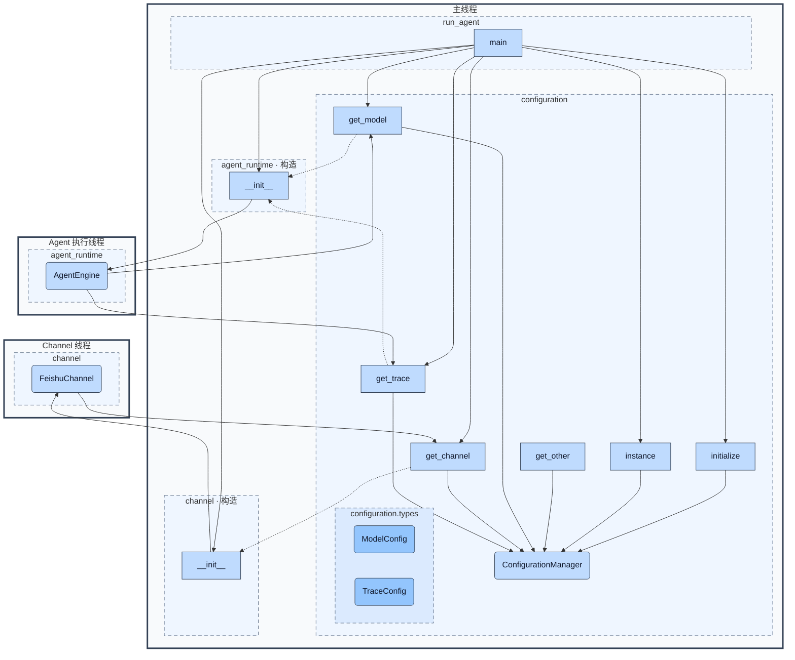

# 配置服务设计

状态：**2026-10-14 已实现**。第 4 节保留为实现契约，伪代码省略方法体；第 6 节表达构造与接口关系，省略工厂和适配函数。适用于 Bines 自有代码；第三方库通过适配边界接收配置。

## 1. 目的与边界

配置的职责是向所有模块提供同一份、经过校验的启动配置。重构前 `src/application/model.py` 和 `src/channel/feishu/config.py` 分别调用 `load_dotenv`，Codex 直接读取环境变量，nTrace 客户端也有自己的环境变量回退。原有读取时机分散，导致配置结果依赖模块初始化顺序，也无法自然表达多组模型和连接。

新增进程内唯一的 `ConfigurationManager`。由主线程在创建模型、Channel、Trace 客户端及工作线程之前显式初始化，集中读取一次，之后只提供查询。业务模块不读取文件、环境变量，也不调用 `load_dotenv`。管理器不创建模型、连接或后台线程，不成为业务服务容器。

这里的“主线程提供服务”指主线程负责创建、初始化和发布单例；查询方法在调用者线程执行，并取得读锁。若要求所有查询实际在主线程执行，就需要主线程事件循环和请求队列，这与本方案的同步只读查询不同。本设计不引入这种代理机制。

这是共享不可变启动配置的专用边界，不改变 Agent 与 Channel 之间仅通过队列传递运行时消息的约束。单例仅保证进程内唯一；未来独立进程分别初始化自己的配置快照，不宣称跨进程共享单例。

## 2. 模块与对象

```text
src/configuration/
    __init__.py       # 不进行读取，不构造单例
    manager.py        # ConfigurationManager，初始化及只读查询
    loader.py         # 文件/环境兼容读取、合并、结构校验和冻结
    types.py          # ModelConfig、TraceConfig、ConfigurationSnapshot、只读值类型
    defaults.py       # Trace 地址和超时的共享默认值
    errors.py         # ConfigurationError、ConfigurationNotInitialized、ConfigurationKeyError
    locking.py        # 内部 ReadWriteLock
```

| 对象 | 目的与约束 |
| --- | --- |
| ConfigurationManager | 持有唯一快照和读写锁；管理初始化状态，提供稳定查询入口 |
| ConfigurationSnapshot | 冻结模型、连接、Trace 及扩展配置；不包含客户端或可变业务状态 |
| ModelConfig | 冻结的模型配置，明确提供商、模型名、地址、凭据及模型扩展选项 |
| TraceConfig | 冻结的 Trace 配置，提供已解析的 enabled 和 server_url |
| ReadWriteLock | 允许多个查询并行；独占发布完整快照，不能暴露给调用方 |

Loader 使用函数实现，不增加配置工厂、配置注册中心、提供商基类或插件系统。配置分组是数据，不为每个提供商生成一个管理类。

## 3. 配置结构

推荐以 `workspace/config.toml` 为结构化配置源，使用标准库 `tomllib`。TOML 明确表达模型分组、服务商和连接名。以下为格式示例，不是真实凭据；字段名统一使用小写，对应现有 `BASE_URL/API_KEY/MODEL` 和 `NTRACE_ENABLED/NTRACE_SERVER_URL`。

```toml
schema_version = 1

[model]
default = "primary"

[model.providers.primary]
provider = "openai"
base_url = "https://api.openai.com/v1"
api_key = "example-only"
model = "configured-model"

[model.providers.secondary]
provider = "openai"
base_url = "https://example.invalid/v1"
api_key = "example-only"
model = "another-model"

[model.providers.codex]
provider = "codex"
model = "configured-codex-model"

[model.providers.codex.options]
reasoning_effort = "medium"
stream_max_retries = 5

[channel.feishu]
default = "operations"

[channel.feishu.connections.operations]
app_id = "example-app"
app_secret = "example-secret"
log_level = "INFO"

[channel.feishu.connections.support]
app_id = "another-app"
app_secret = "another-secret"
log_level = "INFO"

[trace]
enabled = true
server_url = "http://127.0.0.1:8765"

[other.codex]
auth_json = "/path/to/auth.json"
ws_url = "wss://chatgpt.com/backend-api/codex/responses"

[other.collection]
output_directory = "workspace"
```

模型配置的分组名和提供商类型分开：`primary`、`secondary` 可以同时使用相同提供商的不同模型或凭据。`ModelConfig` 定义 `provider: str`、`model: str`、`base_url: str | None`、`api_key: str | None` 和不可变 `options`。API Key 模型必须有非空地址和凭据；现有 Codex OAuth 模型允许二者缺省，认证信息通过 Codex 适配器处理，不伪造 API Key。凭据字段禁止出现在自动生成的 repr 和错误日志中。

Channel 保持动态字符串结构：`服务商 → 连接名 → 字段名 → 字符串`。每组连接返回 `Mapping[str, str]`，满足按字符串查询的需求，同时避免 `Any`。例如 `get_channel("feishu")` 返回语义上等价于 `{"app_id": ..., "app_secret": ..., "log_level": ...}` 的只读映射。服务商特有的必填字段、枚举或数字转换由相应 Channel 适配器负责，中央配置层不依赖飞书 SDK。

多组模型由 `model.default` 指定默认组；多组连接由该服务商的 `default` 指定默认连接。只有一组时可以自动选择；多组但未指定默认时，不按文件顺序猜测。显式指定组名的查询仍然可用，省略组名的查询报错。显式 default 指向不存在的组属于初始化错误。

`model.coding`、`model.behave` 可分别指定编码和页面行为使用的模型组。未配置专用规则时选择 default；显式规则引用不存在的组则初始化失败，不静默回退。
`from src.configuration import get_model_instance` 提供 `get_model_instance(model_rule: Literal["coding", "behave"] | None = None)`。
该接口每次创建独立模型及传输资源，不缓存实例。Root 使用 None，conductor 使用 behave，collector 使用 coding；同类型 fork 也重新构造，不复制父模型或连接状态。
`models.py` 负责模型适配与构造，替代原 `src/application/model.py`。ConfigurationManager 仍只提供冻结配置，不持有客户端。
AgentEngine 接收模型所有权，在关闭或 graph 构造失败时释放 Codex 传输；只共享配置，不共享 WebSocket、请求锁或 previous_response_id 状态。

`TraceConfig` 使用 `enabled: bool`、`server_url: str`。兼容当前默认值：开启 Trace，地址为 `http://127.0.0.1:8765`；启用时校验有效 HTTP(S) 地址。显式 false 必须保留，不使用真假判断回退到默认值。

扩展值采用有限递归类型：`str | bool | int | float | tuple[ConfigValue, ...] | Mapping[str, ConfigValue]`。映射递归只读、序列冻结为元组；不支持 TOML 日期值和非有限浮点数。`options` 与 `other` 使用该类型，业务调用方必须先收窄类型再使用。固定的 model/trace 结构不会退化为通用字典。

## 4. 完整类设计

本节完整定义 configuration 模块的 8 个类；第 6 节仅选择参与对外接口的服务和返回类型绘制，不是完整类清单。公开表示可供模块外调用或识别；内部表示不供业务模块直接使用。以下为当前实现的类设计契约。伪代码中的字段名、类型、方法签名、继承关系及正文约束共同构成实现契约；`...` 仅省略方法体。不得将省略的方法体理解为接口或行为尚待自由决定。

| 类 | 定义位置 | 可见性 | 职责与关系 |
| --- | --- | --- | --- |
| ConfigurationManager | manager.py | 公开服务 | 进程内唯一，持有 ConfigurationSnapshot 与 ReadWriteLock |
| ConfigurationSnapshot | types.py | 内部数据 | 保存全部启动配置，聚合 ModelConfig、TraceConfig 与只读映射 |
| ModelConfig | types.py | 公开返回类型 | 表达一组模型配置，调用方只能读取其字段 |
| TraceConfig | types.py | 公开返回类型 | 表达 Trace 配置，调用方只能读取其字段 |
| ReadWriteLock | locking.py | 内部协作类 | 为管理器提供共享读取与独占发布保护 |
| ConfigurationError | errors.py | 公开异常 | 配置错误的统一捕获基类 |
| ConfigurationNotInitialized | errors.py | 公开异常 | 表示服务尚未成功初始化 |
| ConfigurationKeyError | errors.py | 公开异常 | 表示请求的配置组或路径不存在 |

各代码块按所属文件组织，使用以下共同类型声明；导入不要求在每个片段重复：

```python
from __future__ import annotations

from collections.abc import Mapping
from contextlib import AbstractContextManager
from dataclasses import dataclass
from threading import Condition

# 定义于 types.py；递归值只能由此处列出的类型组成。
type ConfigValue = (
    str | bool | int | float
    | tuple[ConfigValue, ...]
    | Mapping[str, ConfigValue]
)
```

冻结数据类统一使用仅关键字构造。所有字段都必须显式传入，配置文件中的缺省值由 loader 在构造前补齐，避免 loader 和类构造函数各自维护一套默认值。`None` 表示该字段允许无值，不表示构造时可以省略参数。映射字段须在传入前递归复制、冻结；仅使用 `frozen=True` 不能保证嵌套数据只读。

### 4.1 ConfigurationManager

管理器的必要状态仅为已发布的快照及访问锁；单例引用由类维护。尚未发布实例即表示未初始化，不增加可以互相矛盾的 loaded/ready 标志。业务方通过以下接口访问，不直接构造管理器：

```python
class ConfigurationManager:
    @classmethod
    def initialize(cls) -> None: ...

    @classmethod
    def instance(cls) -> ConfigurationManager: ...

    def get_model(self, name: str | None = None) -> ModelConfig: ...
    def get_channel(
        self, provider: str, connection: str | None = None
    ) -> Mapping[str, str]: ...
    def get_trace(self) -> TraceConfig: ...
    def get_other(self, *path: str) -> ConfigValue: ...
```

`initialize` 是唯一的启动接口，只允许主线程调用，不接收任意 ID 或配置修改请求。首次成功初始化后再次调用直接返回，不重读；初始化失败不发布实例，允许修正输入后显式重试。`instance` 未初始化时抛出明确异常，不在工作线程隐式加载配置。

`get_model("primary")` 与 `get_channel("feishu", "support")` 可定位具体配置；省略名称表示读取默认组。`get_other("codex", "ws_url")` 使用路径段定位，避免点分隔字符串与实际键名冲突。缺少键抛出 `ConfigurationKeyError`，类型错误抛出 `ConfigurationError`，不返回空字典或静默转换。对于具有合法默认值的设置，由所属适配器明确处理缺失异常；不新增宽泛的任意默认值查询接口。

查询参数不得为空字符串；`get_other` 至少包含一个非空路径段，不支持空路径返回整份 other，也不支持数组下标路径。参数形式非法时抛出 ConfigurationError；合法路径中缺少键时抛出 ConfigurationKeyError；遇到标量却继续查询下一路径段时抛出 ConfigurationError。

未配置任何模型组或目标服务商没有连接时，查询抛出 ConfigurationKeyError；存在多组且无法确定默认组时抛出 ConfigurationError。仅 `name is None` 或 `connection is None` 才表示选择默认项，不把空字符串当成默认值。缺少单个配置项不影响其他已配置领域的查询。

不提供 `set`、`update`、`reload`、公开 `reset` 或环境写回。文件和环境在初始化后发生变化不影响运行；调整配置需要重新启动应用。测试直接验证 loader 的纯函数，并在独立进程测试单例生命周期，不为测试开放生产修改接口。

### 4.2 ConfigurationSnapshot

由 loader 构建并交由管理器持有的冻结数据对象，只在模块内部使用。没有公开查询或修改方法，也不向外返回整个快照。

```python
# types.py
@dataclass(frozen=True, slots=True, kw_only=True, repr=False)
class ConfigurationSnapshot:
    model_default: str | None
    model_rules: Mapping[str, str]
    models: Mapping[str, ModelConfig]
    channel_defaults: Mapping[str, str]
    channels: Mapping[str, Mapping[str, Mapping[str, str]]]
    trace: TraceConfig
    other: Mapping[str, ConfigValue]
```

`models` 按模型组名索引；`channels` 按服务商、连接名、字段名逐层索引。`channel_defaults` 仅保存显式配置了默认连接的服务商，不用空字符串占位。`model_default` 缺省为 None，其余映射缺省为空只读映射；trace 缺省时仍由 loader 构造完整 TraceConfig。

所有显式默认项必须引用已存在的组或连接；单组推断和多组歧义在 Manager 查询时处理。schema_version 只用于加载时验证，不成为快照字段。禁止快照持有 SDK 客户端、业务对象、环境变量引用或可变底层字典。关闭自动 repr，避免输出连接凭据或扩展配置值。

### 4.3 ModelConfig

表示一组模型提供商配置。由 loader 创建并存入快照，`get_model` 返回同一冻结值对象，不返回可修改副本。

```python
# types.py
@dataclass(frozen=True, slots=True, kw_only=True, repr=False)
class ModelConfig:
    provider: str
    model: str
    base_url: str | None
    api_key: str | None
    options: Mapping[str, ConfigValue]
```

这些字段均公开只读。provider 和 model 必须为非空字符串；provider 在加载时去除首尾空白并统一小写。API Key 模型的 base_url 与 api_key 必须为非空字符串；现有 codex 类型允许缺省为 None。base_url 如有值须为有效 HTTP(S) 地址。options 缺省为空只读映射，具体选项由模型适配器验证和收窄类型。

类不创建模型、不读取环境、不刷新凭据，没有其他业务方法。自动 repr 整体关闭，避免 api_key、含凭据的 URL 或 options 泄漏；模型工厂只能显式记录必要的非敏感信息。构造此值对象不能向管理器写入配置。

### 4.4 TraceConfig

表示 Trace 客户端所需的静态配置。由 loader 创建并存入快照，`get_trace` 返回。

```python
# types.py
@dataclass(frozen=True, slots=True, kw_only=True, repr=False)
class TraceConfig:
    enabled: bool
    server_url: str
```

两个字段均公开只读。loader 对缺失字段分别补入 True 和 `http://127.0.0.1:8765`，显式 False 不得被默认值覆盖。enabled 必须完成布尔解析；server_url 始终为字符串，启用 Trace 时还必须为有效 HTTP(S) 地址。无效值不能通过 `str(value)` 等隐式转换掩盖。

类不创建客户端、不维护网络状态，没有其他业务方法。关闭自动 repr，避免地址中潜在凭据信息被整对象日志带出。客户端装配由消费方负责。

### 4.5 ReadWriteLock

模块内部的访问协调类，仅供 Manager 使用，不向业务方返回，也不在架构图中展示。

```python
# locking.py
class ReadWriteLock:
    _condition: Condition
    _reader_count: int
    _writer_active: bool
    _waiting_writers: int

    def __init__(self) -> None: ...

    def read_lock(self) -> AbstractContextManager[None]: ...

    def write_lock(self) -> AbstractContextManager[None]: ...
```

构造时创建独立 Condition，计数均为 0，writer_active 为 False。状态只在持有 Condition 对应互斥锁时读写。读者可同时持有读锁；写者排斥所有读者和其他写者。存在等待写者时，新读者等待，避免写者持续饥饿；不承诺严格 FIFO。

每次方法调用返回一个独立、仅可进入一次的同步上下文管理器。进入上下文时获取访问权，正常退出或异常退出时均释放并通知等待者。等待写者的计数也必须在等待被异常打断时回收。该类不支持重入、读写升级、降级或超时参数；Manager 不得嵌套获取同一把锁。

锁内不执行文件读取、网络请求或 SDK 构造。原子发布与一次读取的配合方式见[内部设计](configuration-internals.md)。以上方法属于内部协作接口，不属于 configuration 对外服务接口。

### 4.6 ConfigurationError

配置模块统一异常基类，用于文件读取或解析失败、类型和约束错误、默认项歧义，以及非主线程初始化等情况。

```python
# errors.py
class ConfigurationError(Exception):
    def __init__(self, message: str) -> None: ...
```

构造函数将一个已脱敏描述传给 Exception；不新增可变业务字段，`str(error)` 返回该描述。描述可以包含文件位置、配置路径和预期类型，不得包含配置值、凭据或完整对象。包装解析器错误时也不能将包含原文的底层异常链直接带入用户日志；脱敏必须覆盖最终展示的完整错误信息。

该类只用于失败表达，不提供服务方法，不在架构图中展示。

### 4.7 ConfigurationNotInitialized

用于 `instance()` 在服务尚未成功初始化时失败；包括从未初始化，以及先前初始化失败但未发布实例的状态。

```python
# errors.py
class ConfigurationNotInitialized(ConfigurationError):
    # 继承 __init__(message: str) -> None，不增加字段或方法。
    pass
```

不会触发自动读取或重试。调用方可以单独捕获这一类型诊断启动顺序，也可以通过 ConfigurationError 统一捕获。

### 4.8 ConfigurationKeyError

用于合法查询中的模型组、服务商、连接或扩展路径缺失。

```python
# errors.py
class ConfigurationKeyError(ConfigurationError):
    # 继承 __init__(message: str) -> None，不增加字段或方法。
    pass
```

不同时继承内置 KeyError，避免不同的字符串展示及捕获语义。缺少键使用此异常，已存在但类型非法或默认项歧义使用 ConfigurationError；调用方仅对确实允许缺省的字段捕获此异常并使用领域默认值。

### 4.9 类边界与图示约定

ConfigValue 是递归类型别名，Channel 配置使用标准 Mapping，loader 使用函数；它们不是额外设计类。无需为这些数据或函数添加类节点。

Manager 的全部 6 个公开方法在图中展示。ModelConfig、TraceConfig 的只读字段契约在本节说明，不把字段访问伪装成方法节点；异常类只有异常构造契约，没有对外服务方法。ConfigurationSnapshot、ReadWriteLock 及异常类不在架构图中绘制，相关设计保留在文字说明中。异常可供外部捕获，并不意味着它是对外提供调用接口的对象。图中不展示字段、锁操作、解析步骤或异常继承实现。

## 5. 服务保证

配置服务保证主线程一次初始化、跨线程只读查询，以及一致的配置视图。快照冻结、原子发布和读锁机制见[配置子模块内部设计](configuration-internals.md)，总体架构图只展示对外服务接口及其返回类型。

## 6. 架构图

本图同时表达构造调用、配置参与构造，以及运行期的只读访问。实线箭头表示调用；从配置查询指向构造节点的虚线箭头表示查询结果作为构造输入，不表示配置服务主动构造业务对象。

`main` 在主线程调用构造函数。构造节点使用实际 Python 方法名 `__init__`，分别位于对应模块的主线程构造区域；构造出的对象分别放在 Agent 和 Channel 线程框中，表示其运行期归属。AgentEngine 表示业务 Engine 派生实例沿用的基类初始化接口，不直接实例化抽象基类；Channel 以具体实现 FeishuChannel 表示。

ConfigurationManager 放在主线程的 configuration 模块内，表示初始化和管理归属。工作线程通过其只读接口访问配置；图中仅保留 Manager 的公开方法及 ModelConfig、TraceConfig 返回类型，不展示快照、锁和异常类。查询仍在调用方线程执行。



主线程中的构造区域与工作线程中的运行区域属于同一模块，不代表两套模块或重复对象。每个业务对象只绘制一次；跨线程框的构造连线表示 `main` 创建该对象，不表示构造函数在目标工作线程执行。

配置查询到构造节点的连线表示配置参与装配，其中模型配置经模型工厂转换为模型实例，Trace 配置经适配边界用于客户端构造；图省略这些转换细节，不表示把 ModelConfig 直接当作模型传给 Engine。配置服务本身不负责这些转换。

运行期连线是本次确定的目标访问关系：Engine 和 Channel 可以通过相应查询接口读取主线程初始化的配置。构造时已取得的配置可直接保留使用，不要求每次运行都重新查询。构造阶段的查询始终由 `main` 发起，不能用运行期对象发出的连线替代。图展示 Manager 的 6 个公开方法及两个公开返回类型；完整类设计仍以第 4 节为准。get_other 尚未指定具体业务调用方，保留接口节点而不虚构调用方。

## 7. 兼容与扩展

迁移期 loader 支持旧 `workspace/.env`：存在 `config.toml` 时使用新格式；不存在时使用 `dotenv_values` 一次解析旧文件，不修改 `os.environ`。初始化时捕获一次环境变量快照；dotenv 变量引用基于这份快照与此前解析的文件项展开，不再读取实时环境。仅已登记的配置键进入最终配置，保持“进程环境优先于 .env”的现有规则。新格式不自动叠加整份旧环境配置，避免两个来源互相覆盖；部署可显式迁移到 TOML。

旧 `MODEL_PROVIDER` 及对应前缀映射为一组默认模型，飞书的 `FEISHU_* / LARK_* / APP_*` 保持当前别名优先级并映射为默认连接，`NTRACE_*` 映射到 Trace 及有明确用途的扩展字段。别名选择仍为逐键优先环境再文件，不把所有环境变量复制进 other。旧变量映射表归 loader 唯一维护。

Codex 的 `AUTH_JSON`、`CODEX_HOME`、`CODEX_WS_URL` 迁移到 `other.codex`，其配置路径由统一服务提供。OAuth 令牌刷新与认证文件读写仍属于认证服务，不把动态令牌缓存塞进静态配置单例。

nTrace 库的 `default_client()` 仍有独立环境回退。Bines 已通过 `src/application/trace.py` 显式传入 enabled、server_url 和 request_timeout，缓存应用客户端，并由 Engine 将其注入 NTrace；middleware 因而共享已配置客户端，不经过 default_client。第三方 nTrace 代码未修改。超时通过 `other.trace.request_timeout` 配置，旧 `NTRACE_REQUEST_TIMEOUT` 在 loader 中映射。其他 nTrace 独立功能（例如图片目录）的库内设置不属于这次两个 Trace 主字段的迁移范围。

增加 Channel 服务商或同服务商连接只需新增数据，不改变中央管理器。新增字段优先放入明确领域结构；仅服务商特有的模型选项放 options，其他独立配置放 other。中央固定字段拒绝拼写错误，动态字段由消费模块校验，不在管理器硬编码所有服务商规则。语义不兼容的文件变化提升 schema_version，未知版本初始化失败。

## 8. 实现与使用

配置服务实现位于 `src/configuration/`，8 个类及查询签名与第 4 节一致。业务入口不自动在工作线程加载配置；主线程显式初始化：

```python
from src.configuration.manager import ConfigurationManager

ConfigurationManager.initialize()
config: ConfigurationManager = ConfigurationManager.instance()
```

`src/run_agent.py`、`src/application/raw_run.py` 和飞书 smoke 入口均已接入。mind_controller 默认模型入口在主线程初始化配置及 Trace 客户端；训练适配器在主线程直接运行时初始化，在主工具工作线程运行时仅取得已初始化的服务。自定义宿主若跳过这些入口，需要先在自己的主线程完成初始化。

可参考 [config.toml 示例](configuration.example.toml) 创建 `workspace/config.toml`；示例凭据都是占位值。未创建新文件时仍从旧 `.env` 和环境快照读取，不会替换用户当前配置文件。

模型和飞书适配器分别调用 get_model/get_channel，Codex 认证路径与 WebSocket 设置通过 get_other 读取。认证令牌文件仍按认证服务原有机制读取，配置快照不保存动态令牌。自有 src 的直接环境读取仅保留在 loader。

内部初始化使用类级 ReadWriteLock 保护实例发布和读取，直接构造 Manager 会报错。`@contextmanager` 实现的锁方法源码标注 Generator[None]，装饰后的调用结果符合第 4 节 AbstractContextManager[None] 契约，不增加公开接口。

## 9. 验证结果

专项测试覆盖初始化前查询、只读取一次、失败不发布、工作线程拒绝初始化、默认组选择、嵌套只读、缺失与非法值、并发读者、写者排斥及等待优先、异常释放、dotenv 变量展开和优先级、环境变化隔离、Trace 注入、Codex 路径及训练工作线程调用。

验证结果：Pyright strict 覆盖 128 个 Python 文件，0 错误、0 警告；Ruff、显式类型 AST、类型例外登记及依赖检查通过，无运行时循环引用。`tests + trainer/tests` 为 **511 passed、6 failed，另有 30 个子测试通过**；mind_controller 模型入口专项为 **3 passed**。

实施前基线为 484 passed、8 failed。既有失败的处理如下：

| 既有失败 | 本次结果 |
| --- | --- |
| Codex 请求中的 prompt_cache_key 断言 | 未修改其业务语义，仍失败 |
| Codex 实例 prompt_cache_key 稳定性断言 | 未修改其业务语义，仍失败 |
| 设备动作 touch/act 命令期望 | 不属于配置范围，仍失败 |
| middleware 临时手册上下文顺序 | 不属于配置范围，仍失败 |
| 模型 .env 测试使用 API_KEYs 拼写 | 迁移测试到统一 loader，使用规定的 API_KEY 字段；未新增错误拼写兼容 |
| 模型测试要求拒绝未知提供商 | 按可扩展契约改为验证完整的新提供商可用、缺少必需字段被拒绝 |
| 两项页面脚本子测试要求 run(xml) | 排除的页面脚本保持 run(view)，仍失败 |

没有新增回归失败，没有执行真实模型请求或飞书发送。Mermaid 沿用已确认的接口图，本次未进行渲染器验证。
