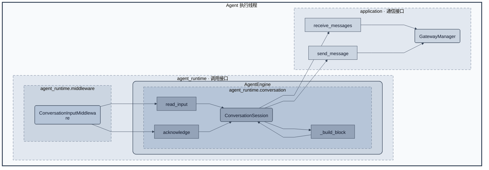

# 单会话与对话消息块

状态：**2026-10-13 已实现**。模块位于 `src/agent_runtime/conversation/`，消息契约位于同级 `messaging/`。本模块接管 Engine 原有的会话绑定与原始消息缓冲；Engine 仅拥有和使用会话对象。

## 1. 背景和目的

Agent 运行可能占用较长时间。期间到达的多条消息通常是一段讨论，而不是多个彼此独立的任务。例如“检查xx目录”和“已经找到了”来自不同人，后一句可能改变前一句的必要性。输入应向模型呈现这段完整对话，不能只让模型看到零散命令或默认所有消息来自同一人。

项目只需要一个 Gateway 同时服务一个 channel 的一个 conversation。conversation 模块因此只维护一个固定会话和一份未完成的输入，不提供会话列表、优先级调度、广播、父子订阅或多租户状态管理。

## 2. 对象与职责

| 对象 | 目的与能力 |
| --- | --- |
| ConversationSession | 每 Engine 一份，由 Engine 创建并拥有：确定固定会话，维护原始积压和去重标识，准备完整对话块，确认提交，发送到固定地址 |
| MessageBlock | 不可变输入值：block_id、text；同一块重试时内容与 ID 都不变 |

MessageBlock 不携带会话管理器、回调或 graph state。原始消息 ID 到 block 的对应关系封装在 ConversationSession 内，外部不能逐条删除其成员。正文格式化使用 Session 私有 _build_block，不单独引入只做字符串拼接的服务类。

AgentEngine 基类在构造时使用显式 gateway_id 创建 ConversationSession，并通过 self._conversation 持有它。外部只提供 gateway_id，不创建或注入会话。Engine 负责会话生命周期，Session 独立实现会话管理；它不是全局单例，Manager 也不持有它。Coordinator 通过 Engine 的只读 conversation 属性使用该对象，输入 middleware 在 Engine._build_graph 的统一列表中绑定同一对象并注册到 graph；Engine 不保存独立 middleware 成员，Coordinator 和 middleware 均不拥有会话。

不同 Engine 即使使用相同 gateway_id，也各自拥有会话对象。外部必须保证只有一个活动消费者；已读入某个 Session 的原始消息、待确认块、固定地址和去重记录不会自动转移。存在本地积压时不得切换消费者；积压处理完也不代表已实现会话连续性。本阶段不提供共享 Session、自动交接或跨 checkpoint 迁移。

## 3. 会话模块图

图只展开本模块，外部只保留 Runtime 的调用对象与 Manager 接口。方法节点放在其定义模块内：read_input、acknowledge、_build_block 属于 conversation；receive_messages 与图中的 send_message 属于 GatewayManager 的 application 模块。粗实线框表示线程，虚线框表示模块；对象为圆角矩形，连接线中间的普通矩形仅标方法名。_build_block 自环表示 Session 自身负责对话格式化，不引入另一条执行线程。



AgentEngine 圆角实线框表示持有范围；Session 位于其中，由 Engine 创建、访问和关闭。内层 conversation 虚线框仍标识类定义所属模块，不代表由外部创建或管理。原始消息只由 Session 消费，Engine 和输入 middleware 使用 read_input 得到 MessageBlock。确认写入使用 acknowledge，人工恢复使用 wait_for_confirmation，发送文本使用 send_message。Manager 的网络投递和 SDK 线程不属于会话模块，不在此图展开。

## 4. 固定会话保证

固定地址是 channel_id 与 conversation_id 的组合。第一批有效消息中最先接纳的消息确定这两个值；后续发言人可以变化，但两项地址不能变化。首次输入之前只有 gateway_id，没有可用回复地址；尚未绑定时发送文本明确报错。

本阶段不提供切换会话接口。来源不匹配的消息被明确拒绝并记录，不加入 MessageBlock，也不覆盖已绑定地址。更换 conversation 需要外部建立新的 Gateway，并用新 ID 构建 Engine，由 Engine 创建新的 Session。不能借助在原 Gateway 上更换 Engine 绕过固定会话约束；跨 Engine 的地址一致性由后续调度方案明确，当前不提供自动重绑定。

当前不考虑 reply_to。对外输出只发往固定 conversation，不引用某条消息，不随最近消息改变回复目标。

## 5. 原始消息必须保留的事实

| 字段 | 用途 |
| --- | --- |
| channel_id、conversation_id | 固定来源与输出位置 |
| message_id | 识别第三方重复事件，追踪消息块的原始成员 |
| sender_id | 区分真实发送者，不能用整段正文猜测 |
| sender_name（可空） | 可读标签；缺失时使用 sender_id，同名发送者用 ID 区分 |
| text | 保留原始正文及 @提及；不自行理解或改写意图 |

Channel 负责从 SDK 提取这些事实，不做会话推理。无需为显示名额外引入用户目录服务。顺序采用 Gateway 接纳顺序，而不是按姓名或正文排序；不对同一 sender 的多条消息擅自合并。重复事件按固定会话和 message_id 去重，不按 text 去重，因为两条相同正文可能是两次真实发言。

## 6. MessageBlock 的语义

当没有待确认块时，Session 将本次可用积压整理成一个完整 user input。格式的稳定部分只说明“同一会话、按接收顺序”，其余保留真实发言：

```text
以下是同一会话按接收顺序积攒的消息，请结合整段对话理解当前需求：
A: @robot 检查xx目录
B: 已经找到了
A: 那就不用检查了
```

不将上例拆成三次任务，也不替模型得出“无需检查”的业务结论。即使只有一条消息，也采用相同格式以避免输入协议切换。

每条发言单独保留发送者标签；正文换行用缩进表示同一发言的延续，不把正文中的“A:”或“B:”误当作新发送者。不移除 @robot，不把多名参与者都标成 user，也不把聊天内容升级成 system 消息。例中的 A/B 应来自真实标签规则，不由模型猜测。

发送者名称、正文只是对话数据。该模块保留它们而不赋予额外权限；例如发送者名包含“done”不代表完成确认。

## 7. 全部积压的范围

“全部”必须有一个有限且可验证的边界。GatewayManager.receive_messages(gateway_id, wait=...) 一次返回读取快照边界之前已接纳的全部消息。若请求阻塞且当前无消息，允许等待首条消息，再确定这次批次边界；边界之后的新消息属于下批。

Session 将这批消息与本地尚未成块的原始积压一起格式化。它不会只取前 N 条就交给 Engine，也不会每取一条就构建一个 HumanMessage。持续到达的新消息不延长已经确定的边界，因此不会导致模型一直等不到输入。

当已有待确认 MessageBlock 时，该块必须原样保留；新消息留在 Gateway 或 Session 的下一批积压里，不能修改已提交过的块。这是可靠重试的必要例外，不是把同一批已知积压任意拆分。

不静默截断、丢弃或自动总结超长对话。消息总量超过模型输入能力时保留完整块并明确报出限制，后续压缩策略单独设计。队列拥塞仍按原有接纳失败语义处理，不假装消息已经被模型看到。

## 8. 最小接口

| 接口 | 契约 |
| --- | --- |
| poll_input() -> bool | 非阻塞收集原始积压并报告是否有待处理消息，不封装 MessageBlock；供模型返回边界及长工具的退出检查使用 |
| read_input(*, wait) -> MessageBlock 或 None | 返回一份完整对话块；无可用输入时按 wait 决定等待或返回 None；已有待确认块则返回原块 |
| wait_for_confirmation(expected) | 保留并收集原始积压，等待一条尚未用于恢复的消息精确匹配确认词；返回只表示恢复条件满足，不表示消息块已提交 |
| acknowledge(block_id) | 只有 graph 确认包含该块后才调用；幂等确认该块的所有原始成员，不接受不匹配的块 ID |
| send_message(text) -> bool | 使用固定 channel_id/conversation_id，通过 Manager 发送；不接受任意回复地址 |
| close() | 由所属 Engine 调用，幂等结束会话收发；保留未确认数据和数量供报告，不关闭 Gateway，不将未确认输入标记为已处理 |
| _build_block | 私有的保序对话格式化，不解释任务或恢复策略 |

已准备的块是等待提交确认的值，重复 read_input 返回相同 ID 和文本。输入 middleware 负责适配成一条 HumanMessage，并检查 checkpoint 中的稳定 ID。acknowledge 不因 Manager 已返回原始消息或模型已经开始请求就提前调用。

wait_for_confirmation 的确认词由 Engine 的中断种类决定，Session 只做原始单条正文精确匹配。例如“他说 done”不是 done；正文“done”可以确认，但原文仍作为真实发言保留，之后进入消息块。一次确认消息只允许触发一次恢复，不能反复使用。

确认等待与块提交独立：普通补充消息暂存，不因缺少确认而丢弃；确认到达后，一起进入下一份完整块。如果已有待提交块，等待确认不修改它，新消息和确认保留为后续批次。这样即使模型在块写入前失败，也能等待人工恢复，不会因为旧块尚未确认而拒绝读取确认消息。不得为了恢复而提前 acknowledge 或重写旧块。

## 9. 状态为何足够

会话只有三组内部数据：固定地址、尚未成块的原始积压、可选待确认 MessageBlock 及其原始成员。去重标识随当前进程内会话保留；不建立第二份模型历史。未绑定是固定地址为空，待提交是块存在，不另加一组互相重叠的布尔标志。另用关闭标志阻止 close 后继续收发；输入流排空关闭与 Session 自身关闭分别记录，因为输入结束后仍允许发送最后结果。这些标志不表示消息已提交。pending_block、pending_count、input_closed 提供只读观察，route 返回地址值副本，不暴露可变缓冲。

任务是否完成、是否中断、使用什么恢复载荷不属于会话状态。Session 不保存 _ready、活动 session_id、按会话排列的中断表或 Engine 引用，也不选择运行哪个 Agent。这样的边界让 Engine 只需处理“有完整输入/暂无输入/等待确认/通信已结束”。

Session 随所属 Engine 关闭，由 Engine.close 调用 Session.close。关闭前结束对此对象的使用；关闭后保留未确认数据及数量供报告，释放 Engine 前必须明确报告未交付输入，不静默清空或自动转交给另一 Engine。会话关闭不影响 Gateway 或其出站，通信实例仍由外部生命周期所有者释放。报告不代表数据已持久化，也不承诺进程退出或对象释放后的恢复。

## 10. 设计验证样例

| 场景 | 应满足的结果 |
| --- | --- |
| A 请求检查，B 表示已找到 | 一个 MessageBlock，发言者和两句原文均保留 |
| 单条、多行、同名用户、正文包含伪发送者前缀 | 发言边界清晰，不制造额外说话人 |
| 模型调用期间积压多条消息 | 本次读取边界内全部进入一条 HumanMessage |
| 读取期间不断有消息到达 | 本批能结束，新增消息留待下一边界 |
| 模型调用失败后重试 | 原块 ID/内容稳定，已写入块不重复追加 |
| 先有普通补充，随后收到精确 done | 全部积压形成一个块，确认单独成立但不替代输入提交 |
| 来自另一 conversation 的消息 | 拒绝并记录，不改变绑定，不混入对话 |
| Engine 构造与关闭 | 自行创建唯一 Session，关闭时幂等结束该 Session，报告未交付输入，不关闭共享通信 |
| 多个 Engine 共用 Gateway | 互斥消费，各自持有 Session；存在本地积压时不切换，不自动移交地址、去重、消息或历史 |

以上场景已纳入会话及 Runtime 回归测试；不包含真实飞书或模型联网验证。
