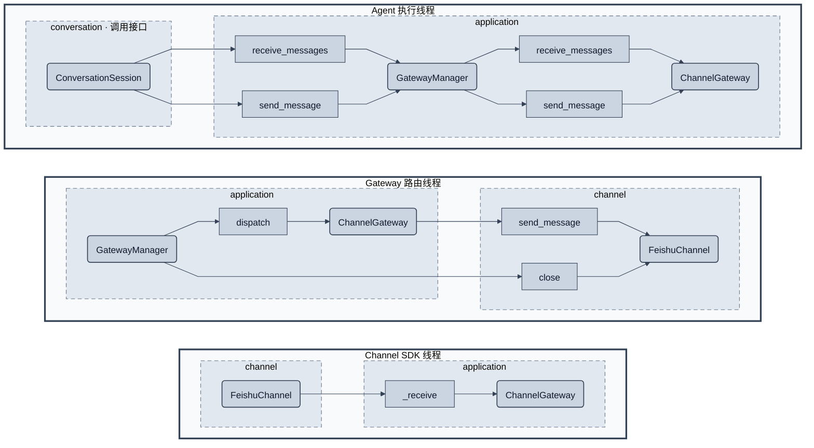

# Channel 与 GatewayManager 架构

归档：2026-10-31。本文仅作历史参考；新的待实现设计见 [三层架构](../../agent-system-design.md)。

状态：**历史设计，2026-10-29 已替代**。GatewayManager/ChannelGateway 已移除，当前采用 AgentApplication、AgentHost 和 AgentRouter；见 [运行时线程模型](threading-model.md)。以下保留原通信方案作为历史记录。

## 1. 背景和边界

通信层的目的，是让 Agent 与第三方 SDK 通过消息队列交互，并隔离不同 Gateway 的资源和生命周期。本阶段一个 Gateway 仅接一个 Channel，且有效通信限定在其中一个 conversation。conversation 的首次绑定、来源验证和对话格式化由 ConversationSession 负责，不放入 Gateway 或 SDK 适配器。

GatewayManager 是进程内唯一服务，生成 ID 并管理普通 ChannelGateway 及路由线程。ChannelGateway 持有私有双向队列，不创建线程，不理解 LLM 输入。FeishuChannel 只处理 SDK 事件和发送。Manager 不保存 Engine、ConversationSession 或模型历史。

多个 Engine 可以显式绑定同一个 gateway_id，但各自创建和管理 ConversationSession，由外部保证互斥运行。互斥读取不保证会话连续性：已被某个 Session 取走的消息不会自动交给另一个 Engine；通信层不承担会话交接，不设置父子关系，不广播消息，不根据 sender_id 选择 Agent。

## 2. 通信模块图

方法节点归入被调用对象的定义模块；同名 send_message 分别指向 Manager、Gateway 或 Channel，不代表同一方法。线程上下排列并使用粗实线边框，模块使用虚线框，不绘制最外层 src。只展开通信内部，对外仅显示 ConversationSession 接口，不展开 Runtime 或消息块内部状态。

重复出现的 Manager、Gateway、FeishuChannel 表示同一个对象的方法在不同线程执行，不代表多个实例。Manager 本身没有专属线程。不可见布局连线只固定线程框顺序，不表示调用或消息传递；可见箭头只有对象间的方法调用。

Manager 的收发接口在调用方线程执行；Gateway.dispatch 在其路由线程执行；SDK 回调在 Channel 线程接纳原始消息。跨这些线程传递的是队列消息，不是 Engine/session 可变状态。

## 3. 对象的必要性

| 对象 | 所有权与保证 |
| --- | --- |
| GatewayManager | 唯一注册入口，生成不复用 ID，管理线程和每 Gateway 读取锁；不持全局锁等待网络或消息 |
| ChannelGateway | 一组私有 incoming/outgoing 队列，一个 Channel 的投递目标；入站批次边界和 FIFO 接纳 |
| Channel / FeishuChannel | 抽象接口及其 SDK 实现；提供原始消息事实和平台投递 |
| IncomingMessage / OutgoingMessage | 冻结的跨线程数据；不包含回调、Agent 引用或 reply_to |

Channel 抽象仍位于 src/channel/base.py。Manager 和 Gateway 分别位于 src/application/gateway_manager.py 与 channel_gateway.py。会话模块独立位于 src/agent_runtime/conversation，不并入第三方实现。

## 4. 对外服务

| 接口 | 目的与约束 |
| --- | --- |
| instance() | 获取进程内唯一 Manager |
| create(channel) -> gateway_id | 只接收一个 Channel，生成 ID 并创建普通 Gateway；不接受外部 ID |
| start(gateway_id) | 启动该实例的渠道和路由线程，拒绝重复启动 |
| receive_messages(gateway_id, *, wait) | 返回本次读取快照内的全部 IncomingMessage，保持接纳顺序；没有输入时按 wait 等待或返回空批次 |
| send_message(gateway_id, message) -> bool | 向该实例的出站接纳；拥塞 False，关闭抛 MessageStreamClosed |
| stop(gateway_id) | 关闭入站接纳，唤醒阻塞读取；不提前关闭出站 |
| finish_output(gateway_id) | 全部生产者结束后非立即关闭出站，保留已接纳输出 |
| join(gateway_id) / release(gateway_id) | 等待路由与渠道结束，然后移除注册 |

receive_messages 替代逐条 receive_message 的外部协议；不同时保留两个让 Engine 自行选择的入口。Manager 返回原始批次，ConversationSession 才将其封装成一份 user input。输入流关闭后先交付已接纳的剩余批次，排空后抛 MessageStreamClosed；空批次和流关闭不能混淆。

Channel 提供只读 channel_id，供 Gateway 检查输入/输出是否属于配置渠道。相同 Channel 对象不能注册到两个 Gateway，避免监听和关闭互相覆盖。本轮不设计多 Channel 路由表或同 Gateway 的动态渠道切换。

## 5. 批量接收与线程安全

每个 Gateway 的读取锁覆盖一次完整批次获取，意外重叠读取明确报错。它防止资源操作冲突，不授予某个 Agent 运行权，也不能替代外部互斥调度。

批次必须有固定的接纳边界：所有边界之前已入队的消息恰好属于本批，之后到达的消息留给下批。等待首条消息不占全局注册锁；确定边界和取出快照使用通信层自己的短临界区，不能一边追逐新增消息一边无限排空。该保证可以由队列的同步快照或等价的接纳序号实现，不要求 Engine 感知具体机制。

全部批次不意味着无限队列。现有入站容量 1024、出站容量 256 与发送接纳超时策略可以保留，但读取不能再任意截取已接纳积压。入站满时明确拒绝接纳，不谎称消息已交付；出站接纳也不是平台送达确认。

stop 不等待阻塞读取持有的读取锁，而是关闭队列以唤醒它。不同 ID 的阻塞、发送失败和关闭相互隔离。全局锁只保护注册与查找，不包围收发、SDK 回调或 join。

## 6. 原始消息契约

IncomingMessage 包含 channel_id、conversation_id、message_id、sender_id、可选 sender_name 和 text。SDK 适配保留可读 @提及及原文，不做业务摘要。队列顺序就是消息块的发言顺序依据。sender_id 标识说话人，conversation_id 标识共同对话，两者不能互换。

OutgoingMessage 只需要 channel_id、conversation_id 和 text。reply_to 不纳入当前设计，平台发送按 conversation 投递；SDK 适配不得再通过缓存的上一条 message_id 隐式回复某条消息。

Manager 接受明确发送地址，ConversationSession 在首次入站绑定后提供这一固定地址；它们之间不共享可变会话缓存。工具只使用本次调用的固定地址值，不持有 ConversationSession 引用。

## 7. 生命周期边界

通信实例由外部生命周期所有者创建和释放。Engine 自行创建并关闭它拥有的 ConversationSession；结束一个 Engine/Coordinator 不结束共享 Gateway。Manager 不参与 Session 的创建、保存或释放。停止接纳与结束输出仍分开，因为模型和工具需要有机会发送最后的状态。

只有相关 Agent/工具生产者全部结束，外部所有者才能 finish_output；join 保证已接纳输出完成队列排空与渠道收尾；release 不得作为强制终止替代。Manager 不反向等待 Agent 或推断最后一个 Engine，实例 ID 失效后不重定向到新实例。

## 8. 验收范围

回归覆盖：批次完整且顺序稳定；持续新消息不拖延已确定批次；发送者信息不丢失；队列满和关闭正确区分；阻塞读取可被 stop 唤醒；每 Gateway 读取保护不阻塞其他 ID；单 Engine 结束不关闭共享信道；无 reply_to 隐式平台回复。

实现与测试已同步迁移；未进行真实网络、飞书或模型验证。
