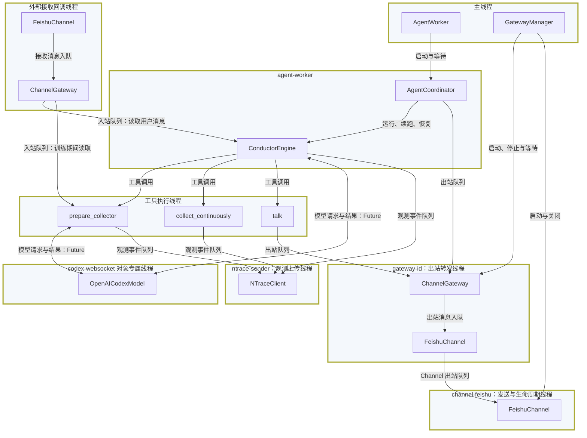
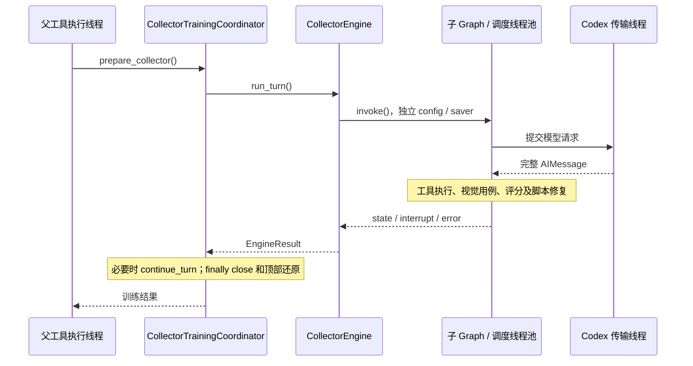

# 运行时线程模型：改造前现状

归档：2026-10-31。本文仅作历史参考；新的待实现设计见 [三层架构](../../agent-system-design.md)。

这是 2026-10-28 改造前的源码分析快照，不是后续实现目标。
主线程通信方案及逐类伪码见 [目标线程模型](threading-model.md)。

本文描述 2026-10-28 当前代码的执行模型，而非目标设计。主路径为
`src/run_agent.py` 启动的飞书 Conductor；同时覆盖 collector、连续采集、Codex
WebSocket 和 nTrace。设备端服务、nTrace 服务端及其他独立程序不计入 Agent 进程线程。

依据：仓库源码及 `bines` 中已安装的 LangGraph 1.2.4、LangChain 1.3.4、
langchain-core 1.4.0、websockets 15.0.1、lark-oapi 1.6.8。
SDK 内部调度随版本变化，不作为项目承诺的固定线程数。

## 1. 关键结论

- 应用层采用一个 `AgentWorker` 驱动一个 `AgentCoordinator`，不是每个工具一个自有线程。
- `AgentEngine`、Strategy、middleware 和 collector 本身不创建业务工作线程。
  但同步 `graph.invoke()` 可以通过 LangGraph/LangChain 线程池执行节点和工具。
- Codex 模型每个实例最多维护一个当前传输线程和事件循环。所有 WebSocket
  连接、发送、接收、心跳与连接关闭都在该循环处理。
- 飞书接收与模型调用相互独立。用户消息先进入线程安全队列，到模型边界才进入历史；
  不会从接收线程重入 Engine 或中断当前设备动作。
- collector 是父工具里的同步嵌套 Engine，不是并行启动的 `AgentWorker`，也不是父 graph 的子图。
- “业务串行”“同一个 OS 线程”“同一个 asyncio 事件循环”“同一个 checkpoint thread”
  是四个不同概念。`configurable.thread_id` 只是 checkpoint 的逻辑标识。

## 2. 模块与线程归属

| 模块 | 对象 / 入口 | 实际执行位置与目的 |
| --- | --- | --- |
| 应用装配 | `run_agent.main` | 主线程创建配置、模型、Engine、Gateway、Worker；等待及协调关闭 |
| 业务执行 | `AgentWorker._run` | `agent-worker` 非 daemon 线程；顺序运行 Coordinator，结束时关闭 Engine |
| 执行策略 | `AgentCoordinator.run`、`AgentEngine._execute` | 调用者线程；决定首次执行、续跑、恢复和返回，不自建线程 |
| Graph 调度 | LangGraph / LangChain | 调用线程和框架线程池；不能承诺所有 hook、节点、工具固定在 `agent-worker` |
| 入站缓冲 / 出站转发 | `ChannelGateway`、`GatewayManager` | 接收回调只入队；`gateway-<id>` 非 daemon 线程负责出站队列转发 |
| 飞书适配 | 项目的 `FeishuChannel._run` | `channel-feishu` 非 daemon 线程，通过 `asyncio.run(_serve())` 创建循环，处理出站和 SDK 生命周期 |
| 飞书 SDK | `lark_oapi.channel.FeishuChannel` | `start_background()` 用 executor 运行同步 `start()`；SDK 另有 `lark-channel-bg` 循环线程处理消息管线 |
| 模型传输 | `OpenAICodexModel` | 懒启动的 `codex-websocket-<对象 id>` daemon 线程，拥有独立 asyncio loop |
| 观测输出 | `NTraceClient` | 启用且首次 emit 后启动 `ntrace-sender` daemon 线程，批量 HTTP 上传 |
| 设备与视图 | `DeviceOperationService`、`PageBridge` | 工具的执行线程；同步 adb 子进程、Reco 计算，不自建设备线程 |
| 训练与归档 | `CollectorToolbox`、`CollectionService` | 调用者 / 工具执行线程；脚本执行、历史管理、工作簿读写均是同步工作 |

这里的“飞书 SDK 线程”不能省略：项目的 `_serve()` 调用 SDK `start_background()`，
并不意味着 WebSocket 接收也运行在 `channel-feishu` 的同一个 loop。
当前 SDK 的 `_on_p2_im_message_receive_v1()` 会把 `_handle_message_event()`
提交到其后台 loop；项目 `_receive()` 是注册在该消息管线上的同步回调。
回调只做转换、去重和 Gateway 入队，不运行 graph。

### 线程与调用边界图

本图只展示线程、线程中的项目对象及其交互，不展开第三方实现或中间调用。
大矩形表示线程，小矩形表示对象或工具。同一线程的全部节点集中在一个线程框内。
框内对象表示其在该线程上的执行位置，不表示对象只能被该线程访问。

为突出业务边界，全部工具相关执行统一画在“工具执行线程”中。这是逻辑归组，
不是声明当前代码存在唯一、固定的工具 OS 线程；框架调度及子 Engine 内部线程均省略。
标注队列的箭头表示消息传递，不表示生产者同步调用消费者；Future 表示模型请求与结果的跨线程交付。

三个 FeishuChannel 节点是同一个实例在接收回调、Gateway 入队及发送循环中的执行位置；
两个 ChannelGateway 节点同样表示一个共享实例，不是各线程分别创建的对象。
FeishuChannel 自己只创建 `channel-feishu` 线程，接收回调线程由外部提供；
`send_message()` 在 Gateway 线程执行入队，不另建线程。
Gateway 入站队列由接收回调写入、当前 Engine 读取；出站队列才由 `gateway-id` 线程消费。
会话、middleware 及 GatewayManager 的中间转发调用均省略。
Codex 与 nTrace 线程按配置及首次使用启动，未启用对应能力时不存在这些线程。

## 3. 消息通信：队列隔离而不是共享 graph

### 入站

`飞书 SDK → FeishuChannel._receive → ChannelGateway._receive → incoming Queue`

后续由 `ConversationSession` 通过 Manager 读取：

- 空闲时 `read_input(wait=True)` 阻塞等待队列。
- 模型执行前 `ConversationInputMiddleware.before_model()` 取出消息块，返回真实 HumanMessage。
- 模型执行后 `poll_input()` 收集到达消息，但不提前封装新的输入块。
- 连续采集调用 `_tool_yield_reason()` 检查输入和关闭标记，在步骤边界让出控制权。
- graph 返回后 Engine 再检查待处理输入，必要时续跑，而不是直接结束业务任务。

`ConversationSession` 维护地址、backlog、pending block 和确认记录，本身没有锁。
它依赖单一逻辑执行者：外部线程只能向 Gateway 入队，不能同时调用同一个 Session 的方法。
Manager 的 `read_lock` 只能拒绝重叠队列读取，不保护 Session 的全部状态。

### 出站

`talk / Coordinator → Gateway outgoing Queue → gateway-<id> → Feishu outgoing Queue → channel-feishu → sdk.send`

两层出站队列有不同职责：Gateway 隔离业务与 Channel，Channel 把同步投递转换成异步网络发送。
Gateway 入站容量为 1024、出站容量为 256；Feishu 自有出站容量为 256。
Gateway 出站入队最多等待 1 秒，Feishu 单次 `sdk.send()` 最多等待 30 秒。

**当前 `talk` 返回 true 表示 Gateway 接收入队，不代表飞书 API 最终发送成功。**
后续 Channel 拒绝或 API 失败会记录日志，不会逆向更改已经返回的工具结果。

### 子 Engine 的消费边界

Conductor 和 Collector 显式绑定相同 gateway ID，但各自有独立 Session。
父工具等待 collector 返回期间，父模型不再迭代，collector 可消费 Gateway 的新输入。
这不是广播：已经被某个 Session 取走的消息不再自动复制到另一个 Session。
共享 Gateway 不能等同于共享对话历史；子 Session 尚未绑定入站地址时主动发送会失败。

## 4. Graph、middleware 与 collector

`AgentWorker` 只保证应用入口没有同时执行两个顶层 Coordinator，不保证工具节点在同一线程。
当前安装版本的同步 `ToolNode._func()` 使用 executor.map，异步实现使用 asyncio.gather。
Pregel 的同步 BackgroundExecutor 同样提供线程池调度；具体节点是否内联取决于框架路径。

因此，模型声明 `parallel_tool_calls=False` 不是线程互斥锁，也不保证异常多调用响应不会 fan-out。
Strategy 只是组合和路由 hook，不是线程调度器；业务状态更新由 graph 收集、归并和保存。
设备锁不会阻止同一步不同 ToolMessage / Command 对同一个 state 字段写入。

collector 的实际路径：

CollectorEngine 没有启动新的 AgentWorker；子 graph 仍可创建自己的框架线程池。
Conductor 与 collector 共用传入的 model、设备服务、PageMechanism 和训练历史服务，
但不共享 graph、InMemorySaver、checkpoint ID 或 ConversationSession。

`AgentEngine._execute()` 使用 `set_config_context(config)` 建立独立 Runnable 上下文。
这是上下文隔离，不是线程切换：避免嵌套 Engine 隐式继承父任务的 checkpoint namespace、
scratchpad 和 callbacks。退出后恢复调用方上下文。`durability="exit"` 是保存时机，
既不取消框架线程池，也不提供多线程调用同一 Engine 的安全性。

## 5. Codex：同一传输循环，串行完整请求

`_ensure_transport_started()` 在 `_transport_guard` 内创建 loop 和线程，使用 Event
等待线程完成 loop 绑定及 asyncio.Lock 初始化。loop 对象在启动方创建、在传输线程运行。
新线程不会因为存在 async 函数就自动有事件循环，故需要显式创建并 `run_forever()`。

| 调用方式 | 调用者行为 | 网络实际执行处 |
| --- | --- | --- |
| `_generate()` | `_submit_request(...).result()` 阻塞当前调用线程 | 专属 Codex loop |
| `_agenerate()` | `await asyncio.wrap_future(...)` 挂起当前 task，调用者 loop 可执行其他 task | 同一专属 Codex loop |

`run_coroutine_threadsafe()` 返回 concurrent Future，把两个线程连接起来。
传输 loop 处理连接、socket 可读写事件、响应超时、心跳和关闭任务；没有独立“心跳线程”。
websockets 的 ping 间隔为 20 秒、pong 等待为 60 秒。

`_request_lock` 覆盖连接获取、发送、完整接收、usage 及 response ID 更新。
同一个 model 的多个请求在这个 asyncio.Lock 上排队，避免并发 recv、响应串线和连接续传状态混用。
锁等待只挂起传输协程，不阻塞事件循环，因此等待响应期间仍可进行心跳。
请求失败会失效 socket；模型重试重新发起请求，不重放已完成工具。

调用者在传输 loop 线程内使用同步 `.result()` 会阻塞该 loop，形成自等待。
当前 graph 在传输线程之外运行；关闭实现也显式禁止从其自身线程同步关闭。
同步调用不天然要求独立线程，这里需要线程是为了以同步接口驱动内部异步网络实现。
若 provider 为普通 `ChatOpenAI`，此 Codex 专属线程不存在。

## 6. 设备、Reco 与持续采集

`DeviceOperationService` 创建一个 RLock，并把**同一个对象**传入 PageBridge。
它保护动作回放、动作后等待、页面抓取、Reco sync 和快照更新，防止查询观察到半更新树。
截图 capture/pull 同样在该锁内执行。Reco 不创建 Agent 专属线程；adb 是同步等待的子进程。

使用 RLock 是因为调用链会嵌套获取：
`collection_swipe → _replay_and_refresh → _run_device_operation → PageBridge.refresh`。
同一线程可重入，不同线程相互等待。不能在父线程持有它时，等待另一个子线程获取同一锁。
当前 prepare_collector 没有把整段子 graph 包在设备 RLock 中，避免这种嵌套等待。

`ContinuousCollection.collect_continuously()` 在同一个工具调用中持有 RLock，
串行完成滑动、同步视图、采集、归档和下一步判断，不逐步发起模型调用。
每步检查用户输入 / shutdown，可安全让出；不会取消已经开始的 adb 或持久化操作。

另有 `DeviceOperationExecutor._lane`：非阻塞获取，忙时抛出 DeviceOperationBusy；
异步版本用 shield 保持实际操作结束前不释放 lane。**当前生产调用只在 captcha 的
认证准备路径看到 execute，未把它统一包在普通工具和连续采集外面；aexecute 当前无生产调用。**
不能根据该类的注释推断它已经覆盖所有设备工作流。

## 7. 同步原语清单

| 对象 / 原语 | 保护范围 | 限制 |
| --- | --- | --- |
| GatewayManager `_instance_lock` / `_registry_lock` | 单例创建、注册表查询及变更 | 不锁 graph 执行 |
| registration `lifecycle_lock` / `read_lock` | 启停 join/release；拒绝同 Gateway 重叠读取 | 不广播消息、不锁 Session 全部方法 |
| ChannelGateway Queue / `_admission_lock` | 跨线程消息；固定批次快照不被入站扩展 | 队列容量有界，入队可失败 |
| FeishuChannel `_lock` | 启停标记、去重、入队及接收回调 | 不包含完整网络发送等待 |
| Codex `_transport_guard` / ready Event | 唯一传输线程、生命周期、启动就绪 | 与请求串行是不同问题 |
| Codex `_request_lock` | 同一模型的完整网络请求及空闲关闭 | asyncio.Lock，仅在传输 loop 使用 |
| DeviceOperationService `operation_lock` / PageBridge `_lock` | 同一个 RLock；设备与当前树一致性 | 实例级，不是按物理设备全局加锁 |
| DeviceOperationExecutor `_lane` | 单个 execute / aexecute 的互斥占用 | 当前覆盖面有限，见上一节 |
| CollectorToolbox `_lock` | `_safe` 包装的工具执行及可变用例状态 | 不代表直接调用每个方法都有锁 |
| CollectorTrainingRegistry `_lock` | 访问实例训练记录读写 | 不等于训练流程整体事务 |
| CollectorHistory `_lock` | 历史加载、提交、失效化等文件操作 | 同一实例内有效，不是跨进程文件锁 |
| PageMechanism `_run_patch_lock` | 脚本补丁及共享文档存储修改 | 实例级，不保护其他实例或外部编辑器 |
| workbook `_PATH_LOCKS_GUARD` / 路径 RLock | 创建锁索引；同一规范路径读、去重、写入 | 进程内生效，不是跨进程互斥 |
| ConfigurationManager ReadWriteLock | 配置读写，Condition 协调且优先等待写者 | 同步锁，非 asyncio 原语 |
| NTraceClient `_lock` / Queue / Event | sender 懒启动、事件队列、停止标记 | 观测失败允许丢弃，不是业务事务 |

通用 SubagentManager 还保留一个非阻塞调用锁，但它不在当前 Conductor 工具装配链上，
不能把它当作 collector 或全部设备操作的互斥保证。nTrace 服务端 SQLite 锁属于另外进程，
不参与 Agent 设备加锁。

## 8. 生命周期与退出

飞书入口的关闭顺序由 `run_agent.main()` 的 finally 管理：

1. `manager.stop()` 关闭入站接收队列，允许已入队内容排空。
2. 等待 AgentWorker 返回；执行中业务到达模型边界或连续采集步骤边界后看到关闭。
3. Worker 的 finally 关闭 Engine / ConversationSession，不关闭共享 Gateway 或模型。
4. `finish_output()` 后等待 Gateway dispatch 排空；其 finally 调用 Channel.close。
5. FeishuChannel 标记 closing，发送线程处理已有出站后 disconnect SDK 并结束。
6. 入口关闭共享 Codex 模型，再释放 Gateway 注册。

Codex.close 在 transport guard 内标记 closing，拒绝新提交；向传输 loop 投递空闲关闭任务，
等待 request lock、关闭 socket，然后停止 loop、join 线程、清空传输状态。
loop finally 取消并等待残留 task。异步 aclose 通过 wrap_future / to_thread(join) 避免阻塞调用者 loop。

nTrace 使用 daemon sender 和 atexit.close，flush / join 各仅短暂等待。
当前入口没有显式完整 trace drain；进程退出不保证全部遥测已经送达。
这与 Excel 每步写入及 graph 的退出 checkpoint 是三套不同持久化机制。

控制台 `application.raw_run.run()` 不创建 AgentWorker，Coordinator 在调用线程执行；
ConsoleChannel 也不自建线程，但 Gateway、Codex 和 nTrace 仍按各自条件工作。

## 9. 当前保证边界与待改进项

以下是源码可见的限制，不表示已在真实设备上复现故障：

1. **没有全链路串行事务。** 普通工具的设备方法有锁，但可靠性 precheck、实际动作、
   middleware 后处理和 graph state 提交没有一个共同的完整事务锁。
   多工具 fan-out 时，设备动作串行仍可能出现前后观测错配或并行 state 写冲突。
   后续若需要强保证，应在统一工具执行边界设计串行调度，不能仅新增局部锁或依赖模型参数。
2. **Session / Engine 不支持任意并发调用。** 同一实例必须保持单执行者契约；
   多个 Engine 共享 Gateway 时还需明确消费者交接，read_lock 不是会话调度器。
3. **锁作用域不能跨实例推导。** 多建一个 DeviceOperationService 就得到另一把锁，
   即使连接同一 Android 设备也不会互斥。多 Engine 同设备部署须共享服务或引入设备级所有权。
4. **发送成功语义有限。** 当前 talk 是入队确认；若要求实际投递确认，需另设计出站结果回执，
   不能把 bool 文档写成已经等待飞书 API 成功。
5. **退出不是强制抢占。** 主入口等待已执行模型 / 设备任务；关闭耗时取决于当前调用。
   不应从其他线程直接关闭 Session、改 graph state 或强行释放设备锁来缩短等待。
6. **线程数量不是固定常量。** SDK、框架 executor、模型实例数和 trace 开关均影响线程数量。
   需要用实际 thread name / native ID 和堆栈核对，不能将线程数增加本身视作泄漏。

## 10. 验证范围与源码索引

本次为源码分析与文档变更，不执行真实飞书、Codex 或 Android 操作。
在 bines 做了两个无网络探针：单节点 StateGraph 的节点在 MainThread 执行；
包含 ToolNode 的 StateGraph 从 MainThread invoke，工具报告 ThreadPoolExecutor 工作线程。
它们验证“同步 graph 不等于全部同线程”，不证明生产运行的具体线程编号或数量。
Mermaid 图保留源码；未进行编辑器渲染验证。

| 关注点 | 源码 |
| --- | --- |
| 主入口和控制台差异 | [run_agent.py](../../../src/run_agent.py)、[raw_run.py](../../../src/application/raw_run.py) |
| Worker / Engine 独立执行边界 | [worker.py](../../../src/agent_runtime/worker.py)、[engine.py](../../../src/agent_runtime/engine.py)、[coordinator.py](../../../src/agent_runtime/coordinator.py) |
| 渠道和队列所有权 | `src/application/gateway_manager.py`、`src/application/channel_gateway.py`（已删除的历史模块）、[channel.py](../../../src/channel/feishu/channel.py) |
| 安全模型边界收件 | [session.py](../../../src/agent_runtime/conversation/session.py)、[communication.py](../../../src/agent_runtime/middleware/communication.py) |
| 传输 loop、Future 和锁 | [codex_oauth.py](../../../src/codex/codex_oauth.py) |
| 子 Engine 和工具锁 | [core.py](../../../src/collector/core.py)、[toolbox.py](../../../src/collector/toolbox.py) |
| 设备与持续采集 | [operations.py](../../../src/device/services/operations.py)、[bridge.py](../../../src/device/services/page/bridge.py)、[execution.py](../../../src/device/services/execution.py)、[continuous.py](../../../src/tools/collection/continuous.py) |
| 观测线程 | [trace.py](../../../src/application/trace.py)、[client.py](../../../nTrace/client.py) |

相关设计：[Runtime](agent-runtime-architecture.md)、[通信层](channel-architecture.md)、
[会话](conversation-architecture.md)、[Codex](../../codex-architecture.md)、
[设备](../../device-architecture.md)、[Strategy](../../../src/strategy/Architecture.md)。
线程创建、对象所有权、锁范围或关闭路径变更时应同步更新本文。
