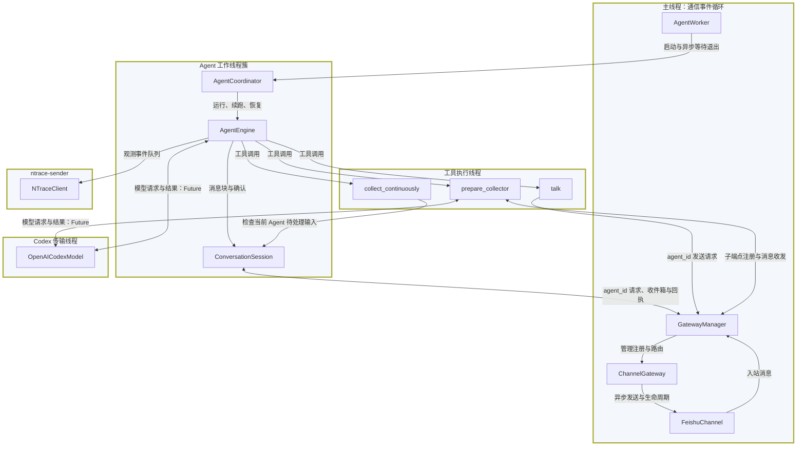
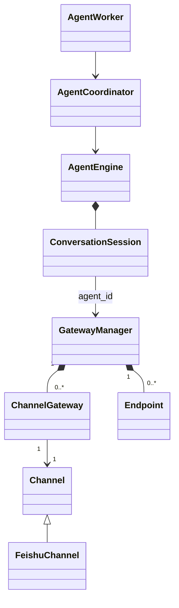

# 运行时线程模型：已替代的提案

归档：2026-10-31。本文仅作历史参考；新的待实现设计见 [三层架构](../../agent-system-design.md)。

状态：历史提案，已被 [当前线程模型](threading-model.md) 替代，不代表当前接口。以 2026-10-28 源码为基线；
[改造前现状](threading-model-current.md) 保留原有线程、锁和执行路径分析。

## 1. 目标与边界

主线程启动服务后运行 asyncio 事件循环，统一承担 Channel 通信、Gateway 路由和退出协调。
无消息时等待事件，不轮询，也不执行模型调用、设备动作或采集脚本。

Gateway 保留独立模块和单例入口，但不拥有线程。Agent 工作线程通过 `agent_id`
请求收发消息，不能直接操作 Channel、路由表或其他 Agent 的收件箱。

移除项目自建的 `gateway-<id>` 转发线程和 `channel-feishu` 发送线程。
Codex 传输、nTrace 上传、框架工具调度和飞书 SDK 内部线程保持现状。
目标是项目通信层共用主线程，不是要求整个 Python 进程只剩两类线程。

### 线程与对象

大矩形表示线程，小矩形表示对象或工具。同一线程的节点放在同一框内。
工具执行统一归组，不代表另建唯一固定工具线程。对象表示主要执行位置；
从 Agent 线程调用的 Gateway 同步入口只提交请求，真正的路由在主线程执行。



SDK 从外部线程触发回调时，Channel 适配器仅把事件提交到主循环。
项目的消息转换、去重、路由与发送在主线程运行，图不展开第三方调度。
AgentWorker 的线程管理方法在主线程执行，其 `_run` 在对应 Agent 工作线程执行。
多个 Worker 各自驱动一个 Coordinator，不并发调用同一个 Engine。

## 2. 所有权与通信契约

| 数据 / 资源 | 所有者与约束 |
| --- | --- |
| 主事件循环 | 应用入口创建、最后关闭；Engine 和 Channel 不关闭它 |
| Channel 注册表、Agent 路由表 | GatewayManager；仅主线程读写 |
| 每 Channel 出站队列 | ChannelGateway；一份有界 asyncio.Queue、一个发送 task |
| 每 Agent 收件箱 | Gateway 私有端点记录持有 queue.Queue；主线程生产、Agent 单一执行者消费 |
| 收件箱消费锁 | 每端点一把非阻塞锁，只拒绝重叠消费，不锁整个 Agent 运行 |
| backlog、pending block、确认记录 | ConversationSession；保留单执行者契约 |
| SDK 连接与回调适配 | FeishuChannel；不再拥有项目发送线程和重复出站队列 |
| graph、checkpoint、设备、训练状态 | 原 Engine / 业务模块；Gateway 不读取或修改 |

### ID 与绑定

`agent_id` 是通信端点 ID，与 checkpoint `thread_id`、Channel `conversation_id` 分开。
端点记录保存 `agent_id → channel_id + conversation_id + inbox`。
Gateway 不保存 Engine 对象，不调用 `run_turn()`，不决定业务任务恢复或完成。

已知地址时直接注册。启动时尚无地址，每个 Channel 最多登记一个未绑定的根端点；
第一条成功入箱的消息原子绑定其 conversation_id。其他聊天必须有自己的已注册端点，
否则在路由层明确拒绝，不允许先被某个 Session 取走后丢弃。本次不自动创建业务 Agent。

### 成功与失败

- Gateway 的 `send_message(agent_id, text) -> bool`：true 仅表示通过路由检查并进入出站队列。
- Channel 的异步 `send_message(message) -> bool`：表示一次实际渠道发送的成功或失败。
- 两个 bool 属于不同边界；实际投递失败记录日志，不逆向更改已经返回的入队结果。
- 入站成功表示已进入目标 Agent 收件箱，之后才写入渠道去重记录。
- 未绑定、未知 ID、关闭或队列满返回明确失败；不把“已调度主循环回调”视作入队成功。
- 不自动重发结果不明确的网络请求，避免重复发送；队列仍仅提供进程内可靠性。

### 跨线程边界

Agent 的同步通信入口通过 `call_soon_threadsafe()` 提交短小回调，等待 concurrent Future
确认实际处理结果。回调只读写内存，不等待网络或 Agent。
主线程内调用同一入口时直接执行，绝不 `.result()` 等待自己。

Agent 读取消息时，先取得稳定的端点引用，再在 Agent 线程等待线程安全收件箱。
不能让主循环执行 `queue.get()`、`Thread.join()` 或同步 `model.close()`。
也不通过 `to_thread(queue.get)` 伪装取消 Gateway 常驻线程，不用 sleep 轮询模拟唤醒。

## 3. 类关系

Endpoint 是拟新增的私有注册记录，不是公共扩展接口。
ChannelGateway 保留为单 Channel 的队列与发送任务所有者，避免单例承载全部实现。



## 4. 逐类变更伪码

仅展示变化部分，未列出的职责保持不变。伪码中的错误处理和 helper 为概念简写，
不表示新增公共接口。容量沿用当前值，不增加默认值仅有一种用法的构造参数。

### 4.1 Channel

生命周期与实际网络发送改为异步接口。listener 是主循环内的短小同步路由回调。

```python
class Channel:
    def bind_message_listener(self, listener: Callable[[IncomingMessage], bool]): ...
    async def start(self): ...
    async def send_message(self, message: OutgoingMessage) -> bool: ...
    async def close(self): ...
```

Channel 不额外排队，队列统一属于 ChannelGateway。SDK 的线程和异步适配是 Channel
内部责任，不泄露给 Gateway 或 Agent。

### 4.2 FeishuChannel

删除 `_thread`、`_outgoing`、轮询 `_run/_serve` 和保护这些状态的 RLock。
SDK 内部线程保留，项目可变状态迁移到主循环。

```python
class FeishuChannel(Channel):
    async def start(self):
        self._loop = get_running_loop()
        self._accepting = True
        self._sdk = build_sdk()
        self._sdk.on("message", self._receive_from_sdk)
        await self._sdk.start_background(timeout=30)

    async def _receive_from_sdk(self, sdk_message):
        if get_running_loop() is self._loop:
            return self._deliver(sdk_message)
        future = submit_callback(self._loop, self._deliver, sdk_message)
        return await wrap_future(future)

    def _deliver(self, sdk_message):
        assert_owner_loop()
        if not self._accepting:
            return False
        message = normalize(sdk_message)
        if already_seen(message):
            return True
        if not self._listener(message):
            return False
        mark_seen(message)
        return True

    async def send_message(self, message):
        assert_owner_loop()
        result = await wait_for(self._sdk.send(to_sdk(message)), timeout=30)
        return result.success

    async def close(self):
        self._accepting = False
        await disconnect_sdk_without_blocking_owner_loop()
```

`submit_callback` 是内部跨线程辅助函数。SDK 必须支持 await async handler；实现时需验证
回调来自哪个 loop，以及启动和关闭期间的行为，不能只根据 `async` 方法名推断不阻塞。
若 SDK 的停止实现包含同步 join，应通过适配器将同步停止部分卸载到临时 executor。
主循环不能阻塞等待仍向自己提交回调的 SDK 线程，也不恢复一个项目常驻 Channel 线程。

### 4.3 ChannelGateway

删除同步 `dispatch()` 和 Channel 级共享入站队列。一个 Channel 只保留一份出站队列。
入站由 Manager 路由到各 Agent 端点，避免多个 Agent 竞争同一个 Channel 收件箱。

```python
class ChannelGateway:
    def __init__(self, channel):
        self.channel = channel
        self.outgoing = asyncio.Queue(maxsize=256)
        self.accepting_output = True
        self.sender = None

    async def start(self):
        await self.channel.start()
        self.sender = create_task(self._send_loop())

    def enqueue(self, message) -> bool:
        assert_owner_loop()
        if not self.accepting_output:
            return False
        return put_nowait_or_false(self.outgoing, message)

    async def _send_loop(self):
        while True:
            try:
                message = await self.outgoing.get()
            except QueueShutDown:
                return
            try:
                delivered = await self.channel.send_message(message)
                log_delivery(message, delivered)
            except Exception as error:
                log_delivery_failure(message, error)
            finally:
                self.outgoing.task_done()

    async def close(self):
        self.accepting_output = False
        self.outgoing.shutdown(immediate=False)
        if self.sender is not None:
            await self.sender
        await self.channel.close()
```

逐条发送保持 Channel 内顺序。网络等待期间其他 task 可继续执行。
队列满立即失败，不创建无限等待入队的 task。启动失败也关闭部分启动的 Channel；
发送 task 意外退出时应停止接收入队并记录剩余消息，不能让没有消费者的队列继续报告成功。

### 4.4 GatewayManager 与 Endpoint

单例在主事件循环中初始化，Agent 不触发懒初始化。
删除 `_dispatch`、每 Gateway 的 Thread / lifecycle_lock / read_lock，以及 join/release
这组线程管理接口。路由表只由主循环修改，不再需要注册表跨线程写锁。

```python
@dataclass
class Endpoint:
    channel_id: str
    conversation_id: str | None
    inbox: queue.Queue       # 每端点容量 1024
    consumer_lock: Lock
    parent_id: str | None

class GatewayManager:
    def initialize(self):
        self._loop = get_running_loop()
        self._channels = {}
        self._agents = {}
        self._routes = {}    # (channel_id, conversation_id) -> 当前收件 agent_id
        self._accepting_input = True

    def create(self, channel):
        assert_owner_loop()
        channel.bind_message_listener(self._route_input)
        self._channels[channel.channel_id] = ChannelGateway(channel)

    async def start(self):
        for gateway in self._channels.values():
            await gateway.start()

    def register_agent(self, channel_id, conversation_id) -> str:
        return self._on_owner(self._register_agent, channel_id, conversation_id)

    def _route_input(self, message) -> bool:
        assert_owner_loop()
        if not self._accepting_input:
            return False
        endpoint = resolve_bound_or_unbound_endpoint(message)
        if endpoint is None or not put_nowait_or_false(endpoint.inbox, message):
            return False
        commit_first_address_binding_if_needed(endpoint, message)
        return True

    def send_message(self, agent_id, text) -> bool:
        return self._on_owner(self._enqueue_output, agent_id, text)

    def _enqueue_output(self, agent_id, text):
        endpoint = registered_and_bound_or_none(agent_id)
        if endpoint is None:
            return False
        message = OutgoingMessage(endpoint.channel_id, endpoint.conversation_id, text)
        return self._channels[endpoint.channel_id].enqueue(message)

    def receive_messages(self, agent_id, *, wait):
        assert_not_owner_thread()
        endpoint = self._on_owner(self._endpoint, agent_id)
        with reject_overlapping_consumer(endpoint.consumer_lock):
            return take_available_batch(endpoint.inbox, wait=wait)

    def _on_owner(self, function, *args):
        if running_on_owner_loop():
            return function(*args)
        completion = concurrent.futures.Future()
        self._loop.call_soon_threadsafe(invoke_and_complete, completion, function, args)
        return completion.result()

    def stop_input(self):
        assert_owner_loop()
        self._accepting_input = False
        for endpoint in self._agents.values():
            endpoint.inbox.shutdown(immediate=False)

    async def close(self):
        # 前提：Agent 生产者已结束，路由保留至出站排空。
        for gateway in self._channels.values():
            await gateway.close()
        clear_registrations()
```

`invoke_and_complete` 无论成功或异常都完成 Future。loop 已关闭的提交立即失败；
Agent 尚存活时不关闭主循环，保证已经提交的通信回调不会永久悬空。
这里不添加“超时返回失败但稍后仍入队”的模糊结果，网络超时由 Channel 单独处理。

读取固定批次使用当次队列数量上限，遇到 Empty 即停止，不追逐持续到达的新消息。
端点解绑前 shutdown 收件箱，唤醒已拿到引用的等待者；agent_id 不复用。
`register_agent(..., conversation_id=None)` 仅用于未绑定根端点，不猜测其他会话地址。

### 4.5 ConversationSession

通信 ID 从 gateway_id 改为 agent_id。地址绑定归 Gateway，不再先消费其他聊天消息再过滤。

```python
class ConversationSession:
    def __init__(self, agent_id):
        self._agent_id = agent_id
        # 原 backlog、pending、seen、acknowledged、confirmations 保留。

    def _collect(self, *, wait):
        batch = GatewayManager.instance().receive_messages(self._agent_id, wait=wait)
        append_unseen_messages_to_backlog(batch)

    def send_message(self, text):
        return GatewayManager.instance().send_message(self._agent_id, text)

    @property
    def route(self):
        return {"agent_id": self._agent_id}

    def detach_unacknowledged_input(self):
        # 仅在 Engine 已停止时使用，返回原始消息，不解析 graph history。
        messages = pending_members_then_backlog()
        clear_pending_and_backlog()
        return messages

    def close(self):
        report_unacknowledged_count()
        self._closed = True
```

消息块、稳定 ID、模型边界注入、人工确认规则不变。
Session.close 不关闭 Channel、不擅自解绑；端点由注册它的入口或 collector 协调器释放。

### 4.6 AgentEngine / ConductorEngine / CollectorEngine

```python
class AgentEngine:
    def __init__(self, ..., agent_id):
        self._agent_id = agent_id
        self._conversation = ConversationSession(agent_id)
        # model、graph、独立 saver、checkpoint ID 保留。

    def _execute(self, input, *, source):
        config = {
            "recursion_limit": self._max_iterations,
            "configurable": {"agent_id": self._agent_id, "thread_id": self._checkpoint_id},
        }
        with independent_config_context(config):
            return self._execute_turn(input, source=source, config=config)

class ConductorEngine(AgentEngine):
    def _create_tools(self):
        collector = CollectorTrainingCoordinator(..., parent_agent_id=self._agent_id)
        # 其余装配不变。

class CollectorEngine(AgentEngine):
    def __init__(self, ..., agent_id):
        super().__init__(..., agent_id=agent_id)
```

talk 的工具 schema 不变，由 Engine 绑定 Session 发送能力，不向模型暴露 agent_id。
输入 middleware、业务策略、模型重试和独立 Engine checkpoint 契约保持不变。

### 4.7 CollectorTrainingCoordinator

串行委派采用显式收件权交接，不竞争同一个收件箱，也不默认广播。
子端点继承父回复地址，但使用独立 agent_id。委派期间新入站归子端点；
父 Engine 保留自己的历史和已封装输入，不继续消费收件箱。

```python
class CollectorTrainingCoordinator:
    def prepare_collector(self, ...):
        manager = GatewayManager.instance()
        child_id = manager.register_child(self.parent_agent_id)
        unconsumed = []
        try:
            agent = CollectorEngine(..., agent_id=child_id)
            try:
                result = run_existing_training(agent)
            finally:
                unconsumed = agent.conversation.detach_unacknowledged_input()
                agent.close()
                restore_page_using_existing_workflow()
        finally:
            manager.release_child(child_id, unconsumed)
        return result

class GatewayManager:
    def register_child(self, parent_id):
        return self._on_owner(self._handoff_to_child, parent_id)

    def release_child(self, child_id, unconsumed):
        return self._on_owner(self._handoff_to_parent, child_id, unconsumed)
```

交接在主循环一次完成，不 await，不持设备锁等待子 Engine。
父端点必须已绑定且没有活跃子端点；注册时把父收件箱尚未消费的消息转交子端点。
释放时按子 Session 未确认消息、子收件箱剩余消息、父收件箱剩余消息的顺序合并，
按 message_id 去重，再恢复父路由；已确认输入不重新送给父 Agent。
超过父箱容量时保留待交接数据与端点并报告失败，不静默删除。
shutdown 后禁止新增子端点；关闭中的剩余消息记录为未消费，不伪装投递成功。

通用 SubagentManager 若继续使用，同样通过 register_child/release_child 交接；
只替换其创建 Engine 和 finally 清理边界，不改任务及历史语义。

### 4.8 AgentWorker / AgentCoordinator

保留业务线程。主线程等待完成 Future，不用阻塞 join，也不增加线程长期代为 join。

```python
class AgentWorker:
    def __init__(self, coordinator):
        self._coordinator = coordinator
        self._finished = concurrent.futures.Future()
        self._thread = Thread(target=self._run, name="agent-worker")

    def _run(self):
        try:
            try:
                result = run_existing_coordinator_loop()
            finally:
                self._coordinator.close()
        except BaseException as error:
            self._finished.set_exception(error)
        else:
            self._finished.set_result(result)

    async def wait(self):
        return await shield(wrap_future(self._finished))

class AgentCoordinator:
    def run(self):
        # 原运行、续跑、恢复逻辑不变。
        ...
        if result.output:
            self._engine.send_message(result.output)
        # 不再检查 Session.route 的 conversation_id，未绑定由 Gateway 拒绝。
```

等待者被取消不能取消工作线程的完成 Future；入口 finally 仍等待实际结束。
Future 完成意味着业务及 Engine 清理已结束，此后工作线程不再发送消息。

### 4.9 ConsoleChannel / TrainingChannel

实现新异步接口，不新增常驻线程或第二份出站队列。stdout 与未知 notifier 可能阻塞，
通过临时 executor 执行，不阻塞通信主循环。

```python
class ConsoleChannel(Channel):
    async def start(self): pass
    async def send_message(self, message):
        await to_thread(print, message.text)
        return True
    async def close(self): pass
    def submit(self, text):
        assert_owner_loop()
        return self._listener(make_incoming(text))

class TrainingChannel(Channel):
    async def start(self): pass
    async def send_message(self, message):
        await to_thread(self._notifier, message.text)
        return True
    async def close(self): pass
    def submit(self, text):
        assert_owner_loop()
        return self._listener(make_training_input(text))
```

raw_run 和 RawRunSlave 的同步外层用 asyncio.run 管理完整生命周期；Agent 业务放工作线程。
不能在运行 Agent 的线程内启动 loop 后立即阻塞它，也不能每次发送都新建 loop。
训练 notifier 若可能无限阻塞，应在业务适配器约定有界执行，不能把取消 await 等同于终止线程。

## 5. 入口与关闭顺序

以下伪码展示顺序。实现需记录资源创建和启动阶段，任何一步失败都释放已获得的资源。

```python
def main():
    asyncio.run(run_application())

async def run_application():
    manager = GatewayManager.instance()
    manager.initialize()
    manager.create(FeishuChannel(config, "feishu"))
    agent_id = manager.register_agent("feishu", conversation_id=None)
    model = build_model()
    engine = ConductorEngine(model=model, agent_id=agent_id)
    worker = AgentWorker(AgentCoordinator(engine))
    try:
        await manager.start()
        worker.start()
        await worker.wait()
    finally:
        manager.stop_input()
        await await_started_workers_without_cancelling_them()
        await manager.close()
        await to_thread(close_model, model)
        # 最后由 asyncio.run 关闭主循环。
```

关闭分两阶段：先禁止入站并唤醒 Agent，再等待生产者退出并排空出站。
Agent 退出前保留绑定和发送能力，允许必要诊断。未启动的 Engine 也要关闭；
某 Channel 清理失败不能跳过其他 Channel、模型与注册表的释放。

主循环必须持续运行到所有 Agent 通信请求结束，否则 Agent 可能等待主循环，
而主线程又等待 Agent。清理任务应由入口持有并保护，不能因外层取消而遗弃；
重复取消需要明确退出策略，强杀不承诺排空或 checkpoint 保存。
SDK 同步停止和模型关闭可临时卸载到 executor，不在主循环阻塞执行。

## 6. 迁移清单与保持不变的能力

| 位置 | 变化 |
| --- | --- |
| `src/run_agent.py` | 主线程 asyncio.run；异步启动与关闭，不阻塞 join |
| `src/application/gateway_manager.py` | 主循环拥有路由表；agent_id 通信入口；删除转发线程 |
| `src/application/channel_gateway.py` | 单份异步出站队列及发送 task；移除共享入站队列 |
| `src/channel/base.py` | async start/send/close；明确实际投递结果 |
| `src/channel/feishu/channel.py` | 删除项目线程及轮询；回调提交主循环 |
| `src/agent_runtime/conversation/session.py` | agent_id、未确认输入交接；消息块与确认不变 |
| `src/agent_runtime/engine.py` | 通信标识与 checkpoint ID 分离，不复制渠道地址 |
| `src/agent_runtime/worker.py` | 完成 Future 与 async wait |
| `src/agent_runtime/coordinator.py` | 不再判断会话地址结构 |
| `src/conductor/engine.py`、`src/collector/engine.py`、`src/collector/core.py` | ID 传递与子端点交接，不改训练算法 |
| `src/tools/subagents/manager.py` | 同步迁移子 Engine 注册及释放 |
| `src/channel/console.py`、`src/application/raw_run.py`、`trainer/raw_run_adapter.py` | 同步迁移接口、入口和训练运行路径 |

不新增 Gateway 常驻线程、每消息线程或可配置调度框架。
Codex 请求锁、设备 RLock、collector 工具锁、历史锁和工作簿锁保持不变。
通信锁减少的依据是状态迁移为主循环单写者，不是假设 Python 对象天然线程安全。
多个 Agent 的通信并发不改变共享设备的串行访问要求。

## 7. 验证要求

- 断言路由、绑定、入队和 Channel 生命周期在主 loop 执行，无项目 gateway/channel 常驻线程。
- 网络发送 await 时，其他 Channel、入站消息及退出信号仍能推进。
- Agent 阻塞收件不阻塞主循环；talk 从工具线程调用，不重入 Engine。
- 队列满、未知 ID、未绑定、关闭后发送均明确失败，不提前返回成功。
- 多 Agent / 多聊天隔离；首次地址绑定原子，其他聊天消息不被错误消费。
- collector 委派及返回时输入顺序、去重、未确认数据与回复地址正确；交接失败不丢数据。
- 启动失败、Agent 异常、网络超时和入口取消均完成清理，Future 不永久 pending。
- 关闭等待期间主循环保持可用；出站处理结束后才关闭 Channel。
- 回归 Runtime、消息压缩、collector、连续采集、设备串行和 trainer。
- 使用真实 SDK 验证 async handler、跨 loop 回调和停止行为；fake Channel 不能证明 SDK 兼容性。

本次仅更新设计，接口尚未落地，图未做渲染验证。实施时同步更新
[Runtime README](../../../src/agent_runtime/README.md)、[Runtime 架构](agent-runtime-architecture.md)、
[通信层](channel-architecture.md)、[会话](conversation-architecture.md) 及相关测试。
