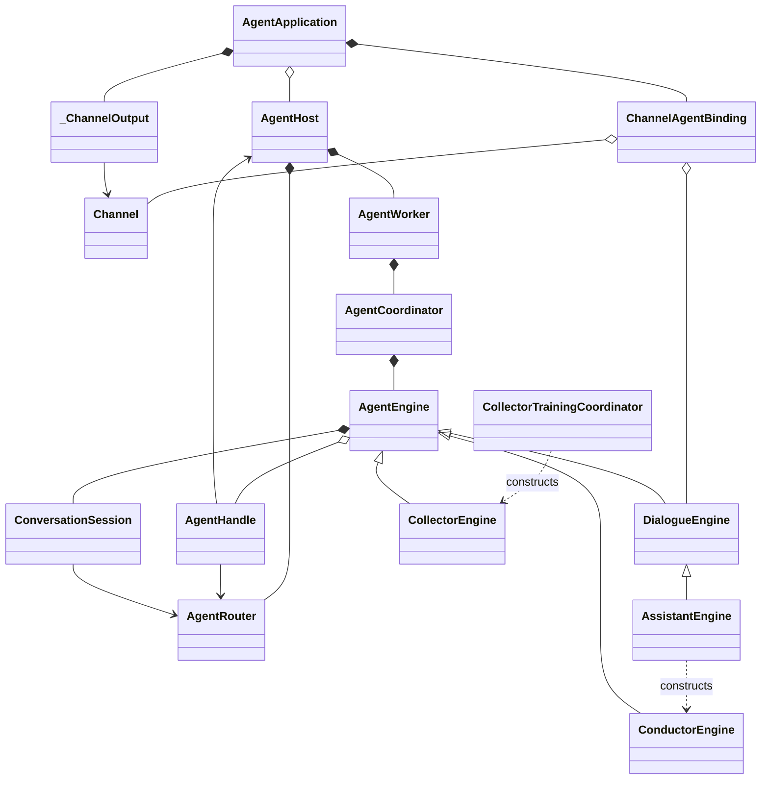

# 运行时线程与通信模型

归档：2026-10-31。保留重划分前的实现说明；新的待实现设计见 [三层架构](../../agent-system-design.md)。

更新：2026-10-29。本文描述固定通信终端、顶层对话 Agent 和常驻子 Agent 的实现。
[改造前现状](threading-model-current.md) 与 [旧提案](threading-model-proposal.md) 仅作历史记录。

## 身份与边界

应用启动前提供 `Sequence[ChannelAgentBinding]`，每个 ChannelAgentBinding 持有一个 Channel 和已构造的顶层 Agent。
`ChannelAgentBinding` 表达通信入口与 agent 的配置关联，不代表物理终端或单一对话。
`AgentApplication` 负责这些关联的启动、消息收发和关闭；`AgentHost` 负责内部 agent 工作线程和父子关系管理。
`AgentApplication` 冻结这份配置，禁止重复 channel_id，不在收到新对话时创建新 Channel 或新顶层 Agent。

| 身份 | 含义 | 所有权 |
| --- | --- | --- |
| channel_id | 一个通信终端 | AgentApplication；一个终端对应一个根 Agent |
| conversation_id | 终端内的一段对话 | Channel 从消息提取，根 Agent 显式选择回复目标 |
| agent_id | 一个长期存在的工作实体 | AgentHost；一个独立 Engine、Worker、收件箱 |
| task_id | 一次父到子的 call | AgentRouter；report 必须匹配实际收到的任务 |
| checkpoint thread_id | 一个 Engine 的模型历史 | Engine 自行生成，不等于以上任一地址 |

一个根 Agent 的多个 conversation 共用同一个模型上下文。ConversationSession 按 conversation_id 保留收到的消息列表，
按照路由接受顺序生成 MessageBlock。序号不是远端消息时间戳，不承诺还原网络到达前的时序。
回复通过 `reply(conversation_id, message)` 明确寻址，不能沿用“最后一个聊天”的全局变量。
子 Agent 不绑定 conversation_id，可接收不同对话派发的独立任务。任务与报告只有 task_id，不携带对话地址。
顶层 Agent 根据自己的调用历史关联 task_id 与来源 conversation_id，再显式回复；Router 不猜测当前对话。

## 线程与对象

大框表示线程，小框表示项目对象或工具。工具统一归入工具执行线程，不展开调度框架内部。
AgentHost、AgentRouter 是共享实例，图中在主线程框内表示其创建和所有权；它们的同步方法也会在调用者线程执行，
不是向主线程投递路由任务。没有独立 Gateway 线程。

```mermaid
flowchart TB
    subgraph MAIN["主线程：通信事件循环"]
        runtime[AgentApplication]
        channel[FeishuChannel]
        output[_ChannelOutput]
        host[AgentHost]
        router[AgentRouter]
        runtime --> host
        runtime --> channel
        runtime --> output
        host --> router
        channel -->|接收 conversation_id| router
        output -->|异步发送| channel
    end
    subgraph ROOT["顶层 Agent 工作线程"]
        rw[AgentWorker]
        rc[AgentCoordinator]
        re[AssistantEngine]
        rs[ConversationSession]
        rw --> rc --> re --> rs
    end
    subgraph CONDUCTOR["Conductor 工作线程"]
        cw[AgentWorker]
        cc[AgentCoordinator]
        ce[ConductorEngine]
        cs[ConversationSession]
        cw --> cc --> ce --> cs
    end
    subgraph COLLECTOR["Collector 工作线程"]
        kw[AgentWorker]
        kc[AgentCoordinator]
        ke[CollectorEngine]
        ks[ConversationSession]
        kw --> kc --> ke --> ks
    end
    subgraph TOOL["工具执行线程"]
        spawn[spawn_subagent]
        call[call]
        report[report]
        kill[kill]
        reply[reply]
        prepare[prepare_collector]
        collect[collect_continuously]
        sniff[sniff_run]
    end
    subgraph CODEX["Codex 传输线程"]
        model[OpenAICodexModel]
    end
    subgraph TRACE["ntrace-sender"]
        trace[NTraceClient]
    end
    host -->|启动| rw
    host -->|启动| cw
    host -->|启动| kw
    rs <-->|根收件箱| router
    cs <-->|子收件箱| router
    ks <-->|孙收件箱| router
    re --> spawn & call & reply & kill
    ce --> prepare & call & report & kill & collect
    ke --> report & sniff
    spawn --> host
    kill --> host
    prepare --> host
    call --> router
    report --> router
    reply --> host
    host -->|跨线程请求和发送回执| output
    re & ce & ke <-->|模型请求及结果| model
    re & ce & ke -->|观测事件| trace
    style MAIN stroke-width:3px,fill:#f4f8fc
    style ROOT stroke-width:3px,fill:#f4f8fc
    style CONDUCTOR stroke-width:3px,fill:#f4f8fc
    style COLLECTOR stroke-width:3px,fill:#f4f8fc
    style TOOL stroke-width:3px,fill:#f4f8fc
    style CODEX stroke-width:3px,fill:#f4f8fc
    style TRACE stroke-width:3px,fill:#f4f8fc
```

每个实际派生实例独占一个 AgentWorker 线程，图中每层仅画一个代表实例。模型、设备调用不会在主事件循环执行。
Feishu SDK 仍可能拥有自己的连接线程；适配器将其回调切回应用事件循环。本文不展开第三方内部线程，
也不把 `start_background()` 误称为 SDK 无线程实现。Codex 和 nTrace 的既有线程模型不变。

## 类关系



## 模块职责与伪码

### AgentApplication 与 Channel

Channel 的 `start/send_message/close` 为异步接口，均运行在应用事件循环。
SDK 回调只转换、去重和入箱，不运行 Agent。`_ChannelOutput` 持有有界异步发送队列，
工具线程等待真实发送回执；主循环不做同步 Future.result。发送有 30 秒上限，失败返回 false。

```python
start():
    for binding in channel_bindings:
        output = ChannelOutput(binding.channel)
        binding.channel.bind_message_listener(router.deliver_user)
        host.bind_sender(binding.agent.handle.agent_id, output)
        host.start(binding.agent)
        start_async_sender(output)
        await binding.channel.start()

receive(remote_message):
    incoming = IncomingMessage(channel_id, conversation_id, message_id, text, sender_id)
    return router.deliver_user(incoming)
```

### AgentHost 与 AgentRouter

Host 负责身份预留、线程和生命周期；Router 只负责身份、父子权限、队列及任务关联，不调用 Engine、Channel 或模型。
同一个 Host 内所有 Agent 共用 Router，测试或独立 Runtime 可以有自己的 Host，不使用进程全局“当前 Agent”。
根 Agent 才持有发送能力。具体子类型由业务 Engine 的 spawn_subagent 方法或业务协调器显式构造。
Host 没有工厂表，不接收构造回调；身份预留上下文在构造失败或未启动 Worker 时清理预留。

```python
spawn_subagent(agent_type):
    require agent_type == "conductor"
    with host.child(parent_id) as handle:
        engine = ConductorEngine(model=model, handle=handle)
        host.start(engine)
    return handle.agent_id

call(sender, child, task):
    require child.parent == sender
    task_id = new_id()
    enqueue(child, Task(task_id, sender, task))
    return task_id

report(sender, task_id, result):
    require task.delivered and task.callee == sender and not task.completed
    enqueue(task.caller, Report(task_id, result))
    if result.status in (completed, failed):
        task.completed = True
```

`call` 不等待模型运行，`report` 返回入箱结果。队列满或关闭不默默丢弃正常消息，调用方得到拒绝。
`progress/blocked` 不关闭任务；`completed/failed` 关闭任务。同一次澄清 call 有自己的 task_id，
Agent 需要分别汇报尚未结束的任务，不能伪造其他 Agent 的 task_id。只有直接父子间允许通信，无兄弟或跨祖辈通道。
父任务可以独立完成，不要求所有子 Agent 都结束。子任务结果仍路由到存活的父 Agent；
真正依赖子结果的任务由 Agent 显式报告 blocked，不把身份树误当作任务依赖图。

### ConversationSession 与通信 Middleware

```python
worker_loop():
    while not stopped:
        coordinator.run()  # 空闲时阻塞于同一个收件箱

session.read_input(wait):
    if pending_block:
        return pending_block
    arrivals = router.read(agent_id, wait)
    append_to_per_conversation_lists(arrivals)
    pending_block = MessageBlock(arrivals_in_sequence_order)
    return pending_block

before_model(state):
    acknowledge_block_if_present_in_state(state.messages)
    if inbox_has_arrivals:
        return {"messages": [HumanMessage(block.text, id=block.id)]}
```

空闲读取与运行中读取共享收件箱和 Session，没有独立监听线程抢消费。已封装但未写入历史的 block 保持不变，
后续消息形成下一个 block；消息 ID 用于去重和 checkpoint 确认，不通过读取即删除 pending 的方式冒充可靠投递。
输入在工具组执行完成后的模型边界生效；既有 tool-call/result 配对及 conductor 的 user-block 压缩规则不变。
子 Agent 收不到原始 Channel 广播：用户补充先到根 Agent，再由根 Agent 显式 `call` 逐级转交。

### Engine、Coordinator 与任务结束

每个 Engine 独立拥有 graph、saver、checkpoint ID 和 ConversationSession。模型重试不跨 Agent 共用状态。
只有自身已投递、未完成任务全部显式报告 blocked 时，运行层允许本轮结束后回到监听；
仍有可运行任务则继续按自身结果契约验收。子任务存在与否不参与该判断。
无等待理由且仍有未报告任务时，运行层要求 report，而不是把自然语言终止当作完成。
普通最终文本不自动发送到 Channel，也不自动变成子 Agent 的任务结果。
自身任务全部报告完成时，本轮自然结束后回到监听，不提前跳过模型调用。
后来到达的子任务报告即使发生在父任务完成后，也会注入历史并进入模型处理。
新任务不会静默清除其他任务的阻塞标记，任务状态通过对应 task_id 的 report 更新。

`DelegationMiddleware` 已删除，不按父子关系拦截普通工具，也不在通用运行层强制 parallel_tool_calls=false。
队列和共享注册表的安全由对象内部锁保障；同一设备的单步操作由执行通道串行化，持续采集持有操作锁。
Collector 的本地证据步骤保留顺序约束。跨多次工具调用的训练流程不是设备层原子事务，
需要协调同一页面的变更，但不限制父 Agent 的独立工作。通信路由不管理设备所有权。

### Collector 接入

`prepare_collector` 仅校验页面访问并构造专用 toolbox、启动 worker、发送训练任务，立即返回 subagent_id/task_id。
它不再同步调用 collector.run_turn，也不在工具返回时关闭 collector。

Collector 的 `report(completed)` 在业务 `_prepare_report` 中验证脚本、历史和还原状态，保存历史并更新共享训练记录；
只有确定性结果合格才能发出完成报告。MerchantWorkflow 在下一次模型边界读取训练记录并切到 ready；
CollectionPersistence 在同一边界独立负责初始化归档，workflow 不执行文件持久化。
业务训练对象仍位于 collector；Router 不理解 trained、页面、schema 或 merchant profile。
父 conductor 用 `call` 跟进，用 `kill` 清理不再需要的页面 worker。完成训练本身不销毁 worker。

## 锁、退出与边界

- Router 的 RLock 保护注册表、单调序号、任务状态和非阻塞入箱；阻塞 queue.get 在锁外执行。
- 每个收件箱的消费锁拒绝重叠消费，避免 idle loop 与 middleware 由两个执行者同时取消息。
- Host 的 RLock 保护身份、发送通道和 worker 注册；等待 worker 退出时释放锁。
- Channel 出站队列只由主循环操作，工具线程用 call_soon_threadsafe 提交请求并等待发送结果。
- `kill` 只允许直接父调用；递归关闭后代队列，在安全模型边界停止，等待 worker 释放 Engine，然后清理注册。
- 子任务被 kill 时向父提交 failed 通知；正常报告完成后仍监听。关闭整个系统是父子 kill 以外的管理终止路径。
- 应用关闭时先停止所有收件箱并等待已开始执行，再排空出站发送，最后关闭 Channel、模型和事件循环。

当前队列、任务表和 conversation 列表仅存在进程内。checkpoint 保持 invoke 退出保存，不承诺进程崩溃后恢复 Agent 树。
一个模型实例可由不同 worker 共用，Codex 传输仍按既有锁串行请求。多个顶层任务如果使用同一物理设备，
仍应由业务入口安排串行任务；通信隔离不等价于设备会话隔离。本次未引入跨终端设备租约。

## 验证范围

自动测试覆盖父子权限、task 关联、FIFO、多 conversation、常驻 worker 重复任务、模型线程隔离、
运行中注入、真实发送回执、关闭唤醒、固定终端、启动失败清理，以及 collector 训练验收与归档回归。
真实飞书连接、真实模型连续委派和真实设备操作须另行联调；离线测试不能替代这些验收。
