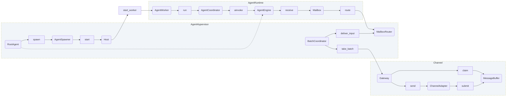
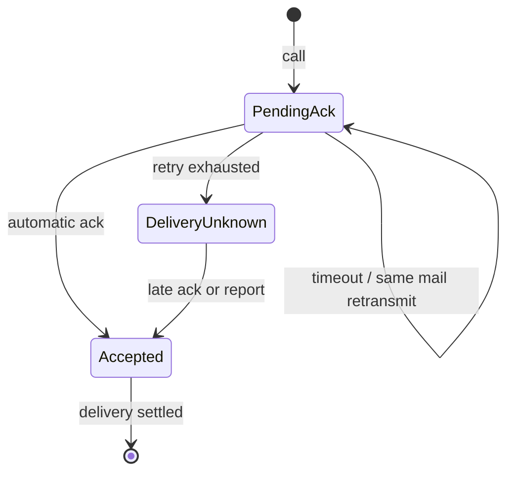
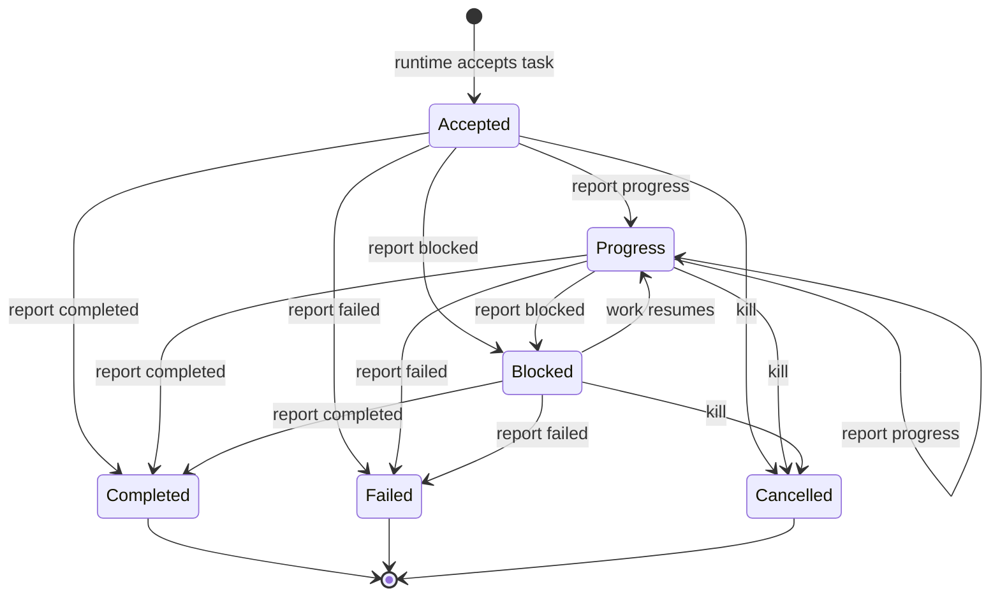
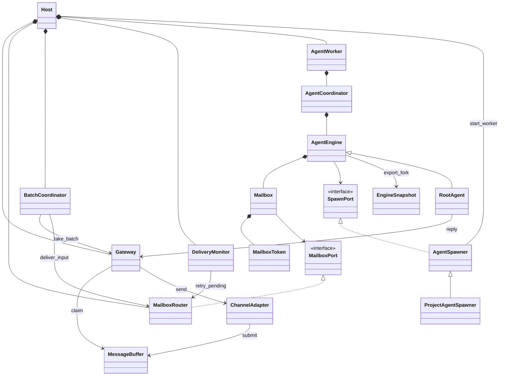

# Channel、Agent Hypervisor 与 Agent Runtime（实施前方案）

日期：2026-10-31。状态：**目标设计，尚未实施代码迁移**。
本文替代旧通信与运行时分层方案；源码仍使用 AgentApplication、AgentHost、AgentRouter 等旧边界。
本轮只新增设计和整理文档，不代表下述接口已经可调用。

配套文档：[线程与同步接口](threading-model.md)。历史方案见 [归档目录](deprecated/README.md)。
后续修改架构时，必须同步更新本文、线程图和对应模块 README。

## 1. 划分目的

运行一个 Agent 与经营一组 Agent 是不同职责。Runtime 不应知道 Channel 的数量、外部会话地址、
全局 Agent 注册表或业务子 Agent 类型。Channel 不应知道谁在执行任务、任务是否完成或如何恢复 graph。
Hypervisor 负责把这些独立能力组合成系统，但不接管每个 Engine 的模型历史和业务状态。

| 层 | 目录 | 拥有的状态 | 不负责 |
| --- | --- | --- | --- |
| Channel | `src/channel/` | 外部连接、入站去重、按地址分组的待取批次、发送回执 | Agent 身份、任务状态、graph |
| Agent Hypervisor | `src/agent_hypervisor/` | Worker 生命周期、Root、内部路由表、任务投递账本、批次交接 | 单个 Agent 的重试/续跑、页面状态 |
| Agent Runtime | `src/agent_runtime/` | 单 Agent 的 Worker、Coordinator、Engine、Mailbox 门面、输入暂存和 checkpoint | Channel SDK、全局路由表、业务 Engine 选择 |

**拓扑决定：本设计采用一个 Host、一个 Root Agent，处理启动前配置好的全部 Channel。**
这替代旧版“一 Channel 一 Root”；不同 `(channel_id, session_id)` 不创建不同 Root，也不创建不同
Root checkpoint。Root 按批次处理多会话，回复必须明确地址，不能使用“最近一个会话”。
这里的 session 是外部对话；现有 `conversation_id` 在 Adapter 边界映射为 `session_id`，
与 Engine 的 `checkpoint_id` 没有对应关系。

父子 Agent 仍在独立线程中运行。父子身份仅约束通信权限和生命周期管理，不推导业务依赖，
不因为存在未完成子任务而限制父工具、禁止 report 或强制父退出本轮。
设备、文件等共享资源由其所属服务保护；单个动作锁不等于跨多步训练流程的资源独占。

## 2. 结构与依赖

```text
src/channel/
  messages.py                 InBoundMessage、OutBoundMessage、ChannelBatch、SessionKey
  adapter.py                  ChannelAdapter 与第三方传输契约
  buffer.py                   MessageBuffer：接收、去重和分组
  gateway.py                  Gateway：有序取批、确认交接、发送
  feishu/                     飞书格式转换与连接
  console.py                  已有控制台适配

src/agent_hypervisor/
  host.py                     Host：启动、派生与回收 Worker
  batch.py                    BatchCoordinator：ChannelBatch -> MessageBlock
  root.py                     RootAgent：通信专用 Engine
  routing.py                  MailboxRouter：注册表、权限、队列和投递确认
  delivery.py                 确认超时与同 mail 重投，不重试业务执行
  spawning.py                 AgentSpawner：通用 Fork 与专用 Engine 装配契约

src/agent_runtime/
  engine.py                   单个 graph 与模型上下文
  coordinator.py              同一 graph 的持续执行和异常恢复
  worker.py                   单 Agent 线程及其事件循环
  mailbox.py                  单 Agent Mailbox 门面
  contracts.py                Mail、MailboxToken、TaskResult、通信/派生 Protocol
  fork.py                     EngineSnapshot、ForkSpec
  conversation/               MessageBlock、输入待提交账本
  middleware/                 Trace、重试、ToolError、Mailbox 输入
  strategy/                   通用策略装配

src/application/
  agents.py                   项目专用 Agent 装配：conductor / collector
  model.py                    模型配置与模型资源装配
```

文件划分表达职责，不要求一个数据类型一个文件。`__init__.py` 只声明最小公共入口。
不为了兼容保留旧 Host/Router 实现的转发层。业务目录 `conductor/`、`collector/` 保持独立。

允许的静态依赖：

- Channel 只依赖自身和通用基础类型，不导入 Hypervisor、Runtime。
- Runtime 只定义自己需要的强类型端口，不导入 Channel、Hypervisor 或 application。
- Hypervisor 导入 Channel 的批次接口、Runtime 的 Engine/Worker/端口，提供端口实现。
- application 是业务装配入口，依赖以上三层和具体 Engine；Hypervisor 不导入 conductor/collector。
- Runtime 的 `MailboxPort`、`SpawnPort` 是必要的依赖倒置边界，不是可选回调集合。
  Engine 不再持有带全局访问能力的 `AgentHandle.host`。

### 模块调用图



RootAgent 是 AgentEngine 的通信专用子类，位于 Hypervisor；其执行由 Runtime 承载，
并不是在 Host 主线程里直接调用模型。图中虚线仅表示这个类型关联，线程归属见配套文档。

## 3. Channel：外部消息与批次

### 数据边界

```python
@dataclass(frozen=True)
class SessionKey:
    channel_id: str
    session_id: str

@dataclass(frozen=True)
class InBoundMessage:
    address: SessionKey
    message_id: str
    sender_id: str
    text: str

@dataclass(frozen=True)
class ChannelBatch:
    batch_id: str
    address: SessionKey
    first_sequence: int
    messages: tuple[InBoundMessage, ...]

@dataclass(frozen=True)
class OutBoundMessage:
    address: SessionKey
    message_id: str
    text: str
```

时间顺序以 MessageBuffer 在主循环**接受消息的本地单调到达时间**为准，并用递增 sequence
打破同一时刻的平局。第三方消息时间仅可作为审计信息，不参与调度，避免时钟差或 SDK 重放改变排序。
以上为最小文本契约；当前已有附件能力按原结构迁移，不在本轮设计中增加新的媒体协议。

### Adapter 与 MessageBuffer

Adapter 转换 SDK 输入后直接 `MessageBuffer.submit(message)`，不经 AgentHost 或 AgentRouter。
调用必须位于主循环；来自 SDK 其他线程的回调通过线程安全调度回到主循环后提交。
SDK 去重与内部去重统一使用 `(channel_id, session_id, message_id)`；只有成功入缓冲才确认接收。
缓冲满或停止接收返回失败，由 Adapter 遵循传输层重投/告警机制，不能静默标记成功。

MessageBuffer 保存每个 SessionKey 的待取消息及首条到达顺序；Gateway 使用这一份数据，
不另建一份消息列表。待取组保存在按首次到达排序的有序结构中，新消息加入已有组不会改变组位置。
取批时冻结该组**当时已有的消息**。同地址后续输入形成新组，按新的首条时间排队。
不等用户停止输入，不增加任意 debounce 参数。

例如到达次序 `A1, B1, A2`，首次取批得到 `[A1, A2]`，随后为 `[B1]`。
这是按组首条排序，不宣称全消息全局 FIFO；组内保留原始时序。
持续活跃的 A 不会通过补充 A3 改变已冻结批次或抢占 B。

### Gateway

Gateway 只负责取批与出站路由，不保存 Agent 身份。

| 接口 | 语义 |
| --- | --- |
| `await take_batch() -> ChannelBatch` | 取最早组；无数据时等待新消息，不忙轮询；关闭后抛出明确关闭结果 |
| `commit_batch(batch_id)` | Root 缓冲已接收，完成交接；主循环同步短操作 |
| `release_batch(batch_id)` | 未交接成功，恢复原优先级；同批次 ID 不变 |
| `await send(message) -> bool` | 校验 Channel/session 地址，返回第三方实际发送状态，有限超时 |

`take_batch` 领取但不立即删除消息。单个 BatchCoordinator 最多持有一个未交接批次。
取消、Root 邮箱满或停止时释放领取；后续重取沿用 batch_id，Root 接收侧幂等。
Gateway 内只登记已接受输入的地址；Root 不能凭空指定未知会话发送。

## 4. Hypervisor：系统编排而非 Agent 业务

### Host

Host 在启动前取得固定 Channel 配置和项目装配对象，创建 MessageBuffer、Gateway、MailboxRouter、
BatchCoordinator 及唯一 Root。启动顺序是：建立主循环服务 -> 注册 Root Mailbox -> 启动 Root Worker
-> 启动批次与重投协程 -> 开始 Adapter 接收。失败时按已建立资源逆序清理。

Host 只管理 Worker/Engine 资源所有权，不直接读取或改写 graph.state。注册令牌由 Router 生成，
Host 持有生命周期管理权限，Agent 无注册表访问权限。
Host 的 start/spawn/kill/close 在主循环串行修改拓扑；不能在等待 Worker 退出时占有 Router 的互斥区。

### BatchCoordinator

这是**主线程中的协程，不是新线程**。循环主动 `await gateway.take_batch()`；有数据则构造一个
带 address、batch_id 和原消息序列的 MessageBlock，交给 Root Mailbox，成功后 commit。
“填充缓冲并提醒”是一次原子交接：先保存 MessageBlock，再设置可读事件。
不发送独立的无内容提醒 mail，避免提醒先于内容或一批触发两次模型输入。

Root 已在执行时，块保持在同一个输入队列，下一安全模型边界读取；Root 空闲时可读事件唤醒 Worker。
用户新增输入不自动批准验证码等人工操作，也不由 BatchCoordinator 猜测应转发给哪个子 Agent。

### RootAgent

Root 只拥有 `reply`、`spawn_subagent`、`call`、`report`、`kill` 通信/派生工具，
没有页面、脚本、文件、设备等业务工具；Root 无父任务时调用 report 返回明确协议错误。

- `reply(channel_id, session_id, message)` 显式寻址，发送能力仅注入 Root。
- 一个共享模型上下文接收多 session MessageBlock；分组信息完整保留。
- Root 发起任务时，隐藏工具上下文显式关联源 batch_id；存在多个输入来源时工具要求指定来源，不能猜“最近输入”。
  关联保存为 Root 私有的 task_id -> 来源批次/地址记录，不存入子 Agent 身份。
- 单任务可显式关联多个源批次；报告需按这些已知来源选择回复，禁止跨会话泄露内容。
- 报告按 task_id 关联原始命令，多次 progress/blocked 均可产生用户沟通，终态前任务保持存活。
- 子任务运行不阻止 Root 处理新会话。Root 完成本轮后回到监听，不通过自然语言终止整个 Host。

本设计增加确定性的来源记录，不再只依靠 LLM 从旧 call 历史中回忆报告对应的用户地址。
来源关联只属于 Root 的通信业务，不扩展为所有 Agent 的 session 绑定。

## 5. Mailbox 与 Router

### 所有权与令牌

每个 Agent 持有唯一 `Mailbox` 对象，其中含不可转发的 `MailboxToken` 和 `MailboxPort`。
它是单 Agent 的通信门面，不是全局邮箱表。`MailboxRouter` 唯一维护 token -> 邮箱状态的绑定、
Agent ID 索引、父子边和任务投递账本。实际队列由 Router 主循环管理，任何 Agent 均不得直接访问。

公开 agent_id 只用于寻址；调用者身份只从隐藏 MailboxToken 解析。
工具输入不能指定 sender_id/token，令牌不出现在 prompt、ToolMessage、trace 或 ForkSnapshot 中。
注册/撤销属于 Host，通信属于 Mailbox。令牌撤销后所有在途调用都得到明确关闭结果。
令牌是进程内权限边界，不宣称能隔离任意恶意 Python 插件。

Runtime 定义 `MailboxPort` Protocol；Hypervisor 的 Router 实现此端口。
Mailbox 调用端口，端口完成线程切换、认证和路由；禁止 Runtime 直接导入具体 Router。
接收、ACK、call、report 都经同一端口，不保留绕过鉴权的公共队列接口。

### 内部信封与状态

```python
@dataclass(frozen=True)
class Mail:
    mail_id: str
    task_id: str
    sender_id: str
    recipient_id: str
    sequence: int
    kind: Literal["command", "ack", "report"]
    status: Literal["submitted", "accepted", "progress", "blocked", "completed", "failed", "cancelled"]
    payload: JsonObject
```

`mail_id` 是一次命令/报告的幂等标识，`task_id` 是整个任务生命周期；一次 task 可以有多条 report。
重投保留原 mail_id/task_id/payload，仅投递账本增加 attempt，不能伪造为新任务。
Root 外部 MessageBlock 使用独立输入接口，只允许 BatchCoordinator 的受限投递端口访问，
不伪装成某个 Agent 的 call，也不产生无意义的父任务。

| 操作 | 权限与效果 |
| --- | --- |
| `call(subagent_id, task)` | 只能直接父 -> 直接子；入箱即返回 task_id/submitted，不等待子 Agent 完成 |
| `report(task_id, result)` | 只能该任务的实际执行者 -> 原父；可多次 progress/blocked，最终 completed/failed |
| 内部 `ack` | 接收端 Runtime 自动生成，确认已接受到本地待注入账本，不要求 LLM 调工具 |
| `kill(subagent_id)` | 直接父通过 SpawnPort 请求 Host 停止子树；系统关闭由 Host 执行 |

ACK 由收件接口实际接收时触发，不在 `put` 时伪装成接收确认，也不等一次模型生成结束才确认。
ACK 只更新父端投递账本，通常不作为 HumanMessage 进入模型。任务报告才是可读进展。

### 确认、超时与幂等

1. 父 Mailbox 记录待确认命令，Router 先保存投递记录再唤醒子邮箱。
2. 子端领取后保存到待注入账本并自动 ACK；相同 mail 重投只重发 ACK，不建立第二个执行任务。
3. Hypervisor 的 DeliveryMonitor 协程到期检查未 ACK 命令，以父 Mailbox 的原始投递记录重投。
   它是“父自动重新投递”的基础设施实现，不要求父模型重复调用 call。
4. 默认 ACK 超时 30 秒，最多重投 3 次，均为模块内部策略常量，不增加公共构造参数。
   这只限制接收重试，不限制任务执行时间；已 ACK 的长任务不重投。
5. 重试耗尽，投递状态置为 `delivery_unknown`，向父投递带 task_id 的运行时通知。
   不宣称业务 failed/未执行，不自动创建新任务。延迟 ACK/报告可消除此不确定性。
6. 重复终态报告幂等返回原回执；不同内容的矛盾终态拒绝。终态后的迟到 progress 不回退任务状态。

传输状态 `pending_ack/accepted/delivery_unknown` 与业务状态 `progress/blocked/completed/failed/cancelled`
分别保存。网络式确认失败不能代替业务结论；blocked 不是终态。重复报告按 mail_id 幂等，
同 task 的不同 progress 不误去重。队列满不得先将任务标记为已投递或已完成。

ACK 和模型历史提交也分别处理：ACK 后待注入 mail 仍保留，直至带稳定 block_id 的输入出现在当前
graph state/checkpoint 才确认消费。模型请求失败不丢 mail，也不重复附加 HumanMessage。
invoke 退出保存策略保持不变，执行中以当前 state 观察已注入块；最终完成与新输入到达在收件端原子交接。
仅保证进程内可靠投递，不宣称进程强杀后恢复或任意设备动作 exactly-once。

### 状态图





任务终态不终止 Worker。父完成自身任务也不停止仍在工作的子 Agent，迟到子报告仍进入父上下文。
账本在任务存活期间不丢弃幂等信息；终态确认并过重投窗口后释放 payload，保留紧凑终态记录直至 Agent 撤销。

## 6. Runtime：接收与执行

Worker 启动自己的 asyncio loop，空闲时 `await mailbox.receive()`；无数据时挂起，不按固定周期轮询。
同一个 Worker 只运行一个 Engine graph。运行时输入 middleware 在每个模型边界检查同一 Mailbox，
after_model 仅暂存新消息，完整工具调用/返回对结束后再写入下一次模型输入。
不在 AI tool call 与 ToolMessage 之间插入用户消息，不抢占正在执行的模型请求或设备操作。

idle receiver 和运行时 reader 不能并发消费：Worker/Coordinator 明确切换所有权，
Engine 运行期间仅 middleware/同一输入服务取消息。`receive` 与 `receive_nowait` 共用投递账本，
不是创建两个队列分别广播。边界查询也负责接收 ACK/报告，但 ACK 不污染模型上下文。

AgentCoordinator 保留连续性和异常恢复职责；它不决定给哪个外部会话回复。
单 Agent 自己的任务全部显式 blocked 且没有新输入时可回到监听；部分任务 blocked 不冻结其他任务。
同一 Engine 不并行 invoke；不同 Worker 的 Engine 独立推进。

## 7. 两种派生方式

### 通用 Fork

`spawn_subagent(kind="general")` 产生与父相同 Engine 结构的独立 Worker。
Engine 显式提供 `export_fork()` / 同类型的 `fork(snapshot, services)` 契约，不用反射、deepcopy 活对象或工厂回调。
ForkSpec 保留模型配置、基础 prompt、工具能力声明和策略装配；EngineSnapshot 保存可复制的语义状态和
截至安全边界的已提交消息。SpawnPort 将请求交给 Host 后，新 Engine 使用全新图和 checkpoint ID。

- 在完整模型/工具边界冻结 snapshot，派生动作本身不成为子历史中悬空的 tool call。
  若 spawn 与其他工具并发，使用该 AIMessage 之前的最近完整边界，不等待正在执行的同批 sibling tool。
- 同名工具重新绑定到子 Engine、子 Mailbox；不复制父 StructuredTool 的 bound methods。
- 不复制线程、锁、事件循环、Router、令牌、待确认任务、resume/interrupt 标识和 checkpointer 对象。
- 父历史中的任务 ID 只是历史，不授予子 report 父任务的权限；子执行状态从新的 call 开始。
- 设备、文件等外部环境可共享，但不是通过复制引用意外共享可变 graph/state。
  有资源语义的 Engine 必须显式声明其 fork 数据与资源服务，无法安全 fork 时明确拒绝而非降级浅复制。
- Root 的 general 子保留对话 Engine 的结构，但不继承 Root 专属 Channel 发送权限；reply 工具保持存在，
  运行时因缺少根权限返回明确错误。工具结构相同不等于权限相同。

### 专用 Engine

`spawn_subagent(kind="specialized", agent_type=...)` 或已有业务委派工具直接构造预封装 Engine。
application 中的具体 `ProjectAgentSpawner` 用显式分支创建 ConductorEngine、CollectorEngine，
再交给 Host 注册/启动。Hypervisor 只认识派生端口，不 import 业务类，不保存回调工厂表。

Collector 的页面访问、指南、训练环境来自其父 Conductor 的结构化 assignment；不由通用 Host
检查页面是否 ready。现有 `prepare_collector` 工具可继续负责验证 assignment 并使用专用派生路径。
Root 主要派生 conductor，conductor 在需要时派生 collector；子 Agent 不固定绑定任何 session。

“相同 Engine 结构”要求保留能力装配，不要求克隆资源所有权。
模型连接若继续共享，同一模型内部请求锁仍可能串行化推理；独立 Worker 不等于模型传输一定并行。

## 8. 类关系



RootAgent 对 Gateway 的实际调用经过其专属发送端口跨线程调度；Runtime 基类不认识 Gateway 类型。
图中组合关系表达生命周期所有权，箭头表达接口依赖，不暗示在同一线程执行。

## 9. 迁移路径

| 当前实现 | 目标归属与变更 |
| --- | --- |
| `agent_runtime/application.py` | Channel 收发归 Gateway，启动/回收归 Hypervisor Host；删除运行层应用编排 |
| `agent_runtime/agents.py` | Host 生命周期归 Hypervisor；AgentHandle.host 改为受限 Mailbox/SpawnPort |
| `agent_runtime/messaging/messages.py` | 外部信封归 Channel；内部 Mail/任务协议归 Runtime contracts |
| `agent_runtime/messaging/router.py` | 全局注册与权限归 Hypervisor MailboxRouter；取消 channel/session 身份绑定 |
| `agent_runtime/dialogue.py`、`application/assistant.py` | 通信 Engine 归 Hypervisor RootAgent，专用装配归 application |
| `agent_runtime/conversation/session.py` | 保留单 Agent 输入暂存/提交；外部会话路由归 Root，不保存全局接收索引 |
| `agent_runtime/worker.py` | 改为线程内 asyncio loop，idle 异步等待；保留一个 Worker 一个 Engine |
| `agent_runtime/coordinator.py` | 增加异步调用路径，保持续跑语义；不持有 Channel/Router 全局对象 |
| `agent_runtime/engine.py` | mailbox-aware graph 边界；去除 Host 访问；增加明确 fork 契约 |
| `channel/base.py`、Adapters | 不再 import runtime 的外部消息类型；直接向 MessageBuffer 提交 |
| `run_agent.py`、raw/trainer 入口 | 显式构造项目装配对象与 Host；调试入口不额外发明 Channel 类型 |

实施顺序：先确立 contracts 和导入边界 -> Channel 分组和交接 -> Router/令牌/ACK 幂等 ->
Runtime 异步收件与输入提交 -> Host/Root/两种派生 -> 业务委派与入口迁移 -> 删除旧实现。
每一步迁移调用方与测试，不同时保留两套有效消息队列。

## 10. 验收与风险

| 领域 | 必须验证 |
| --- | --- |
| 导入边界 | Channel 不导入 Runtime/Hypervisor；Runtime 不导入 Hypervisor/application/Channel；Hypervisor 不导入业务 Engine |
| 分组 | A1/B1/A2 分批顺序、领取后同 session 新批次、到达时间相同、SDK 重复消息、持续输入无饥饿 |
| 交接 | enqueue 成功后 commit 失败重取不重复；取消释放领取；Root 满/关闭不丢消息 |
| 鉴权 | 伪造 agent_id 无效、token 不进模型/日志、只能直接父子通信、撤销后不能投递 |
| ACK | ACK 丢失重投只执行一次、ACK 到期竞态、已 ACK 长任务不重投、重试耗尽不虚报业务失败 |
| 任务 | 多次 progress、blocked 后继续、终态幂等、终态后迟到报告、kill 与 report 竞争 |
| 并发 | 父独立工作/报告、多个子不互锁、idle/active 单消费、工具期间消息下一边界注入 |
| Fork | 类型/能力一致、上下文深隔离、工具绑定新对象、无 token/任务权限继承、无悬空 tool call |
| 恢复 | 模型失败/递归退出不丢已 ACK 输入，新增 HumanMessage 稳定 ID，invoke 退出保存保持 |
| 资源 | 关闭唤醒等待、无死等 Future、模型只由所有者关闭、有限队列背压、终态清理 |
| 业务回归 | collector 专用 assignment、设备互斥、采集归档、验证码人工恢复、真实 Channel 收发 |

仍需在实施时验证 SDK 回调/关闭线程和具体模型异步路径。本设计不保证进程崩溃后的邮箱恢复；
ACK 幂等保证的是同一运行进程内任务接收不重复，不应扩展为外部副作用的全局 exactly-once。
资源被多个 Agent 共享时，真正跨步骤的独占必须由业务资源协议定义，不能重新引入父子全局等待门禁。
