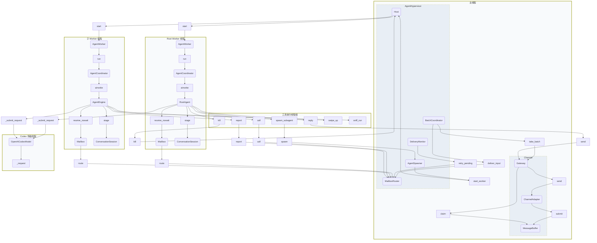
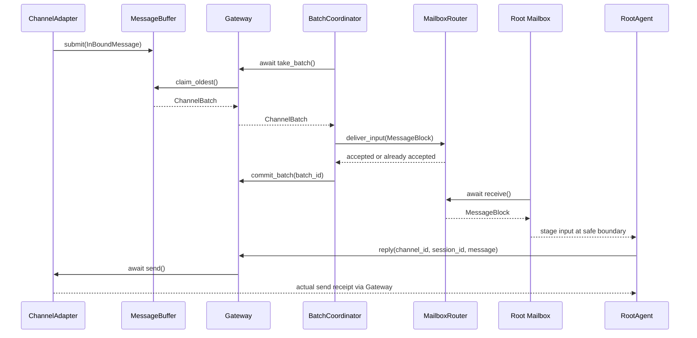
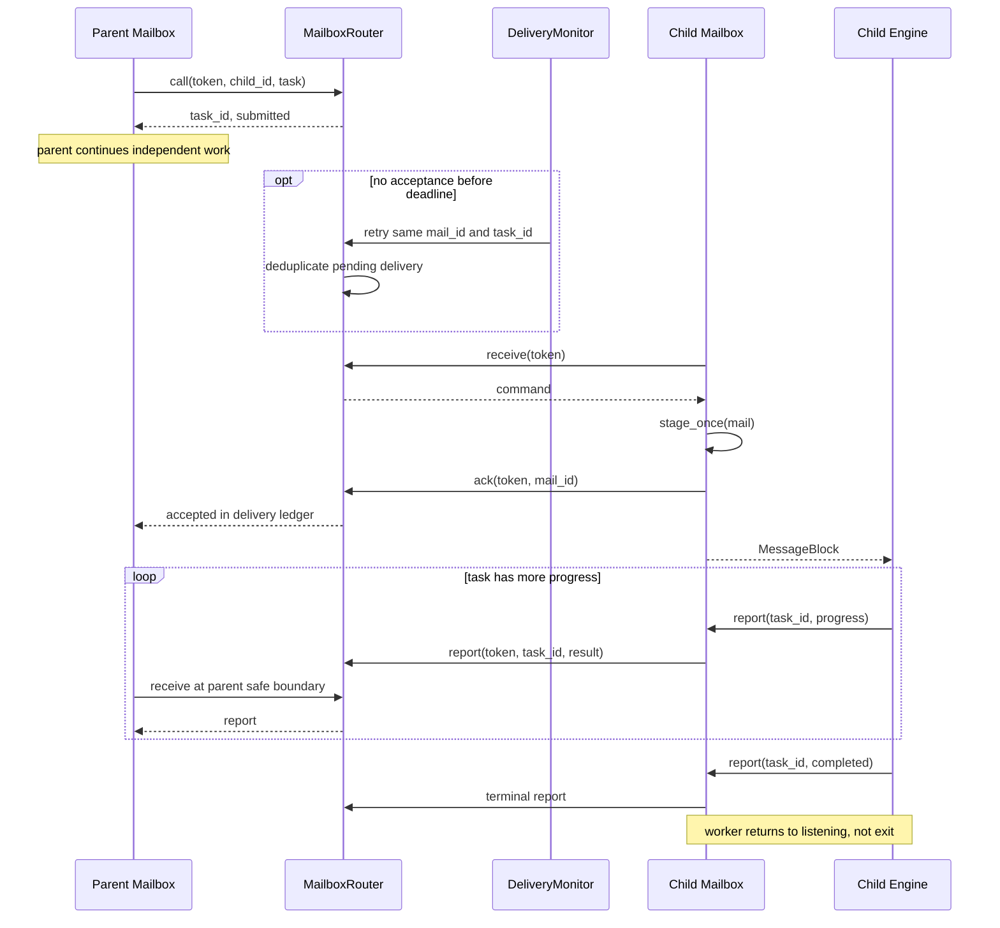

# 三层架构的线程与调用边界（实施前方案）

日期：2026-10-31。状态：**待实现设计，不是当前源码线程清单**。
职责、类型和任务语义见 [三层架构](agent-system-design.md)。
重构前的实现保存在 [归档快照](deprecated/runtime-before-hypervisor/threading-model.md)。
本文不展开 LangGraph 或第三方 Channel SDK 内部线程；同步工具执行线程按一组表示。

## 1. 线程归属

| 执行位置 | 本项目对象 | 工作与等待 |
| --- | --- | --- |
| 主线程的 asyncio loop | Host、ChannelAdapter、MessageBuffer、Gateway、BatchCoordinator、MailboxRouter、DeliveryMonitor、AgentSpawner | Channel 收发、分组交接、拓扑和任务账本；空闲 await，不调用模型 |
| Root Worker 线程的 asyncio loop | RootAgent、AgentCoordinator、AgentWorker、Mailbox、ConversationSession | 多 session 通信决策、派生/命令/回复；空闲 await 收件 |
| 每个子 Worker 线程的 asyncio loop | 对应 AgentEngine、AgentCoordinator、AgentWorker、Mailbox、ConversationSession | 独立任务上下文、连续执行、进展报告；完成任务后继续监听 |
| 工具执行线程组 | 同步工具调用 | 有限业务/设备操作与同步端口等待；不修改别人的 graph |
| Codex 传输线程 | 现有 Codex 模型传输循环 | WebSocket 请求；沿用当前实现，不因本次通信重构移动 |

Gateway、BatchCoordinator、Router、DeliveryMonitor 都**没有自己的线程**，使用主循环协程。
Worker 对象由 Host 创建并管理，但图中放在其执行线程里；其 start/wait 是外部生命周期操作。
Mailbox 是 Agent 本地门面，实际邮箱队列/注册表只有 Router 一份，属于主循环。
共享对象的跨线程箭头表示通过线程安全调度请求其 owner loop，不表示直接访问该对象内部字段。

### 线程图



“子 Worker”方框代表每个子 Agent 都有的一份线程和本地对象，不是把所有子 Agent 放在一个线程。
图中未展开第三方工具调度器；同步工具有工具执行线程，异步通信工具也可直接在 Worker loop await。
工具线程中的节点仅表示工具名，其闭包引用所属 Agent 的受限端口，不因此复制 Router/Gateway。
OpenAICodexModel 的调用门面可由多个 Agent 共享，图示对象代表其传输执行部分，不新增模型复制。

## 2. 同步与异步接口规则

所有跨 owner loop 的访问通过有类型的方法，禁止直接操作另一线程的 asyncio.Queue/Event。
不传递随意 callback 或动态方法名；通用 Protocol 只覆盖实际运行时调用需要。

| 对象 | 同步入口 | 异步入口 | 执行位置与限制 |
| --- | --- | --- | --- |
| MessageBuffer | `submit(message)` | 无 | 只在主循环，短操作；SDK 外线程先调度回主循环 |
| Gateway | `commit_batch`、`release_batch` | `take_batch`、`send` | 只在主循环；IO 必须有超时 |
| Mailbox | `call`、`report`、`receive_nowait` | `acall`、`areport`、`receive`、`areceive_nowait` | 端口封装主循环调度；同步方法不能在主循环使用 |
| MailboxPort | 同上对等操作 | 同上对等操作 | 同一 Router 实现、同一算法，不维护双份账本 |
| AgentSpawner / SpawnPort | `spawn`、`kill` | `aspawn`、`akill` | 同步工具可等待主循环 Future；主循环直接 await 实现 |
| Root 发送端口 | `reply` | `areply` | 只供 Root；跨线程 Gateway.send，返回实际发送状态 |
| AgentWorker | `start` | `wait` | start 启动线程；wait 不阻塞主循环；不允许自己 join 自己 |
| AgentCoordinator / Engine | 保留离线同步运行入口 | Worker 使用异步运行入口 | 同一 Engine 只能运行一条路径，不能同步/异步并行 invoke |

`receive_nowait` 表示**不等待新 mail 到达**，同步跨线程调用仍需等待一次短路由请求完成。
运行中的异步 middleware 使用 `areceive_nowait`，不能在 Worker loop 执行 `.result()` 阻塞整个循环。
同步工具的 `.result()` 仅等待主循环上的短接收/发送操作或有界 IO，不等待子 Agent 的业务结果。
异步方法以 `asyncio.wrap_future` 等待跨线程 Future；在 owner loop 内直接 await，不把请求调度给自己后阻塞。

禁止在主线程执行 `worker.join()`、阻塞队列 get、模型同步 invoke 或同步 Channel 发送。
不能靠为每个异步等待创建一个 `to_thread(queue.get)` 来实现空闲接收，否则会产生额外常驻线程和取消问题。

## 3. 关键接口伪码

以下伪码描述职责和调度语义，不是可复制的实现文件。省略日志及错误类型的完整定义。

### Channel 与批次交接

```python
class ChannelAdapter:
    async def on_message(self, sdk_message):
        message = self.normalize(sdk_message)  # InBoundMessage
        # SDK 外线程先切换到主循环，本方法不调用任何 Agent。
        accepted = self.buffer.submit(message)
        if not accepted:
            raise InboundNotAccepted()

class Gateway:
    async def take_batch(self):
        while True:
            batch = self.buffer.claim_oldest()
            if batch is not None:
                return batch
            await self.buffer.wait_readable()  # 空检查和等待注册必须避免 lost wakeup

class BatchCoordinator:
    async def run(self):
        while not self.stopping:
            batch = await self.gateway.take_batch()
            try:
                block = MessageBlock.from_batch(batch)
                await self.root_input.deliver(block)
                self.gateway.commit_batch(batch.batch_id)
            except BaseException:
                self.gateway.release_batch(batch.batch_id)
                raise
```

`root_input` 是 Router 提供给 BatchCoordinator 的受限输入端口，不允许发送任意 Agent 命令。
deliver 对相同 batch_id 幂等；主循环在写入队列后才唤醒接收者。
队列满采用可取消的等待提供背压，不清空其他会话，不 busy retry。

### Mailbox 与投递确认

```python
class Mailbox:
    async def receive(self):
        # Router 为该令牌领取；不直接暴露队列。
        delivery = await self.port.receive(self.token)
        self.pending.stage_once(delivery)
        await self.port.ack(self.token, delivery.mail_id)
        return delivery

    async def areceive_nowait(self):
        deliveries = await self.port.receive_nowait(self.token)
        for delivery in deliveries:
            self.pending.stage_once(delivery)
            await self.port.ack(self.token, delivery.mail_id)
        return deliveries

    async def acall(self, child_id, task):
        return await self.port.call(self.token, child_id, task)

    async def areport(self, task_id, result):
        return await self.port.report(self.token, task_id, result)

class MailboxRouter:
    async def call(self, token, child_id, task):
        sender = self.authenticate(token)
        self.require_direct_child(sender, child_id)
        # task/mail 在主循环原子登记；满队列时不能出现半提交。
        return self.enqueue_command(sender, child_id, task)

    async def ack(self, token, mail_id):
        recipient = self.authenticate(token)
        self.delivery_book.accept(recipient, mail_id)

class DeliveryMonitor:
    async def run(self):
        while not self.stopping:
            await self.router.wait_delivery_deadline()
            self.router.retry_expired()  # 原 mail_id，去重，有限重投
```

领取记录在 Router 保留至 ACK；本地 stage 成功但 ACK 失败时可再次确认。
本地 pending 和 Router 投递状态采用稳定 ID 合并，不通过查看文本去重。
ACK、重投与取消都在 Router owner loop 修改任务账本；重投不能在已成功接收后再次触发业务执行。
实际实现的 `MailboxPort` async 方法包含跨线程调度，上述 Router 方法主体只在主循环执行。

### Worker、Engine 与输入边界

```python
class AgentWorker:
    def start(self):
        self.thread.start()

    def thread_main(self):
        asyncio.run(self.run())

    async def run(self):
        try:
            while not self.stopping:
                await self.mailbox.receive()   # idle 唯一消费者，先 stage + ACK
                await self.coordinator.run()  # 此间 middleware 接管收件
                # 若运行结束边界还有 pending，先处理，不重新等待新事件。
                while self.mailbox.has_pending and not self.stopping:
                    await self.coordinator.run()
        finally:
            await self.coordinator.close()

class MailboxInputMiddleware:
    async def before_model(self, state):
        await self.mailbox.areceive_nowait()
        self.session.confirm_visible_blocks(state)
        return self.session.pending_message_updates()

    async def after_model(self, state):
        await self.mailbox.areceive_nowait()  # 暂存，不破坏 tool call/result 配对

class AgentEngine:
    async def run(self, input):
        # 独立 LangChain 配置作用域，不继承父图 task/checkpoint namespace。
        return await self.graph.ainvoke(input, self.config, durability="exit")
```

伪码中的 has_pending 包括已领取但尚未完成上下文交接的输入；已出现在当前 state 的块不能重复触发 invoke。
关闭与 final/新输入竞争由 Router 的领取状态及 Worker 本地待提交账本共同协调。
主循环不读取 Engine.messages，不直接向运行中 graph 写状态；所有输入只能由 owner Worker 提交。
通信工具可在子线程调用 Router，但不能反向进入父 Engine。

## 4. 时序

### 外部输入与回复



Root 可以运行时收到多个批次，不为每条输入开启新线程或并发 graph。
新块作为真实 HumanMessage 开启 user block，沿用现有上下文压缩规则；Root/collector 的具体策略独立配置。

### 父子任务与重投



## 5. 同步原语与关闭

| 共享资源 | 保护方法 | 不能做的事 |
| --- | --- | --- |
| Channel 缓冲与 Gateway 批次 | 主循环独占、async 可读事件、领取记录 | SDK 线程直接改字典/Queue |
| Mailbox 注册与任务账本 | 主循环独占；跨线程 Future；同 owner turn 原子变更 | Agent 持有 Router._tasks 或传入 sender 身份 |
| Agent pending/state | 单 Worker owner；工具结果经框架返回 | Root/子直接写对方 graph |
| Host worker 表 | 主循环独占；等待退出不阻塞主循环 | 工具线程直接注册或 join |
| 设备、页面桥接、文件 | 保留所属服务必要锁/原子写入 | 用“父有子任务”替代资源协议 |
| 模型 WS 连接 | 现有传输循环与请求锁 | 在通信路由层代替模型实现加全局锁 |

上述主循环独占使 Router 无需再维护跨线程可变字典锁，但**不取消线程安全边界**：
所有入口必须调度至 owner loop，取消 Future 不代表业务动作已撤回。
同步端口等待设置有限失败边界；shutdown 需完成或拒绝所有待回执请求，不能遗留永久 `.result()`。

关闭顺序：

1. Host 停止 Adapter 接收入站，禁止新派生；保持主循环、Router 和出站通道可用。
2. 停止 BatchCoordinator；未提交领取回退到 Gateway，记录尚未投递批次。
3. 向 Worker 发停止信号并唤醒 idle receive；运行中的模型/工具在安全边界结束。
4. Worker 发出必要的取消/中断结果并保存退出 checkpoint；Host 异步等待，不阻塞发送回执。
5. 停止确认重投，撤销令牌并清理队列；排空已接受出站请求，再关闭 Adapter/模型资源。
6. 所有 Worker 及有限发送操作完成后退出主循环。共享模型只由模型所有者关闭一次。

不能强杀 Python 线程。模型或设备调用缺少超时会破坏关闭保证，实施时必须核对其有限等待契约；
不能通过无限 `join` 掩盖。未投递数据为进程内保留，进程退出后的可靠恢复不在本轮保证范围内。

## 6. 验证范围

本轮仅设计文档，未修改 Worker/Router 的运行实现，也未执行真实 Channel 或设备联调。
已进行文档相对链接及差异格式检查；Mermaid 编辑器未连接，图表尚未完成实际渲染验证。
实现验收必须涵盖：主循环无阻塞、独立 Agent 同时运行、超时重投不重复执行、pending 输入不丢失、
SDK 回调跨线程、同步工具发送回执、异步取消、关闭时等待者释放，以及两种 Fork/专用派生路径。
