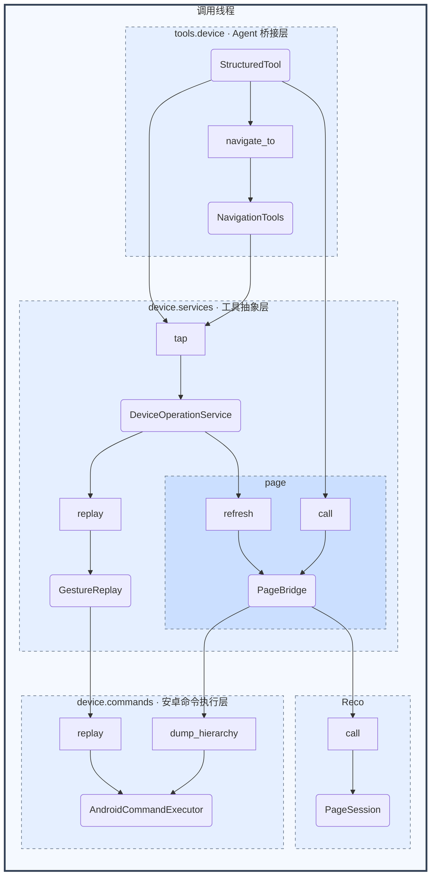

# Device 三层架构设计

状态：三层结构已实施，2026-10-16 更新。C 源文件、回放程序、录像文件与 Reco 实现保持不变。本文同时记录实现边界和验证限制。

## 1. 目的与兼容边界

设备能力统一收敛到 `src/device`，Agent 工具定义集中到 `src/tools/device`，按“安卓命令执行 → 工具抽象 → Agent 桥接”三层组织。执行层只处理确定的设备命令；工具抽象层解释操作含义、组合命令并维护页面；桥接层将这些能力包装成 Agent 工具。

外部依赖保持不变：继续使用 adb、自定义 UI dump 程序、PIAR 回放程序、Reco、LangChain、现有日志和工具策略。保留工具名称、参数 schema、返回内容/artifact、页面访问协议、角色可见范围及安全 middleware 契约。不新增设备后台线程、命令消息队列或通用命令插件体系。

仓库内 Python 调用方已同步修改导入路径；旧转发文件删除，设备公共接口统一由 `src.device` 显式导出。工具工厂从 `src.tools.device` 导入，不由 device 反向导出。内部类可以调整，但不能因移动类而意外改变工具 policy_id 等外部标识。页面脚本、历史记录和快照格式保持兼容。

本次明确的行为调整是：**常用手势随机选取录像，X/Y 分别浮动 -2 至 +2 像素；非常用手势不随机化。** 原 `AndroidDevice.act` 对所有手势浮动 ±5px；现已由 GestureReplay 按新规则处理。

## 2. 原实现问题与分层决策

| 原实现 | 问题 | 目标归属 |
|---|---|---|
| `AndroidDevice` | 命令执行、动作白名单、版本随机化混合 | 命令执行留在执行层；手势策略移入抽象层 |
| `DeviceOperationService` | 操作组合与页面同步已有雏形，但依赖分散 | 保留为抽象层统一入口 |
| `page_bridge/page_view/page_change_hint/page_types` | 页面能力散落在 src 根目录 | 收入 `device/services/page` 与 `device/types` |
| `tools/event_hub/page_queries/navigation` | 同属设备工具包装但分散管理 | 收入 `tools/device` |
| `screenshots` | 设备下载与模型内容包装混合 | PNG 采集归抽象层；image_url 包装归桥接层 |
| `translator` | 格式转换与上传混合，部署检查不可靠 | 转换保留纯函数；部署由手势对象统一管理 |
| `tools/page_similarity/optimize_xml` | 页面计算被放在工具目录 | 移至页面抽象子模块，保持算法不变 |

`tools/page_notes` 修改 PAGE.md，属于页面知识管理；`PageMechanism`、训练、采集策略及业务 middleware 不迁入 device。导航工具可以迁入桥接层，但路径校验、商家去重和恢复规则仍由原 middleware 负责。

## 3. 模块规划

```text
src/device/
├── __init__.py                 # 设备公共接口与类型
├── commands/                   # 第一层：确定的设备调用
│   ├── executor.py             # AndroidCommandExecutor
│   └── shadow_control.py       # 现有 nScreen 适配边界
├── services/                   # 第二层：工具语义与命令组合
│   ├── operations.py           # DeviceOperationService
│   ├── gestures.py             # GestureReplay，录像部署与随机化
│   ├── translator.py           # getevent 解析、坐标归零、PIAR 编码
│   ├── screenshots.py          # PNG 采集与校验
│   └── page/
│       ├── bridge.py           # PageBridge
│       ├── view.py             # ReadOnlyPageView、冻结与恢复
│       ├── change_hint.py      # 变化提示与比例
│       ├── similarity.py       # 原页面相似度计算
│       └── optimize_xml.py     # 原 XML 处理函数，不插入 Reco 访问链
├── types/
│   ├── results.py              # CommandResult、DeviceError
│   ├── gestures.py             # GestureSpec、ReplayTarget、ParsedEvent、ReplayFrame
│   ├── observations.py         # CollectionSwipe、SwipeObservation
│   ├── page.py                 # PageSnapshot、PageArtifact、变化提示类型
│   ├── images.py               # ImageUrl、ImageContent
│   └── shadow.py               # nScreen 状态数据
├── names.py                    # 动作名；命令路径常量归 commands/executor.py
├── actions/                    # 原录像资源，路径不变
└── native/                     # 原生程序及源码，保持不变

src/tools/device/               # 第三层：Agent 工具桥接
├── __init__.py                 # 工具工厂与角色集合
├── operations.py               # 设备工具规格与工厂
├── pages.py                    # Reco 工具包装
├── navigation.py               # 语义导航工具
└── screenshots.py              # PNG 模型内容编码
```

目录代表职责，不要求每个文件都有服务类。格式转换、快照处理和图片编码继续使用函数。纯数据类型不依赖任何上层服务，`__init__` 只导出明确公共接口。

依赖只能从桥接层指向抽象层、从抽象层指向执行层。页面子模块依赖 Reco，桥接层依赖 LangChain；执行层不得引用二者。同一层对象可以组合，底层不能回调高层操作服务。

## 4. 安卓命令执行层

### AndroidCommandExecutor

替代 `AndroidDevice` 中的底层命令职责。维护 adb 路径、设备 serial 和执行函数，统一构造参数、执行命令、收集输出和格式化错误。不感知 Agent、逻辑手势、页面树、等待策略或随机数。

对上只开放项目实际需要的命令接口：

| 接口 | 实际命令能力 |
|---|---|
| `start_package` / `stop_package` | monkey 启动 / am force-stop |
| `disable_animations` | 三种动画设置命令，首次失败即返回 |
| `dump_hierarchy` / `read_file` | 自定义 dump helper / 读取 dump 文件 |
| `capture_screen` | screencap 写入指定设备路径 |
| `list_files` / `push_file` / `pull_file` | 目录查询、创建目标目录及文件传输 |
| `replay` | 使用固定 act_script_path、input_device 重放指定文件及坐标 |

命令接口允许必要参数，不提供上层可任意拼接的公共 `shell` 或任意可执行文件入口。内部保留私有命令执行函数，参数列表及 root 转义逻辑沿用现有方式。某个有限命令需要多个 adb 调用时仍由该命令接口处理，不引入通用工作流对象。

### 统一结果

每个命令返回 `CommandResult`，包含命令参数、returncode、stdout、stderr，以及 `error: DeviceError | None`。`ok` 要求没有 error 且 returncode 为零；执行失败、进程启动异常、明确 adb 错误输出均必须产生 error。不要将异常吞掉后伪造空文本成功结果。

`DeviceError` 保留现有分类、message、details 及 `as_dict()` 序列化格式。非零退出码保留原码；执行异常没有真实退出码时允许 returncode 为 None。文件命令的目标路径由调用方已知参数确定，不从 adb 的自然语言输出中猜测。

此层统一处理错误输出识别，即使测试替换 runner，也通过同一结果规范化逻辑。资源部署、图片格式错误和 Reco 解析失败由对应抽象能力处理，不伪装成 adb 错误。

## 5. 工具抽象层

### 5.1 DeviceOperationService：共享设备操作入口

保留应用、手势、截图和连续采集所需的现有方法语义。持有唯一的命令执行器、`GestureReplay`、`PageBridge` 和现有日志对象，将同一组对象提供给 conductor、collector 与离线调用方。该服务不创建 StructuredTool。

操作服务拥有一把 RLock，并将同一锁交给 PageBridge；保留 `operation_lock` 供连续采集使用。手势执行、等待和页面刷新，以及截图到下载，均在各自完整操作的锁区间内。PageBridge 可直接通过执行器获取 XML，不再回调 `DeviceOperationService._dump_xml`，消除“服务 → 页面 → 服务”的依赖。

不同服务实例不自动获得全设备互斥；装配方必须让同一设备的业务使用同一个服务实例。这里不扩展为全局设备注册中心。同步调用仍运行在调用方线程，锁不代表存在设备工作线程。

### 5.2 应用管理

`run_package` / `close_package` 校验包名后调用相应命令接口，将成功文本或 `DeviceError` 返回上层。成功启动后重置页面缓存的现有行为保留，并与启动命令放在同一服务锁内。关闭应用保持当前不自动刷新页面的行为。两者不套用手势随机化或动作后等待。

危险操作 justification、通知策略和工具 metadata 属于桥接层，不进入命令或操作服务。

### 5.3 GestureReplay：录像选择与资源管理

把当前 `act` 的手势策略和 `check_actions` 的资源管理集中在一个有状态对象中，不再由执行器处理逻辑手势。

`GestureSpec` 记录逻辑名称、可选录像文件名和是否属于常用手势。`ReplayTarget` 记录已选定的远端录像路径和最终坐标。两者是明确数据结构；随机化仅在 `GestureReplay` 内完成，执行器接收的是确定值。

| 分类 | 初始动作 | 录像选择 | 坐标 |
|---|---|---|---|
| 常用 | tap、swipe_up、swipe_down、swipe_up_long、swipe_to_random | 对现有 `_0`、`_1`、`_2` 均匀随机选择 | X/Y 独立增加 randint(-2, 2) |
| 非常用 | swipe_back | 固定同名录像 | 不抖动，保留服务提供的 (0, 2000) |

分类以现有 HOT_ACTIONS 为初始依据；未来新增动作通过明确规格登记，不靠文件名猜测类别。Agent 仍只传逻辑动作和坐标，不接收版本、偏移或部署参数。`replay(name, x, y)` 对一次业务调用只采样一次；同一次调用内部若重发已选命令，应使用同一个 ReplayTarget。

录像资源仍使用原 device_dir 与 act_script_path。`ensure_available` 查询远端真实文件列表，与规格中要求的录像文件比较；缺失文件经纯转换函数生成 PIAR，再调用执行器上传。只有所有必需资源成功确认后才标记就绪；任一转换或上传失败都返回 DeviceError，不缓存成功。逻辑白名单不能充当已部署文件列表。

只补齐缺失录像，不引入版本哈希或自动更新服务。保留 getevent 解析、首个 X/Y 归零、SYN_REPORT 分帧、PIAR 字节格式及原录像内容。修正 `check_actions` 忽略上传失败、跳过 swipe_back 的问题；不安装或重编原生 helper。

操作服务在手势回放成功后保留默认 1.2 秒等待，再刷新页面；回放失败不得继续生成“动作后页面成功”的结果。连续采集仍通过 `collection_swipe` 获得 SwipeObservation，不需要调用模型工具。

### 5.4 PageBridge：统一 Reco 页面能力

将页面树、源 XML、快照、冻结恢复和变化提示集中在 `services/page`。`PageBridge` 通过执行器执行动画设置、dump 和读取，完成 XML 噪声清理后交给 Reco；日志仍使用现有 WorkspaceEventLogger。相似度和 XML 优化代码只迁移归属，不改算法，也不把旧 optimize 流程额外插入当前 Reco 输入。

**页面访问接口维持原状：**

- `create_page_tools` 继续以 `Reco.model_interface.TOOLS` 为工具名称、description、input_schema 的唯一来源，不手写另一套 schema。
- 保留 `PageBridge.call/query/refresh/reset/snapshot/load_snapshot/root_change_ratio` 的对外语义，以及 ReadOnlyPageView 的页面脚本接口。
- `call` 在无快照或满足现有根 page_view 条件时刷新；普通分页、区域读取及别名访问保持原有缓存与查询行为。
- 首次观测返回根视图，后续返回 page_change_hint；提示结构、整页比例算法、最多三个互不为祖先的入口规则不变。
- 返回 `(content, artifact)`，artifact 中的 page_xml/page_snapshot、快照身份与别名格式不变；桥接层继续将页面查询 content 转为 JSON 文本。
- 独立冻结视图不持有设备执行器，离线恢复和采集脚本不会因移动文件而触发设备调用。

页面变化提示仍只表示查询优先入口，不表示业务完成或动作必然有效。页面笔记、商家路径及采集决策留在业务模块。

### 5.5 截图与其他设备能力

抽象层提供 `capture_png()`，组合截图、pull、读取和 PNG 头校验，成功返回 bytes，失败返回 DeviceError。整个截图及下载过程共享服务锁，避免同一服务内固定远端路径被覆盖。临时本地文件管理沿用现有方式。

桥接层负责 bytes 到 base64/image_url 的转换；旧 `capture_png` / `screenshot_content` 调用方如依赖抛 ValueError 的语义，可由单向适配函数维持。抽象层不依赖模型消息类型，截图不能直接通过 `service.device.pull_file` 绕过操作边界。

nScreen 属于现有第三方接管接口，不改造成 adb 命令：`commands/shadow_control` 保留 SDK 调用及严格状态校验，操作服务提供启停抽象接口，现有 `CaptchaAuthenticationTool` 调用这些接口。其通知、用户等待、Gateway 和运行时恢复仍在原模块；不将业务人工确认逻辑搬进 device，也不宣称服务锁覆盖了用户接管的整个生命周期。

## 6. Agent 桥接层

沿用函数工厂与现有 NavigationTools，不额外创建统一工具管理器。桥接层只做参数/schema、模型内容、artifact 与 metadata 适配，不执行 adb、不访问录像文件、不选择随机版本。

| 工具类别 | 桥接职责 | 抽象层入口 |
|---|---|---|
| 应用管理 | 保留 justification 校验、安全与通知 metadata；错误转 JSON | run_package / close_package |
| 手势 | 保留坐标 schema、content_and_artifact 和效果策略 | tap / swipe_* |
| 语义导航 | 保留 purpose、next_path、merchant_name、recovery_reason；由原 middleware 校验 | tap / swipe_back |
| 页面访问 | 直接采用 Reco TOOLS；JSON 内容和 artifact 包装 | PageBridge.call |
| 截图 | PNG bytes 编码为现有 image_url 列表 | capture_png |

conductor 与 collector 的工具集合保持现状：swipe_to_random 仍仅向 collector 暴露，conductor 的原始动作集合和语义导航入口不扩张。默认设备工具工厂是否附加页面工具、显式选择工具时的行为也保持一致。

危险操作 policy_id 原先由类模块路径生成。迁移后固定为 `src.device.operations.DeviceOperationService.<operation>`，保持原有标识，不让目录整理改变授权规则。通用 create_tool、安全策略和 middleware 仍复用现有模块。

## 7. 目标架构图

图中对象均已实现；AndroidCommandExecutor、GestureReplay 为新增/替换对象，其余对象保留并调整归属。只画代表性调用，其他并列接口见前文。StructuredTool 由现有函数工厂构建，不新增虚构的桥接管理对象。



仅有一个线程框：三层都是同步调用，不引入新的设备线程。该框表示调用发生的位置，不承诺所有业务调用来自同一个固定线程；多线程调用同一服务由共享锁串行化。adb 是外部进程，Reco 是同线程库调用，不将其误画成设备工作线程。

## 8. 迁移与验收约束

实现已按以下调用链完成迁移，旧转发文件已删除，公共接口集中到包入口：

1. 建立命令执行器与结果类型，保留真实命令、路径和错误归类；将随机策略移出底层。
2. 集中手势规格与部署，落实常用手势双随机、非常用手势固定，以及失败不标记就绪。
3. 迁移页面及快照代码，PageBridge 直接依赖执行层，所有使用方共享原业务对应的页面实例。
4. 拆分截图采集与模型编码，迁移设备、页面和导航工具工厂，更新调用方导入。
5. 核对外部工具 schema、metadata、返回结构、脚本与快照格式；删除被替代实现，删除旧入口并统一使用包级公共接口。

验收重点：

| 边界 | 验证内容 |
|---|---|
| 命令 | 非零返回、启动异常、零返回码错误输出均产生格式化失败；不暴露任意 shell |
| 手势 | 常用录像选择范围与 ±2px 两轴边界；非常用不随机；执行层不再生成随机数 |
| 部署 | 查询真实远端文件；swipe_back 缺失会上传；任何上传失败不会标记完成 |
| 页面 | Reco 工具 schema、缓存刷新条件、提示算法、artifact、冻结恢复和别名不变 |
| 截图 | 获取与下载处于同一锁区间；PNG 内容和旧错误边界兼容 |
| Agent | 角色工具集合、危险操作标识、通知及效果策略不变；业务不直连命令层 |
| 文件结构 | device 实现唯一；旧转发文件已删除；无跨层反向导入与新增依赖环 |

## 9. 实现与验证范围

实现入口：[命令执行器](../src/device/commands/executor.py)、[操作服务](../src/device/services/operations.py)、[手势管理](../src/device/services/gestures.py)、[页面桥接](../src/device/services/page/bridge.py)、[设备工具](../src/tools/device/operations.py)、[页面工具](../src/tools/device/pages.py)。

PageBridge 为离线冻结场景保留 XML 来源回调形式；在线操作服务传入命令执行器与共享 RLock，不使用服务回调。`src.device` 显式导出设备能力、页面视图与数据类型；原有转发模块已删除，工具包装由 `src.tools.device` 提供；原底层任意 shell、translate/check_actions 入口不再作为业务接口，设备命令及部署改用执行器和 GestureReplay。仓库内调用方已经更新。

2026-10-16 定向回归 **137 passed**，覆盖设备命令、PIAR 转换、手势部署、随机化、页面与变化提示、相似度、采集、截图、公共工具、注册、安全策略及 nScreen 包装。新增回归覆盖截图到下载的锁区间、错误规范化、失败部署重试、固定 policy_id 和 Reco schema 等价。测试使用替身，不代表真机验收。

扩大检查时使用 `--continue-on-collection-errors` 得到 **392 passed、19 failed、13 collection errors、30 subtests passed**（在新增的 5 项跨层测试加入前）。其中 src/tasks 在本次实施前已缺失，阻断 Agent/Runtime 测试收集及评估相关测试；另有 Codex 缓存预期、middleware 组合及页面文档缺失等失败。未为本次设备重构恢复被删除的业务目录，也不宣称全套通过。

静态验证：Ruff、显式变量/动态访问审查、类型例外登记与导入环检查通过。全 src Pyright 的 8 项错误均来自 src/agent.py 对缺失 src.tasks 的依赖，device 及其新目录无类型诊断。

未完成真机、原生回放或实际 nScreen 接管验收。Mermaid 保留可编辑源码，未进行实际渲染验证。

本轮目录整理后重新执行上述定向回归：**137 passed**。公共包导入、接口对象身份与模块依赖环检查通过；工具 policy_id 保留历史字符串标识，该字符串不是旧模块导入路径。
