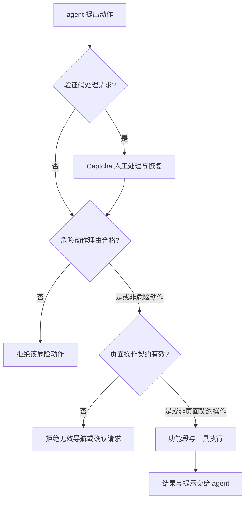
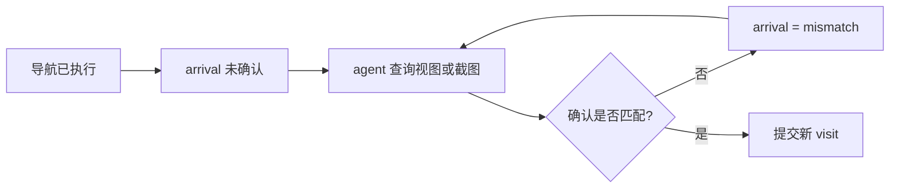
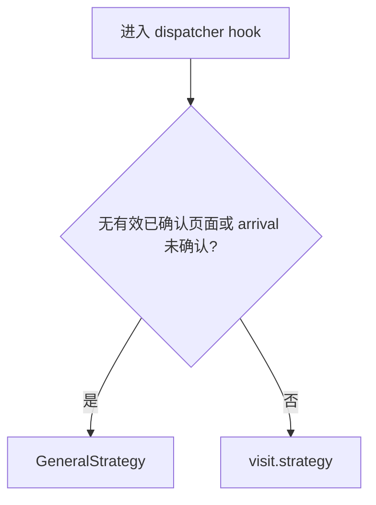
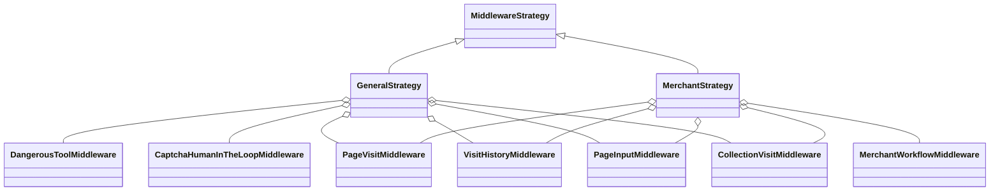
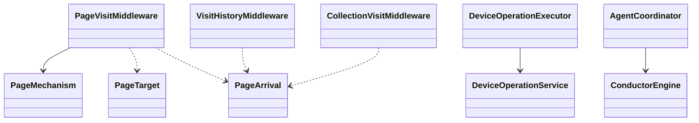
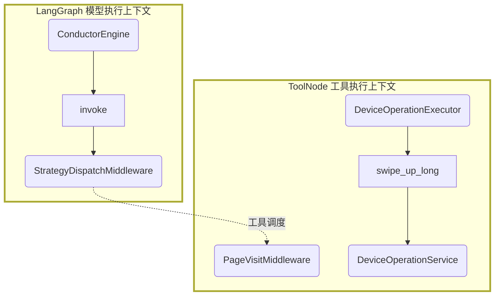

# General 辅助型工作流重设计

> 2026-10-23 修订：当前实现以 `src/strategy/Architecture.md` 为准。业务 middleware 已按功能迁入 strategy；confirm_page 只接收 candidate_id 和 matches，不再要求 observation/evidence。已删除 DeviceDispatch；参数格式统一由外层 ToolError 校验；pending 期间可直接确认，也可选用查询，matches=false 清除 pending 后可重新导航。下文保留上一版设计讨论，不代表这些已替换的行为。

日期：2026-10-22。**已实施。本文保留设计理由与验收边界；当前装配以 [Middleware Architecture](../src/strategy/Architecture.md) 为准。**

实现落点：PageVisitMiddleware 直接维护页面事实；PageVisitController、ProbeLifecycleMiddleware 和 GeneralPageAdmissionMiddleware 已删除。
新增 CollectionVisitMiddleware、VisitHistoryMiddleware、DeviceOperationExecutor、DeviceDispatchMiddleware，以及只读 get_probe_progress。
DeviceDispatch 是两个页面策略最外层的技术执行边界，不属于 General 的三个业务检查点。MerchantWorkflow 位于 PageVisit 外侧，防止未获准的商家导航误生成候选。
PageArrival 的目标路径/策略字段在代码中保留简短名称 `path`/`strategy`，其语义分别是 expected_path/target_strategy。
新流程沿用页面事实的有效访问读取函数，不将旧 visit 当作已确认的新页面；旧 lifecycle/pending checkpoint 要求重新开始任务。

## 1. 目标与决策边界

General 阶段由 agent 决定下一步业务动作：探索哪里、是否重访、是否离开、是否结束。
系统提供可信操作反馈和上下文，仅保留三类业务执行检查点：

1. DangerousToolMiddleware：危险动作是否提供合格理由。
2. CaptchaHumanInTheLoopMiddleware：验证码需要人工处理时暂停。
3. PageVisitMiddleware：声明的页面跳转是否与观测一致，是否可以提交对应页面上下文。

其他 middleware 只能通过 features 提供事实、提示和上下文，不根据探测进度拒绝工具，不产生业务 interrupt，不替 agent 决定完成。
参数解析错误、设备断线和执行串行化是工具/运行基础设施边界，不是新的业务门禁；不能借此重新引入商家完成、访问目标或页面类型判断。

本次不重写 collector 训练与商品采集算法。MerchantWorkflow 的本页训练及采集约束仍归 Merchant 策略，不上移到 General 或页面确认模块。

## 2. 代码现状与偏差

| 现有位置 | 当前职责混合 | 目标处理 |
| --- | --- | --- |
| ConductorEngine._create_tools | General 配置 Lifecycle、GeneralPageAdmission、PageVisit 等约束 | General 只保留上述三个业务检查点 |
| GeneralPageAdmissionMiddleware | 按工具名禁止 General 调用商家能力 | 删除；工具自身仅校验实际必需的输入资源 |
| PageVisitController._validate | 候选确认、应用限制、无页面限制、pending 工具白名单 | 仅保留页面目标与观测一致性校验；删除全局白名单和 probe 应用限制 |
| PageVisitController.strategy_kind | 页面策略声明与商家采集契约混合 | 只校验声明有效、策略已注册；采集契约由采集模块负责 |
| PageVisitController.begin_navigation | 路径、manual、必填 merchant_name、已完成商家去重 | 保留页面目标解析；商家名仅为可选提示，去重改成信息提示 |
| PageVisitController._after | 候选、观测、商家重置、未完成商家义务 | 页面确认、访问记录、采集访问绑定分别归属独立模块 |
| PageVisitController._claim / 锁 | 页面确认与设备调度混合 | 移至独立设备执行边界，不读 probe/merchant |
| ProbeLifecycleMiddleware | 完成授权、关闭门禁、访问登记、义务清理、失败与无动作中断 | 删除组合类；事实记录与执行协议分别处理，取消全局业务门禁 |
| ConductorEngine._evaluate_result / _completion_allowed | 有效 resolved 回复仍被 probe.status 否决 | 移除业务完成谓词，只检查已有结构化回复契约 |
| PageInput / 导航工具 / prompts | 含“必须完成全部目标、未完成不可离开”等命令 | 改为事实与建议，不能用 prompt 恢复已删除的强制流程 |

**不是把 Lifecycle 换名搬到 features。** completion_authorized、必须关闭应用才能结束、未完成商家必须回访等规则直接取消。

## 3. 目标装配与执行语义

GeneralStrategy 配置如下（设计示意）：

```python
constraints = [
    DangerousToolMiddleware,
    CaptchaHumanInTheLoopMiddleware,
    PageVisitMiddleware,
]
features = [
    CollectionVisitMiddleware,
    VisitHistoryMiddleware,
    PageInputMiddleware,
    OperationNoticeMiddleware,
    DeviceOperationReliabilityMiddleware,
]
```

Strategy 只组合，不持有其他 Strategy。两个策略需要共同能力时显式配置同一 engine 范围内的实例。
Merchant 配置共同页面/危险/验证码能力，并保留自己的 MerchantWorkflow 与采集功能；不再配置 ProbeLifecycleMiddleware。

### 可达性图

以下是控制流，不是类调用图。三个检查点运行于不同 hook，不能把列表顺序误解为验证码在每次工具执行前自动检测。



- Captcha 保留模型边界 HITL；当前实现依赖 agent 调用认证工具，不具备自动视觉检测能力，目标设计不虚构该能力。
- Dangerous 在工具执行前检查 typed policy，不检查 probe 完成程度。
- PageVisit 对页面目标及确认请求进行校验；普通点击、滑动、观察、沟通不因 pending 或业务进度被统一拦截。
- 页面不匹配可以拒绝“确认成功/提交目标上下文”，不能撤销已发生的设备动作，也不能禁止 agent 后续修正。
- features 不改写工具成功/失败来表达业务建议。页面事实校验失败与真实设备错误仍保留明确结果。

## 4. 单一职责拆分

不引入通用事件总线、动态插件系统或第二套状态机框架。无跨调用数据的处理使用纯函数；只在需要 hook 或资源所有权时使用类。

| 模块 | 唯一职责与输入输出 | 明确不做 |
| --- | --- | --- |
| **PageVisitMiddleware（修改）** | 导航意图、最新观测、确认声明 → arrival/visit 更新 | 不读 probe、merchant、商品数量、训练版本；不管理设备锁 |
| `resolve_page_target`（新增函数） | 包名或 canonical path + PageMechanism → PageTarget | 不核验商家是否采完、不要求 merchant_name、collection contract |
| `validate_arrival`（新增函数） | 候选、观测版本、确认参数 → 通过或页面确认错误 | 不检查其他业务状态；不访问设备或 workbook |
| **VisitHistoryMiddleware（新增）** | 页面访问提交/退出事实 → 紧凑访问历史 | 不判断哪些页面必须访问、是否必须回访；不阻止重访 |
| `summarize_probe_progress`（新增函数） | 任务目标、访问历史、既有采集摘要 → 覆盖及遗漏事实 | 不返回 authorized，不修改任务状态，不决定完成 |
| **PageInputMiddleware（修改）** | 有效页面上下文、访问/进度事实 → manual 与请求投影 | 不注入强制授权/关闭要求；无有效 visit 时不用旧页面冒充当前页面 |
| **CollectionVisitMiddleware（新增，仅采集适配）** | 已确认访问身份变化 → 本页采集状态绑定/失效 | 不决定页面是否可导航、不登记全局未完成义务 |
| **DeviceOperationExecutor（新增）** | 设备执行请求 → 串行执行结果 | 不认识 general/merchant/probe、页面目标或业务许可 |
| **ConductorEngine（修改）** | 外部输入与结构化 AgentResponse → 继续或结束 | 不调用全目标验收、关闭授权、商家完成谓词 |

DangerousToolMiddleware、CaptchaHumanInTheLoopMiddleware 保留各自现有领域，不扩大职责。
DeviceOperationReliabilityMiddleware 保留相似度提示，PageBridge 继续维护真实视图与变化提示，不重复实现 UI 匹配算法。

“单一职责”不是禁止校验一个对象的多个必要属性。例如候选 ID、观测版本、确认依据共同构成一个页面确认契约；禁止的是同时把探测目标、商家训练、页面身份、任务完成混成一个通过条件。

### PageVisitController 的去向

删除该聚合类，不保留转发壳或 begin_merchant/end_merchant 回调：

- 目标解析移入 resolve_page_target。
- 页面确认与提交留在精简 PageVisitMiddleware，confirm_page 工具绑定该实例。
- 访问记录移入 VisitHistoryMiddleware。
- 采集访问初始化移入 CollectionVisitMiddleware。
- 认领/互斥移至 DeviceOperationExecutor 和独立的单批次设备动作处理函数。
- completed_merchants 拒绝、unfinished_merchants 强制义务及 probe.package_name 锁定删除，不换位置保留。

## 5. 页面确认与策略切换

### 状态仅表示页面事实

修改现有 GeneralState，保留已确认 visit 作为历史参照，新增独立 arrival：

| 字段 | 含义 |
| --- | --- |
| `visit` | 最后确认的 path、visit_id、strategy；不保证导航之后仍然有效 |
| `arrival` | 当前导航 candidate_id、expected_path、target_strategy、observation_id、status |
| `arrival.status` | awaiting_observation、mismatch、confirmed；不包含训练或完成状态 |
| `app_root` | 当前页面路径解析上下文，不是 probe 任务的应用白名单 |

不保留 rejected 的永久锁定语义。新鲜观测允许重新判断同一候选，无需为了清锁强行退出再进入。
同页点击或滑动发生后使旧 observation_id 失效；成功观测提供新的引用。
保留“显式导航声明”的边界：tap_in_page 意外跳页不能被当前系统可靠识别；agent 需要声明导航或重新检查，不虚构自动分类器。

### 小图：导航和确认



未确认或 mismatch 期间，agent 可以继续观察、关闭弹窗、点击、滑动、重新导航、使用危险工具或结束任务。执行请求仍经过危险/验证码检查。
PageVisit 只拒绝过期或矛盾的确认请求，不设置工具名白名单。无法确认目标时不运行该目标页面的采集脚本，也不按目标 manual 声称已到达。

### 小图：路由



这是与现状的明确差异：**导航到未知页面后转入 General 探索，而不是继续使用来源 Merchant 的操作限制。**
确认成功后的下一次 hook 才路由到目标策略；同一次工具链不重入目标策略。
成功关闭应用后清空当前页面上下文，路由 General，但不自动宣告整个任务完成。

运行前的路径参数错误直接返回，不改上下文；执行已经发出但设备返回失败、无法确认是否移动时，将 arrival 标为未确认，不能假定仍停留在旧页，也不自动重放动作。

### 功能型辅助与必要输入错误的边界

- General 不再基于“这是商家工具”拒绝 prepare_collector / collect_continuously / is_done。
- 这些工具仍必须有真实有效的访问、采集契约、脚本或训练记录才能执行；缺失时由工具返回具体输入错误，不撤销页面操作权限，不创建回访义务。
- 不允许把旧 general.visit 传给采集工具冒充已确认当前页面。工具统一通过页面事实读取函数获得有效访问，未确认时返回无有效访问。
- 这属于工具资源契约，不是 General 的业务流程门禁；用户仍可选择任何其他操作或停止。

## 6. features 如何记录事实而不产生新门禁

### 访问历史

VisitHistoryMiddleware 只记录“确认进入、离开、关闭”等路径事实，关联 visit_id；重复进入同一路径也生成新访问。
导航尝试和失败沿用现有工具消息及审计日志，不再在 state 复制全量快照。
历史字段只保存紧凑路径、身份与顺序；不保存商品明细。采集数量继续由 CollectionService 保存，不重复统计。


为避免 wrapper 返回方向导致读到旧状态，VisitHistoryMiddleware 在 before_model 消费已提交的页面上下文，以 visit_id/候选身份去重。
工具返回仍只提交页面事实；观察者不在同一个工具 wrapper 中猜测外层尚未生成的更新。

### 页面变化

设备层/PageBridge 产生完整 artifact 和紧凑 change_hint；DeviceOperationReliability 提供相似度建议。
辅助信息与原工具结果并存，不根据变化率自动否决已完成动作，不累计错误次数后冻结操作。

### 采集访问绑定

CollectionVisitMiddleware 在下一次模型输入前对齐当前有效 visit_id；新商家访问初始化采集状态，未确认/离页时清除活跃采集绑定。
它可以在两个策略的 features 中显式配置同一实例，但只修改 merchant 访问绑定，不读取任务完成清单。
采集执行入口仍校验有效 visit_id，因此两次模型调用之间不会将旧绑定用于新页面。

### 探测进度

`summarize_probe_progress` 从目标列表、访问历史和采集摘要计算“已访问/尚未访问/曾采集”等信息。
同一份结果既供 PageInput 简短提示，也供新的 `get_probe_progress` 工具主动查询，避免两套逻辑。
明确区分“访问过”和“采集完成”；缺少证据时返回 unknown，不凭 phase 猜测业务完成。
agent 可以重访已完成商家、跳过建议目标、在任意页面决定结束；系统只记录其行为。

## 7. Lifecycle 拆解与任务结束

| 原 Lifecycle 能力 | 目标模块/处理 | 是否可阻断 General |
| --- | --- | --- |
| target/visited 维护 | VisitHistory + summarize_probe_progress | 否 |
| 已完成商家记录 | 既有采集服务与摘要，作为事实展示 | 否，不再拦重复导航 |
| unfinished 商家义务 | 删除强制义务；历史可显示未完成访问 | 否 |
| 完成授权、关闭前置条件 | 删除 authorize_probe_completion，改用 get_probe_progress | 否 |
| 无 tool call 自动 jump_to=model | 不在 middleware 做；沿用结构化回复和 runtime 持续层 | 不依据业务状态拦截 |
| failed_tool_count / 三次业务失败 interrupt | 删除业务活性门禁；错误通过工具结果、talk 和日志报告 | 否 |
| status 及 continuation_reason | 运行状态使用既有 EngineStatus/执行层原因 | 不由页面确认激活任务 |

**必须同时修改 ConductorEngine._completion_allowed。** 否则即使删除 Lifecycle，resolved=true 仍会因 probe.status 被外层持续层拒绝。

目标回复协议保持 AgentResponse：

- 非法结构化回复：runtime 要求纠正协议，不据此推断业务失败。
- resolved=false：沿用 context 继续执行；不要求调用特定业务工具。
- resolved=true：接受 agent 的结论，结束本轮，不要求关闭应用、访问全部目标、返回列表或清除商家义务。
- 网络重试、checkpoint、用户消息接收、显式关闭和验证码恢复保留，不能把已删除的 liveness 规则迁到 coordinator 中继续生效。

不另增“任务完成判断器”。如未来需要限制持续层无进展循环，应作为独立通用 runtime 需求设计，而不是偷偷恢复探测业务门禁。

## 8. 类图与依赖边界（目标）

下面是真正的类关系图：新增与修改均在表中声明；不在类节点堆叠字段。依赖线表示静态关系，不表示线程或执行时序。

### 策略与 middleware



图只展开本次职责变化；Merchant 也配置危险/验证码检查，现有通知、可靠性和采集 middleware 未逐一展开。没有 Strategy → Strategy 关系。
CollectionVisit 是纯访问绑定适配，所以 General 的 features 也配置它；不意味着 General 加入训练门禁。

### 页面、设备与执行层



PageTarget 是目标路径及策略的不可变值；PageArrival 是页面确认状态的结构化值，对应第 5 节字段，均为新增类型，不创建独立服务。
PageVisit 不持有 CollectionService、CollectorTrainingRegistry、workbook 或任务进度对象；纯函数传入所需值，不获得整个运行时服务容器。

### 修改清单与公开边界

| 类 | 变化 | 对外必要能力 |
| --- | --- | --- |
| GeneralStrategy / MerchantStrategy | 修改配置，不新增业务方法 | 现有 Strategy hooks |
| PageVisitMiddleware | 替代 Controller 的页面确认部分 | hooks、confirm_page 工具绑定 |
| VisitHistoryMiddleware | 新增事实记录 | before_model/abefore_model |
| PageInputMiddleware | 修改为读取页面和进度事实 | 原有 hooks |
| CollectionVisitMiddleware | 新增采集访问绑定适配 | before_model/abefore_model |
| DeviceOperationExecutor | 新增设备串行执行边界 | 同步/异步 execute，不公开锁 |
| ConductorEngine | 移除业务完成谓词、调整装配 | 现有运行接口 |
| ProbeLifecycleMiddleware / PageVisitController / GeneralPageAdmissionMiddleware | 删除 | 无兼容空壳 |

不增加可调队列长度、重试阈值、默认策略参数或只有一个调用者的配置注入点。

## 9. 状态写入、线程与顺序

### 状态所有权

| 状态区域 | 写入者 | 不允许的依赖 |
| --- | --- | --- |
| 页面 visit/arrival | PageVisitMiddleware 与其绑定确认工具 | probe/merchant 业务状态 |
| 访问历史 | VisitHistoryMiddleware | 完成授权 |
| merchant 活跃访问绑定 | CollectionVisitMiddleware | 目标覆盖率 |
| merchant 本页训练/采集事实 | MerchantWorkflow、现有采集服务 | General 操作许可 |
| 任务描述、run_id、目标路径 | ConductorEngine 接收新任务时初始化 | 导航确认自动创建任务 |
| 任务运行/结束 | 既有 runtime 执行层 | 页面业务验收 |

保留既有 run_id 隔离历史，不能因移除 ProbeState 的控制字段而丢失 collector 历史范围。
迁移时逐个去除 status、failed_tool_count、premature_final_count、unfinished_merchants 的消费者，不将它们换名复制到新状态。
已存在的 collection summary 和历史不重复复制进访问历史；不保存第二份完整消息/视图。

### 功能顺序和状态提交

- before_model：CollectionVisit 对齐访问 → VisitHistory 记录变化 → PageInput 注入 manual/进度并投影。
- 第 3 节 features 配置将 CollectionVisit 放在 VisitHistory 之前，保证 PageInput 读到对齐后的访问状态。
- 工具链先走约束，再走 features；页面确认结果由 PageVisit 在返回时提交。后续模型 hook 消费已提交结果，不在内层读取未来更新。
- Command 保留 messages、goto、resume 等框架字段，各模块只产生自己区域的补丁。禁止为了方便回填完整旧 probe 覆盖下层更新。
- 记录、提示、通知类 feature 的自身故障记录为诊断，不反转原工具执行结果；框架 interrupt/取消信号继续传播。采集访问绑定更新失败时保留无有效绑定，由采集工具报告缺少资源，不阻止 General 的其他页面操作。

### 线程边界



这是执行上下文边界，不承诺固定两个操作系统线程；异步调用由框架调度，执行器不能在事件循环里阻塞等待同步锁。图仅展示代表性的底层滑动调用，省略 ToolNode、工具适配器和功能段，不表示 PageVisit 持有执行器。
设备执行器复用既有安全执行路径/必要的工作线程，不另外增加每工具线程。同一设备的工具适配器必须共享一个执行器，不能每个策略分别建锁。它覆盖完整连续采集调用，内部步骤复用已持有的执行权限，不嵌套加锁。
单个模型响应的多个设备动作在执行前串行准入；额外动作返回纯执行冲突结果，不写业务状态。该机制只保护设备一致性，不限制 talk 等独立工具。
验证码启动也走同一设备执行入口；不能在 after_model 绕过执行边界直接操作设备。

## 10. 迁移与验证

### 实施顺序

1. 固化 General 自由操作回归用例，确认所有隐式门禁位置（包括工具说明、prompt、Engine 完成谓词）。
2. 提取页面目标解析与确认函数，PageVisit 删除 probe/merchant 依赖。
3. 将认领和设备互斥迁到执行层，保证连续采集、验证码和普通动作共用同一设备通道。
4. 添加访问历史与采集访问绑定 features；PageInput 消费其状态，调整未确认时路由 General。
5. 删除 Lifecycle、GeneralPageAdmission、全局授权工具和完成谓词，新增只读 get_probe_progress。
6. 迁移状态与历史读取，更新 prompts、工具说明和架构现状文档，再进行真实设备联调。

工具集合在一次 agent 运行中固定，不随状态增删。移除 authorize_probe_completion 属于版本升级的显式接口变更，不能静默保留名字却改变 authorized 的含义。
旧 checkpoint 涉及授权/liveness 语义的任务升级后要求重新启动；保留审计与采集文件，不把旧授权猜测为新任务完成。

### 验收矩阵

| 场景 | 必须满足 |
| --- | --- |
| General 尚有目标未访问 | 可以点击、滑动、导航和给出 resolved=true |
| General 重访已完成商家 | 导航不被 completed_merchants 拒绝，只提供已访问提示 |
| General 请求关闭应用 | 只要求危险理由与正常设备参数，不要求完成授权 |
| 多次工具失败 | 错误返回，不自动触发业务 liveness interrupt |
| 无工具回复且 resolved=false | 持续层继续，不要求特定业务动作 |
| 页面未确认或不匹配 | 可观察和修正；不提交错误目标 manual，不锁死操作 |
| 新鲜观测重新确认 | 无需强制重新导航即可纠正先前 mismatch |
| 从商家导航到候选页面 | 未确认阶段路由 General，不沿用旧商家操作门禁 |
| General 调用采集工具但缺必要资源 | 工具返回具体资源错误，不影响其他操作；不得使用旧访问执行脚本 |
| 功能记录失败 | 提供诊断，不将已经成功的设备动作改为业务拒绝 |
| 任务进度摘要 | 仅提供事实，不能输出授权、强制回访或关闭要求 |
| 设备并发/连续采集/验证码 | 执行串行，无重复设备副作用、无跨调用旧页面写入 |
| 普通非探测对话 | 不被导航或进度观察者自动激活探测任务 |

单元测试分别验证页面契约、事实记录、结构化结束和设备互斥；集成测试验证组合顺序、同步/异步、固定工具 schema、manual 和 checkpoint。
已实现并增加页面失配恢复、访问绑定、只读进度、设备串行、异步取消和消息前缀回归测试。真实设备联调与 Mermaid 实际渲染尚未执行；不能将单元测试视为真实设备验收。
