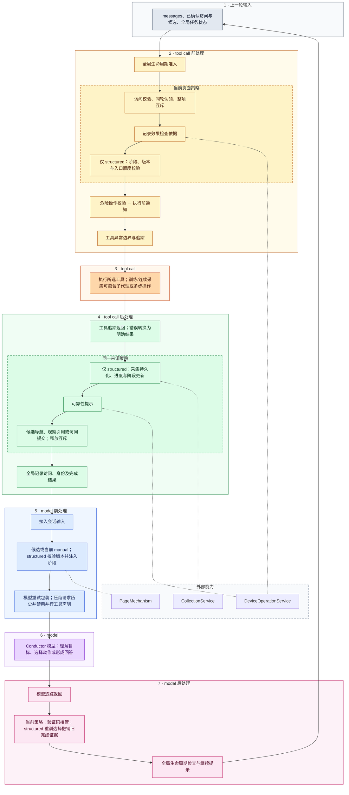

# Middleware 职责、引用关系与目录分类

本文描述页面策略迁移后的当前装配。页面业务规则的完整设计见 [页面策略架构](page-strategy-design.md)，迁移前审查证据见 [Conductor 工作流](conductor-workflow.md)。

## 1. 分类原则

middleware 的目录按能力归属划分，而不按 hook 名称划分。业务状态由所属领域定义，middleware 只校验和产生更新。组合类只负责组合已有行为，不复制领域算法。

| 目录 | 所有能力 | 对外依赖 |
| --- | --- | --- |
| agent_runtime/middleware | 输入接入、模型重试、工具异常 | 会话、框架与模型适配 |
| strategy | 通用 PageStrategy 契约和 PageStrategyMiddleware 委托 | LangChain hook，不依赖 conductor |
| strategy/general、strategy/structured | 页面策略选择所需业务行为与访问状态 | 页面文档、下述 middleware、采集服务 |
| middleware/probe | 全局探测生命周期 | strategy.state |
| strategy/context | manual 注入和模型请求投影 | PageMechanism、agent_messages |
| middleware/execution | 全局危险操作、通知 | 工具声明与通知服务 |
| collector | CollectorModelMiddleware | collector 工具与训练协议 |

## 2. 当前装配关系

业务装配唯一入口为 ConductorEngine._create_tools。业务 middleware 顺序为：

1. ProbeLifecycleMiddleware：全局任务、目标访问、未完成义务和关闭授权。
2. PageStrategyMiddleware：通过 Engine 的解析函数委托给当前页面策略。
3. ToolExecutionPolicyMiddleware：危险操作校验和执行前通知。

AgentEngine 在此前添加 HostTrace、模型重试与 ConversationInput，在此后添加 ToolError、ToolTrace 和 LLMTrace。基础能力不因页面策略切换而失效。CollectorEngine 保持独立装配。

## 3. 当前文件及引用关系

| 文件 | 职责与使用方 |
| --- | --- |
| probe/lifecycle.py | 全局准入、访问记录、完成授权；直接注册于 ConductorEngine |
| strategy/structured/persistence.py | is_done 工具声明及工具结果到采集服务的适配；仅由 StructuredOfficeStrategy 包装 |
| strategy/context/middleware.py | PageInputMiddleware 组合 manual 与压缩；由 GeneralOperationStrategy 持有 |
| strategy/context/manual.py | before_model 加入页面知识 |
| strategy/context/compression.py | wrap_model_call 投影历史；不替代 checkpoint 历史 |
| execution/policy.py | 组合危险校验与通知；全局注册 |
| execution/dangerous_tool.py | 根据工具声明验证操作理由 |
| execution/operation_notice.py | 调用通知服务后继续工具执行 |
| strategy/general/reliability.py | 捕获操作前后信息、生成可靠性提示；由通用策略组合 |
| strategy/general/captcha.py | after_model 人工接管；两种策略共用 |
| tool_io.py | 有类型的请求读取、Command 与 ToolMessage 更新适配 |

原 ProbeControlMiddleware、PageContextMiddleware、CollectorReadinessMiddleware 已删除，没有转发文件。访问控制集中到 PageVisitController，训练准入集中到 StructuredOfficeStrategy。`__init__.py` 只保留包说明。

## 4. 页面规则如何隔离

通用策略使用 PageVisitController、PageInputMiddleware、DeviceOperationReliabilityMiddleware 和 CaptchaHumanInTheLoopMiddleware。它不接受 collector 工具，不生成结构化进度。

结构化策略通过组合调用通用能力，额外加入训练版本、阶段、入口额度、持久化与完成验收。不是在全局 middleware 中反复判断页面名，也不是为每个目录创建一个空策略类。PAGE.md 的显式声明绑定到已确认访问；新导航确认之前仍由来源策略处理。

## 5. 工具与领域服务边界

confirm_page 在 strategy/tools.py 定义，调用 PageVisitController 完成证据关联与访问提交。is_done、连续采集和训练工具保留原领域服务；采集算法不迁入策略。

固定工具集合保持注册。策略执行端控制适用性，模型看到工具不代表此时可以执行。采集的商品内容不返回 conductor；失败类别、未完整行及恢复提示可以返回。

## 6. 状态归属

全局探测状态跨访问保留。`page_visit` 是以 kind 区分的联合：general 只有访问标记，structured 额外保存 phase、training_version 和 entry_taps。`pending_visit` 是尚未确认的导航候选，不冒充已到达页面。

CollectionService 与策略直接使用同一份 collection_* 进度字段；删除嵌套 progress 与服务视图转换。完成状态只保存在 page_visit.phase，路径和访问 ID 只保存于顶层字段。

## 7. 同步、异步与互斥

所有 hook 均有同步与异步委托。工具进入和返回使用同一个来源策略。PageVisitController 对整项页面操作持锁，涵盖训练及连续采集；同一模型响应只允许一个页面操作，不能依赖 parallel_tool_calls=false 作为唯一约束。

## 8. Conductor：七阶段状态与输入处理流程

### 8.1 七阶段流程图

下图是执行流程图，节点描述目的；实线表示先后/返回次序，虚线无箭头表示外部能力依赖。嵌套框表示同一次工具包装链，不表示额外注册。当前页面二选一，不同时执行两套业务策略。

### 8.2 时序边界

before_model 按注册顺序执行，after_model 反向执行。工具包装先进入外层，返回时先执行内层后处理。结构化采集发生在可靠性后提示和全局访问记录之前。候选确认工具提交新访问后，下一次 hook 才解析新策略。

拒绝可以提前返回，不执行内层工具。interrupt 保存现场，不等于成功返回。当前图聚焦正常 conductor 循环，不展开恢复调度。没有工具调用时直接进入模型后处理/结束判定，不能理解成每轮必须执行所有节点。

### 8.3 hook 覆盖

| 对象 | 干预位置 |
| --- | --- |
| PageStrategyMiddleware | before/after_model、wrap_model_call、wrap_tool_call 及其异步形式 |
| GeneralOperationStrategy | manual、请求压缩、验证码；工具公共准入/可靠性 |
| StructuredOfficeStrategy | 继承组合的公共行为；模型前版本校验/阶段提示、模型后重训失效；工具前强准入/后进度 |
| ProbeLifecycleMiddleware | 工具前后、模型后；全局完成工具 |
| ToolExecutionPolicyMiddleware | 工具前危险校验及通知，等待内层返回 |

### 8.4 输入与状态

checkpoint 保留真实消息与访问状态；模型请求可投影压缩。候选 manual 标为未确认，不替代已确认 path。structured 阶段提示以 visit ID 稳定标识，允许更新；业务进度不由自然语言提示反向解析。

## 9. 验证边界

测试覆盖同步/异步分发、来源策略固定、候选确认、互斥、版本失效、完成证据及真实 LangGraph 集成。未运行真实设备或在线模型。图经关系检查，未做实际 Mermaid 渲染；历史全套失败在交付结果中单列。

## 10. 目录所有权

strategy 及其直接关联的状态、上下文、可靠性、验证码与采集适配均集中于 src/strategy，不再位于 conductor 或 middleware/context。全局 ProbeLifecycleMiddleware 和危险操作/通知仍独立于页面策略。状态统一在 strategy/state.py，以 TypedDict 字段名访问。所有 middleware 使用 StrategyState，旧 checkpoint 在读取边界转换。
