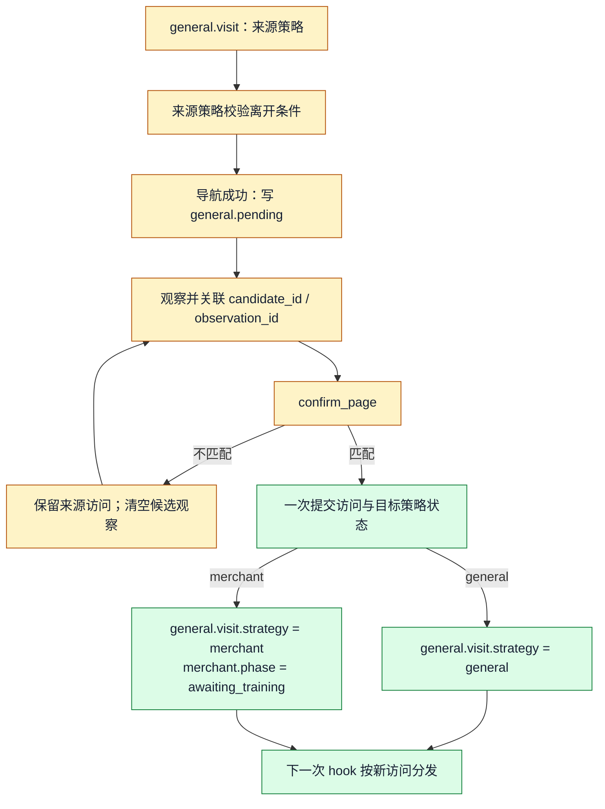
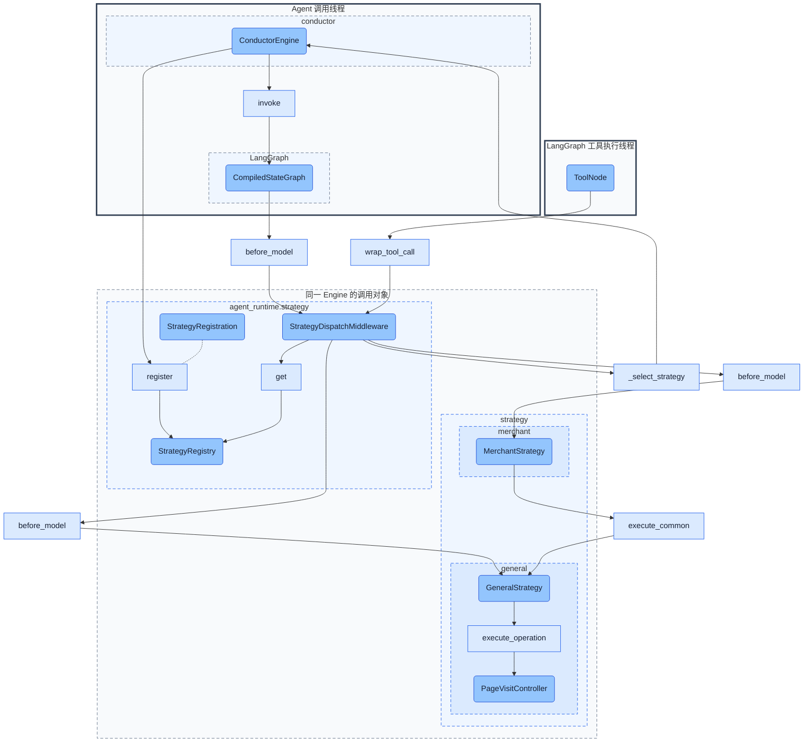
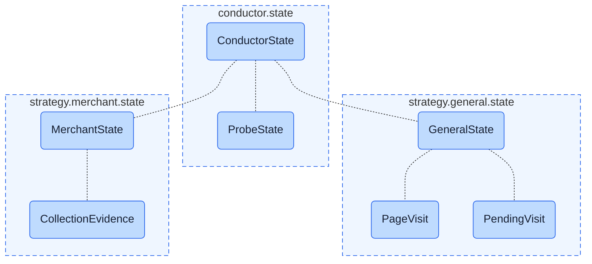

# 策略分发与场景策略设计

本文描述已实施的通用策略分发与场景状态隔离。`agent_runtime.strategy` 提供注册和 LangChain 委托，Conductor 注册 general / merchant；CollectorEngine 独立注册 collector，具体边界见第 6.3 节。

## 1. 目的与概念

原 `PageStrategyMiddleware` 与页面声明、访问记录、商家训练、采集进度共处一个模块，原 `StructuredOfficeStrategy` 实际只描述商家商品采集。重构将**如何分发**与**为什么采用某种业务行为**分开。

- **Strategy** 是一组场景行为，可以按页面、任务或业务阶段选择，不是页面的类型系统。
- **页面** 是访问对象。多个页面可以声明同一种策略；同一页面也可以被不同 Agent 以不同职责处理。
- **策略状态** 是该场景行为可恢复的数据，通过独立 TypedDict 子结构隔离，不混放在 graph 根节点。
- **策略注册** 是 Engine 构图前的实例、状态契约和命名空间登记，不是全局插件单例。

Conductor 在商家页面采用 `MerchantStrategy`，表示“在此执行商家采集约束”；Collector 在同一页面训练脚本属于另一种执行职责，不能因为页面声明为 merchant 就套用 Conductor 的操作门禁。

## 2. 模块规划与依赖边界

```text
src/
  agent_runtime/
    engine.py                    # 构图与策略扩展接口
    strategy/
      base.py                    # Strategy：通用生命周期接口
      middleware.py              # StrategyDispatchMiddleware：LangChain 适配
      registry.py                # StrategyRegistry：注册、校验、初始化
      registration.py            # StrategyRegistration：注册契约
  strategy/
    general/
      strategy.py                # GeneralStrategy
      state.py                   # GeneralState、PageVisit、PendingVisit
      visits.py                  # PageVisitController
      declarations.py            # PAGE.md 声明解析
      tools.py                   # confirm_page
      context/                   # manual、消息投影与历史压缩
      reliability.py
      captcha.py
    merchant/
      strategy.py                # MerchantStrategy
      state.py                   # MerchantState、CollectionEvidence
      persistence.py             # 商家采集结果处理
    collector/                   # 独立的页面脚本训练策略
      strategy.py                # CollectorStrategy
      state.py                   # CollectorState
  conductor/
    engine.py                    # 注册 general / merchant，决定分发规则
    state.py                     # ConductorState、ProbeState、输入/更新类型
    checkpoints.py               # 旧状态到命名空间的单向转换
  collector/
    engine.py                    # 独立注册 collector
    state.py                     # CollectorAgentState 根状态
```

依赖方向为：业务 Engine → 场景策略 → runtime 策略接口。runtime 不导入 `src.strategy`、页面、设备、商家或 collector；场景策略不导入业务 Engine。业务 Engine 负责聚合根状态和装配依赖。

`src/strategy` 只保存具体场景规则和直接服务于这些规则的代码。设备执行、页面存储、采集算法和工作簿持久化仍由已有领域模块提供，策略调用它们，不复制其实现。跨页面的探测目标、完成记录及恢复义务属于 conductor，不随 MerchantStrategy 切换而销毁。

## 3. Engine 提供的定制能力

AgentEngine 在既有构图流程中提供四个受保护扩展接口，由子类覆盖；默认不注册任何策略，未使用策略的 Engine 行为保持不变。

```python
class AgentEngine:
    def _strategy_registrations(self) -> Sequence[StrategyRegistration]:
        return ()

    def _strategy_state_schema(self) -> type[AgentState]:
        return AgentState

    def _select_strategy(self, state: AgentState) -> str:
        raise NotImplementedError

    def _strategy_middleware_position(self) -> int:
        return 0
```

以上伪代码省略泛型展开；实现中 `AgentEngine[StateT]`、注册表与分发器使用同一根状态类型，协调器和 Worker 传递该类型。业务根状态与每个策略子模块均有具体 TypedDict。

`_strategy_middleware_position` 指定分发器在业务 middleware 列表中的插入位置，默认位于首部；Conductor 返回 1，保持生命周期 → 分发器 → 工具执行策略的嵌套关系，使全局控制能观察最终结果、工具通知在策略准入后发生。基类负责构造与安装分发器，子类只声明顺序。

基类在子类完成服务、工具依赖装配后读取注册项，校验根 schema，并在 graph 编译前冻结注册表。存在注册项时，自动安装一个 `StrategyDispatchMiddleware`；业务子类不再手工构造分发 middleware。基础输入、重试、追踪和错误处理照常装配，策略不能替换基础 middleware 链。

子类的 `_select_strategy` 只从本次传入的 state 读取选择依据，不修改 Engine、注册表或业务状态。返回未注册名称是明确错误，不自动降级。runtime 不内置 general、merchant、collector 枚举，也不读取 PAGE.md。

Conductor 的选择规则：

```python
# state 已经在业务边界验证为 ConductorState。
visit: PageVisit | None = state["general"].get("visit")
strategy_name: str = visit["strategy"] if visit is not None else "general"
```

无访问时的 general 是 Conductor 明确指定的启动策略。声明缺失、非法或不被该 Engine 支持，不能采用启动规则兜底。

CollectorEngine 可以固定返回 `collector`，或以后根据自身任务状态选择其他策略；不读取 Conductor 的页面策略绑定。新增 Strategy 不要求修改 AgentEngine 或 runtime 中的名称列表。

## 4. 通用分发模块的对象

### 4.1 Strategy

`Strategy` 替代 `PageStrategy`，保留同步/异步 LangChain 生命周期能力：`before_model`、`wrap_model_call`、`after_model`、`wrap_tool_call` 及其异步版本。默认透传，只覆盖有实际需求的 hook。

策略实例保存稳定依赖，业务进度写入 state。正常包装调用只执行内层 handler 一次；拒绝可以不执行，但必须返回明确结果或中断。不得因切换策略重复执行设备动作。

### 4.2 StrategyRegistration

每个策略必须提交注册项，其中名称同时作为其 state 子模块的键，避免额外维护一套 name → state_key 映射。

```python
class StrategyRegistration[RootStateT]:
    name: str
    strategy: Strategy[RootStateT]
    state_schema: type
    initial_state: Callable[[], Mapping[str, object]]
```

`RootStateT` 是策略接收的根状态类型；`state_schema` 是其子模块 TypedDict，注册表在构图时核对根字段与子类型。工厂聚合处采用异构映射边界，业务工厂仍返回具体 GeneralState / MerchantState。注册项本身是构图配置，不写入 checkpoint。每次初始化深复制工厂返回的数据，不共享嵌套可变对象。`general`、`merchant` 等是场景标识，不重新引入每个状态字段的字符串常量。

### 4.3 StrategyRegistry

每个 Engine 独享一个注册表，由基类持有，构图后只读：

```python
class StrategyRegistry:
    def register(self, registration: StrategyRegistration) -> None: ...
    def validate_schema(self, state_schema: type[AgentState]) -> None: ...
    def initial_state(self) -> Mapping[str, object]: ...
    def get(self, name: str) -> Strategy: ...
```

它拒绝重复名称、框架保留键冲突和状态类型不匹配。`validate_schema` 要求业务根 TypedDict 中存在同名且同类型的字段；不能注册成功却让 LangGraph 丢弃未声明状态。

分发器在 `before_agent` / `abefore_agent` 初始化缺失的策略子模块；graph 恢复会先合并 checkpoint 中的现有值。已有子模块只校验并保留，不能重置进度。注册时记录初始快照的必备键，恢复时缺键或类型错误明确报错。结构迁移由业务边界负责，不能依靠默认值掩盖损坏数据。

`Mapping[str, object]` 只用于注册表聚合异构 schema 的框架边界；策略和工具读取的是已验证的业务 TypedDict。业务根 schema 显式组合，**不运行时拼造 TypedDict**，不把所有场景状态退化成 `dict[str, object]`。

### 4.4 StrategyDispatchMiddleware

分发器持有冻结注册表和 Engine 的选择回调，负责对应 hook 的状态读取、解析和委托。它不拥有页面访问、采集阶段或任务完成逻辑。

一次 hook 只选择一次策略；包装调用的进入和返回使用同一实例。工具提交了新访问，也只能影响后续 hook，不能在返回途中重新选择策略。同步和异步入口保持相同的委托语义。

当前支持的四类 hook 全部迁移，不因重构遗漏 `after_model` 中的验证码和训练失效操作。分发器自身不是另一个业务 Strategy，不再通过继承业务基类表达适配关系。

## 5. 状态注册与隔离

### 5.1 显式 TypedDict 子模块

以下展示完整快照的数据形状；每个字段在所属模块声明一次，根状态只引用子类型。实现的子 TypedDict 使用 total=False，以同一份字段声明表达事务内局部更新，避免复制一套近似 Patch 类型。完整快照由工厂提供；注册表根据工厂的必备键校验恢复状态。局部更新不能直接当作 graph 完整子模块提交，必须经过 5.3 的提交边界。

```python
class ConductorState(AgentState):
    general: GeneralState
    merchant: MerchantState
    probe: ProbeState

class GeneralState(TypedDict):
    active: bool
    app_root: str
    visit: PageVisit | None
    pending: PendingVisit | None

class PageVisit(TypedDict):
    visit_id: str
    path: str
    strategy: str

class MerchantState(TypedDict):
    visit_id: str
    phase: Literal["inactive", "awaiting_training", "ready", "traversing", "completed"]
    training_version: str
    entry_taps: int
    evidence: CollectionEvidence

class CollectionEvidence(TypedDict):
    initialized: bool
    latest_new_count: int
    consecutive_empty_swipes: int
    last_swipe: str
    traversal: str
```

访问示例：`state["merchant"].get("phase")`、`state["general"].get("pending")`。必填值也可直接索引，仍然是 TypedDict 的映射访问，不引入 `state.xxx`。

`general.visit.visit_id` 是当前页面身份；`merchant.visit_id` 是商家阶段与证据所属访问，用于拒绝迟到结果，两者有不同用途。证据和阶段作为一个商家访问整体更新，不再重复保存 `collection_page_visit_id`。商家完成只有 `merchant.phase == "completed"`，不增设 done 布尔镜像。

根状态中的 `messages` 等框架字段维持原有语义和 reducer。`probe` 是全局任务子模块，由 Conductor 自己定义和初始化，不伪装成一个 Strategy。CollectorEngine 使用独立的根 schema，其 `collector: CollectorState` 由 CollectorStrategy 注册；具体字段依据训练职责迁移，不照搬 MerchantState。

### 5.2 谁能读写哪个子模块

| 子模块 | 所有者 | 协作约束 |
| --- | --- | --- |
| general | GeneralStrategy 及其 PageVisitController | MerchantStrategy 通过共同组件复用页面确认、可靠性和输入能力；不能自行实现另一套访问写入 |
| merchant | MerchantStrategy | 采集服务接收明确的商家状态/证据并返回领域结果；策略负责合并，不让服务写任意根状态 |
| collector | CollectorStrategy，使用独立 Collector graph | 只维护脚本训练场景状态，不等价于商家遍历进度 |
| probe | Conductor 全局任务控制 | 消费访问、完成和恢复事实；跨页保留，不由策略注册表清空 |

隔离是明确的所有权与类型边界，不是禁止必要协作。MerchantStrategy 可只读 general 的访问身份，通过 PageVisitController 请求导航与确认；只有指定组件产生 general 更新。全局探测通过明确的业务结果更新 probe，不让商家内部任意改写任务状态。

### 5.3 嵌套状态的提交规则

LangGraph 的根级更新不等价于递归合并。策略必须从当前快照构造完整子模块再提交，不能把 `{"merchant": {"phase": "ready"}}` 当作安全的局部更新。

```python
merchant: MerchantState = {**state["merchant"], "phase": "ready"}
update = {"merchant": merchant}
```

同一次包装调用存在内外更新时，外层必须以**内层结果合并后的子模块**为基础修改，不能从旧 request.state 重建并覆盖内层证据。消息仍通过原框架 reducer 处理，不能随子模块整包替换。

每个可变子模块在一次工具事务内只有一个最终提交者。不同命名空间的更新可以组合；同命名空间的并发写入应报冲突，不用 last-write-wins 掩盖错误。现有页面整项互斥与同轮单个页面操作准入保留；通用分发器不增加设备锁，也不宣称所有业务策略自动线程安全。

## 6. 场景策略的职责

### 6.1 GeneralStrategy

将 `GeneralOperationStrategy` 更名为 `GeneralStrategy`，注册 `general`。保留必要的访问记录、候选确认、manual 输入、上下文压缩、设备可靠性反馈和验证码处理。没有商家训练门禁、商品入口额度或连续零新增完成条件。

在其他场景中复用的是共同组件和明确的共性调用接口，不能同时将 GeneralStrategy 和 MerchantStrategy 作为两个独立的活动分支执行，否则会重复观察、压缩或验证码处理。MerchantStrategy 组合共性能力，并在一个分支内运行一次。

### 6.2 MerchantStrategy

将当前 `StructuredOfficeStrategy` 的商家行为迁入 `MerchantStrategy`，注册 `merchant`。它表达当前商家商品采集场景，不代表所有具有固定步骤的页面。

| 阶段 | 业务意义与约束 |
| --- | --- |
| inactive | 尚未绑定商家访问，不能使用历史证据 |
| awaiting_training | 已确认商家，等待有效训练；允许观察、通信、遮挡处理、训练和明确恢复离开 |
| ready | 训练版本已绑定；允许受限商品入口操作与开始遍历 |
| traversing | 遍历中限制类别切换，累计有效采集证据 |
| completed | 当前访问有有效完成证据，允许正常离开；重训会撤销资格 |

完成仍要求训练有效、访问一致、已初始化且相同遍历上下文连续三次零新增。普通观察不累计证据；失败或上下文变化撤销相应计数。手动与连续采集使用同一个领域判定，连续采集的内部步骤不能被外层重复持久化。

现有实现中外层 `_after` 从旧 visit 重建结果，可能覆盖内层撤销完成的更新。迁移时必须按 5.3 统一合并，不能把该覆盖行为作为需要保留的业务契约。是否发生实际遍历应依据执行结果，不因调用名称是滑动就声称已成功遍历。

### 6.3 CollectorStrategy

`CollectorStrategy` 是页面脚本训练场景的策略，由 `CollectorEngine` 固定选择 `collector`。它不读取 PAGE.md，也不根据同一页面的 merchant 声明加载 MerchantStrategy。原 `CollectorModelMiddleware` 已删除，其同步和异步模型调用约束统一迁入策略：保留其他模型设置，强制 `parallel_tool_calls=False`，保持视觉证据操作的顺序要求。这是模型请求约束，不宣称能对不遵守请求设置的模型提供执行器级串行保证。

`CollectorAgentState` 是 Collector 独立的根 schema，包含 `collector: CollectorState`。子模块只保存当前训练任务的身份：

```python
class CollectorState(TypedDict):
    page_path: str
    page_visit_id: str
    run_id: str

class CollectorAgentState(AgentState):
    collector: CollectorState
```

这些字段由 Engine 从已构造的 CollectorToolbox 提取，通过注册工厂初始化并进入 checkpoint。策略在模型调用前校验 checkpoint 身份与装配时的训练任务一致，避免其他页面访问或其他探测任务的状态被复用。恢复保留已有状态，缺字段由通用注册表拒绝，不重新生成 run_id。字段不是工具参数，不由 LLM 填写。

训练事实仍由 `CollectorValidationSession`、`CollectorToolbox` 和 `CollectorTrainingRegistry` 管理；不把验证分数、冻结快照、恢复结果复制到 graph 状态。CollectorStrategy 负责模型调用约束和任务身份校验，工具负责实际训练与验证，CollectorTrainingCoordinator 负责委派、恢复与最终训练资格提交。工具构造仍只有 CollectorEngine 的总装配入口；既有训练算法、工具协议、历史格式与 conductor 的探测任务隔离规则保持不变。

## 7. 页面绑定与策略转换

PAGE.md 继续使用 `page_strategy`，但值改为业务注册名称：普通页面为 `general`，当前两个商家采集页面为 `merchant`。声明只影响采用该页面分发规则的 Engine，不是对所有 Agent 的全局指令。

声明解析只负责格式，Engine 的注册表负责名称是否受支持，MerchantStrategy 的领域校验负责采集契约是否具备。runtime 不维护有限页面种类列表，也不依靠路径、脚本存在性或页面名称推断策略。

关键状态归属如下：

| 数据 | 位置 | 意义 |
| --- | --- | --- |
| 已确认策略与页面身份 | general.visit | 当前选择的唯一依据 |
| 候选目标、声明、最近观察、拒绝标记 | general.pending | 尚未生效的导航目标 |
| 商家阶段、版本与进度 | merchant | 当前商家访问的业务约束 |
| 已完成商家、未完成义务、全局目标 | probe | 跨策略保留的任务事实 |

确认操作是业务事务：PageVisitController 生成 general 的新访问；MerchantStrategy 提供业务接口 `begin_visit(visit: PageVisit) -> MerchantState` 创建商家状态，`end_visit() -> MerchantState` 返回 inactive 状态。Conductor 装配的确认处理将这些结果组合为同一 Command 提交。这两个接口只属于页面业务协作，不加入通用 Strategy 基类。runtime 不解释访问，也不隐式清空旧策略状态。离开商家之前，全局任务控制记录必要的完成或恢复事实；旧 merchant 状态退出为 inactive，证据清空，持久摘要保留在任务/领域存储中。

以下为业务状态流程图，箭头表示条件转移，不是对象调用：



导航失败保留来源状态，不创建候选；候选尚未确认时，仍由来源策略执行候选期间的有限操作。模型负责语义匹配，代码保证证据关联和提交时机，不保证视觉判断绝对正确。

## 8. 模块架构与线程关系

下图展示一个 Conductor graph。对象只画一次；策略、注册表及分发器属于该 Engine 的共享调用区域，不是新线程或全局单例。模型 hook 在 Agent 调用线程执行，工具 hook 可以由 LangGraph 工具执行线程进入同一分发器。共享对象不保存可变业务进度。



ConductorEngine 继承 AgentEngine，沿用基类构图和调用逻辑；图中保留实际业务实例及源码模块归属，不再画一个重复的 AgentEngine 实例。`register` 是构图阶段的调用，不与运行期分发同时发生。图中策略 hook 只示意一种，实际委托覆盖第 4 节列出的全部同步/异步入口；两个目标每次只选一个。Strategy 是接口基类，不额外制造一个运行实例。

状态模块关系单独展示；以下无箭头虚线表达类型组成及所有权，不表示方法调用，也不复制运行对象：



## 9. 迁移与兼容

| 当前实现 | 目标归属 |
| --- | --- |
| strategy/base.py 的 PageStrategy | agent_runtime/strategy/base.py 的 Strategy |
| strategy/middleware.py 的 PageStrategyMiddleware | agent_runtime/strategy/middleware.py 的 StrategyDispatchMiddleware |
| Conductor 手动构造分发器 | AgentEngine 扩展接口与统一注册/构图 |
| GeneralOperationStrategy / general_operation | GeneralStrategy / general |
| StructuredOfficeStrategy / structured_office | MerchantStrategy / merchant |
| StrategyFields 中 page_context_*、page_visit、pending_visit | GeneralState |
| page_visit 的 phase、training_version、entry_taps 与 collection_* 进度 | MerchantState / CollectionEvidence |
| probe_* 与 collection_visit_summaries | Conductor 的 ProbeState，保留任务归属 |
| strategy 的全局状态联合与类型枚举 | 各场景 TypedDict + 业务 Engine 显式根 schema |
| CollectorModelMiddleware | CollectorStrategy，独立 collector 状态及模型约束 |

修改 PAGE.md、提示词、工具状态读取、任务生命周期、采集服务更新及测试应以完整调用链进行。不得只重命名策略却保留根级商家字段，也不保留旧文件作为长期转发层。

旧 checkpoint 在业务恢复入口一次性转换：映射旧策略名；将路径和身份归入 general；将阶段和证据归入 merchant；将任务历史归入 probe。验证访问 ID 与证据一致后使用新结构。无法还原有效访问或阶段时明确拒绝恢复，不能把未知状态默认为 general 或 ready。新 checkpoint 只写新结构。

工具名称、参数 schema、外部消息和设备协议保持不变。已删除旧通用分发文件、structured 目录和统一扁平 state.py；没有兼容转发层。旧字段只在 `conductor/checkpoints.py` 的迁移边界识别。本轮未修改 C、动作录像和页面脚本。

## 10. 验收重点

- runtime 不导入业务策略、PAGE.md 或商家类型；第三种自定义策略可由另一个 Engine 注册，无需修改 runtime。
- 每个策略必须注册同名状态子模块；重复、保留键、类型不匹配、未知选择均在明确边界报错。
- 新 graph 独立初始化；checkpoint 恢复不重置业务进度；根 schema 不丢失已注册字段。
- 基础 middleware 正常执行；四类 hook 的同步/异步委托一致；每次包装调用只有一个策略实例。
- general 页面不受到商家训练和商品入口限制；merchant 门禁保持有效；同页 Collector 训练不误用 MerchantStrategy。
- 内外结果合并保留全部嵌套字段；内层撤销 completed 不被外层旧状态覆盖；冲突写入不静默丢失。
- 候选确认后才切换策略；新访问重置对应场景状态；跨页任务记录与恢复义务保留。
- 手动/连续采集共用有效性规则，无重复持久化；失败、重训、版本变化和过期访问结果正确撤销证据。

实施验证：通用自定义策略、注册冲突、独立初始化、恢复校验、同步/异步委托、嵌套更新、商家完成撤销和关闭清理均有回归覆盖。完整测试结果以本次交付说明为准；Mermaid 未进行实际渲染验证，未调用真实设备或在线模型。

### 10.1 本轮实施验证（2026-10-19）

- Pyright strict：170 个 Python 文件，0 错误、0 警告；Ruff、显式类型审计与第三方例外审计通过。
- 导入检查：无运行时循环依赖或双重模块身份；旧分发与扁平状态路径不再用于生产调用。
- 完整 tests：518 passed、30 subtests passed、5 failed。保留此前记录的 Codex 请求/缓存键 2 项、上下文投影 1 项和旧页面脚本签名断言 2 个子测试失败，不宣称全套通过。
- 新回归包括任意非页面策略的真实 graph 装配、checkpoint 继续执行、注册冲突及恢复完整性、独立状态初始化、同步/异步委托、商家完成资格撤销、训练摘要保留和关闭访问清理。
- 此处记录的是此前 general / merchant 迁移的验证基线。Collector 后续已按第 6.3 节迁移至独立策略；新增回归覆盖真实 graph 注册与 checkpoint 保留、同步/异步模型约束、跨任务身份拒绝。未运行真实设备或在线模型。
