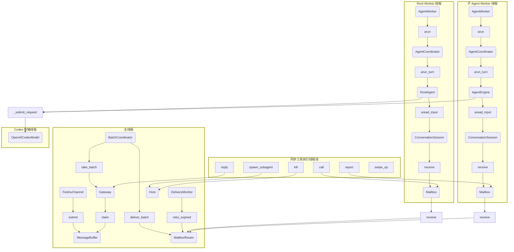
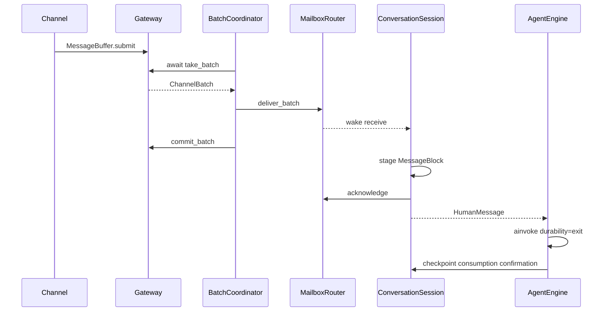

# 三层架构的线程与调用边界

更新：2026-11-01。本文描述当前项目代码，不展开第三方 SDK 或 LangGraph 内部线程。
职责与类图见 [三层架构](agent-system-design.md)。

## 线程归属

主线程运行应用 asyncio loop，承载 Channel 收发、Gateway、BatchCoordinator 和 DeliveryMonitor。
这些服务都是协程，没有额外 Gateway 线程。每个 AgentWorker 独占一个线程和事件循环，
包含 Coordinator、Engine、ConversationSession 和 Mailbox。同步工具由执行线程池承载，图中合并表示。
Codex 模型继续使用自身传输线程；多个 Engine 共享同一模型时共享该传输对象，而不是每个 Agent 创建一份。

Host 和 Router 在主线程创建，但**不是线程绑定对象**：所有线程访问的都是图中同一实例。
它们的短方法在调用方线程执行，以锁保护注册表、任务账本和邮箱；图中位置表示所有权，不表示独占执行。
Root/子 Agent 的 Mailbox 分别持有独立 token，不能通过修改 sender_id 冒充其他 Agent。
工具节点属于实际调用它的 Engine，图中合并仅为避免展开工具线程池。

## 同步与异步边界

| 对象 | 同步接口 | 异步接口 | 约束 |
| --- | --- | --- | --- |
| MessageBuffer | submit、commit、release、close | claim | 主循环独占，外线程先调度 |
| Gateway | commit_batch、release_batch | take_batch、send | Channel IO 有限超时 |
| Mailbox | read、call、report、acknowledge | receive、acall、areport | 短操作用锁；等待用 Future |
| Host | register_root、child、start、kill、stop | open、run、wait_root、close | 单 Root；不在持锁期间 join 或 await Worker |
| AgentEngine | run_turn、continue_turn、resume_turn | arun_turn、acontinue_turn、aresume_turn | 同一 Engine 不并发执行 |
| AgentWorker | start、join | wait | Worker 内 asyncio.run；应用异步 wait |

Mailbox.receive 在锁内原子检查队列并注册等待 Future，随后释放锁再 await。
投递唤醒 Future；取消会清理等待者，停止会唤醒空闲 Agent。不会因先检查后等待而漏掉消息。
同步 call/report 只等待入箱操作，不等待子任务执行；异步版本执行相同短临界区，不额外占线程。
Root 的同步 reply 则通过 run_coroutine_threadsafe 调用主循环 Gateway.send，并有界等待真实发送结果。
Root 禁止在 Gateway 所属线程调用这个阻塞接口。

## 接收与持续运行

空闲时 Worker 等待新输入。执行过程中 ConversationInput 在模型边界检查同一邮箱，
只在工具结果完整配对后补入 HumanMessage，不抢占设备工具或模型请求。
路由信封不直接序列化给模型；可见正文只保留短任务主题和内容。Root 的异会话输入在轮次边界切换，
防止回复地址在处理途中改变；同会话补充仍在安全模型边界生效。
每个邮箱的 TaskManager 在 Router 锁内登记发出/收到的任务；最终报告移除子方记录，父方验收后再移除自身记录。
Coordinator 负责续跑和恢复；Worker 不因一次任务完成退出。真实退出来自 stop/kill 或不可恢复异常。
子任务 report 是新 mail，父 Agent 正在运行时也可接收；不存在自动等待所有子任务的全局卡口。

## 独立配置与 Fork

每个 Engine 的同步调用在自身 config context 内执行；异步入口在该 context 内新建 asyncio Task。
这既隔离线程，也隔离同线程嵌套调用时的父 graph namespace。不能仅在 with context 内创建协程后直接 await，
因为协程本身不会保存创建时的 context。
Fork 只复制最近完整模型边界的语义状态；新 Engine、工具绑定、Mailbox 和 checkpoint 重新构造。
设备服务可由业务共享，但共享不代表复制设备状态或获得独占页面租约。

## 关闭与限制

Host 统一启动和关闭所有服务。close 先禁止新派生并唤醒所有邮箱，再停止 Buffer 接收、取消批次和重投协程，
await 所有 Worker 后关闭 Channel。run 监视唯一 Root Worker 和必要服务，任一退出便进入统一清理。
wait_root 不维护多 Root 列表，Root 未启动时明确报错。kill 在同步工具线程等待子 Worker，不占 Host/Router 锁。
模型和设备动作在安全边界停止，无法强制取消无界第三方调用；当前发送有超时，模型保留既有超时和重试。
Feishu SDK stop 使用 asyncio.to_thread；这里只记录该项目调用，不展开 SDK 内部线程。

当前测试覆盖取消唤醒、FIFO、跨 Channel 地址隔离、ACK/重投、独立异步 Engine 和 Fork。
未进行真实 Feishu/Android/模型联调；图表已按源码核对，未进行 Mermaid 渲染验收。
