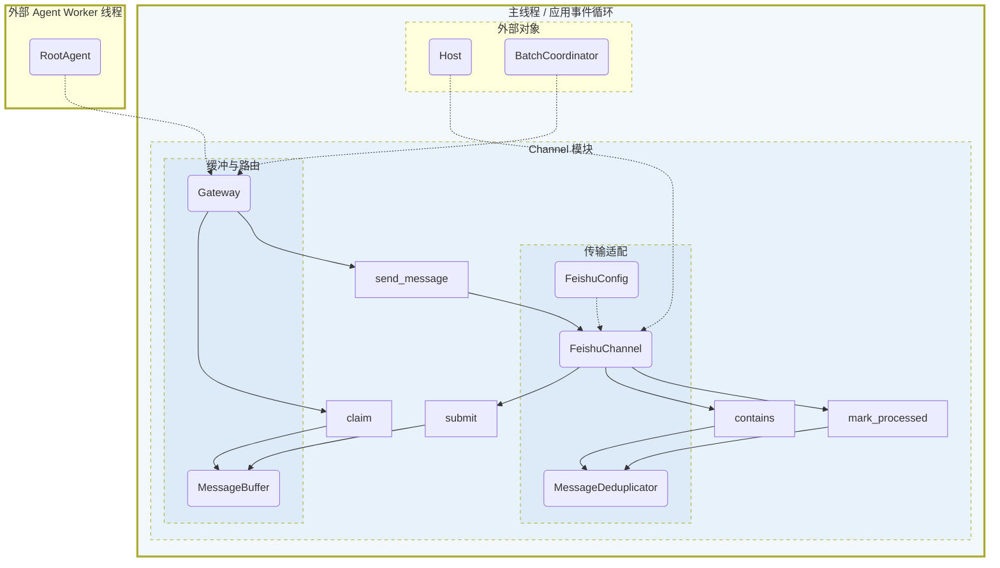
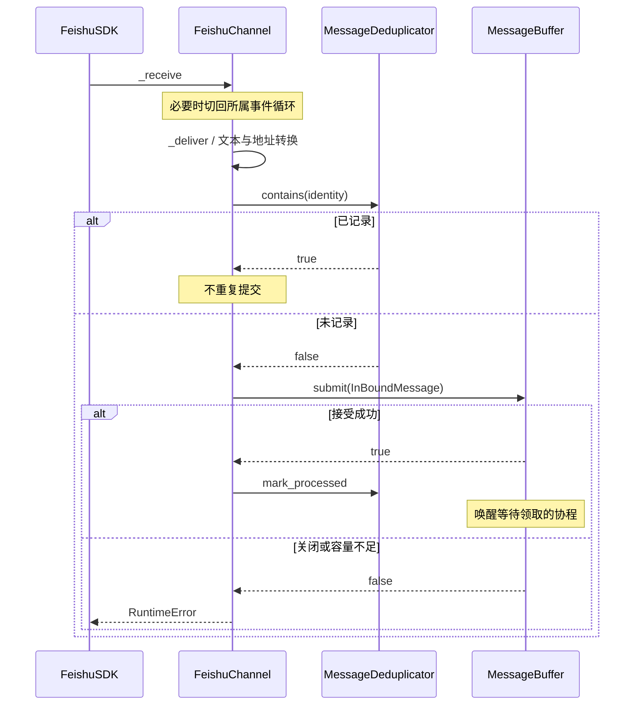
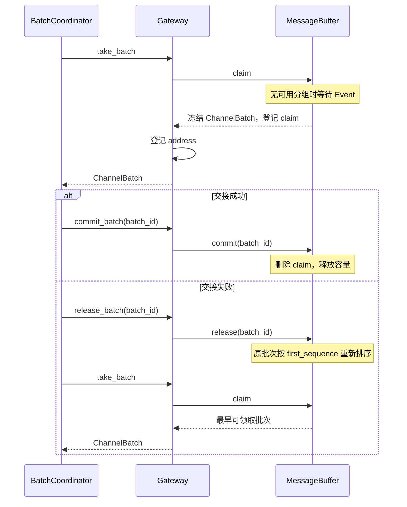
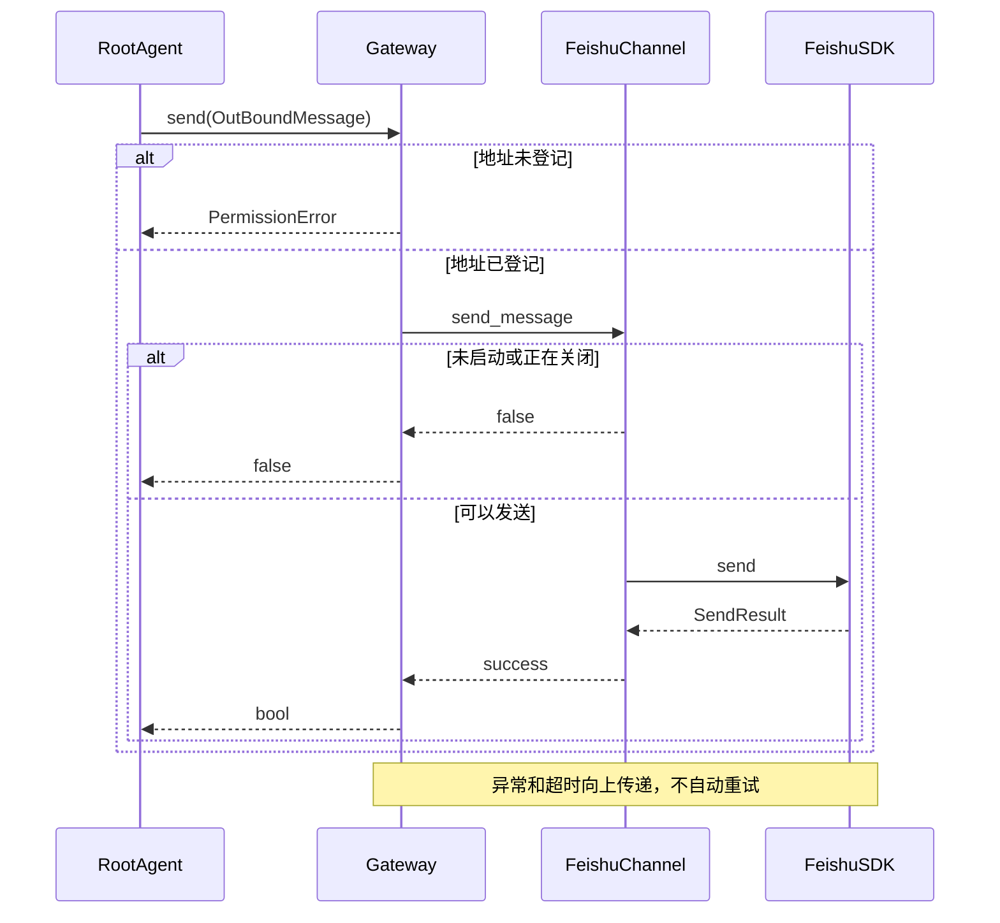
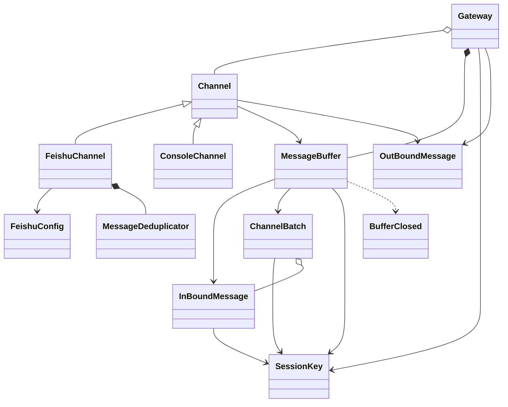

# Channel 模块架构

本文依据当前 `src/channel` 实现编写。模块职责、消息协议、缓冲语义或线程边界变化时，需同步更新本文。
本文只展开 Channel 内部；外部参与者保留为对象，不描述 Agent 调度、任务确认或模型执行。

## 1. 设计边界

Channel 解决两个问题：将不同通信来源转为统一入站消息，以及将出站消息发送到明确的会话地址。
其中，Adapter 隔离第三方协议，MessageBuffer 管理分组和交接，Gateway 管理批次入口与发送路由。
三者不负责判断消息的业务含义，也不决定哪个 Agent 执行任务。

一个 Channel 对应一个配置好的通信入口，可容纳多个 session。会话身份是
`(channel_id, session_id)`，而不是单独的 session_id，也不是 Agent ID。
多个 Channel 共用一个 MessageBuffer，但不同地址的消息不会合并为同一批次。

### 架构图

图中 Channel 模块对象均由主事件循环管理。外部对象只显示与本模块的联系；第三方 SDK 的内部线程不展开。
FeishuSDK 是源码中第三方 `FeishuChannel` 的导入别名。

图中虚线表示持有或外部关联，实线经方法节点表示模块内调用。
RootAgent 只保留外部对象，不展开其发送调度；Gateway 的实际调用需调度到主循环。
SDK 节点未分配项目线程，避免将第三方执行模型误画为本模块所有。

## 2. 统一消息类型

四个消息类均为 `frozen=True` 的 dataclass，不携带行为策略。
它们将通信地址、消息内容和批次交接身份分开，避免用一个 ID 同时承担多种含义。

### SessionKey

文件：`messages.py`。包含 `channel_id` 与 `session_id`，作为可哈希的地址值对象。
MessageBuffer 使用它作为分组键，Gateway 使用它记录可发送地址。
相同 session_id 出现在两个 Channel 中时，仍属于不同会话。

### InBoundMessage

文件：`messages.py`。保存通信入口、会话、来源消息 ID、文本、发送者 ID 和可选发送者名称。
`address` 属性生成 SessionKey，调用方无需重复拼装分组键。
本类型只表示外部输入，不携带内部 task_id、Agent ID 或执行状态。
不可变消息可安全加入已冻结批次，防止领取后内容被后续入站操作修改。

### OutBoundMessage

文件：`messages.py`。只包含 channel_id、session_id 和 text。
发送目标必须显式提供，不使用“最近会话”隐式路由，也不把回复目标藏在全局可变变量中。
没有内置发送重试 ID、业务任务状态或消息编辑协议。

### ChannelBatch

文件：`messages.py`。包含 batch_id、address、first_sequence 和不可变 messages 元组。
batch_id 用于领取后的 commit/release；first_sequence 用于失败释放后恢复原来的批次顺序。
批次在领取时冻结，而不是在第一条消息到达时冻结；领取前到达的同地址消息可聚合到一起。
失败释放会保留原 batch_id 和内容，新到达消息不会并入这个旧批次。

## 3. Channel：传输契约

文件：`base.py`。Channel 是抽象基类，约束所有 Adapter 具有相同的最小生命周期和发送接口。

| 成员 | 输入与输出 | 设计目的 |
| --- | --- | --- |
| channel_id | 稳定字符串 | 区分不同通信入口，不能随会话变化 |
| bind_buffer | MessageBuffer → None | 明确指定入站目的地，避免通用回调隐藏数据去向 |
| start | 异步 → None | 启动适配器，不接管应用事件循环 |
| send_message | OutBoundMessage → 异步 bool | 返回实际传输结果，而不是“已排队” |
| close | 异步 → None | 释放适配器资源，不关闭应用事件循环 |

抽象基类不实现额外的发送队列、自动重试或参数修复。具体传输的校验和状态由子类负责。
Gateway 不负责自动调用 bind_buffer/start/close；生命周期装配由外部对象完成。

## 4. MessageBuffer：分组与批次所有权

文件：`buffer.py`。MessageBuffer 的目标是让入站接受与后续处理解耦，同时明确谁暂时持有一批消息。
它是主线程事件循环独占对象，不是跨线程 Queue；所有公开操作均检查创建线程。
同步状态变更中没有 await，因此在同一个事件循环中无需额外互斥锁。
线程检查不等于验证 event loop 身份，调用约定仍要求使用同一应用循环。

### 状态结构

| 字段 | 含义 |
| --- | --- |
| `_groups` | 尚未领取的地址分组；OrderedDict 保持每组第一次入队顺序 |
| `_released` | 领取后退回的冻结批次，按原 first_sequence 排序 |
| `_claims` | 已领取、尚未 commit/release 的批次 |
| `_seen` | 已接受的 `(SessionKey, message_id)`，用于进程内去重 |
| `_size` | 尚未提交的消息总数，覆盖上述三个阶段 |
| `_readable` | 唤醒等待 claim 的协程，不轮询 |
| `_closed` | 停止接受和领取的终态 |

### 接受、排序与容量

submit 返回 false 的情形是已关闭、文本为空白、session_id 为空或容量已满。
重复消息返回 true，但不重复入队，也不增加容量占用。容量上限为 1024 条消息，不是 1024 个批次。
已领取但未提交的批次仍占容量，避免处理侧领取后无限积压。

排序针对**组的首次接受顺序**，不是将所有消息全局按时间逐条排序。例如 A1、B1、A2 在领取前到达，
输出先为 `[A1, A2]`，再为 `[B1]`。代码使用递增 sequence，不依赖发送端时间戳。
没有等待聚合窗口：claim 时已有多少条同组消息，就冻结多少条。

### 领取与归还

claim 从未领取组和已释放批次中选择 first_sequence 最早的一项，移入 `_claims` 后返回。
没有可用数据时 await `_readable`。检查和进入等待之间没有可插入的同步状态变更点，避免丢失唤醒。
commit 删除领取记录并释放消息容量；release 保持容量不变，将原批次重新放入可领取序列。
未知或重复提交的 batch_id 直接触发 KeyError，不做隐式幂等修复。

### BufferClosed

同文件中的异常类，明确表达“已不能再领取输入”，区别于临时无消息时的异步等待。
close 设置关闭标记并唤醒等待者；之后 claim 优先抛出 BufferClosed，**不会继续排空尚存分组**。
close 不清空容器，也不代表已接受消息已经完成处理。commit/release 仍可处置已有 claim，
但 release 不会使关闭后的 Buffer 重新可读。

## 5. Gateway：外部会话路由

文件：`gateway.py`。Gateway 组合一组预先确定的 Channel，并拥有唯一 MessageBuffer。
它不拥有 Agent 或 Mailbox，也不根据消息文本选择处理器。

构造时要求 Channel 列表非空且 channel_id 唯一。`take_batch` 委托 Buffer.claim，
并将该批次地址加入 `_addresses`；`commit_batch/release_batch` 委托对应的缓冲操作。
地址在**领取时**登记，而不是在 submit 或 commit 时登记。因此已领取后又 release 的地址仍允许发送。

send 只接受已登记地址，未知地址抛出 PermissionError；已知地址按 channel_id 选择 Adapter，
在 30 秒超时内等待 send_message。false 表示 Adapter 报告发送未成功；异常与超时向上传递，
Gateway 不吞掉错误，也不自动重试可能已被远端接受的发送。

## 6. ConsoleChannel：本地文本适配

文件：`console.py`。ConsoleChannel 用同一通信契约支持本地任务提交，不引入独立的控制台运行架构。
channel_id 固定为 `console`，submit 的 session 固定为 `main`，每次生成新的 message_id。
它不主动读取 stdin；本地调用方显式 submit(text)，失败时抛出 RuntimeError。

start 无额外资源动作。send_message 通过 asyncio.to_thread 执行 print，输出 session 标签，
避免打印阻塞应用事件循环；正常打印后返回 true，打印异常不会被转换为成功。
close 解除 Buffer 引用，不关闭共享 Buffer。该类没有飞书式启动状态机，直接调用发送也不会校验 Channel 地址，
正常路径依赖 Gateway 路由，而非假设所有子类有完全相同的防御性校验。

## 7. FeishuChannel：协议转换与 SDK 生命周期

文件：`feishu/channel.py`。FeishuChannel 将 SDK 的消息、mention 和发送结果转换为统一契约。
它持有配置、Buffer 引用、SDK 引用、所属事件循环及 MessageDeduplicator，不持有 Agent。

### 入站转换

只接受非空 TextContent；其他内容直接忽略。mention 占位符被替换为名称或可用身份字符串。
SDK chat_id 成为 session_id，SDK message.id 成为 message_id，发送者 open_id 和 display_name 原样映射。
不能把 SDK 的 InboundMessage 与项目的 InBoundMessage 混为同一个类型。

SDK 回调可能来自其他事件循环。`_receive` 检查所属循环，必要时通过 run_coroutine_threadsafe
转交主循环再执行 `_deliver`；它不会从外线程直接写入 MessageBuffer。
传输级去重先检查，Buffer 接受后才 mark_processed。Buffer 拒绝时抛异常，不记录“已处理”。
这里的“已处理”仅指输入已接受，**不表示业务完成或 checkpoint 已保存**。

### 生命周期与发送

bind_buffer 必须在启动前调用。start 要求已绑定、未启动且未关闭，保存当前 loop，
构造 SDK、注册消息回调并等待后台启动，启动等待上限 30 秒。对象不支持关闭后重启。
SDK 内置的文本批处理、去重和按旧消息年龄丢弃被关闭，接纳与分组由项目控制。

send_message 校验 channel_id；未启动或正在关闭时返回 false。
发送以 session_id 作为 chat_id，等待 SDK SendResult.success，内部同样设置 30 秒超时。
这与 Gateway 的超时嵌套，不能理解为最多等待 60 秒。
close 先标记 closing，再通过 asyncio.to_thread 停止 SDK，成功后清除 SDK 引用。
本层没有独立出站缓冲，也没有显式等待所有在途 send 的任务集合。

### FeishuConfig

文件：`feishu/config.py`。冻结配置对象，持有 app_id、app_secret 和 log_level。
`repr=False` 避免默认 repr 展开凭据，但不等同于凭据加密或全面日志脱敏。
同文件的 load_feishu_config 从外部 ConfigurationManager 取得配置，验证必要字段非空和日志等级合法，
再构造对象。直接手动实例化 dataclass 不会自动执行这些校验。

### MessageDeduplicator

文件：`feishu/dedup.py`。对 SDK 重投提供独立的最近消息去重，和 MessageBuffer 的全入口去重职责不同。
内存为最多 1000 项的 LRU OrderedDict；contains 命中会更新最近使用位置。
mark_processed 先更新内存，再向 `workspace/logs/feishu_processed_messages.jsonl` 追加记录。
启动扫描日志恢复最近 ID，读取或写入异常被忽略；持久化是尽力而为，不是事务日志。

默认 `feishu` Channel 使用原始 message_id，其他 Channel 使用序列化的 `[channel_id, message_id]`
命名空间，避免不同账号的供应商 ID 相撞。chat_id 作为日志信息保存，不参与该层去重键。
文件不轮转，加载时扫描全文件；内存有上限不代表磁盘文件或扫描成本有上限。

## 8. 关键时序

### 飞书入站接受

外部 FeishuSDK 只作为事件来源；图中不展开其网络连接或回调调度实现。

### 批次领取与失败释放

外部 BatchCoordinator 只保留为领取方；不展开它如何处理批次。

### 按地址发送

外部 RootAgent 只保留为发送方；不展开其工具或线程调度实现。

## 9. 类之间的关系

## 10. 当前保障与边界

- 保障进程内地址隔离、同组顺序、冻结批次和显式交接；不提供业务任务完成保证。
- Buffer 容量受限，但 `_seen` 和 Gateway 已知地址集没有回收策略，不能据容量上限推断长期内存有界。
- Buffer、地址集合和未交接输入不持久化。飞书 ID 已记入日志而进程在消费前崩溃时，重启可能过滤重投，不能声称无丢失。
- 发送超时不代表远端一定未收到；因此当前不做自动重试，也不提供远端 exactly-once 保证。
- MessageDeduplicator 没有独立锁，依赖适配器将访问收敛至所属循环；多个独立进程写同一文件不在当前保障范围内。
- `feishu/run.py` 是仅验证 Channel 的回显入口，不引入额外类或 Agent。Gateway 不负责 SDK 内部线程兼容性。

本次文档按源码逐类核对。Mermaid 图以源码形式提供，未进行渲染验收；外部系统联调不属于本文的验证范围。
