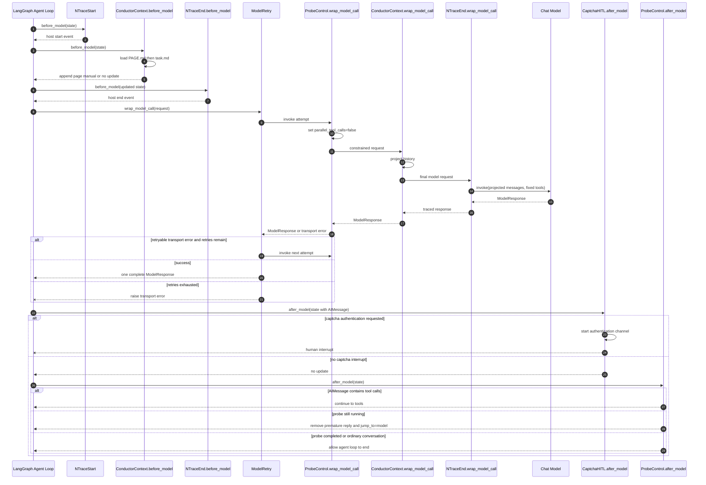
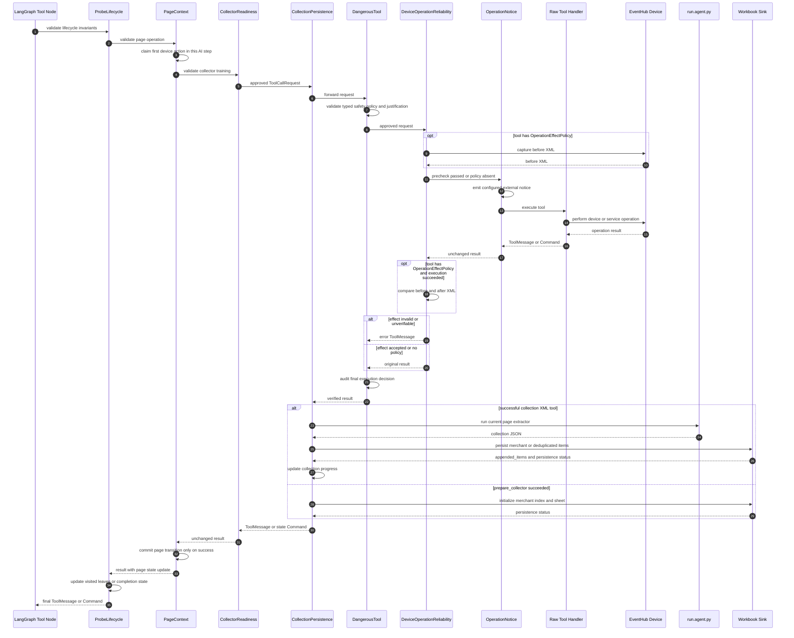
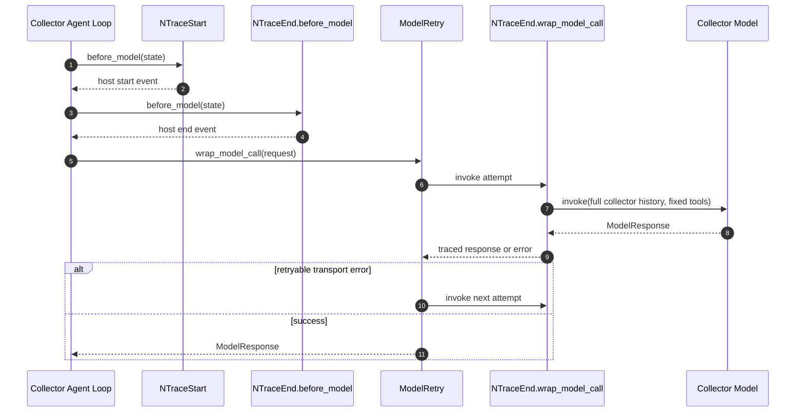

# Middleware Architecture

本文档描述 conductor 与 collector 在当前代码中的 LangChain middleware 架构。

## 维护约束

以下任一内容发生变化时，必须在同一个变更中同步更新本文档：

- `src/agent.py` 或 `src/agent_runtime` 中 middleware 的注册、删除或顺序调整；
- composite middleware 的内部调用顺序；
- middleware 使用的 graph state 字段、工具 metadata 或服务依赖；
- middleware 对 `ModelRequest`、`ToolCallRequest`、`ToolMessage`、`Command` 或 interrupt 的输入输出契约；
- conductor 与 collector 之间 middleware 边界的变化。

## 组合入口

conductor 的业务依赖由 `src/agent.py:build_agent()` 组装；通用运行能力由
`src/agent_runtime/_stability.py` 统一添加。注册顺序如下：

1. `NTraceStartMiddleware`
2. `ModelRetryMiddleware`，所有模型统一使用瞬时传输错误策略
3. `ProbeControlMiddleware`
4. `CollectionPersistenceMiddleware`
5. `ToolExecutionPolicyMiddleware`
6. `ConductorContextMiddleware`
7. `CaptchaHumanInTheLoopMiddleware`
8. `ToolErrorMiddleware`
9. `NTraceEndMiddleware`

### 运行层边界

`src/agent_runtime` 不导入页面机制、设备工具、采集或业务 middleware。
模块对外提供 create_runtime(name, model, tools, system_prompt, middleware=())，参数均为 keyword-only；
middleware 只用于传入业务策略，Trace、模型重试、ToolError 和 checkpointer 不接受外部注入。

- `AgentRuntime` 持有编译后的 graph、私有 Trace、会话结果和待恢复 checkpoint 标识。
  run_turn 将新增消息转换为输入；同一 thread 的历史由 InMemorySaver 保存，不重复提交历史。
  resume_turn 对递归上限、模型传输失败使用 invoke(None)，对人工中断使用 Command(resume=...)。
  执行结果统一为 AgentRunResult，包含 state、stopped_by、interrupts 和 completion_allowed。
- `AgentPersistenceLayer` 验收结构化完成回复及 runtime 的 completion_allowed。
  未形成有效结论时，在同一 thread 追加内部续跑指令；递归、网络和 liveness 中断自动恢复。
  人工中断仍返回调用方等待输入。永久配置、鉴权和协议错误归一化为 execution_interrupt，
  保留 checkpoint，但不会无限重试；修复原因后可显式恢复。
- `_ConductorRuntime` 位于业务构建模块，只负责探测输入补充、初始 graph state 和业务完成判断。
  通用运行层不需要了解 canonical path、商家 readiness 或 probe 字段。
  验证码与 liveness 的业务恢复载荷也由该适配层转换；通用 runtime 原样传递恢复输入。
- collector 使用相同 create_runtime 构建；它的视觉验证与最终验收仍由 CollectorManager 管理，
  不使用 conductor 的结构化完成协议。
- agent graph 和 Trace 名称统一使用调用方显式传入的 name，不读取名称环境变量；开关与服务地址由 NTrace 读取
  NTRACE_ENABLED 和 NTRACE_SERVER_URL；不在 graph 上动态添加 _ntrace 属性。
  checkpoint 恢复和自动续跑均使用 Trace 的 resume=True 保留关联。
- 当前 InMemorySaver 只保证同进程恢复，不承诺进程重启后的持久化。

LangChain 对不同 hook 使用两种顺序：

- `before_model` 按注册顺序执行，结果写入 graph state 后传给下一节点；
- `after_model` 按注册顺序的逆序执行；
- `wrap_model_call` 和 `wrap_tool_call` 采用嵌套调用，注册靠前者位于外层，请求由外向内传递，结果由内向外返回。

### Reco 页面桥接边界

`EventHub` 持有 `src/tools/page_bridge.py:PageBridge`。设备 dump 是内部能力，
原始 Android XML 直接通过 Reco 的公开 `PageSession.build_tree(xml_string)` 构造区域树，
已有会话通过 `sync()` 更新，保留 Reco 能够匹配的区域 ID 和别名。
不再创建临时 XML 文件。相似度提示使用内部 XML，middleware 不检测弹窗；
采集脚本只接收从同一快照重建的只读 Reco 视图，不接收 XML。

conductor 与 collector 均暴露 `Reco/model_interface.py:TOOLS` 的七个原始 schema：
`page_view`、`page_catalog`、`page_read`、`page_node`、`update_aaid`、`select_aaid`、`update_ratio`。
不再暴露 `uiautomate` 或 `collector_uiautomate`。
无 key 且 offset 为 0 的 `page_view` 刷新设备快照；子区域读取、分页和别名操作使用同一快照。
成功设备动作通过 Reco.sync 刷新树并返回 `page_change_hint`，最多包含三个互不为祖先的区域入口，
顶层 `update_ratio` 表示 Reco 根节点的全页面变化率，每个入口仅有 `id` 和该区域的 Reco `update_ratio`；无变化时顶层变化率为 0、`regions=[]`，不发送节点内容和删除明细。
Reco 在既有比较过程中保留只读统计：自身是否变化、子树变化数量、比较规模和父子关系。
自身稳定节点分隔变化连通部分；新增/替换子树视为整体，删除归属仍存在的父区域。
桥接层的 `page_change_hint.py` 不重新比较 XML，允许提升到稳定祖先以合并碎片。
按 `变化节点数 / sqrt(比较节点数)` 自底向上比较选取当前区域与组合子区域，最多选择三个入口；
同分优先覆盖更多变化，再优先更深区域，最后按树顺序。比较规模包含删除，替换取旧、新规模较大值。
展示更新率仍使用 Reco 原有算法，不以叶子 100% 更新率排序。
提示只用于搜索优先级，不承担完整变化枚举、操作效果判定或采集完成判断。
入口不足时可查询根视图，定位仍不明确可截图；可靠性检查和采集始终读取完整内部快照。
首次建树返回根视图；显式 page_view/page_node 查询仍可读取完整上下文。应用启动时清空旧树和别名。
树属于共享设备实例；页面任务路径、访问 ID 和完成状态仍属于各 thread 的 graph state。

LangChain 工具使用 `response_format="content_and_artifact"`：

- `ToolMessage.content` 是 Reco 公开区域结果，不包含 XML 或原始节点属性。
- `ToolMessage.artifact.page_xml` 是内部原始 XML；模型序列化只读取 content。
- `artifact.page_snapshot` 保存 XML、区域子节点路径形式的别名、快照 ID 和时间。
  重建时将路径解析为当前公开 ID，不依赖 sync 产生的临时 ID。
- `tool_io.page_xml()` 为 middleware 提供统一快照读取，禁止从 content 解析 XML。
- 静默采集保留原始工具消息及 artifact，不向模型追加采集或落盘结果。
- collector 在冻结视图后调用 screenshot，根据真实图片提交不可覆盖的视觉基准。
  首次脚本输出在基准保存前隐藏；不存在独立 coder，也不向 agent 暴露历史 XML。

所有页面工具的集合固定。覆盖层完全由 LLM 根据视图或截图判断；middleware 不检测、记录或提示覆盖层状态。未训练页面允许查询和截图；LLM 声明 purpose=dismiss_overlay 的同页点击可用于关闭覆盖层，其余操作仍受训练门禁约束。
conductor 的 update_page_notes 仅原子更新当前 PAGE.md Operation Observations 分区，不修改 schema、契约或 task.md；manual digest 更新后重新注入。
区域读取类结果参与当前页面最近三组短期工具调用的压缩，别名赋值记录保留。

因此，注册顺序不仅表示模块清单，也决定状态能否在正确阶段被观察和提交。

## 调用时序图

### Conductor Model 迭代



### Conductor Tool 迭代



前置校验中任意一层拒绝调用时，会立即向外返回错误 `ToolMessage`，其内层 middleware、真实工具和设备副作用均不会执行。可靠性后置校验失败时，真实设备动作已经发生，但新的页面状态、采集脚本和落盘不会提交。

### Collector Model 迭代



collector 的工具调用不经过 conductor 的页面状态、采集落盘和设备可靠性 middleware；其权限由 collector 自己暴露的固定工具集合控制。

## 一次 Model 迭代

### 1. NTraceStartMiddleware

文件：`nTrace/middleware.py`

**职责**

- 在每轮 model node 执行前创建 host span；
- 记录当前完整 graph state、用户输入和基础 system prompt；
- 为本轮 LLM span 提供 parent span 和 trace 关联上下文。

**输入**

- `before_model(state, runtime)`；
- `state.messages` 以及当前 thread 的其他 graph state。

**输出**

- 返回 `None`，不修改 graph state；
- 副作用是向 nTrace 写入 host `start` 事件并建立当前 host span。

**顺序原因**

它位于所有业务 middleware 之前，用原始轮次状态定义追踪边界。后续 middleware 对模型请求的投影不会改变这份审计输入。

### 2. ConductorContextMiddleware.before_model

文件：`src/middleware/conductor_context.py`，内部调用 `page_manual.py`。

**职责**

- 根据 `page_context_path` 和 `page_visit_id` 读取当前页面的 `PAGE.md` 与 `task.md`；
- 计算 manual digest；
- 当前访问实例尚无相同 manual 时，将带 `bines_context.kind=page_manual` metadata 的尾部 `SystemMessage` 持久化到消息历史；
- 同一访问实例、路径和 digest 不重复写入。

**输入**

- `PageContextState`；
- `PageMechanism.load_manual_bundle(current_path)` 的结果。

**输出**

- 无需注入时返回 `None`；
- 需要注入时返回 `{"messages": [SystemMessage(...)]}`，由 LangGraph message reducer 追加到 state。

**顺序原因**

它在模型调用前形成持久化 manual 锚点，使随后执行的上下文投影可以识别页面边界。它不修改顶层基础 system prompt，从而保持模型请求的稳定前缀。

### 3. NTraceEndMiddleware.before_model

文件：`nTrace/middleware.py`

**职责**

- 结束本轮由 `NTraceStartMiddleware` 创建的 host span；
- 记录当前状态中的既有模型输出和最近一组工具调用结果。

**输入**

- 已经过 `ConductorContextMiddleware.before_model` 更新的 graph state。

**输出**

- 返回 `None`；
- 副作用是写入 host `end` 事件。

**顺序原因**

它作为 `before_model` 链的最后一项，使上一轮工具结果及本轮刚补齐的 manual 都已进入 state 后再关闭当前 host span。随后的 LLM span 使用该 host span id 作为 parent id。

### 4. ModelRetryMiddleware

文件：`src/agent_runtime/_model_retry.py`，实现使用 LangChain `ModelRetryMiddleware`。

**职责**

- 包裹所有模型调用，不导入或判断项目模型适配器的类型；内部固定最多重试 5 次；
- 对 `ConnectionClosed`、`EOFError`、`OSError`、`TimeoutError` 以及 WebSocket 握手 `500/502/503/504` 执行有限退避重试；
- 不重试鉴权、协议、参数和业务错误；
- 重试耗尽后继续抛出异常，由上层 runtime 转换为可恢复 transport interrupt。

**输入**

- 完整 `ModelRequest`；
- 内层 model handler 抛出的异常。

**输出**

- 成功时返回唯一一次完整 `ModelResponse`；
- 失败时抛出最后一个异常，不生成伪造的 AI 消息。

**顺序原因**

它是 model wrapper 的最外层。每次重试都会重新经过内层的请求约束、上下文投影和 LLM tracing，但不会重放已经完成的工具调用。

### 5. ProbeControlMiddleware.wrap_model_call

文件：`src/middleware/probe_control.py`，内部调用 `page_context.py`。

**职责**

- 在页面上下文激活时固定 `parallel_tool_calls=False`；
- 保持完整工具集合不变，不根据状态动态增删工具；
- 将“同一 AI 响应只允许一个外部设备动作”的执行约束留到 tool-call 阶段处理。

**输入**

- `ModelRequest` 及其 `ConductorState`。

**输出**

- 页面上下文未激活时原样转发；
- 激活时返回覆盖了 `model_settings.parallel_tool_calls=False` 的请求。

**顺序原因**

并发工具设置必须在绑定模型之前确定，同时需要位于上下文投影外层，保证投影逻辑只处理串行设备行为形成的历史。

### 6. ConductorContextMiddleware.wrap_model_call

文件：`src/middleware/conductor_context.py`，请求投影仅调用 `device_context_compression.py`；`page_manual.py` 仅用于 before_model。

**职责**

1. 从完整 state history 确定性构造本轮 conductor 输入投影；
2. 完整保留 user message，将历史按 user block 和 manual block 组织；
3. 将已离开的页面压缩为行为意图记录：依据实际工具调用描述查询、滑动、点击、训练、完成检查及导航目标，不将调用尝试描述为成功；商家名称仍用于展示路径，仅在存在归档统计时附加数量。返回父页面时在原位置恢复离开前的 manual 和旧历史，返回后的新 manual 与操作留在消息尾部，不能回填到旧位置。跨 user block 继承的页面锚点在当前块独立占位，不覆盖上一块的活跃页面槽；
4. 当前活跃页面只保留最近三组短期页面状态工具调用及对应 AI tool-call message；
5. 保留 package、captcha、`think`、`prepare_collector`、`is_done`、完成授权和未知工具的原文；
6. 不注入运行时页面语义提示；覆盖层处理原则由固定 conductor prompt 提供。

**输入**

- `ModelRequest.messages`，不包含 `ModelRequest.system_message`；
- `collection_visit_summaries`；
- page manual message 的 `bines_context` metadata；
- 导航工具调用及其 `next_path`。

**输出**

- 使用 `request.override(messages=...)` 得到的请求；
- graph state 和基础 system prompt 保持不变；
- 不生成覆盖层状态或临时覆盖层消息。

**顺序原因**

manual 由 before_model 持久化，wrap_model_call 仅投影消息历史。它位于 tracing 内层的外侧，使 nTrace 记录模型实际看到的投影消息。

### 7. NTraceEndMiddleware.wrap_model_call

文件：`nTrace/middleware.py`

**职责**

- 在真实模型调用前后记录 LLM span；
- 记录最终 system prompt、投影后的 messages、完整固定工具定义、模型设置、tool calls 和 token usage；
- 模型异常时记录 error span 后重新抛出。

**输入**

- 已完成并发设置、上下文压缩的最终 `ModelRequest`。

**输出**

- 原样返回 `ModelResponse`；
- 副作用是写入 LLM `start/end` 事件。

**顺序原因**

它是最内层 model wrapper，因此记录的请求与真正提交给模型的请求一致。若外层 retry 重试，每次网络尝试都会形成独立 LLM span。

### 8. 真实模型调用

LangChain 将稳定的基础 `system_message` 放在 `request.messages` 之前，绑定固定工具集合并调用模型。模型返回 `ModelResponse`，wrapper 按相反方向依次返回。

### 9. CaptchaHumanInTheLoopMiddleware.after_model

文件：`src/middleware/captcha_human_in_loop.py`

**职责**

- 检查最新 AI message 是否调用 `authenticate_captcha`；
- 在 interrupt 前启动验证码认证通路；
- 使用 LangChain `HumanInTheLoopMiddleware` 和 `respond` 决策创建可恢复 interrupt。

**输入**

- 已包含最新 AI message 的 graph state；
- 已注册工具中的 captcha authentication tool。

**输出**

- 无验证码调用时返回 `None`；
- 需要人工处理时产生 LangGraph interrupt；
- 恢复后由标准 HITL 协议生成相应状态更新。

**顺序原因**

`after_model` 逆注册顺序执行，因此验证码判断先于生命周期终止判断。验证码工具调用会先进入人工协作流程，不会被误判为普通无动作终止。

### 10. ProbeControlMiddleware.after_model

文件：`src/middleware/probe_control.py`，内部调用 `probe_lifecycle.py`。

**职责**

- 对运行中的 probe 实施硬终止门禁；
- AI message 有工具调用时清除连续提前终止计数和旧续跑指令；
- AI message 无工具调用但任务未完成时，删除该回复、追加 runtime continuation system message，并 `jump_to="model"`；
- 连续三次无动作时创建 liveness interrupt；
- 非 probe 对话和已完成 probe 不干预正常结束。

**输入**

- `ProbeState` 和最新 AI message；
- 页面、访问实例、待导航、leaf 访问和商家采集完成状态。
- `probe_completed_merchants` 按 canonical merchant path 保存本次任务已完成的完整商家名；随 checkpoint 保留，新探测任务清空，页面访问切换不清空。

**输出**

- 正常继续时返回 `None` 或计数清理 update；
- 提前终止时返回 message 删除/追加、计数更新和 `jump_to="model"`；
- 失活时产生可恢复 interrupt。

**顺序原因**

它是 model iteration 的最终业务门禁。只有验证码 HITL 已确认无需中断后，才判断模型是否可以进入工具节点或结束 agent loop。

## 一次 Tool 迭代

工具 wrapper 的请求方向与返回方向不同。当前完整调用链为：

```text
request
  -> ProbeLifecycle validation
  -> PageContext validation and action claim
  -> CollectorReadiness validation
  -> CollectionPersistence boundary
  -> DangerousTool validation
  -> DeviceOperation precheck
  -> OperationNotice
  -> raw tool execution with exception conversion
  <- DeviceOperation postcheck
  <- DangerousTool audit
  <- Collection extraction and persistence
  <- PageContext transition
  <- ProbeLifecycle transition
result
```

### 1. ProbeControlMiddleware: lifecycle validation

**职责**

- 未经 `authorize_probe_completion` 成功授权时拒绝 `close_package`；
- 未完成商家的普通 navigate_back、navigate_to 和 run_package 受统一离页校验；训练未就绪时允许导航恢复，已训练时可提供非空 recovery_reason 导航退出。恢复离页追加警告及审计，记录 path + merchant 的未完成义务；重新进入同一商家并 is_done=true 后清除，尚有义务时不能授权完成。
- 导航和授权后的非完成操作撤销旧完成授权；连续三次工具错误在 after_model 触发可恢复 liveness interrupt，不再把“发出了工具调用”等同于进展。恢复载荷不提供未经统一校验的 permitted_tools 列表。

**输入**

- `ToolCallRequest`；
- probe status、当前路径及商家完成状态。

**输出**

- 合法请求继续向内传递；
- 非法请求返回带稳定 `error_type` 的 `ToolMessage(status="error")`，不执行设备副作用。

### 2. ProbeControlMiddleware: page context validation

**职责**

- 校验 `run_package` 首页映射和显式导航的绝对 canonical path；
- 在设备操作前验证目标 manual 完整存在；
- 根据商家点击额度和采集是否已开始限制普通页面操作；middleware 不判定覆盖层，LLM 声明的 dismiss_overlay 点击不占商品入口额度；
- 商家 `navigate_to` 要求提供当前列表卡片的 `merchant_name`（含分店名）。按模板路径和完整名称检查已完成集合，重复目标在设备点击前返回 `merchant_already_collected`，不迁移页面状态。
  名称只归一化空白，不做模糊匹配；排序、坐标及临时节点 ID 不作为去重身份。未完成商家可再次进入，不同模板及分店名分别记录。
- 对同一 AI message 的多个设备动作执行 action claim，只允许第一个动作进入设备层；
- 将 `parallel_tool_calls=False` 的模型约束再落实为执行期门禁。

**输入**

- 工具名、参数、tool call id、thread state 和页面策略。

**输出**

- 合法请求继续；
- 校验失败时返回结构化错误 `ToolMessage`。

### 3. ProbeControlMiddleware: collector readiness validation

**职责**

- 页面策略要求 collector 且当前访问未训练或契约失效时，普通操作仍执行，随后追加独立 operation_warning SystemMessage；
- prepare_collector、返回、关闭、思考和 captcha 不增加 readiness 警告，其他层的安全规则仍适用；
- 允许视图查询、截图和 purpose=dismiss_overlay 的同页点击。

**输入**

- 当前 page path、visit id；
- `CollectorTrainingRegistry` 中的实例级训练记录。

**输出**

- 允许时继续；
- 未就绪普通操作返回包含原始 ToolMessage 和 collector_training_required 警告的 Command，不伪造错误或改变设备证据。

### 4. CollectionPersistenceMiddleware: 外层边界

文件：`src/middleware/collection_persistence.py`

**职责**

- 让原始工具先执行；可靠性层仅提供建议，不阻止采集。支持从带 warning 的 Command 提取对应 ToolMessage，合并进度后保留所有原始消息；
- 只处理成功的 `prepare_collector` 和带内部页面快照的指定工具结果；
- 自行构造并持有 `CollectionWorkbookSink`，共享外部 `PageMechanism` 和 `CollectorTrainingRegistry`；
- 提供与同一采集状态契约绑定的 conductor 工具 `is_done`。

**输入**

- `ToolCallRequest`；
- 内层返回的 `ToolMessage` 或 `Command`；
- 当前 path、visit id、训练记录和 collection state。

**输出**

- 不相关、失败或不应采集的结果原样返回；
- 页面工具成功时原样保留 ToolMessage，包括 content、状态和内部 artifact；采集与落盘仅为后台副作用；
- 有采集进度变化时返回 `Command(update=...)` 更新消息和 graph state；
- `prepare_collector` 成功后初始化商家索引和 Sheet，并更新访问摘要。

### 5. ToolExecutionPolicyMiddleware: dangerous policy

文件：`src/middleware/tool_execution_policy.py`，内部调用 `dangerous_tool.py`。

**职责**

- 仅根据 typed tool metadata 判断工具是否危险；
- 验证结构化 justification 的 reason、evidence、expected outcome 和风险确认；
- 拒绝理由不完整的调用；
- 对批准、拒绝及最终执行结果写审计日志。

**输入**

- 工具 metadata 中的 `DangerousToolPolicy`；
- tool args 中的 justification；
- 当前页面与访问实例。

**输出**

- 无 policy 时透明传递；
- 理由无效时返回 `dangerous_action_reason_invalid`；
- 理由有效时传入下一策略，并在结果回卷后记录审计结论。

### 6. ToolExecutionPolicyMiddleware: operation reliability precheck

内部调用 `device_operation_reliability.py`。

**职责**

- 仅根据 typed `OperationEffectPolicy` metadata 选择需要验证的设备操作；
- 操作前通过共享 `EventHub.page_bridge.refresh()` 构造抽象视图并获取内部 XML 快照；
- precheck 失败仍执行工具，返回阶段追加无法比较页面的警告。

**输入**

- 工具 metadata 和操作前 XML。

**输出**

- 无可靠性 policy 时透明传递；
- 无法获得有效 precheck 时继续设备调用，后续提示不可比较；
- 成功时把操作前 XML 保留到返回阶段进行对比。

### 7. ToolExecutionPolicyMiddleware: operation notice

内部调用 `operation_notice.py`。

**职责**

- 仅根据 typed external-operation metadata 发送通知；
- 当前仅用于任务启动、开始探测商家和探测完成等配置过的外部操作；
- 普通页面设备操作不通知；
- 从显式注入的 `OperationNoticeService` 发送消息。

**输入**

- tool metadata、当前 path、导航参数和危险操作 justification。

**输出**

- 不修改 tool result；
- 副作用是在真实操作前发送通知。

### 8. ToolErrorMiddleware: raw tool execution

**职责**

- 调用 LangChain 提供的真实 tool handler；
- 将普通 Python 异常转换为模型可见的失败 `ToolMessage`；
- `GraphInterrupt` 和其他 LangGraph control-flow 异常继续抛出，不被当作工具错误吞掉。

该层由 agent_runtime 内部创建，位于业务工具策略内侧。异常先转换成失败结果，
再返回通知、可靠性、归档和导航策略，因此不会把执行失败当作成功操作。
ToolExecutionPolicyMiddleware 不再重复实现异常捕获。

**输入**

- 经过全部前置策略批准的 `ToolCallRequest`。

**输出**

- 正常的 `ToolMessage` 或 `Command`；
- 或由 `make_tool_error_message()` 生成的 `status="error"` ToolMessage。

### 9. ToolExecutionPolicyMiddleware: operation reliability postcheck

**职责**

- 从成功工具结果的 `artifact.page_xml` 读取操作后 XML；
- 使用内部 `PageSimilarityEvaluator` 对比前后 XML；
- navigate_to 相似度达到 0.50 时产生提示；
- swipe 相似度超出 [0.05, 0.95] 时产生提示；
- 阈值不满足仅追加包含高低结论及百分比的警告，不覆盖原始工具成功状态、XML 或快照；页面迁移及采集照常处理。真实设备错误保持错误。

**输入**

- 操作前 XML、操作后 XML、typed effect policy。

**输出**

- 有效时原样返回工具结果；
- 阈值不满足或不可验证时返回包含原工具结果和独立警告的 Command；
- 副作用是记录不包含 XML 的可靠性审计事件。

### 10. CollectionPersistenceMiddleware: extraction and persistence

**职责**

- 训练前完全跳过脚本执行与落盘；训练后对 `tap_in_page`、swipe 和 `page_view` 的内部快照构造 `ReadOnlyPageView`，静默执行当前页面 `run(view)`；
- 脚本或必要别名检查失败时仅记录内部日志，不改变工具返回、不撤销 readiness，不在页面操作阶段要求 agent 修复；清除连续空滑证据和完成标记，防止错误被当作零新增；
- 仅在 merchant page、当前访问已训练且 profile 有效时落盘；
- `tap_in_page` 与 `page_view` 只允许初始化/提取，不追加商品；其他 Reco 查询不触发采集；
- swipe 使用 workbook 全量去重后的 `appended_items` 更新最新新增量、连续空滑次数和访问摘要；
- PAGE.md Collection Requirements 定义联合主键与非空字段；collector 多状态验证后复用已有规则，仅缺失或明确反例时保存，相同内容不写盘。训练记录绑定契约指纹，契约变化要求重新训练。
- 非空检查由通用契约执行，完整条目进入 sink；主键查重在 workbook 锁内基于已保存行进行，同商家跨访问去重，失败写入不占键。不完整条目允许以后补采。
- 不完整批次通过独立 SystemMessage 提示沿原方向短滑，保留原 ToolMessage；有效条目仍落盘，但连续空滑计数清零。重复且完整的批次可以计入零新增。
- 最近滑动方向保存在 thread 的 collection_last_swipe，页面访问切换时清空；读取页面发现不完整行时可沿用该方向，没有历史方向则要求先确认遍历方向。
- 每次商品滑动以 5% 概率在当前串行执行链内通过共享截图服务归档原始结果、准入摘要、完整快照、PNG、契约和脚本版本到 workspace/collection_audits。只供离线查验，异常仅记日志。
- 连续三次有效采集 swipe 新增为零后，`is_done` 才返回 `done=true`；
- `is_done=true` 时，将 collector 确认的 merchant profile 完整名称登记到 `probe_completed_merchants`。进入页面、完成训练或写入部分商品均不会登记完成；普通采集保持静默。
- LLM 声明的 dismiss_overlay 点击不触发采集；不依据页面几何判断是否采集。落盘跳过不覆盖进度，执行或落盘失败清除连续空滑及完成证据。

**输入**

- 已通过可靠性校验、带 page_snapshot artifact 的抽象页面 tool result；
- page mechanism、training registry、merchant profile、workbook sink 和 collection state。

**输出**

- 原始工具结果，不添加 collection/persistence 内容；不完整条目可产生独立补滑建议，显式调用 `is_done` 时返回采集完成判断；
- 可选 `Command`，更新 `collection_initialized`、`collection_latest_new_count`、`collection_consecutive_empty_swipes`、`merchant_collection_done` 和 `collection_visit_summaries`。

### 11. ProbeControlMiddleware: page transition

**职责**

- 仅在最终工具结果成功时提交页面状态；
- `run_package` 建立应用根路径和新的 visit id；
- `navigate_to`、`navigate_back` 提交目标 path 和新 visit id；
- 导航成功立即提交目标 path；不推断覆盖层；pending path 仅保留旧 checkpoint 兼容并清空；
- `tap_in_page` 不提交导航，普通点击更新入口次数，LLM 声明的 dismiss_overlay 点击不占次数；生命周期完成验收不检测覆盖层；
- merchant swipe 标记 collection started；
- 每次新页面访问原子重置商家采集完成状态。

**输入**

- 原始请求 state、工具参数及所有内层处理后的最终结果。

**输出**

- 无状态变化时原样返回；
- 有变化时返回合并页面字段和原工具消息的 `Command`。

**顺序原因**

页面切换发生在可靠性验证和采集处理之后。失败的导航或 swipe 不会提交新的 canonical path、visit id 或 collection started 状态。

### 12. ProbeControlMiddleware: lifecycle transition

**职责**

- 在 page transition 已形成 `Command` 后读取其中的目标 path；
- 记录已访问的目标 leaf path；
- 成功普通工具调用清除提前终止计数；
- 已授权的 `close_package` 成功后将 probe 标记为 `completed` 并写审计事件。

**输入**

- page context 处理后的 `ToolMessage` 或 `Command`；
- probe targets、visited leaves 和 completion status。

**输出**

- 合并 lifecycle state 的 `Command`，或原结果。

**顺序原因**

生命周期只能接受已经通过所有策略并成功提交的页面变化。这样 leaf 访问和 probe 完成不会被误触、可靠性失败或落盘异常提前确认。

## 状态与数据边界

### Conductor graph state

`ProbeControlMiddleware.state_schema` 使用 `ConductorState`，合并：

- `PageContextState`：应用根路径、当前路径、pending path、visit id、点击额度和采集启动状态；
- `ProbeState`：probe 生命周期、leaf 访问、提前终止计数、商家完成状态和 collection summaries；
- LangChain `AgentState.messages`。

这些字段使用 replace reducer，确保同一步中的确定性状态更新覆盖旧值。消息仍使用 LangGraph 的 message reducer。

### 外部共享对象

- `PageMechanism`：由 `build_agent()` 构造，供 collector manager、probe control、collection persistence 和 conductor context 共享，保证页面策略、manual 和脚本路径一致；
- `CollectorTrainingRegistry`：由 `CollectorManager` 持有，并共享给 readiness 与 persistence，使训练准入和归档使用同一实例级记录；
- `EventHub`：由 `build_agent()` 构造，供工具执行和可靠性 precheck 使用同一设备通路；
- `OperationNoticeService`：由入口显式传入，或从工具 metadata 的兼容载体提取后注入工具策略层；
- `CollectionWorkbookSink`、日志器和页面相似度 evaluator：只由使用它们的 middleware 内部构造。

### Tool metadata

危险操作、效果校验和外部通知均由 typed policy metadata 驱动，不通过工具名字符串推断是否启用策略。工具名仅用于执行具体状态转换、采集范围和审计记录。

### Tool result

middleware 之间只接受 LangChain `ToolMessage` 或 LangGraph `Command`。`src/middleware/tool_io.py` 提供：

- `ToolInvocation`：从 request 提取经类型校验的 name、id、args、state、tool 和 metadata；
- `require_tool_result()`：拒绝不支持的返回类型；
- `tool_succeeded()`：依据结构化 status 和 JSON error 字段判断成功；
- `with_state_update()`：保留原消息并合并 graph state；
- `command_state_value()`：读取内层 middleware 已提交的状态值。

## Collector Middleware

collector 由 `build_collector_runtime()` 单独创建，不注册任何 conductor 页面控制、落盘、工具策略、上下文压缩或 HITL middleware。其顺序为：

1. `NTraceStartMiddleware.before_model` 创建 collector host span；
2. `ModelRetryMiddleware` 使用通用的瞬时传输错误重试策略；
3. `NTraceEndMiddleware.before_model` 关闭本轮刚建立的 host span；
4. `CollectorModelMiddleware.wrap_model_call` 设置 parallel_tool_calls=false，工具集合保持固定；
5. `ToolErrorMiddleware` 统一处理实际工具执行错误，不拦截 LangGraph control flow；
6. `NTraceEndMiddleware.wrap_model_call` 记录 collector 实际模型请求和响应。

collector 的页面能力、视觉 baseline、脚本增量修改、指南和还原流程由
`CollectorToolbox` 管理，不经过 conductor middleware。工具执行在实例锁内串行；
冻结验证或历史模式禁止滑动和点击，根视图查询只读取冻结快照。
通过当前验证后才能返回实时视图；全部验证通过后才解锁一次顶部还原点击。

### Collector 数据与验证

- `COLLECT.md` 首行包含 required_aliases 数字字符串数组，其余是英文定位指南。
  指南不存在时必须先读取区域和截图，再生成指南。每个状态显式标记必要别名。
- 脚本接口严格为 `run(view)`；只读视图复用 Reco 的 page_view、page_catalog、
  page_read、page_node、select_aaid，保留分页语义，不提供标记写入或设备操作。
  这是接口隔离，不是任意 Python 代码的安全沙箱。
- capture_validation_case 仅注册和冻结标记后的完整视图；screenshot 提供视觉证据，
  save_baseline 校验并持久化视觉基准，不执行脚本或评分。保存后即可返回实时视图继续随机采样。
  sniff_run 是唯一测试入口，只对本次探测运行、同一 canonical path 下已准备的当前及历史用例执行脚本，不采样、不操作设备；
  未完成视觉基准的用例必须先准备完毕。首次全量通过时无需读取或修改代码。
  评分输出分为 cases、ground_truths、run_results、eval_grades。JSON 比较由确定性工具完成。
- 至少两个不同当前状态（包含随机滑动状态）及本次运行同路径全部历史通过后才允许还原。
  指南变化使旧标记版本失效，需要逐个载入历史重新标记；视觉基准不可修改。
  脚本变化使所有旧评分失效，必须重新全量运行。
- `CollectorHistory` 在基准保存时保留全部视觉用例，包括脚本尚未通过的用例，原子写入
  workspace/collector_history/runs/<probe_run_id>/<canonical_path>/<page_visit_id>/<case_id>/record.json。
  `initial_probe_state` 在新探测任务启动时生成 probe_run_id，作为带 reducer 的 graph state 随 checkpoint 保存。
  后续 invoke、网络重连、续跑及页面访问切换不重置该 ID；新的探测任务即使复用 thread 也生成新 ID。
  prepare_collector 从隐藏 ToolRuntime.state 取得该 ID，缺失时拒绝执行，不猜测运行范围。
  用例加载仅扫描指定运行和页面的目录；不同运行及旧格式归档保留在磁盘，但不参与 sniff_run、契约验证或训练验收。
  记录保存内部源快照、别名路径、PNG data URL、视觉基准、schema 和指南。
  兼容读取旧的 visit/record.json；同一 case ID 优先采用新位置的记录。
  旧的无截图 XML 基准不会自动升级。
- screenshot 通过 AndroidDevice.pull_file 拉取真实 PNG，作为 ToolMessage 图片块返回。
  Codex 序列化将图片转换为 function_call_output 的 input_image，而非文本化 base64。
  协议依据：[OpenAI Function Calling](https://developers.openai.com/api/docs/guides/function-calling)。


### Recovery Evidence Boundaries

- collector 的 repair_baseline 只修订已保存用例：须先加载原始截图并提供具体错误证据，校验原 schema；保留全部旧 baseline、修订说明和时间，不能删除历史用例。修订使全部评分失效，必须重新运行全量回归；保存失败回滚内存基准。
- collector reset tap 执行失败后可重试；成功还原后仍不允许继续滑动。restore_to_top 是还原结果检查，不宣称 finally 自动操作设备。
- 相似度为 100% 的成功滑动仍运行采集脚本，并按完整条目落盘去重结果累计零新增证据；提示本身不证明已到底。
