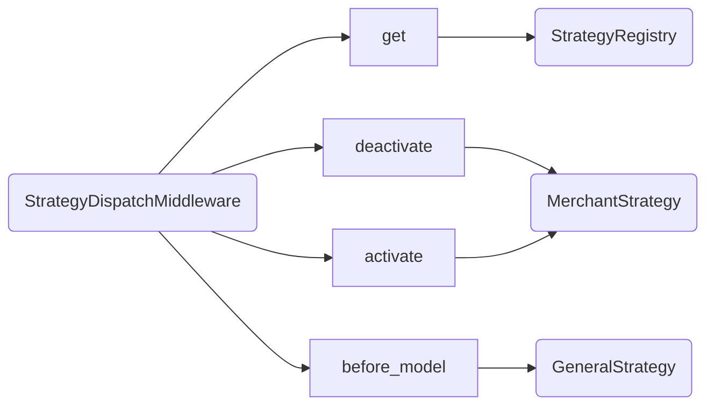
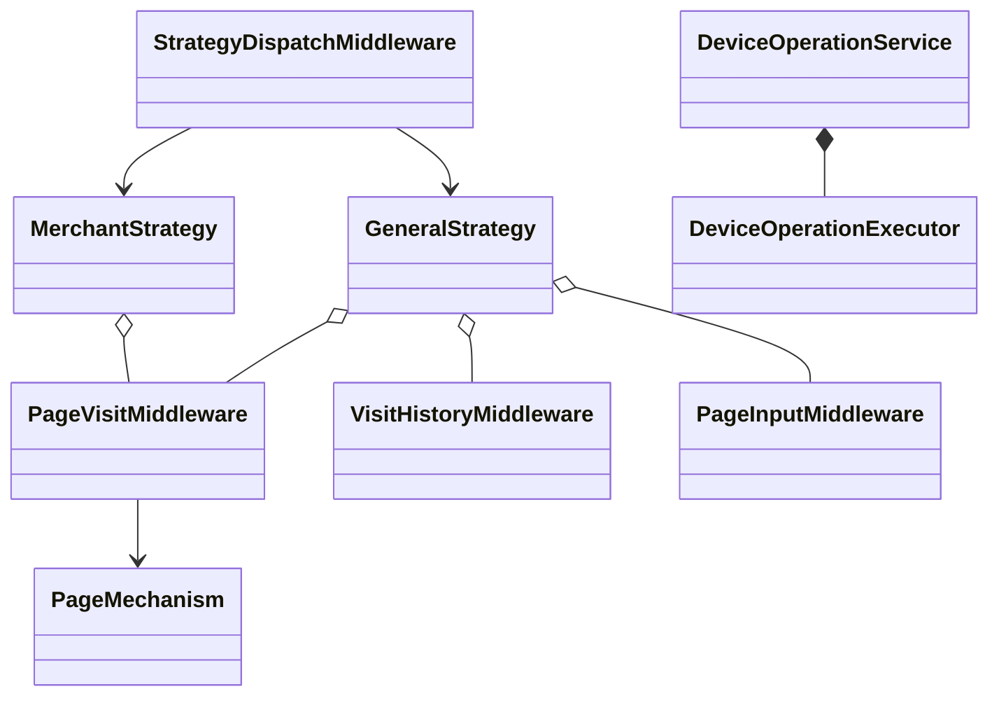
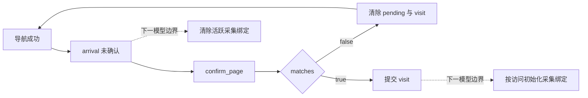
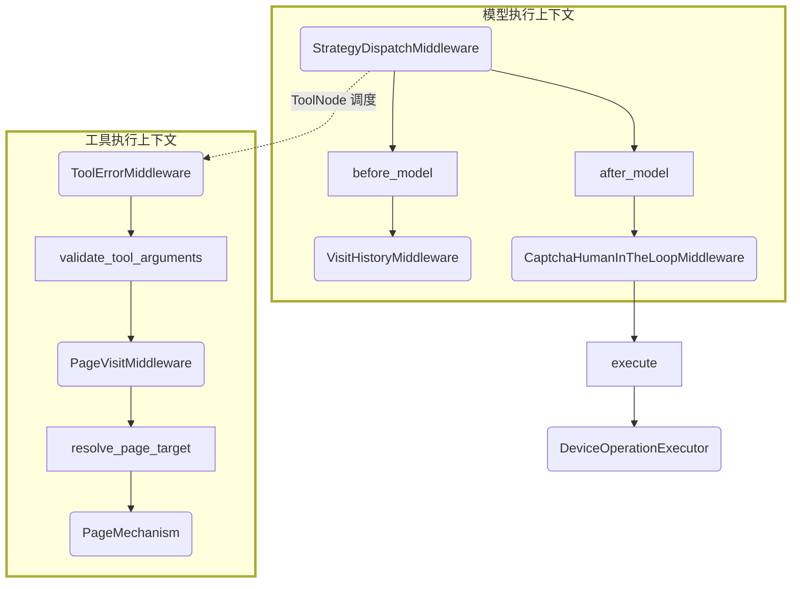

# Strategy Architecture

更新：2026-10-29。本文描述当前代码。设计决策见 [General 辅助型工作流](../../docs/general-assisted-workflow-design.md)。
后续修改 middleware 的职责、装配、状态或执行顺序，必须同步更新本文。

## 目录与功能归属

当前通信与线程实现见 [线程模型](../../docs/threading-model.md) 和
[三层架构](../../docs/agent-system-design.md)。
根 AssistantEngine（继承通用 RootAgent）、ConductorEngine、CollectorEngine
各有独立 worker 和模型历史。业务策略不直接读 Channel；父子消息通过同一收件箱在模型边界注入。
通用运行层不再设置 DelegationMiddleware：存在未完成子任务不限制父 Agent 工具、不强制等待、
不阻止父任务独立完成。任务依赖不从 agent 父子关系推导；工具集合保持稳定。
自然语言结束不是隐式 report，也不直接发送给用户。
Agent 身份不绑定 conversation；用户对话地址只在顶层处理，父子任务与报告按 task_id 关联。
业务代码直接构造 Engine，再由作用域内 AgentSpawner.start 委托 Host 启动 Worker；运行层不保存工厂回调或业务类型表。
自身已投递未完成任务全部显式 blocked 时，可在本轮自然结束后监听；部分 blocked 不冻结其他任务。
委派未结束且无最终报告待验收时，Engine 在本轮自然返回后进入 WAITING，Worker 阻塞监听邮箱；
这不是业务 middleware 门禁，不阻止父 Agent 本轮执行其他工具。新邮件触发下一轮，避免等待训练时空转。
list_subagents 为固定通信工具，商家策略允许查询；任务验收不自动销毁子 Agent。
已完成任务记录不在模型调用前触发跳转，后续子报告仍正常处理。新 call 不清除其他任务的阻塞标记。
共享对象由所属组件的锁保护；CollectorAssignment 的顺序调用要求仅作用于其自身证据流程。

prepare_collector 已删除。Conductor 使用 spawn_subagent("collector") 绑定当前确认页面，再通过 call 派发任务。
Collector 的 report(completed) 先验收脚本、还原页面并保存历史，
再更新训练记录和向父 Agent 报告；worker 继续监听。MerchantWorkflow.before_model 在观察到合法训练记录后
将 phase 更新为 ready；其后的 CollectionPersistence.before_model 按当前访问的 profile 幂等初始化归档。
Conductor 核验报告后通过 accept_report 关闭委派任务，不再由专用工具同步返回训练结果。
MerchantWorkflow 不拦截通用 spawn/call/report/accept_report；collector 构造自身验证页面资源。
通用 Router 不读取 merchant state。

探测启动不再依赖输入文本匹配。Conductor 根据用户或父 Agent 的任务语义调用固定工具
`start_app_probe`；该工具通过 Command 原子初始化 probe、general、merchant 和 general 策略，
并以配对 ToolMessage 返回配置及环境上下文。模型决定是否启动，工具负责确定性初始化，
不额外调用分类模型或增加 middleware。已有 run_id 时重复调用不重置访问、训练或采集进度。
普通输入和通信补充消息只沿用已有状态，不隐式创建探测任务。

业务 middleware 与对应策略共同放在 `src/strategy`，不再维护独立 `src/middleware` 包，也不提供旧路径转发层。Strategy 负责组合及所属状态的生命周期委托，middleware 实现约束和功能。

| 目录 | 实现 |
| --- | --- |
| `general/` | 页面访问与确认、访问历史、危险操作审计、验证码、通知、可靠性提示 |
| `general/context/` | 页面手册、消息压缩与请求上下文 |
| `merchant/` | 商家采集绑定、训练与遍历流程、采集持久化 |
| `collector/` | 独立 collector 任务身份与执行策略 |
| `tool_io.py` | 业务策略共用的工具请求、结果与状态更新适配 |

`CollectionVisitMiddleware` 已删除。`merchant/visit_binding.py` 提供 Merchant 自己的激活和清理函数，由 MerchantStrategy 的 activate/deactivate 委托调用。General 不读取或修改 merchant，不配置任何采集绑定模块。
通用 graph 路由、通信、模型重试和 ToolError 继续属于 `agent_runtime`，不依赖业务策略实现。

## 1. 运行层与路由

`AgentEngine._build_graph` 的固定顺序：HostTrace → ModelRetry → ConversationInput → ForkContext → ToolError → StrategyDispatch → ToolTrace → LLMTrace。

| 模块 | 输入 → 输出 | 职责 |
| --- | --- | --- |
| HostTrace | graph hook → 会话追踪事件 | 运行可观测性，不决定业务完成 |
| ModelRetry | 模型请求、可重试传输异常 → 完整模型回复或异常 | 仅重试模型，不重放设备工具 |
| ConversationInput | 会话收件箱、历史 → HumanMessage 更新 | 在安全模型边界接收外部消息 |
| ForkContext | 完整模型边界 state → 派生快照 | 记录可复制语义状态；仅派生时深复制，不复制锁、邮箱或父 graph 配置 |
| StrategyDispatch | 当前 state、冻结注册表 → 生命周期更新及单一策略 hook | 选择策略，先清理未选中策略，再激活选中策略；不理解业务字段 |
| ToolError | 模型参数、工具异常 → 结构化 ToolMessage | 在业务层前校验工具公开 schema；统一捕获参数和执行异常，框架 interrupt 继续传播 |
| ToolTrace / LLMTrace | 工具或模型请求、结果 → 追踪事件 | 记录执行，不参与业务可达性 |

工具 wrapper 按配置顺序进入，反向返回。ToolError 在策略外层，先校验公开 tool_call_schema（不要求注入的 ToolRuntime），再进入业务语义逻辑。业务 middleware 不重复校验参数格式或封装异常；实际工具失败不会推进成功状态。
`src/agent_runtime/strategy/base.py` 中的 `Strategy` 直接提供 middleware 组合执行与默认无操作的 activate/deactivate，不再区分接口基类和 MiddlewareStrategy 实现层。General、Merchant、Collector 直接继承 Strategy，注册表和路由层统一引用该类型。

before_model/after_model 按列表顺序执行；Strategy 将前序更新投影给后续 hook，messages 按 add_messages 合并，最终只提交更新。

路由器唯一读取固定字段 `state["active_strategy"]`，不接收选择回调、不读取页面路径或推导策略。所有启用策略的 graph schema 必须声明该字符串字段；缺失或未注册的值直接报错，不自动回退。
Conductor 初始输入写入 general，新用户轮次沿用已有字段；精确的新探测任务重置为 general。PageVisit 在导航成功产生 pending、确认失败或关闭应用成功时，与页面状态一起原子写入 general；确认成功时原子写入目标 visit.strategy。Collector 初始输入显式写入 collector。
`current_visit` 只供业务读取有效访问，不再是路由选择入口。状态读取只接受当前命名空间结构，不再迁移旧扁平 checkpoint 或旧生命周期字段。Engine 使用进程内 checkpoint；新任务和测试均直接构造当前 schema，不通过历史字段猜测路由。

Probe 的 target_leaf_paths、visit_history 和 completed_merchants 中的商家序列统一使用 list，保证经过 checkpoint 的 msgpack 序列化后仍满足严格类型校验。任务规格可使用 tuple，但进入 graph state 时转换为 list；状态读取不负责隐式类型修复。
Engine 采用独立运行契约，不作为父工具的 LangGraph 子图。`AgentEngine._execute` 在本 Engine 的 Runnable config 上下文中执行完整轮次（trace、invoke、异常后的 get_state 与结果验收）；首次执行、续跑和恢复共用该边界，始终使用本 Engine 持有的 saver 与根 namespace。父任务的 checkpoint/task/scratchpad 不继承，调用结束恢复父上下文；不补齐缺失业务字段或通过 `_state` 回灌历史。详见 [运行契约](../agent_runtime/README.md#独立-engine-运行契约)。
同一工具调用不因返回的状态更新而重入另一个策略。Collector 使用独立 CollectorStrategy，未复用商家遍历流程。

### 策略状态生命周期

每次 before_model/abefore_model 先选定一次策略，再依次调用未选中策略的 deactivate 和选中策略的 activate；生命周期更新投影后，才进入选中策略的约束与功能 hooks。返回值合并为一次 graph state 更新，输入 checkpoint 不就地修改。

activate/deactivate 是幂等的状态对齐接口，不是仅触发一次的事件回调。它们只返回完整 state namespace，不产生 messages、工具动作或跳转。未实现的策略默认 no-op。路由对象不保存“上一策略”或“上一访问”，状态完全来自当前 thread 的 checkpoint，避免恢复和会话之间串状态。

- Merchant 激活：当前 visit_id 与绑定不同才初始化 awaiting_training，清空旧训练版本、点击次数和滑动证据；相同访问不覆盖正在进行的工作。
- Merchant 停用：清理活跃商家状态和 current_merchant；历史完成记录、采集摘要和已归档数据保持不变。
- 同为 Merchant 但 visit_id 变化也会重新绑定，无需先路由到 General。
- 导航产生 pending 后，在下一个模型边界路由 General，路由器调用 Merchant.deactivate。关闭应用或确认失败后的清理使用同一路径。

图中 MerchantStrategy 在选中和未选中情形下分别参与 activate/deactivate；Selected 示意切回 General 的执行分支。全部生命周期函数在 before_model 的调用上下文内同步计算，async 路径也无设备 I/O 或额外线程。

## 2. 策略配置

| 策略 | 基础设施与可达性，按顺序 | features，按顺序 |
| --- | --- | --- |
| General | DangerousTool、Captcha HITL、PageVisit | VisitHistory、PageInput、OperationNotice、DeviceOperationReliability |
| Merchant | DangerousTool、Captcha HITL、MerchantWorkflow、PageVisit | VisitHistory、PageInput、OperationNotice、CollectionPersistence、DeviceOperationReliability |
| Collector | CollectorAssignment | 无 |

DeviceDispatchMiddleware 已删除；暂不实现多工具批次仲裁，不拒绝本轮后续工具调用。General 的业务检查仅为危险理由、验证码和页面确认。没有目标覆盖、商家完成或任务关闭授权门禁。
MerchantWorkflow 位于 PageVisit 外侧：本页不允许的导航尚未执行时直接拒绝，不生成虚假的未确认目标。
GeneralStrategy / MerchantStrategy 不互相持有；页面动作规则由 middleware 承担，Merchant 的状态初始化/清理由 lifecycle 回调委托独立函数。共同能力由 engine 创建同一实例后显式配置。

## 3. 参数与执行边界

ToolError 使用工具声明的公开 Pydantic schema 校验模型参数，注入字段由 LangChain 提供。页面路径所指文档是否存在、应用根是否一致、候选是否过期属于页面语义，不是参数格式校验。
业务 middleware 中的异常直接交给外层 ToolError；普通错误不再各自转换为不同协议。已有错误 ToolMessage 原样传播，不提交成功状态。
DeviceOperationExecutor 当前仅供验证码启动使用，不再承担全部工具的调度。底层设备 service 的锁保持不变；本轮不新增多工具调用调度方案。
同一模型回复中多个工具并发写同一 state namespace 仍可能触发 LangGraph InvalidUpdateError。当前没有批次串行化或状态合并保证，不通过 reducer 掩盖此边界。

## 4. 可达性模块

### DangerousToolMiddleware
typed tool metadata + 已通过 schema 校验的 justification → 危险调用审计。理由缺失、空白、风险未确认由 ToolError 统一处理，不进入业务审计。不会检查任务目标、采集完成或 probe 状态。

### CaptchaHumanInTheLoopMiddleware
模型认证调用 → 启动人工访问并产生 HITL interrupt；人工恢复沿用原协议。它依赖 agent 发现验证码，不自动识别图片。
异步认证启动通过线程执行同步发送/设备操作，避免阻塞事件循环；通信与采集的上下文仍独立。

### PageVisitMiddleware
只管理页面目标和 agent 提交的确认结论，不持有 Collector、CollectionService 或任务进度对象。

- `resolve_page_target`：canonical path → 不可变 PageTarget；校验 manual 和已注册 page_strategy，不校验 collection contract 或商家名。
- 主流程显式分支：pending 操作门禁 → 是否导航 → 执行 → 成功后记录；不以可空 target 隐含操作分类。
- pending 期间拒绝其他页面操作；视图查询和截图可选，confirm_page 可直接调用。talk、think 等非页面工具不受此门禁限制。
- 导航成功才创建 PageArrival；工具抛错或返回 error 时不创建 pending。保留旧 visit 仅作历史参照，未确认时 current_visit 不提供旧身份。
- `confirm_page(candidate_id, matches)` 只要求当前存在未确认候选且 ID 相符，不要求 observation_id、evidence 或先执行查询。结论由 agent 根据可用上下文判断。
- 查询和截图不写页面确认状态，工具结果原样返回；已删除通用 `_record_page_operation` 后处理。
- 确认成功提交 visit，matches=false 清除 pending 与旧 visit，允许纠正操作，避免永久卡住。重复或过期确认由 ToolError 返回工具错误。
- PageArrival 状态为 awaiting_confirmation/confirmed。本次改变了确认工具 schema 和 pending 状态，旧进程应重新启动，新任务使用新契约。
- 关闭应用成功清空 general，不替任务宣布完成。路径、manual 或策略配置错误交由 ToolError 处理。

### MerchantWorkflowMiddleware
只保留确认商家页内部的训练版本、滑动证据、入口点击额度及恢复导航约束。训练前禁止产品动作，观察、沟通和带理由的恢复仍可用。
导航获准进入候选后，下一轮路由 General，不再继承来源商家的限制。恢复不建立全局回访义务。
`get_probe_progress`、危险关闭等非商品动作不应承担训练前置条件；它们由相应独立模块判断。
before_model 在训练就绪或版本失效时更新状态，不发送阶段说明或操作指令。商家操作协议由 conductor 基础 prompt 和页面 task.md 提供，训练结果由 collector 的 report 提供。

### CollectorAssignmentMiddleware
校验 collector 的独立任务身份并关闭并行 tool calls；不处理 conductor 页面策略或全局生命周期。

Collector 的标记、用例及脚本归 CollectorToolbox 管理，不由 middleware 判断训练通过。
先复用 COLLECT.md 并验证锚点关系，多状态视觉采样后用 sniff_run 测试现有脚本；通过即跳过编码。
只有标记指南变更才使旧指南下的全部用例退出回归，包括当前访问的用例。CollectorHistory
将原 record.json 移入同路径、同 probe run 的 invalidated 审计目录，普通 load 不再加载；
其他路径及任务不受影响。重新读取被外部修改的指南也采用相同失效逻辑。
Toolbox 清除旧评分、冻结视图、滑动样本和还原状态，要求重新采集当前商家的视觉用例。
相同指南写入为 no-op；脚本修复和 baseline 修正不允许清除历史。基准保存仍即时落盘以支持恢复，
只有通过当前有效用例回归并完成顶部还原后，coordinator 才归档完成结果并向 conductor 返回 trained。

## 5. 功能模块

| 模块 | 输入 → 输出 | 状态所有权 |
| --- | --- | --- |
| VisitHistory | 已提交 general → entered/exited/closed 紧凑事实 | probe.visit_history；以访问身份和事件幂等记录 |
| PageInput | 当前访问、事实、完整历史 → manual 消息更新和请求投影 | messages；不修改页面许可 |
| OperationNotice | 工具 metadata、理由 → 用户通知 | 不修改业务 state；发送失败只诊断 |
| CollectionPersistence | 成功操作完整 artifact → 共享采集服务、落盘与进度更新 | merchant.evidence、采集摘要；正常结果静默 |
| DeviceOperationReliability | 操作前后完整快照 → 相似度提示 | 不修改访问身份；警告不否决设备动作 |

路由层的生命周期对齐先于所选策略的所有 before_model hooks；VisitHistory 随后记录已提交页面事实。
PageInput 在 VisitHistory 之后运行；未确认时注入明确标识的候选 manual，不宣称目标已到达。旧页面指令只作为历史。
manual 和事实消息只在变化时追加，基础 system prompt 不变。压缩仅投影 ModelRequest.messages，不修改完整 graph history，也不压缩 collector。
基础 system prompt 在 Engine 构造时从模型目录、affinity 或 `gpt-6.1-sol` 目录选择，不由策略或 middleware 选择。conductor 按相同优先级选择完整的 `page_mechanism` 目录，页面文档、指南和脚本不跨模型目录混合。委派的 collector 共用该页面服务，确保训练与采集使用相同契约和脚本；collector 自身角色 prompt 仍按 coding 模型选择。canonical path 不包含模型目录；同一 Engine 运行期间基础 prompt 固定。
仅最近三个 user block 保留完整页面投影，更早的 block 留下用户原文和确定性的处理记录，不携带图片、manual 和工具载荷。最近一轮工具调用与回执成对保留，避免页面折叠破坏增量协议。
页面确认反馈只由 PageVisit 发出：导航后的候选提示与 confirm_page 的工具结果。PageInput 仅提供候选/当前 manual，不重复发出确认要求，也不追加 page_identity 消息。完整消息来源、压缩规则和一帧输入/输出图见 [上下文投影说明](general/context/Compression.md)。
通知、manual 读取或诊断失败不建立新业务卡口；框架 interrupt 和取消不被当作普通诊断吞掉。

`summarize_probe_progress` 从目标、访问历史和既有采集摘要生成只读事实，同时供 PageInput 与 `get_probe_progress` 使用。访问过不等于采集完成；没有对应完成证据时使用 unknown。不会生成 authorized 或强制回访指令。

## 6. 状态与结束协议

general.visit/arrival 只由 PageVisit 写入；merchant 的访问绑定由路由层调度 MerchantStrategy 生命周期管理，本页采集事实由 MerchantWorkflow 与采集服务管理。
probe 保留任务描述、run_id、目标、访问历史及采集事实。不再含 status、failed_tool_count、premature_final_count、unfinished_merchants、continuation_reason。
run_id 仍隔离 collector 历史，不会由任意导航隐式启动探测任务。

ProbeLifecycleMiddleware、PageVisitController、GeneralPageAdmissionMiddleware、authorize_probe_completion 和 ConductorEngine._completion_allowed 已删除。
运行层接受有效 AgentResponse：resolved=true 结束本轮；resolved=false 或非法结构继续已有上下文。无需全目标覆盖、关闭应用或离开商家页。
网络恢复、checkpoint、外部消息、显式关闭及 captcha 保持原运行协议。旧授权/liveness/pending checkpoint 明确要求新建任务，不猜测其许可含义；审计和 Excel 文件不删除。

## 7. 调用与状态图

类关系表示依赖，不表示线程：

页面身份控制流与采集绑定分开：

以下为执行上下文，不承诺固定操作系统线程数；同步 ToolNode 可能使用线程池，异步工具由框架调度：

Mermaid 仅完成源码检查，未进行实际渲染。真实设备导航、captcha 和长时间采集仍需联调，不以单元测试代替设备验收。
