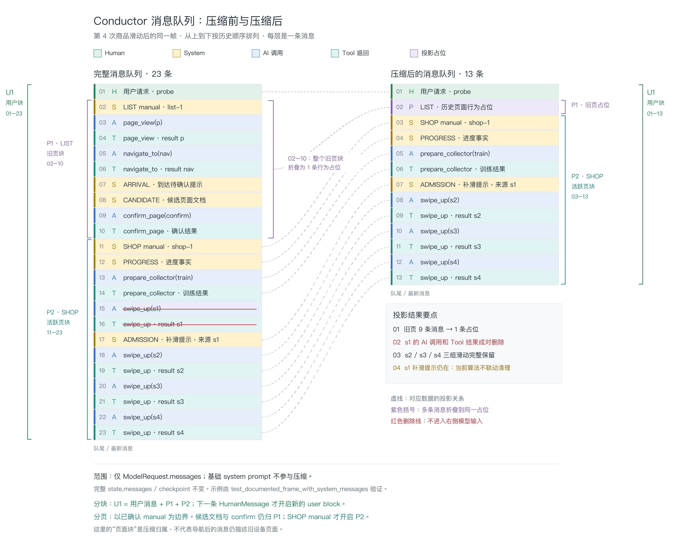

# Conductor 上下文投影

本文描述 `compression.py` 的当前实现，不是目标方案。入口是
`PageInputMiddleware.wrap_model_call → DeviceContextCompressionMiddleware → compact_device_messages`；
同步、异步使用同一投影函数。全部计算在调用方模型 hook 中完成，不新增线程。

## 边界与消息所有权

输入为 `ModelRequest.messages` 和 `probe.visit_summaries`。输出为新的请求消息列表。
`request.system_message`（基础 prompt）、完整 `state.messages`、checkpoint 均不修改。
collector 不应用本投影。页面栈每次从完整历史重建，不跨请求维护共享可变对象。

| 消息来源 | 内容及触发时机 | 压缩中的身份 |
| --- | --- | --- |
| 外部输入、运行时通信 | HumanMessage，保留用户原文 | user block 边界 |
| PageVisit | 导航成功后的 operation_warning；confirm_page 的 ToolMessage | 普通块内消息；不建立 manual 边界 |
| PageInput | 候选 manual，仅含文档；manual 缺失诊断 | 普通 SystemMessage，不是已确认页面锚点 |
| PageManual | 已确认页面 PAGE.md + task.md | metadata.kind=page_manual，唯一页面块锚点 |
| PageInput | 内容变化时追加 probe_progress 事实 | 普通 SystemMessage |
| CollectionPersistence | collection_admission 补滑/健康提示 | 普通 SystemMessage，虽有 source_tool_call_id，投影不据此联动删除 |
| DeviceOperationReliability | operation_warning 相似度提示 | 普通 SystemMessage |
| 模型、工具 | AIMessage 与配对 ToolMessage | 短期操作限额或原文保留 |
| 投影自身 | 历史页面行为占位 | 仅存在于请求，不写入 state |

MerchantWorkflow 不再写入 merchant-phase/MERCHANT_INSTRUCTIONS，PageInput 不再写入
page_identity，也不在候选文档中重复 confirm_page 指令。确认反馈属于 PageVisit；
操作协议属于固定 conductor prompt 和 task.md。这些变化不清洗已有 checkpoint 中的旧提示。

## 分块与页面栈

1. `_split_user_blocks` 按 HumanMessage 切分。首条用户消息前的 prefix 原样保留；
   若整个输入没有用户消息，则对整个输入执行一次短期工具限额。
2. 每个 user block 以用户原文开始。若继承上一块的活跃页面，在请求内复制其 manual 为锚点，
   不写回 state。没有 manual 的普通消息先写入 committed 列表。
3. 仅 `bines_context.kind == page_manual` 且 canonical_path 非空的消息建立页面块。
   身份由 `(canonical_path, page_visit_id)` 决定。同身份 manual 更新替换该块锚点，body 保留。
4. 新身份 manual 出现才切换块，而非看到 navigate 或 confirm 调用就立即切换。
   旧块 body 中最后一个 navigate_to/navigate_back 用于判断栈行为。
5. navigate_to：旧块变为行为占位；去掉离页导航所属 AI 整轮及配对结果后，旧块压栈。
6. navigate_back：子块变为行为占位，不压栈。按 next_path 从栈顶向下找父块，
   删除该项及其后的栈项，将父块旧内容在原 output slot 展开。
   返回后的新 manual 和新动作另建块，留在实际发生的位置，不拼进旧父块。
7. 无可识别导航时，旧块仍变为占位，但清空页面栈。最后的活跃块完整输出，再应用短期工具限额。

页面占位按工具调用提取去重意图，不使用 LLM 摘要，也不把操作请求描述成成功事实。
例：`At /app/list/炒面: requested return to app/list; archived 17 items.`
商家叶子名与数量来自 visit_summaries；无采集证据时不编造数量。

## 工具清理

以下工具合计保留最近 3 个调用 ID，限额作用于每个展开的 manual body，而非整个请求：

`swipe_up, swipe_up_long, swipe_down, swipe_to_random, tap, tap_in_page,
page_view, page_catalog, page_read, page_node, select_aaid, node_update_ratio, view_update_ratio, screenshot`。

`_remove_tool_call_turns` 删除包含过期 ID 的整条 AIMessage（含文本和所有同轮调用），
并删除这一 AIMessage 所有调用 ID 对应的 ToolMessage。混合多工具轮次也整体删除，
因此结果可能少于 3 组。其余工具（含 prepare_collector、is_done、collect_continuously、
think、package、captcha、未知工具）在展开块中保留，但块折叠后同样只剩占位。

普通 SystemMessage、没有工具调用的 AIMessage 不参与该限额；system 角色本身既不意味着
永久保留，也不意味着独立压缩：它们随所在块折叠，展开块中则原样保留。

## 一帧实例：商家内第 4 次滑动后

以下为可执行合成帧，不是线上日志。测试
`tests/test_device_context_compression.py::test_documented_frame_with_system_messages`
固定验证 23 条历史消息投影为 13 条。`A/T` 表示两条消息（AI 调用、Tool 结果），
`S` 表示 SystemMessage。基础 system prompt 不在图内。

每层是一条消息，左右按相同层高排列；不同颜色分别标识 Human、System、AI 调用、Tool 返回和投影占位。
虚线连接对应数据块，紫色括号表示多条旧页消息折叠为一个占位；红色删除线表示该消息不进入模型请求。
两侧最外层绿色括号标识同一个用户块 U1；内层括号标识页面块 P1（LIST）和 P2（SHOP）。
完整队列中 U1 包含用户消息 01、P1 的 02–10 和 P2 的 11–23；投影后分别为用户消息 01、
P1 占位 02、P2 的 03–13。页面块是压缩算法的归属：候选文档与 confirm 消息仍归旧块，
不是说这些消息描述的设备页面仍是旧页面。

候选 manual、到达警告及 confirm 的配对消息出现在已确认 SHOP manual 之前，
所以当前代码将它们归入 LIST body；它们与旧页一同折叠。
旧页占位的确切文本为：
`At /app/list: queried the page view; requested navigation to app/list/merchant; called confirm_page.`

返回父页面后顺序如下（不同框表示不同访问阶段，不表示独立线程）：

## 当前算法的精确边界

- 不按 system 消息来源、有效期或 source_tool_call_id 清理；短期动作删除后，其提示可能仍在。
- 候选文档不是 manual 锚点；在首个确认页面出现前，它可留在 committed 区域。
- 栈保存时只删除导航所属 AI 轮次，不删除随后警告、候选文档或确认轮次。
  父页原位展开可能再次出现这些历史内容。
- 导航识别只读调用，不验证工具结果；以新 manual 的出现作为切块时机。
- 用户原文始终保留，但“旧 user block 投影永不变化”不是完整保证：跨用户块的返回可展开
  旧 output slot，最新 visit_summaries 也参与历史占位生成。
- 短期工具计数按调用而非已完成结果；没有单独的 pending-call 保护规则。

这些边界描述当前实现，不能把它等同于全局最近 N 条消息压缩、自动总结，
或通用 system-message 去重。本次仅清理消息生产职责，未更改投影算法。
